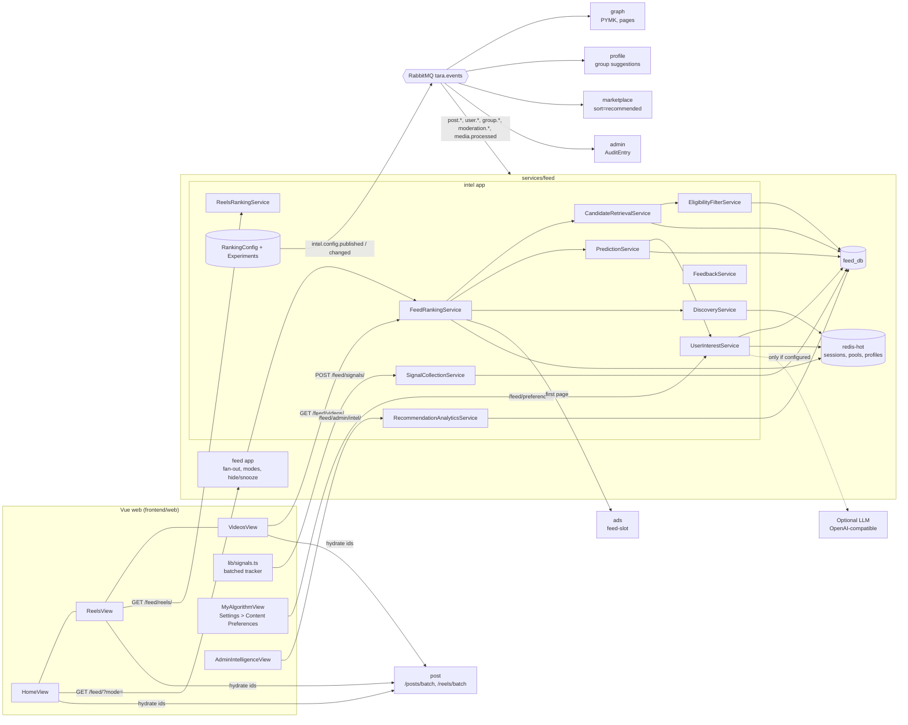
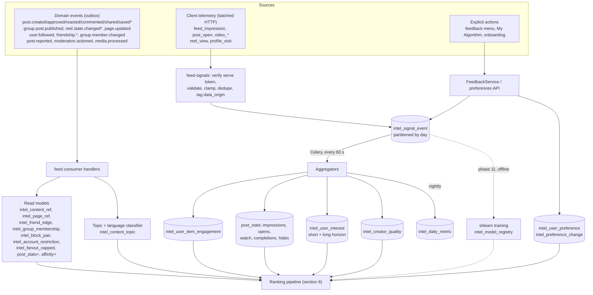
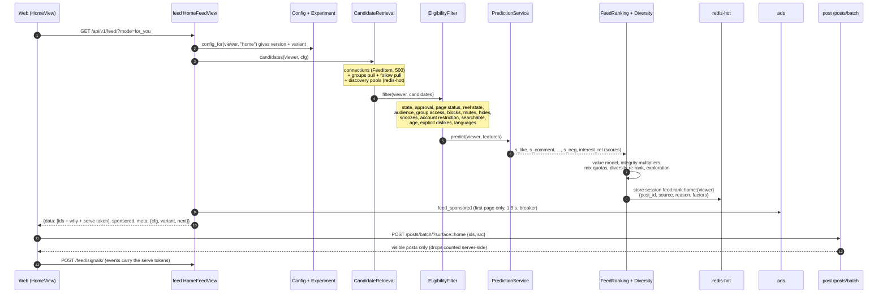

# Tara Intelligence 02: target architecture

This document is built on [01-technical-audit.md](01-technical-audit.md), and it designs what [00-master-spec.md](00-master-spec.md) asks for. Every ranking number below is a **configurable default** that lives in the ranking config (section 8). The few numbers that are deliberately *not* in the ranking config (classifier, language and telemetry-validation constants, which define stored data rather than ranking behaviour) are listed by name in section 8.4. Everything up to phase 10 is **rules**. ML appears only in phase 11, and only behind the prediction interface (section 15).

**Naming rule: scores, not probabilities.** Before phase 2 data exists, the rule outputs are heuristics whose denominator is the number of fan-out recipients. They are therefore called `score_like`, `score_comment`, ... (written `s_*` below) in code, in the API and in the dashboard. They are renamed `p_*` for a surface only after the calibration check in [04](04-implementation-plan.md) WP 12.6 passes on real impressions.

## 1. Decisions at a glance

| # | Decision | Why |
|---|---|---|
| A1 | **No new microservice for now.** Tara Intelligence is a new Django app, `intel`, inside `services/feed`. It shares `feed_db`, `redis-hot` and the feed event consumer. | See section 2. Ranking must sit next to the event-built read models, because cross-database joins are impossible. Feed already owns 20 consumed event types, `Affinity`, `PostStats`, ranking sessions and the ads blend. |
| A2 | Telemetry ingestion runs as a separate **process role** of the feed image (`feed-signals` container). In production (Dokploy) it is routed by the nginx edge, a `location /api/v1/feed/signals` block in `frontend/web/nginx.conf` placed before the existing `location /api/v1/feed` (`nginx.conf:136`); in Kubernetes by a rule in `infra/k8s/overlays/feed/ingress.yaml`; Traefik routes it only in the dev compose. The role never runs migrations (section 7.2). | This isolates load without adding a new codebase or database. |
| A3 | Feed ranks **every content surface**: home, reels, video, groups, and discovery content. Marketplace listings and people/page/group suggestions are ranked **in their owning services**, which read config pushed by the `intel.config.published` event. | Each service keeps the data it owns. The config stays central. |
| A4 | Feed returns ranked **ids, reasons and explanations**. Hydration stays in `post`: `/posts/batch/`, plus a new `/reels/batch/`. The visibility check in `post` remains the final authority. | Defence in depth: feed's eligibility runs *before* ranking, and `post` re-checks after it. |
| A5 | Telemetry lands in a **day-partitioned `intel_signal_event` table** via batched HTTP. It does not go through the outbox. | The outbox relay (`tara_events/outbox.py:49-97`) publishes a locked batch of 200 rows one by one, with one `UPDATE` per row; its throughput, measured in WP 2.0, is about 1,370 events/s to RabbitMQ with confirms (about 2,500 events/s of database work alone; [results/phase-02.md](results/phase-02.md)), shared by every event the service emits. The outbox is also purged after 7 days. |
| A6 | Topics come from a **curated bilingual taxonomy** plus deterministic mappers: hashtags, page/group/market categories, and ar/en keyword lexicons. LLM tagging is optional, constrained to existing topic slugs, and off by default. | The brief says no fake AI and that the output must be measurable and reviewable. |
| A7 | The LLM is used only for natural-language preference parsing (and optional tagging). It runs only when `INTEL_LLM_PROVIDER` is set, behind a closed-schema validator, and produces a reviewable proposal with undo. | The LLM never touches queries, eligibility or security. |
| A8 | A/B assignment is a deterministic server-side FNV-1a bucket. `libs/tara_common/tara_common/bucketing.py` exposes the same 32-bit hash as `frontend/web/src/stores/flags.ts:26-35` and a **parameterized fold**: `bucket(account_id, key, buckets=100)` equals `flags.ts` exactly, and experiments call it with `buckets=10000` for 0.01% granularity. The experiments themselves live in `intel`. | Assignments are sticky and need no storage. Parity with the client is claimed, and tested, only for the `% 100` fold. |
| A9 | **Every ranked item carries a signed serve token** (section 12.2), the same pattern as ads' `serve_tokens.issue` (`ads/services.py:275`). Telemetry is attributed (surface, config version, variant, source, position) from the token, never from client fields. | One ranking session per viewer is replaced on every first page and lives 1,800 s, so it cannot serve as the join key for attribution or eligibility. |

## 2. Is a separate `intelligence` service justified? No, not yet

**Why it lives inside `feed`:**
1. **Data locality.** Ranking a 500 to 800 candidate page needs:
   - the fan-out rows;
   - `PostStats`;
   - `Affinity`;
   - mutes, hides and snoozes;
   - interest weights;
   - topic links.

   All of them are in `feed_db`, or would be. A separate service would have to copy every one of these read models from events (duplicate consumers, duplicate drift) or call feed synchronously per request. The graph audit rules the second option out: the batch endpoint takes 50 ids per call, so 500 candidates means 10 round trips.
2. **Feed already is the ranking service.** It has the session pager, the signed cursor, the `redis-hot` fallback, the ads blend, 114 tests and the deployment trio (`feed`, `feed-worker`, `feed-consumer`).
3. **Operating cost.** A new service means a 16th database, relay, consumer, Dokploy containers, internal JWT audience and readiness checks, and none of that improves ranking.
4. **The split stays cheap.** `intel` is its own Django app with its own tables (prefix `intel_`) and no ForeignKey into `feed` models (UUID columns only). It talks to `feed` code only through `intel.ports` (section 7). Splitting it out later means moving the app and pointing a consumer at the same events.

**Triggers to split it out** (they are revisited in phase 13):
- telemetry above about 2,000 events/s sustained;
- analytics queries measurably slowing feed reads (p95 of the feed's first page over 1.5× budget);
- a need for a different scaling profile (for example GPU inference for ML).

## 3. Service ownership

| Concern | Owner | Notes |
|---|---|---|
| Candidate retrieval and eligibility for posts, reels, video and group posts | **feed / `intel`** | Built from event read models |
| Ranking for home, reels, video, groups, discovery content | **feed / `intel`** | Endpoints under `/api/v1/feed/...` |
| Telemetry ingestion and aggregation | **feed / `intel`**, `feed-signals` role | `POST /api/v1/feed/signals/` |
| Interest profile, topics, preferences, My Algorithm | **feed / `intel`** | Private to the viewer |
| Ranking config, experiments, change log, analytics | **feed / `intel`** | Audited into admin's `AuditEntry` through the `intel.config.changed` event |
| Hydration and the final visibility check | **post** | `/posts/batch/` (exists), `/reels/batch/` (new). Post counts the ids it drops, labelled by the caller-supplied surface and source (section 11) |
| Saves, reaction changes, reel hides and reel playability as events | **post** | New events, including `reel.state.changed` from the reconcile job (see [03](03-database-design.md), section 3) |
| Video facts for media quality | **media** | Additive `has_audio` and `fps` fields in `media.processed` (the probe already has them, `media_app/video.py:68-90`) |
| People and page suggestions | **graph** | Consumes `intel.config.published` (surface `discovery`, active version plus running variants). Excludes inactive (D5) and restricted or shadowed accounts (E11) |
| Group suggestions | **profile** | Consumes `intel.config.published` |
| Marketplace ranking (`sort=recommended`) | **marketplace** | Consumes `intel.config.published` (surface `marketplace`). Local signals only in v1 |
| Ads selection, auction and caps | **ads** | Unchanged contract (`/internal/v1/ads/feed-slot/`). Feed only places slots. Ads adds the `billing_status` check (D13) |
| Moderation decisions | **moderation** | Feed consumes `post.reported` and `moderation.actioned` (content targets for pending demotion, `target_type=user` for `restrict` / `shadow`). Moderation consumes the new `intel.integrity.flagged` into system-sourced cases (section 16) |
| Language change event | **identity** | New `account.updated` event carrying `language` |
| Intelligence dashboard UI | **web** (admin console) | `AdminIntelligenceView.vue`, calling feed's admin endpoints |

## 4. Component diagram



## 5. Data flow



## 6. The four-stage pipeline



### 6.1 Stage 1: inventory (CandidateRetrievalService)

| Source | Surfaces | How it is retrieved | Default cap |
|---|---|---|---|
| `connections`: friends, follows, self | home, video | Existing `FeedItem` rows, newest first (`feed_recipient_idx`) | 500 |
| `follow_pull`: followers dropped by the fan-out cap, newly followed authors | home | (a) Posts in `intel_fanout_capped` (one row per `(author_id, post_id)` written by `fan_out_post` when it truncates, `feed/services.py:176-182`) whose author the viewer follows or is friends with; (b) the last 7 days of `intel_content_ref` for authors the viewer followed in the last 24 h (fixes D2 and D3). Rows are **deduplicated against the viewer's existing `FeedItem` rows** by `post_id`, and pass rule E2b | 100 |
| `groups`: joined groups | home, groups | `intel_content_ref (group_id, created_at)` for the viewer's active `intel_group_membership`, `approval_state=approved` only (rule E1b). `notify_posts` gives a reason boost (fixes D1) | 150 |
| `discovery`: public posts of non-connections | home, video, discovery | Precomputed pools in `redis-hot`, sorted sets `intel:pool:{surface}:{lang}:{topic}`, rebuilt every 5 minutes from `intel_content_ref` rows of the last `pools.window_days` (default **7**, not the 180 days the table keeps) + `post_stats` + `intel_creator_quality`. Read for the viewer's top topics and languages | 200 |
| `trending` | home, discovery | `intel:pool:{surface}:{lang}:_trending`: topic and hashtag velocity against a 7-day baseline | 50 |
| `new_creators` | home, reels, discovery | `intel:pool:{surface}:{lang}:_new`: authors under 30 days old or with fewer than 200 followers who pass the quality floor | 50 |
| `reels` | reels | Connected reels plus the public reels pool (`type=reel`, `reel_state=published`, portrait, duration ≤ 90 s) | 400 |
| `video` | video | Connected plus public `type=video` | 300 |

Every candidate carries a `source` and a `reason` code. These feed the mix quotas (section 10) and the explanations (section 20). Every pool rebuild applies E1 to E2, E6, E6b, E7 and E11 itself, so a pool never holds an item that is ineligible for everybody; E3 to E5 and E8 to E10 are per-viewer and run at request time.

### 6.2 Stage 2: signals (features)

`intel/ranking/features.py` builds one `CandidateFeatures` row per candidate. It uses **batched** lookups only (one `IN` query per table, no per-candidate calls):

| Group | Features | Source |
|---|---|---|
| Content | `age_h`, `type`, `lang`, `topics[] (id, conf)`, `hashtags[]`, `is_reshare`, `dup_score`, `bait_score`, `media_quality`, `duration_ms`, `pending_reports`, `audience` | `intel_content_ref`, `intel_content_topic`, `intel_media_ref` |
| Engagement (rates, smoothed) | `like_rate`, `comment_rate`, `share_rate`, `save_rate`, `open_rate`, `completion_rate`, `avg_watch_frac`, `hide_rate`, `discussion_depth` | `post_stats` (extended), with Beta priors per (type, duration bucket) |
| Viewer × author | `reason`, `favorite`, `affinity_decayed`, `shared_groups`, `conversation` (replies exchanged in 90 days), `author_dislikes` | `affinity` (extended), `intel_group_membership`, `post_hide` |
| Viewer × content | `interest_rel` (short and long term), `explicit_topic` (like, dislike, more, less), `format_pref`, `lang_ok`, `seen_before`, `watched_frac_before` | `intel_user_interest`, `intel_user_preference`, `intel_user_item_engagement` |
| Author | `quality`, `originality`, `report_rate_90d`, `is_new_creator` | `intel_creator_quality` |

**No cross-service call on the request path.** A `mutual_count` feature (mutual friends with a discovery author) is **dropped from v1**: it would need about 4 graph batch calls of 50 ids on the first page, against decision A1 and the 150 ms / ≤ 12-query budget (section 22). Mutual friends can be precomputed from `intel_friend_edge` in a later version, behind its own config key, once its cost is measured.

**The interpretation rules from the brief are encoded in the default event weights:**
- An impression **adds 0 interest**. It only feeds denominators and seen-before.
- A quick skip is **weakly** negative (−0.3, capped per item). An explicit "not interested" is −4.

### 6.3 Stage 3: predictions (scores until calibrated)

See section 15. The rules predictor turns features into **scores** in [0, 1] with transparent formulas. They are heuristics, not probabilities, until the calibration check of WP 12.6 passes. Every score is logged with the impression it led to (the serve token carries it into `intel_signal_event.pred`, section 12.2), so the calibration can be measured before any model replaces the rules.

### 6.4 Stage 4: final ranking (FeedRankingService and ReelsRankingService)

```
value = Σ_k w_k · s_k                    # s_meaningful, s_like, s_comment, s_share, s_save, s_complete, exp_watch
      + w_int   · interest_rel           # explicit preferences weigh strongly: explicit_multiplier (default 2.0)
      + w_rel   · relationship           # reason prior + favorite + decayed affinity + shared groups + conversation
      + w_fresh · 2^(−age_h / half_life)
      + w_qual  · quality + w_orig · originality
      − w_neg   · s_negative
score = value × Π integrity_multipliers  # pending reports, duplicate, bait, spam (section 16)
```
After scoring, three more steps run:
1. **mix quotas**, which pick between sources (section 10);
2. the **diversity re-ranker** (section 17);
3. **exploration** (section 10.3).

Organic ranking is finished before any ad is placed (section 18).

## 7. The ten modules, mapped to files

Every path below is new unless it is marked "exists". The app lives at `services/feed/intel/`.

| Brief module | File(s) | Responsibility | Public interface |
|---|---|---|---|
| CandidateRetrievalService | `intel/retrieval/__init__.py`, `intel/retrieval/sources.py` | Sources from section 6.1. Each source is a class with `fetch(viewer_ctx, cfg) -> list[Candidate]` and a `max` taken from the config | `retrieve(viewer_ctx, surface, cfg)` |
| EligibilityFilterService | `intel/eligibility.py` | Ordered rules from section 11. Pure functions over preloaded sets, with one batched load per rule group | `filter(viewer_ctx, candidates) -> (kept, dropped_counts)` |
| UserInterestService | `intel/interests.py`, `intel/topics/{taxonomy,classify,language,lexicons}.py` | Profile reads with lazy decay, updates from aggregates, explicit vs inferred, inspect and edit | `profile(viewer)`, `relevance(profile, topics)`, `apply_explicit(op)` |
| SignalCollectionService | `intel/signals/{ingest,serializers,validate,aggregate,partitions}.py` | Batch endpoint, validation, dedupe, `data_origin`, COPY insert, aggregation tasks, partition management | `ingest(account, batch, origin)` |
| PredictionService | `intel/predictions/{base,rules,sklearn_model}.py` | `Predictor` protocol, `RulePredictor` (v1), `SklearnPredictor` (phase 11), shadow mode | `predict(viewer_ctx, feats) -> list[Prediction]` |
| FeedRankingService | `intel/ranking/{scorer,home,video,groups,diversity,explain,session,serve_tokens}.py`. Exists: `feed/ranking.py` becomes a delegate | Value model, multipliers, mix, diversity, per-surface session payload, serve tokens | `rank(viewer_ctx, surface, now)` |
| ReelsRankingService | `intel/ranking/reels.py` | Reels value model (watch-centric), seen demotion, duration-bucket normalization | `rank_reels(viewer_ctx, now)` |
| DiscoveryService | `intel/discovery.py`, `intel/tasks.py::rebuild_pools` | Pool building, trending velocity, new-creator pool, people/page/group config publishing | `pools_for(viewer_ctx, surface)`, `trending(lang)` |
| FeedbackService | `intel/feedback.py` (wraps the existing `feed/feedback.py` for hide and snooze) | Interested, not interested, more like this, less like this, hide, and the post-menu fan-in. Writes the action, the signal event and the interest delta in one transaction. Undo | `act(viewer, item, action)`, `undo(action_id)` |
| RecommendationAnalyticsService | `intel/analytics.py`, `intel/tasks.py::daily_metrics` | Daily metric rollups, k-anonymity suppression, experiment readouts | `metrics(surface, days, variant)` |

Supporting files:
- `intel/config/{schema,store,defaults/*.json}.py`: ranking config (section 8).
- `intel/experiments.py`: buckets and variants (section 10.2).
- `intel/preferences/{service,nl,rules_parser}.py`: My Algorithm (section 19).
- `intel/handlers.py`: event handlers, registered in the existing feed consumer dispatch next to `feed/handlers.py`.
- `intel/ports.py`: the only imports from the `feed` app (`visible_items`, `FeedItem` querysets, `PostStats`), which keeps a later split mechanical.
- `intel/views.py`, `intel/urls.py`, `intel/admin_views.py`.
- `intel/management/commands/`: `intel_seed_topics`, `intel_backfill_content`, `intel_backfill_edges`, `intel_make_partitions`, `intel_seed_synthetic_signals` (with `--scale N`, which also builds the 10× dataset used by WP 9.1 and WP 13.1).
- `libs/tara_common/tara_common/bucketing.py`: the shared FNV-1a hash with a parameterized fold (`buckets=100` matches `flags.ts`; experiments use `buckets=10000`).

### 7.1 Endpoints

| Method and path | Purpose | Auth |
|---|---|---|
| `GET /api/v1/feed/?mode=for_you\|following\|friends\|favorites\|recent` | Home (exists, gains `friends`, `why` and `meta.cfg`) | user |
| `GET /api/v1/feed/reels/`, `/feed/videos/`, `/feed/groups/`, `/feed/discover/` | Ranked id pages per surface | user |
| `GET /api/v1/feed/why/{item_type}/{item_id}/` | Explanation (section 20). **404 unless the item is in the viewer's current session for some surface, or the request carries a serve token for it issued to this viewer** | user |
| `POST /api/v1/feed/signals/` | Telemetry batch (section 12), served by `feed-signals` | user |
| `POST /api/v1/feed/feedback/`, `DELETE /api/v1/feed/feedback/{id}/` | Interested, not interested, more, less, with undo | user |
| `GET/PATCH /api/v1/feed/preferences/` | My Algorithm settings and the default mode | user |
| `GET /api/v1/feed/preferences/profile/`, `DELETE .../profile/{dim}/{key}/` | Inspect and edit the interest profile | user |
| `POST /api/v1/feed/preferences/interpret/` then `POST .../apply/`, `POST .../changes/{id}/undo/` | Natural-language preferences (section 19) | user |
| `GET /api/v1/feed/topics/?q=` | Topic picker (cold start, My Algorithm) | user |
| `POST/DELETE /api/v1/feed/preferences/debug-consent/` | The user grants or revokes 24 h debug access for support (section 21) | user |
| `GET/POST /api/v1/feed/admin/intel/configs/...`, `/experiments/...`, `/metrics/...`, `/topics/...` | Dashboard | capability (section 21) |
| `GET /internal/v1/intel/interest-summary/?dims=market_cat` | Optional marketplace personalization (phase 9+), 300 ms timeout, coarse values only. **Viewer-only:** the account is taken from the forwarded end-user identity of the request being served (the internal JWT's subject), never from a path or query parameter, so a service can read only the profile of the person it is currently serving | internal JWT |
| `POST /internal/v1/intel/interest-overlap/` `{candidates: [ids ≤ 50]}` | Optional overlap for people and group suggestions (phase 9+). Feed computes the overlap between the requesting viewer and each candidate **inside feed** and returns one coarse bucket (0 to 3) per candidate. No candidate's topics, weights or counts ever leave feed | internal JWT, viewer-only as above |

**Routing.**
- **Dev compose:** all of these sit under the existing Traefik `PathPrefix(/api/v1/feed)` (`infra/compose/docker-compose.yml:604`). A new higher-priority Traefik router `PathPrefix(/api/v1/feed/signals)` sends telemetry to `feed-signals`.
- **Production (Dokploy):** Traefik only routes the domain to the `web` container (`docker-compose.dokploy.yml:991-994`); every `/api/v1/...` path is routed by the nginx edge (`frontend/web/nginx.conf:116-146`). A new block goes before `location /api/v1/feed` (`nginx.conf:136`):
  ```nginx
  location /api/v1/feed/signals { client_max_body_size 64k; set $u feed-signals; proxy_pass http://$u:8000$request_uri; }
  ```
  The body limit is 64 KB (the API rejects anything over 32 KB, section 12.2); the server-level `client_max_body_size` is 1 MB (`nginx.conf:32`). The server-level `limit_req zone=api` (`nginx.conf:18,61`) still applies; the per-account limit is the app throttle.
- **Kubernetes:** `infra/k8s/overlays/feed/ingress.yaml` gets a `/api/v1/feed/signals` `Prefix` rule pointing at a `feed-signals` service, listed before `/api/v1/feed`.

### 7.2 The `feed-signals` process role

- Same image and env as `feed`, command `gunicorn` with its own worker count.
- **It must never migrate.** `services/feed/entrypoint.sh:13` migrates whenever `RUN_MIGRATIONS=true` and the first argument is `gunicorn`, and the Dokploy `*feed-env` anchor sets `RUN_MIGRATIONS: "true"` (`docker-compose.dokploy.yml:272-275`, commit 0483ae3). So `feed-signals` must resolve `RUN_MIGRATIONS=false`.
- **Dokploy's 128 KiB argument cap** (commit 0483ae3: Dokploy re-dumps the compose with merge keys expanded and passes it base64-encoded in one shell argument; it was 168 KB and failed, it is now 68 KB base64). Workers and consumers alias `environment: *feed-env`. An alias cannot override one key, so `feed-signals` uses the one merged block `environment: {<<: *feed-env, RUN_MIGRATIONS: "false"}`, about 40 env lines, about 3.5 KB of base64. Every other new container aliases.
- Acceptance (WP 2.4): the resolved env of `feed-signals` has `RUN_MIGRATIONS=false`, its log has no `[feed] migrate` line, and `docker compose -f docker-compose.dokploy.yml config | base64 -w0 | wc -c` stays below 131,072.

## 8. Central ranking config

### 8.1 Model

- `intel_ranking_config(surface, version, status, params, schema_version, ...)` is **immutable once activated**.
- Exactly one version per surface is `active`, enforced by a partial unique index.
- Every activation or rollback writes `intel_ranking_config_change` with a JSON diff and a reason. It also emits `intel.config.changed`, which admin turns into an `AuditEntry`, and `intel.config.published`, which marketplace, graph and profile consume.
- **`intel.config.published` carries the variants too**: the active version's params plus, when an experiment runs on that surface, its key, salt, split and each variant's params. Graph, profile and marketplace bucket the viewer with `tara_common.bucketing` exactly as feed does, so their surfaces can be A/B tested (section 10.2).

### 8.2 Validation

`intel/config/schema.py` defines a typed schema per surface:
- dataclasses with bounds;
- unknown keys rejected;
- weights in [−10, 10];
- ratios summing to 1;
- half-lives > 0.

Params are validated on write. A version that fails validation can never be activated. A defaults file per surface (`intel/config/defaults/home.json`, ...) is loaded by migration as version 1.

**`home@1` reproduces today's `ranking.py` exactly, through the new code.** From phase 4 on, `feed/ranking.rank_items` always delegates to the new scorer; there is no "old path" kept for versions below 2. `home@1` is a params file (today's constants from `ranking.py:48-56`, `readmodels.py:33-41`) under which the new scorer's terms that today's formula lacks have weight 0. The golden test runs the **new scorer with `home@1` params** on every `feed/tests/test_hide_rank.py` fixture and asserts the **identical order** to the current `ranking.rank_items` (kept as a frozen reference copy in the test module). Phase 4 then activates `home@1` first, so switching code paths changes nothing.

### 8.3 Shape (home, version 2 proposed defaults)

```json
{
  "schema_version": 1,
  "surface": "home",
  "window": {"connections": 500, "groups": 150, "follow_pull": 100, "discovery": 200, "trending": 50, "new_creators": 50},
  "pools": {"window_days": 7, "max_members": 128, "rebuild_every_s": 300},
  "mix": {"connected": 0.60, "recommended": 0.30, "groups": 0.10, "min_connected_head": 3, "recommended_min_gap": 2},
  "weights": {"s_meaningful": 2.0, "s_like": 1.0, "s_comment": 1.5, "s_share": 1.5, "s_save": 1.5,
              "interest": 1.5, "explicit_multiplier": 2.0, "relationship": 1.0, "freshness": 3.0,
              "quality": 0.8, "originality": 0.5, "negative": 3.0},
  "predictor": {"name": "rules", "c_aff": 0.4, "c_int": 1.0, "c_disc": 0.5, "c_conv": 0.5, "c_dis": 0.6, "c_neg": 1.0,
                "c_reason": {"self": 0.0, "friend": 0.6, "follow": 0.3, "page": 0.3, "group": 0.4, "discovery": 0.0},
                "priors": {"text":  {"like": [1, 20], "comment": [1, 60], "share": [1, 200], "save": [1, 150], "hide": [1, 200]},
                           "image": {"like": [1, 15], "comment": [1, 70], "share": [1, 180], "save": [1, 120], "hide": [1, 200]},
                           "video": {"like": [1, 25], "comment": [1, 90], "share": [1, 200], "save": [1, 150], "hide": [1, 200],
                                     "complete_by_bucket_s": {"0": [3, 2], "10": [2, 3], "20": [3, 7], "45": [2, 8], "90": [1, 9]}}}},
  "relationship": {"reason_prior": {"self": 0.3, "friend": 1.0, "follow": 0.6, "page": 0.6, "group": 0.7, "group_notify": 0.9, "discovery": 0.0},
                   "favorite_bonus": 1.5, "affinity_weight": 0.25, "affinity_half_life_days": 30,
                   "dislike_weight": 0.75, "dislike_cap": 3, "shared_group_weight": 0.1, "conversation_weight": 0.3},
  "freshness": {"half_life_hours": 24},
  "integrity": {"pending_report_multiplier": 0.6, "pending_report_min_reporters": 3, "duplicate_multiplier": 0.3,
                "simhash_max_distance": 3, "simhash_author_window_days": 30, "simhash_public_window_hours": 24,
                "bait_multiplier": 0.7, "spam_flag_multiplier": 0.2, "spam_flag_rate_threshold": 0.02,
                "exclude_pending_from_discovery": true, "max_posts_24h": 10,
                "suspect_account_age_hours": 24, "suspect_burst_per_min": 20},
  "media_quality": {"rungs": {"720": 1.0, "480": 0.7, "360": 0.5}, "no_poster_penalty": 0.1, "no_audio_penalty": 0.1},
  "diversity": {"max_per_author_page": 2, "author_gap": 3, "max_topic_share": 0.4, "max_same_format_run": 3, "lambda": 0.3,
                "sim_weights": {"author": 0.6, "topics": 0.3, "type": 0.1}},
  "exploration": {"epsilon": 0.05, "new_creator_share_of_recommended": 0.2},
  "event_weights": {"feed_impression": 0, "post_open": 0.5, "post_like": 1, "post_comment": 2, "post_share": 3,
                    "post_save": 3, "video_progress": 0, "video_complete": 2, "video_rewatch": 2, "video_skip": -0.3,
                    "profile_visit": 0.5, "follow": 3, "unfollow": -3, "mute": -4, "block": -6,
                    "interested": 3, "more_like_this": 3, "less_like_this": -2, "not_interested": -4,
                    "post_hide": -3, "post_report": -5},
  "interest": {"short_half_life_days": 3, "long_half_life_days": 45, "short_mix": 0.4, "tanh_k": 5.0},
  "ads": {"slots": [4], "first_page_only": true}
}
```

Notes on the block above:
- `predictor` holds **every** `RulePredictor` coefficient (section 15), including the Beta priors per type and, for video and reels, per duration bucket. The old top-level `priors` key is gone.
- `video_progress` is 0 on purpose: progress only feeds `max_watch_ms`; the watch signal enters interest through `video_complete`, `video_rewatch` and `video_skip`. `unfollow`, `mute` and `block` act on the `creator` dimension only; `block` also removes the author through E4.
- `ads.slots` defaults to `[4]`, today's single slot at index 4 (`HomeView.vue:526`). Two slots (`[4, 14]`) would double today's ad density and is an owner decision ([README.ar.md](README.ar.md) section 4).
- `mix.groups` stays a share of the `for_you` mode only; it never changes `recent` (section 9).

The other surfaces use the same skeleton with surface-specific blocks:

| Surface | Distinctive keys (defaults) |
|---|---|
| `reels` | `weights.s_complete` 3.0, `exp_watch` 2.0, `s_rewatch` 1.0, `s_share` 1.5, `s_save` 1.5, `media_quality` 0.6, `originality` 0.8, `interest` 2.0, `relationship` 0.5. `freshness.half_life_hours` 72. `seen.multiplier` 0.2, `seen.rewatch_exempt` true. `duration_buckets_s` [0, 10, 20, 45, 90]. `mix.recommended` 0.6 |
| `video` | `weights.interest` 2.0, `exp_watch` 2.5, `s_complete` 1.5, `media_quality` 0.8, `creator_relevance` 1.5, `history` 0.8. `freshness.half_life_hours` 168 |
| `groups` | `weights.membership` 1.5, `discussion_depth` 1.5, `group_activity` 0.8, `interest` 1.0, `quality` 1.0. `freshness.half_life_hours` 36 |
| `marketplace` | `weights.text_relevance` 3.0, `category_match` 1.0, `price_fit` 0.8, `location_match` 0.8, `seller_trust` 1.0, `listing_quality` 0.6, `freshness` 0.5, `reports` −2.0. `seller_trust.prior` [3.5, 5] |
| `discovery` | `people.mutual_weight` 1.0, `shared_groups` 0.5, `interest_overlap` 0.8. `max_bridges` 500 (was `MAX_BRIDGES`). `pages.interest_weight` 1.5, `followers_log_weight` 0.3. `groups.friend_members` 1.0, `category_match` 0.8, `size_log` 0.2. `trending.window_hours` 24, `baseline_days` 7, `min_authors` 3 |

**Inputs of the surface-specific terms.** Every term above has a defined source; none is computed by a cross-service call on the request path except the optional, viewer-only overlap call.

| Term | Surface | Definition | Source (owner) |
|---|---|---|---|
| `group_activity` | groups | `log1p(live posts in the group in 7 days) + 0.5·log1p(comments on them)`, scaled to [0, 1] by the surface's 95th percentile | `intel_content_ref (group_id, created_at)` + `post_stats` (feed) |
| `membership` | groups | 1 for an active member, plus `notify_posts` 0.5 | `intel_group_membership` (feed) |
| `creator_relevance` | video | `affinity_decayed(viewer, author)` blended with the viewer's inferred `creator` interest row | `affinity`, `intel_user_interest(dim=creator)` (feed) |
| `history` | video | The viewer's mean watch fraction on this author's videos in the engagement retention window, and on the format; 0 without history | `intel_user_item_engagement` + `intel_user_interest(dim=format)` (feed) |
| `price_fit` | marketplace | `1 − min(1, |ln(price / m)| / ln 4)`, where `m` is the median price of the viewer's saved or inquired listings in the same category; null (term skipped) with fewer than 3 such listings | `ListingSave`, `ListingInquiry` (marketplace, local) |
| `interest_overlap` | discovery (people, groups) | A coarse bucket (0 to 3) returned by feed's viewer-only `interest-overlap` call (section 7.1) | feed |

### 8.4 Constants that are deliberately not in the ranking config

These values define **what is stored**, not how it is ranked. Changing one means re-classifying or re-validating stored rows, not running an A/B test, so they are code constants with a version stamp (`classifier_version`, `validator_version`) written on every row they produce. Changing one is a code change with a backfill, reviewed like a migration.

| Constant | Value | Module |
|---|---|---|
| Language thresholds | Arabic ≥ 60% of letters gives `ar`; Latin ≥ 60% plus ≥ 2 English stopwords gives `en`; both ≥ 25% gives `mixed`; fewer than 8 letters gives `und` | `intel/topics/language.py` |
| Topic classifier confidences | hashtag 0.9; page or group category 0.6; lexicon 0.4 + 0.1 per extra hit, cap 0.7; store threshold 0.4; at most 3 topics; reshare inheritance × 0.8 | `intel/topics/classify.py` |
| Telemetry limits | 50 events and 32 KB per batch; 60 batches per minute; `ts` window ±24 h; `rewatch_cap` 3; wall-clock tolerance +10% per 60 s; `video_complete` at ≥ 0.9 × duration; `video_skip` below min(2 s, 0.2 × duration); progress at most every 5 s | `intel/signals/validate.py` |
| Impression definition | ≥ 50% visible for ≥ 1 s, once per (session, item) | `frontend/web/src/lib/useImpression.ts` |

### 8.5 Resolution and caching

```
config_for(viewer, surface):
    variant = experiments.assign(viewer, surface)   # None, or a variant with a config_version
    version = variant.config_version or active_version(surface)
    return cache.get_or_set(f"intel:cfg:{surface}:{version}", load, ttl=300)
```
- Versions are immutable, so a cache entry never needs invalidation. Only the "active pointer" (`intel:cfg:active:{surface}`, TTL 30 s) changes.
- An in-process LRU on top of that keeps the request path at zero extra queries in steady state.
- The `version` and `variant` are written into the ranking session and into every serve token. **The server stamps them on telemetry rows from the token** (section 12.2); values sent by the client are ignored, so readouts cannot be forged or mixed.
- The first time an account is assigned to a running experiment, feed writes one `intel_experiment_exposure` row **at assignment** (section 10.2), whether or not any telemetry follows.

## 9. Feed modes

| Mode | Candidates | Order | Discovery | Notes |
|---|---|---|---|---|
| `for_you` | All sources | Ranked (section 6) | Yes, per mix and preference | Default stays `recent` until the owner decides (`services.py:423`, `HomeView.vue:52`) |
| `following` | `reason=follow`, `FollowEdge` authors, `follow_pull` | Chronological. Optional `light_rank` config flag | No | Exists today |
| `friends` | `reason=friend` fan-out rows | Chronological | No | **New** |
| `favorites` | Favorite authors | Chronological | No | Exists today |
| `recent` | **Fan-out rows only** (`FeedItem`, unchanged) | Strictly chronological `(post_created_at, id)` keyset | No | Always available, and **not changed by this project**: this is the brief's "chronological access" guarantee ([04](04-implementation-plan.md) section 0.1) |

- **Group posts in `recent` or `friends` are a separate, flagged decision.** Joined-group posts reach Home through `for_you` (the `groups` source) and the new `GET /feed/groups/` surface. Adding them to `recent` would change the chronological feed, so it sits behind the config flag `modes.recent_includes_groups` (default **false**), and turning it on is an owner decision ([README.ar.md](README.ar.md) section 4).

- **The mode is remembered** in `intel_user_preference.default_mode`, through `PATCH /feed/preferences/ {default_mode}`.
- `localStorage["tara.feedMode"]` stays as the offline fallback. The precedence is: `?mode=` link, then the server preference, then local storage, then the default.
- **D4 fix:** the realtime "new posts" pill calls `GET /feed/?mode=...&peek=1`. That request returns ids newer than the session's start and **does not** replace the ranking session or call ads.

## 10. Discovery ratio, A/B assignment, exploration

### 10.1 Mix quotas

`mix` gives target shares per source class: `connected`, `recommended` and `groups`. The user's `discovery_level` (0 to 3) scales the `recommended` share:

| `discovery_level` | Recommended share | Notes |
|---|---|---|
| 0 | 0 | Off |
| 1 | `mix.recommended × 0.5` | |
| 2 | `mix.recommended` | Default |
| 3 | `min(mix.recommended × 1.33, 0.5)` | |

**Recommendation frequency** is this lever, shown to the user as "Off, Fewer, Normal, More". It decides *how many* recommended items appear.

**Discovery preferences** are separate toggles (the brief lists them separately). They decide *what kind* of recommendations appear, and are stored in `intel_user_preference.discovery_prefs`:

| Toggle | Default | Effect |
|---|---|---|
| `new_creators` | on | Off removes the `new_creators` source and its share flows to the other recommended sources |
| `trending` | on | Off removes the `trending` source |
| `people_suggestions` | on | Off hides PYMK: the web hides the rail and the in-feed strip, and stops calling graph's suggestions endpoint |
| `page_suggestions` | on | Off hides page suggestions |
| `group_suggestions` | on | Off hides group suggestions |
| `other_languages` | off | On drops rule E10 for recommended items, so content outside the viewer's content languages may be recommended |

The re-ranker fills slots greedily:
- The first `min_connected_head` slots go to connected items.
- After that, the next slot comes from whichever source class is furthest below its target share.
- Two recommended items are always at least `recommended_min_gap` slots apart.

When a class runs out, its share flows to the others. For example, a new user with no connections gets mostly recommended items: that is cold start.

### 10.2 Experiments

```
bucket = bucketing.bucket(account_id, experiment.salt, buckets=10000)   # FNV-1a of f"{account_id}:{salt}" % 10000
variant = first v in experiment.variants where bucket < cumulative(v.pct * 100)
```
- An experiment targets exactly one surface and maps each variant to a config version.
- The audience can be filtered by `language` and `account_age_days`. Only `data_origin=real` accounts are ever analysed; synthetic and test accounts are assigned but excluded from readouts by their registry label (section 12.3).
- **Holdout:** a control variant always points to the current active version.
- **Surfaces outside feed** (marketplace, people, page and group suggestions) receive the variants through `intel.config.published` (section 8.1), bucket locally with the same function, and stamp `variant` in their response `meta`. The first time they serve an account a variant, they record it in a local `intel_exposure_seen` table and emit `intel.experiment.exposed.v1` once ([03](03-database-design.md) section 4.3), which feed writes into `intel_experiment_exposure`.
- **Exposure is logged at assignment, not from telemetry.** Taking exposure from telemetry would only count accounts whose client reported something, which biases the readout toward engaged users (survivorship). `intel_experiment_exposure(experiment, account_id, variant, first_exposed_at)` gets one row when the account is first served the surface under the experiment.
- **Unit of analysis is the user.** Impressions of one user are correlated, so a z-test over impressions overstates significance. Every metric is computed per exposed user (a ratio such as engaged impressions / impressions per user) and compared between arms with the **delta method** for the variance of a ratio of means; watch time uses per-user means with Welch's t-test. 95% CIs.
- **Guardrails without peeking.** Guardrails (hide rate, report rate, negative-feedback rate) are checked nightly, but against **sequential thresholds**: an O'Brien-Fleming-type alpha-spending boundary over the planned number of nightly looks (14 by default), so repeated checks do not inflate the false-pause rate. A variant that crosses the boundary is auto-paused and `intel.config.changed` is emitted with action `paused`.
- **Primary readout** runs once, at the fixed end date (default 14 days), on the pre-registered metric and minimum detectable effect (`intel_experiment.mde`).
- **Sample size at Tara's scale.** For a per-user metric with coefficient of variation CV, two arms, α = 0.05 two-sided and power 0.8, each arm needs about `n ≈ 16 · CV² / δ²` users, where δ is the relative effect. With a typical CV of about 1 for per-user engagement rate: δ = 10% needs about **1,600 exposed users per arm**, δ = 5% about **6,400**. The proposed 3-arm `home.discovery_ratio` therefore needs about 4,800 real weekly-active users to detect a 10% change, and about 19,200 for 5%. The dev dataset (about 120 seeded users) can only exercise the pipeline, never read a result. The CV is measured on real data before the experiment starts, and the dashboard refuses to start an experiment whose expected exposure cannot reach the computed n by its end date.
- **Proposed first experiment:** `home.discovery_ratio`, with control `recommended=0.0` (today's behaviour) against `0.15` and `0.30`. The owner picks the initial ratio (see [README.ar.md](README.ar.md)).

### 10.3 Exploration and fair reach

- **ε exploration:** with probability `epsilon` (default 0.05) per recommended slot, the slot is filled by a uniform draw from eligible pool items above the quality floor instead of the top-scored one. The draw is seeded by `(session_id, slot)`, so it is reproducible.
- **New creators** get `new_creator_share_of_recommended` (default 20%) of the recommended slots. Their engagement rates use Beta priors, so a creator with 0 impressions starts at the prior, not at 0.
- **Quality is separate from popularity.** `quality` is computed from rates and integrity, never from raw counts or follower counts (section 16).

## 11. Eligibility layer: no unauthorized content

`EligibilityFilterService` runs **before** scoring. It is fail-closed for privacy rules and fail-open only for preference rules (mute, snooze), matching today's graph behaviour.

| # | Rule | Data | Applies to |
|---|---|---|---|
| E1 | Content is live: not deleted, not `PostState.hidden`, `moderation_state != removed` | `intel_content_ref.state`, `PostState` | all |
| E1b | **Group approval:** post shows a group post with `approval_state=pending` only to its author and the group's staff (`posts/services.py:185`). `intel` is stricter: a pending post is excluded from **every** `intel` source (the author still has the `self` fan-out row; staff review in the group's approval queue). It becomes eligible for members on `post.approved` / `group.post.published` (both emitted behind `POST_EMIT_GROUP_EVENTS`) | `intel_content_ref.approval_state` | groups source, all non-connection sources |
| E1c | **Reel playability:** a reel is eligible only while `reel_state=published`. The reconcile job's `media_missing`, `media_failed` and `media_elsewhere` reach feed through the new `reel.state.changed` event | `intel_content_ref.reel_state` | reels, home, discovery |
| E2 | Audience. Fan-out (`connections`) rows were audience-checked at fan-out. **Non-connection candidates must be `audience=public` and `group_id IS NULL`, or belong to a group with `privacy=public` and `status=active`** | `intel_content_ref`, `intel_group_ref` | discovery, trending, new-creator, reels/video pools |
| E2b | **Audience of pull sources** (`follow_pull`, the new-follow rows and `groups`), which never went through the fan-out check: `public` is eligible; `friends` needs an `intel_friend_edge` (viewer, author); `followers` needs a `follow_edge` or an `intel_friend_edge`; `only_me` is never eligible (except for the author); `group` is decided by E1b and E3 only | `intel_friend_edge`, `follow_edge`, `intel_content_ref.audience` | `follow_pull`, `groups` |
| E3 | Group access: an active membership for private groups; banned members see nothing; hidden groups are never discoverable | `intel_group_membership`, `intel_group_ref` | groups source |
| E4 | No block in either direction (author, or page owner) | `intel_block_pair` (new, replacing row deletes as the only enforcement) | all |
| E5 | Viewer hides, snoozes and mutes | `post_hide`, `author_snooze`, `relationship_flag` | all |
| E6 | Author active and discoverable: `AuthorRef.active`; `searchable=false` excluded outside connections | `author_ref` (extended) | non-connection |
| E6b | **Page status:** a post published as a page is eligible only while the page is `published` and not deleted, matching post's `_page_visible` (`posts/services.py:103-104`). Draft and suspended pages' posts are excluded everywhere (dev at 15:51 UTC: 28 draft pages, 28 posts) | `intel_page_ref (status, deleted)` from `page.created` / `page.updated` | all |
| E7 | Pending integrity: posts with an open moderation case or ≥ N reports are excluded from **discovery**. In connection sources they are demoted, not excluded | `intel_content_ref.pending_reports`, `moderation_open` | discovery |
| E8 | Explicit dislikes: a disliked topic or creator is excluded from recommended sources. A **preference filter** the user set, not a privacy rule | `intel_user_interest` (explicit, polarity −) | recommended |
| E9 | Age: when the JWT has `is_minor=true` or `age_band=unknown`, there are no people recommendations and content discovery is limited to pages and public groups in an allow-listed topic set. Impact: 86 of 795 dev accounts (10.8%) have no date of birth, so they get `age_band=unknown` and restricted discovery. Whether **minor authors** are excluded from adults' discovery and PYMK is an owner decision (README section 4) | JWT claims (`identity/tokens.py:94-96`) | discovery |
| E10 | Language: recommended content must be in one of the viewer's content languages (defaults to `Account.language` plus `und`), unless `discovery_prefs.other_languages` is on. A **preference filter** | `intel_user_preference.languages` | recommended |
| E11 | **Account moderation:** content of an account under `restrict` or `shadow` is excluded from discovery, trending and new-creator pools, and the account from people suggestions. Its connection rows are unaffected (a shadowed account must not notice). Fed by `moderation.actioned` with `target_type=user` and action `restrict` / `shadow`. Lifting needs a new moderation `reinstate` action for users, because an overturned `restrict` or `shadow` emits nothing today (`moderation/services.py:44-62`) | `intel_account_restriction` | non-connection, people suggestions (graph) |

**Privacy rules vs preference filters.** E1 to E7, E9 and E11 are privacy and safety rules: fail-closed, and nothing a user, a config or an LLM does can relax them. E8 and E10 are preference filters that the user sets; natural-language ops may change them only after the user presses Apply (section 19).

**Guarantees and tests:**
- Hydration through `post` (`/posts/batch/`, `/reels/batch/`) remains the final check.
- **Every id dropped at hydration is counted on the server**, in post: `/posts/batch/` and `/reels/batch/` accept optional `surface` and `src` hints (passed through from feed's response) and increment `post_batch_dropped_total{caller="web", surface, src}` for every requested id they do not return. Client-reported flags are not used for this metric, because a client can lie or drop them.
  - For discovery sources it must be 0, and an alert fires otherwise.
  - For connection sources a small rate is expected (edits that narrow the audience).
- The phase 3 acceptance test is a randomized integration test. It generates synthetic graphs with blocks, private groups, friends-only and followers-only posts, `only_me` posts, pending group posts, draft pages, unplayable reels, restricted and shadowed accounts, minors and deactivated authors, then asserts that every id `intel` returns passes post's visibility check for that viewer.

## 12. Event tracking ingestion

### 12.1 What comes from where

| Event | Source | Why |
|---|---|---|
| `post_like`, `post_comment`, `post_share`, `post_report`, `follow`, `unfollow` | **Bus** (existing domain events, consumed by feed) | Authoritative. The client never reports these |
| `post_save` | **Bus**, new `post.saved` / `post.unsaved` | Authoritative. Private payload (ids only) |
| `post_hide`, `interested`, `not_interested`, more/less | **Server**, written by `FeedbackService` in the same transaction | Authoritative |
| `post_hide`, `author_snooze` from the **existing** menu items | **Server**: the existing `HideView` and `SnoozeView` (`feed/views.py:105,129`) write a signal row (`source=server`) in the same transaction as their `post_hide` / `author_snooze` row; `UnhideView` / `UnsnoozeView` write the inverse | Every menu action stored as an event, as the brief requires |
| `mute`, `block` | **Bus**: `relationship.muted` / `relationship.unmuted` and `user.blocked` / `user.unblocked` (feed already consumes `relationship.muted` and `user.blocked`, `feed/handlers.py:50,112`) | Authoritative; mapped to signal rows with the item set to the author's profile |
| `reel_view` | **Bus**, new `reel.viewed` emitted from `reels/services.record_view`, **plus** client watch events | The server row exists; watch time comes from the client |
| `feed_impression`, `post_open`, `video_start`, `video_progress`, `video_complete`, `video_rewatch`, `video_skip`, `profile_visit` | **Client telemetry** | The server cannot observe them (HLS segments are presigned) |

### 12.2 Endpoint

**Serve tokens.** Every item in a ranked response (feed surfaces, and the reels and video surfaces) carries `st`, a compact signed token: `{viewer, item, surface, cfg_version, variant, source, reason, position, issued_at, scores}`, where `scores` is the item's rule scores quantized to one byte each (about 9 bytes). It is signed with HMAC-SHA256 under a feed-only secret, `INTEL_SERVE_TOKEN_SECRET` (never `SECRET_KEY` or the internal JWT secret, the same rule as ads' `ADS_SERVE_TOKEN_SECRET`), and is valid for 24 h. It is about 120 bytes base64url, about 2.4 KB per page of 20. Nothing is written per impression at serve time.

`POST /api/v1/feed/signals/` (served by `feed-signals`):

```json
{"batch_id": "uuid", "session_id": "uuid",
 "events": [{"id": "uuid", "t": "feed_impression", "item": "post:uuid", "st": "<serve token>", "ts": "2026-11-05T12:00:01.2Z"},
            {"id": "uuid", "t": "video_progress", "item": "reel:uuid", "st": "<serve token>", "watch_ms": 4200, "pos_ms": 9100, "ts": "..."},
            {"id": "uuid", "t": "post_open", "item": "post:uuid", "surface": "profile", "ts": "..."}]}
```

- **Attribution comes from the server.** `surface`, `cfg_version`, `variant`, `source` and `position` are taken from a valid serve token whose `viewer` is the authenticated account and whose `item` matches. A client may not send `cfg` or `variant`; such fields are ignored.
- **Items opened outside a ranked surface** (a profile, search, a group page, a shared link) have no serve token. Their events are stored with the client's `surface` hint (`profile`, `search`, `groups`, `link`), `attributed=false`, and no `cfg_version` or `variant`. They count toward the viewer's **own** interest profile and seen-before, and toward an item's public `post_stats` only when the item is `audience=public`, live and not in a group in `intel_content_ref`. They never count in experiment readouts.

**Limits and validation:**
- **Batching:** at most 50 events and 32 KB per batch. The client (`frontend/web/src/lib/signals.ts`) flushes every 10 s, at 30 queued events, and on `visibilitychange=hidden` using `fetch(..., {keepalive:true})`. Plain `sendBeacon` cannot carry the bearer header.
- **Throttling:** 60 batches per minute per account, through `tara_common.throttling`.
- **Impressions:** an impression is counted only when at least 50% of the card is visible for at least 1 s (an `IntersectionObserver` with time accumulation), and only once per (session, item).
- **Validation** (`intel/signals/validate.py`):
  - The event type is in the enum; `item_type` ∈ post, reel, video, profile, page, group, listing; `surface` is in the enum.
  - Client `ts` must be within ±24 h of server time, or it is clamped to the receive time and marked `ts_clamped`. The clamp applies to client events only: the `intel_seed_synthetic_signals` command writes **directly** (`source=server`, `data_origin=synthetic`), skips the clamp so it can backdate, and runs only when `INTEL_ACCEPT_SYNTHETIC=true`.
  - **Which time is used where:** metrics, interest decay and the ML labels use `occurred_at` (the clamped client time, or the server time for server and bus rows). Partitioning and retention use `received_at`. Synthetic backdated rows set `received_at = occurred_at`, so the command creates the past partitions it needs and refuses to backdate beyond `INTEL_SIGNAL_RETENTION_DAYS` (dev sets it to 90 so the 60-day synthetic history survives).
  - `watch_ms` is clamped to `duration_ms × rewatch_cap (3)`, with the duration taken from `intel_media_ref` / `intel_content_ref`.
  - **Wall-clock check:** the watch time a session claims in each 60 s window must stay at or below the elapsed server time plus 10%. Excess is dropped and counted as `intel_signal_rejected_total{reason="watch_overclaim"}`. This is the brief's "no fake watch time".
  - `video_complete` requires a preceding `video_start` for the same (session, item) and `watch_ms ≥ 0.9 × duration`.
- **Dedupe, without one Redis key per event.** One `SET NX` per event with a 48 h TTL would be about 6M keys at 10k DAU (3M events a day), in the default Redis, which is shared by every service, runs with AOF and has no `maxmemory` (`infra/compose/docker-compose.yml:76-79`; Dokploy `mem_limit: 256m`, `docker-compose.dokploy.yml:496-501`). Instead:
  1. **per batch:** `INSERT INTO intel_signal_batch (account_id, batch_id) ... ON CONFLICT DO NOTHING` in the same transaction as the `COPY`; a retried batch is a no-op. Volume: about 10 to 30 batches per user per day, so 100k to 300k rows a day at 10k DAU, pruned after 48 h: a few tens of MB in Postgres, nothing in Redis;
  2. **per event, in the aggregator:** `DISTINCT ON` the client event id and the per-type natural key: impression per (session, item), `video_start` per (session, item, play_index), `profile_visit` per (account, profile, UTC day).
- **Items the viewer cannot see:** an event whose serve token is missing, invalid, expired or issued to another account is stored with `attributed=false` and the `ineligible_item` flag when the item fails the public-item check above. **Aggregation ignores flagged rows for everything except the viewer's own profile**, so nobody can inflate someone else's stats by posting ids.
- **Storage:** `COPY` into `intel_signal_event`, partitioned by `received_at` day ([03](03-database-design.md), section 2.6). Impression rows carry the token's quantized `scores` in a `pred` column, which is the served-prediction log used for calibration (WP 12.6) and for the phase 11 dataset. The p95 budget is 30 ms per batch (1 `INSERT` + 1 `COPY`).

### 12.3 Synthetic and real separation

- Every signal event and every new `intel_*` aggregate row carries `data_origin ∈ {real, synthetic, test}`.
- **Origin is decided by the registry label only, never by a request field.** The server sets `synthetic` or `test` only when two things are both true:
  1. the account is in `intel_synthetic_account`, whose `label` decides the origin (`seed-*` gives `synthetic`, `test-*` gives `test`); the seed command and the integration-test fixtures fill it;
  2. the environment allows it (`INTEL_ACCEPT_SYNTHETIC=true` in dev and staging only).
- **Bus-fed tables that existed before `intel`** (`post_stats`, `affinity`, `reaction_state`) and the new `intel_creator_quality` have no `data_origin` column. Their handlers and the nightly rebuild **exclude events whose actor is a registered synthetic or test account** unless `INTEL_SYNTHETIC_IN_RANKING=true`. Dev sets it to true, because the whole dev dataset is synthetic and ranking must still have data to work with; staging and production leave it false.
- **The seed refuses production.** `scripts/seed/seed_dataset.py` exits with an error when `TARA_ENV=production` or when its target base URL is the production domain (D16).
- Analytics, experiment readouts and ML training read `data_origin='real'` unless a dashboard toggle (shown only in non-production) says otherwise.
- In production, `INTEL_ACCEPT_SYNTHETIC=false` and the synthetic-account table must be empty. A readiness check fails otherwise.

### 12.4 Retention (defaults; the owner decides)

| Data | Default retention | Mechanism |
|---|---|---|
| `intel_signal_event` (raw) | **30 days** | Drop the daily partition (`intel_make_partitions` beat task, daily) |
| `intel_user_item_engagement` | **30 days** since `first_at` (configurable 7 to 30). Size at 10k DAU: about 150 distinct items seen per user per day, so about 1.5M rows a day and about 45M rows (about 5 GB with indexes) at 30 days; 90 days would be about 1.35 × 10^8 rows. Weekly range partitions on `first_at` | Drop the weekly partition |
| `intel_signal_batch` | 48 h | Hourly delete |
| `intel_user_interest` | Until account deletion. Inferred rows decay to 0 and are pruned when below 0.01 | Nightly prune |
| `intel_daily_metric` | 400 days (aggregates only, no account ids) | Nightly delete |
| `intel_preference_change` | 180 days. The NL text itself is **not** stored, only a hash and the parsed ops | Nightly delete |
| Everything for one account | Deleted on `account.deleted` (handler in `intel/handlers.py`) | Event |

## 13. Interest profile

- **Dimensions** (`intel_user_interest.dim`): `topic`, `format` (text, image, video, reel, poll, link), `creator`, `lang`, `market_cat`, `group_cat`.
- **Explicit rows** (`source=explicit`) come from onboarding, My Algorithm, feedback actions that name a topic, and natural-language changes. They have `polarity` ∈ like, dislike, more, less, **do not decay**, and stay until the user removes them.
- **Inferred rows** (`source=inferred`) are updated by the aggregator from signal events:
  - `Δ = event_weight × topic_confidence` (weights in section 8.3);
  - two accumulators per row, `short` and `long`, with lazy decay: `v_now = v · 2^(−Δt / half_life)` (defaults 3 and 45 days).
- **Relevance of an item** to a viewer:
  ```
  inferred(t) = tanh((short_mix·short_t + (1−short_mix)·long_t) / k)
  explicit(t) = {like: +1, more: +0.5, less: −0.5, dislike: −1}
  rel(item)   = clamp( Σ_t conf(item,t) · (explicit_multiplier·explicit(t) + inferred(t)) / Σ_t conf, −1, 1 )
  ```
  - An explicit `dislike` also excludes the topic from recommended sources (rule E8).
- **Inspect and edit:** `GET /feed/preferences/profile/` returns explicit rows, plus the top 20 inferred rows with *counts by event type* behind each one (for example "liked 6, saved 2, watched fully 3 posts about تكنولوجيا"). Item lists are never shown.
  - `DELETE .../profile/topic/{slug}/` deletes the inferred row and writes a `suppressed` explicit marker, so it does not instantly come back.
  - "Reset my interests" clears all inferred rows.
- **Caching:** the profile is cached in `redis-hot` as `intel:prof:{account}` (top 50 per dimension, about 2 KB, TTL 10 min), and the cache is invalidated on any explicit change.
- **Cold start:**
  - An optional onboarding picker (`OnboardingTopics.vue`, skippable) writes explicit rows.
  - With no profile at all, `lang` comes from `Account.language` (via `account.registered` and the new `account.updated`). Recommended sources then draw from `_trending` and quality pools in that language, plus public groups ordered by quality-adjusted activity.
  - **No demographic data is used.** Gender and date of birth never leave identity; only `is_minor` and `age_band` are used, and only for safety (E9).
- **Sensitive topics** (`intel_topic.sensitive = true`; seeded: politics, religion and Quran, and any topic staff mark later). The taxonomy seeds سياسة and قرآن explicitly, so these rules are needed from day one:
  - **inferred only after an explicit opt-in.** By default the aggregator never writes an *inferred* row for a sensitive topic. The user can still add explicit rows (like, dislike, more, less) themselves, and the opt-in toggle (`intel_user_preference.sensitive_inference`) is off by default. Whether to offer the opt-in at all is an owner decision (README section 4);
  - **never used for ads**, in any form, even if interest-based ads targeting is approved later;
  - **never shown in staff "explain" output** (section 21), which prints `sensitive_topic` instead of the slug;
  - **shown only as "a topic"** in "Why am I seeing this?" (section 20): «لأنك مهتم بموضوع تتابعه» / "a topic you follow", never the label.
- **`personalization_off` stops collection, not only ranking.** When the user turns it on:
  - the web tracker sends **no telemetry** for that account, and `feed-signals` drops anything that still arrives (defence in depth);
  - the aggregator stops updating that account's `intel_user_interest`, `intel_user_item_engagement` and decayed `affinity` score; existing inferred rows are kept frozen (not decayed into use) until the user resets them or turns personalization back on;
  - bus events still update **content-level public counters** (`post_stats` likes, comments, shares), because those are public counts that exist today regardless of ranking;
  - every ranked surface falls back to its chronological order. A test asserts that an account with the switch on produces zero new `intel_signal_event` and `intel_user_interest` rows.
- **Reporter ids never surface.** `post_report` signal rows carry the reporter's account id (they feed that reporter's own negative feedback). They are excluded from every per-author view, from creator analytics and from staff explain output; only aggregate report *rates* reach `intel_creator_quality`.

## 14. Topic taxonomy and language, without fake AI

**Taxonomy.** `intel_topic` holds about 40 curated bilingual topics (`slug`, `label_ar`, `label_en`, `parent`, `sensitive`, `allow_minors`).
- It is seeded from the 18 `Group.Category` values (`profile/groups/models.py:28-46`), the marketplace roots, and the seed's topic pages (سياسة, قرآن, تكنولوجيا, ...).
- Topics are **never auto-created**. Staff manage them in the dashboard (capability `intel.topics.manage`).

**Mapping** (`intel_topic_alias`): `(kind, value_norm) → topic, weight`.
- `value_norm` uses the existing `tara_common.text.normalize_ar` (alef/hamza, taa marbuta, tatweel), plus lower-casing for Latin text.
- `kind` is one of:
  - `hashtag`: curated, for example `#برمجة`, `#programming` and `#coding` all map to `technology`;
  - `page_category`: normalizes the free-text `Page.category` (Bookshop and مكتبة map to `books`; مطاعم, Food and Bakery map to `food`);
  - `group_category`: 1:1;
  - `market_category`: 1:1;
  - `keyword`: lexicon terms in `intel/topics/lexicons/{ar,en}.txt`.

**Classification**, `intel/topics/classify.py`, run on `post.created` and `post.updated`:
1. Hashtags map through their aliases with confidence 0.9.
2. A post by a page inherits the page's category topic (0.6). A post in a group inherits the group's category topic, unless it is `general` (0.6).
3. **Keyword lexicon:** normalized tokens of the 280-character `excerpt`. A topic needs at least 2 distinct lexicon hits (confidence 0.4 + 0.1 per extra hit, capped at 0.7), or 1 hit of a term marked `strong`.
4. Each topic keeps its maximum confidence across rules. Only topics ≥ 0.4 are stored, at most 3 per post.
5. A shared post (`shared_post_id`) inherits the original's topics at × 0.8.

The `source` of each row (`hashtag`, `page`, `group`, `lexicon`, `llm`) is stored and shown in the dashboard. Coverage is tracked as a metric (`intel_topic_coverage_ratio`); the baseline is 25.5% from hashtags alone.

**Language**, `intel/topics/language.py`:
- Count Arabic-script letters (`؀-ۿ`, `ݐ-ݿ`) against Latin letters in the excerpt.
- `ar` if Arabic is at least 60% of the letters; `en` if Latin is at least 60% and there are at least 2 English stopword hits; `mixed` when both are at least 25%; `und` when there are fewer than 8 letters.
- This needs no dependency and is deterministic. On the dev data it splits roughly into 1,191 posts with Arabic, 995 Latin-only and 89 empty.
- Franco-Arabic (Arabizi) is labelled `en`/`mixed`. This is a known limitation, listed in [04](04-implementation-plan.md).

**Optional LLM tagging**, phase 10, `intel/topics/llm_tagger.py`:
- It runs only when `INTEL_LLM_PROVIDER` is set and the flag `intel.llm_tagging` is on.
- A Celery task sends the excerpt **and the list of existing topic slugs**. The output must be at most 3 slugs from that list, each with a confidence, as JSON validated against a schema. Anything else is discarded.
- Rows are stored with `source=llm` and `confidence ≤ 0.6`.
- **Private content is never sent:** only `audience=public` posts are eligible for tagging.
- **Sending public excerpts to a third-party provider is still a data transfer.** A hosted provider needs an updated privacy notice and a data processing agreement before this flag is turned on; a self-hosted OpenAI-compatible endpoint does not. This is an owner decision (README section 4).

## 15. Predictions layer

```python
# intel/predictions/base.py
@dataclass(frozen=True)
class Prediction:
    # Named score_* until the surface passes the calibration check (WP 12.6);
    # renamed p_* for that surface only afterwards.
    score_meaningful: float
    score_like: float
    score_comment: float
    score_share: float
    score_save: float
    score_complete: float | None
    score_rewatch: float | None  # reels and video: (rewatches + a)/(completions + a + b)
    exp_watch_s: float | None
    score_negative: float
    interest_rel: float
    predictor: str  # "rules@1", "sklearn:logreg@2026-12-01"
    calibrated: bool  # False for rules@1 until WP 12.6 passes


class Predictor(Protocol):
    name: str

    def predict(
        self, ctx: ViewerContext, feats: Sequence[CandidateFeatures], cfg: SurfaceConfig
    ) -> list[Prediction]: ...
```

**`RulePredictor`** (phase 4, transparent formulas; every coefficient, `c_*` and every Beta prior, lives in the config's `predictor` block, section 8.3):
```
base_like        = (likes + a)/(reach + a + b)                    # Beta(a, b) prior per (type, duration bucket)
score_like       = σ( logit(base_like) + c_aff·log1p(affinity_decayed) + c_int·interest_rel + c_reason[reason] )
score_comment    = same shape with the comment rate; score_share and score_save likewise
score_meaningful = σ( logit(score_comment) + c_disc·discussion_depth + c_conv·conversation )
score_complete   = (completions + a_d)/(starts + a_d + b_d)      # prior per duration bucket, so short clips are not favoured
exp_watch_s      = duration_s · mix(avg_watch_frac_item, viewer_avg_watch_frac_for_format)
score_negative   = σ( logit(hide_rate_item) + c_dis·author_dislikes + c_neg·max(0, −interest_rel) )
```

`reach` comes from `post_stats.impressions` once phase 2 exists. Before that it uses the number of fan-out recipients (`FeedItem` rows per post), the only honest denominator available today. **That is why these are scores, not probabilities**: a fan-out recipient is not a viewer. The API and the dashboard label them "score" until WP 12.6 shows, on real impressions, a reliability curve within the configured tolerance for that surface.

**Swapping in ML (phase 11):**
- `SklearnPredictor` loads a model from `intel_model_registry`: `LogisticRegression` or `HistGradientBoostingClassifier`, one per target, with calibrated probabilities.
- Its features are exactly `CandidateFeatures.as_vector()`. The training labels are impression → action joins from `intel_signal_event` with `data_origin='real'`.
- It runs in **shadow mode** first: both predictors run, and the rules output decides the ranking.
- It is promoted only through an experiment.

**Data thresholds**, defaults: at least 100k real impressions on the surface, at least 2k positives per target, and at least 500 active real users over 14 days. Until those are met, the dashboard says **"rules"**, and the UI never says "AI" or "ML".

## 16. Quality and integrity

| Signal | Rule (v1, deterministic) | Effect |
|---|---|---|
| Pending reports | `post.reported` adds to `pending_reports`. `moderation.actioned` with `dismiss`/`approve` clears it; `remove` arrives as `post.deleted` | ×`pending_report_multiplier` (0.6) in connection sources when there are ≥ `pending_report_min_reporters` (3) distinct reporters or an open case. Excluded from discovery. **Never a removal**, because a report is not proof |
| Account moderation | `moderation.actioned` with `target_type=user` and `restrict` / `shadow` writes `intel_account_restriction`; a new `reinstate` action (moderation, for overturned appeals) deletes it. `warn` and `dismiss` change nothing | Rule E11: out of every non-connection pool and people suggestions |
| Duplicate | 64-bit SimHash of the normalized excerpt. Hamming distance ≤ `simhash_max_distance` (3) against the author's last `simhash_author_window_days` (30) or any public post in the last `simhash_public_window_hours` (24) | ×`duplicate_multiplier` (0.3), except for the oldest copy |
| Reshare | `shared_post_id` set | originality 0.3 (an original post gets 1.0) |
| Engagement bait | ar/en bait lexicon (`intel/topics/lexicons/bait_{ar,en}.txt`, for example «اعمل شير», «لايك لو», "comment yes", "tag a friend"). Precision is checked on a gold set (WP 4.4) | ×`bait_multiplier` (0.7) |
| Repetition | More than `max_posts_24h` (10) posts by the author in 24 h | Per-author freshness throttle in the diversity step |
| Manipulated interactions | Reactions from accounts younger than `suspect_account_age_hours` (24), or bursts of more than `suspect_burst_per_min` (20) reactions per minute from accounts that share one reactor set, are **excluded from rates**, not penalized | Counted as `intel_suspect_engagement_total` |
| Spam/sexual hides | Existing `PostStats.flags` | ×`spam_flag_multiplier` (0.2) when `flags / reach > spam_flag_rate_threshold` (0.02). Feed also emits its own event, **`intel.integrity.flagged.v1`** (`post_id`, `author_id`, `signal="spam_hides"`, `rate`, `distinct_hiders`), and a new moderation handler opens a **system-sourced case** for it (WP 7.4). Feed does not emit `post.reported`: that event belongs to post, and moderation drops any report whose reporter is not a UUID (`moderation/services.py:419-425`) |
| Author quality | `intel_creator_quality.quality = f(hide_rate, report_rate_90d, removal_rate, completion, comment_depth)`, all as **rates with priors**, never as popularity | A term in the value model, plus a pool floor |
| Media quality | `intel_media_ref`, built from `media.processed` with `kind=video`: the top rung is `max(renditions)` mapped through `media_quality.rungs` (720p 1.0, 480p 0.7, 360p 0.5); a poster exists when `variants` contains `poster`; `has_audio` comes from a new additive field (WP 2.6b, the media probe already has it); portrait from `width < height`, for reels | Reels and video only |

## 17. Diversity re-ranker

`intel/ranking/diversity.py` greedily re-ranks the top `3 × page_size` items for each page, using MMR-style selection:

```
pick next = argmax_i  score_i − λ·max_sim(i, selected)  subject to:
  author_gap: no two items of one author within `author_gap` slots; ≤ max_per_author_page per page
  topic:      no topic above max_topic_share of the page
  format:     no more than max_same_format_run consecutive items of one type
  mix quotas (section 10.1), and the recommended_min_gap
sim(i, j) = w_a·[same author] + w_t·jaccard(topics) + w_f·[same type]   # diversity.sim_weights, defaults 0.6 / 0.3 / 0.1
```

Constraints relax in a fixed order (format, then topic, then author) when the candidates cannot satisfy them, so a page is never short.

**Diversity metrics** are logged per session:
- distinct authors per 20 items;
- topic entropy;
- format entropy;
- share of new creators.

## 18. Ads separation

- Organic ranking is computed **completely** first and stored in the session.
- Ad slots are then placed at `ads.slots` positions, which replace today's client rule (`HomeView.vue:526`, `i % 5 === 4`). The web app reads the positions from `meta.ad_slots`. **The default is `[4]`, today's density:** feed returns one sponsored object on the first page (`feed/views.py:72-76`), and the web shows it at index 4 or in the right rail. A second slot (`[4, 14]`) doubles the ad density and is an owner decision.
- The ads service keeps eligibility, approval, budget and the frequency cap (`ads/services.py:234-277`). **It must also check payment** (D13): `eligible_creatives` gains `ad_set__campaign__advertiser__billing_status="active"`, so a suspended or unfunded advertiser never serves (WP 4.11). The `ads.E001` boot check (`ads/checks.py`) stays until prepaid funding with verification ships.
- **Targeting, bid/auction, relevance and ad quality are descoped from Tara Intelligence by default** and recorded as an owner decision (README section 4): the brief lists them, but they belong to the ads service's own roadmap (`ads/checks.py:16-18` names roadmap 6.3 for funding). If the owner keeps them in scope, they become a phase-13 work package in the ads service, with the acceptance criteria listed in [04](04-implementation-plan.md) WP 13.6. Either way they use only ads data plus coarse context (`surface`, `lang`), **never** `intel_user_interest` and never a sensitive topic, unless the owner later decides on interest-based ad targeting with consent.
- **No code path writes from ads into the organic score.** A test asserts that the organic order is identical whether ads are on or off.
- Sponsored items carry `sponsored: true` and are rendered by `SponsoredCard.vue` with the label «مُموَّل» / "Sponsored".
- Ad impressions stay in ads (`ad_impression_event`). `intel` does not duplicate them.

## 19. My Algorithm and natural-language preferences

**UI:** Settings > Content Preferences > My Algorithm (`frontend/web/src/views/MyAlgorithmView.vue`, linked from `SettingsView.vue` and from the existing `/feeds/manage`).

**Controls:**
- topics: add or remove, with polarity like, dislike, more or less;
- favourite creators and pages (graph `FavoriteRelation`, unchanged);
- preferred formats: more, normal or less, per type;
- recommendation frequency (discovery level 0 to 3);
- discovery preferences, as separate toggles: new creators, trending, people, page and group suggestions, other languages (section 10.1);
- sensitive-topic inference opt-in (off by default, section 13);
- content languages;
- default feed mode;
- "Reset inferred interests".

**API:** `GET/PATCH /feed/preferences/`. Every change writes `intel_preference_change` with `ops`, `before` and `after`, so it is **undoable** (`POST .../changes/{id}/undo/` applies the inverse ops).

**Natural language** (phase 10):
1. The user types, for example, «عايز بوستات برمجة أكتر وبلاش سياسة خالص» or "less football, more cooking videos".
2. `POST /feed/preferences/interpret/ {text}`. When `INTEL_LLM_PROVIDER` is set, the server calls the LLM with:
   - a system prompt;
   - the **closed list of topic slugs and labels**;
   - the allowed op schema.

   No history, ids or other users' data are sent. **The user's own typed text is sent**, which is personal data when the provider is a third party: a hosted provider needs a privacy notice and a data processing agreement first (owner decision, README section 4).
3. The LLM must return JSON matching:
   ```json
   {"ops":[{"op":"topic","slug":"technology","polarity":"more"},
           {"op":"topic","slug":"politics","polarity":"dislike"},
           {"op":"format","type":"video","level":"more"},
           {"op":"discovery","level":1},
           {"op":"languages","set":["ar","en"]}],
    "unrecognized":["..."]}
   ```
   The response is validated by a DRF serializer: slugs must exist, enums must match, at most 10 ops. Creator names are **not** resolved by the LLM. They come back as `unrecognized` and the UI offers a normal search.
4. The server returns a **proposal**, a diff in plain words. Nothing is applied until the user presses Apply (`POST .../apply/ {proposal_id}`), which writes one `preference_change` with `source=nl`. Undo is one click.
5. **Without an LLM**, a deterministic rules parser (`rules_parser.py`) handles the common patterns:
   - topic aliases;
   - «أكتر / more», «أقل / less», «بلاش / no / مش عايز»;
   - format words.

   The UI labels the result **"Understood by simple rules"**, and **"Understood by AI (provider name)"** only when an LLM was really used.
6. **Safety:**
   - The LLM output only ever becomes validated enum or slug values.
   - The LLM never builds a query and never sees another user. It **never touches the privacy and safety rules** (E1 to E7, E9, E11). Applied ops do change the **preference filters** E8 (disliked topics) and E10 (content languages), and the mix, but only after the user presses Apply, and the user can undo them. A test asserts that no op in the closed schema can relax E1 to E7, E9 or E11 (WP 10.2).
   - No op can set the sensitive-topic inference opt-in; only the toggle in the UI can.
   - Rate limit: 20 interpretations per day per account.
   - Timeout 8 s, falling back to the rules parser.
   - The text is not stored, only a SHA-256 hash.

**Configuration:**
- `INTEL_LLM_PROVIDER` = `none` (default) or `openai_compatible`;
- `INTEL_LLM_BASE_URL`;
- `INTEL_LLM_MODEL`;
- `INTEL_LLM_API_KEY` (a secret, in `.env` only, never committed);
- `INTEL_LLM_TIMEOUT=8`.

An OpenAI-compatible base URL covers a hosted API, or the owner's 9router/Ollama hub (for example a tool-capable `qwen3:8b`) in dev.

## 20. "Why am I seeing this?"

- The ranking session stores, for each item, the `source`, the `reason` and the top 3 **factor codes** with their contributions, packed in 6 bytes per item.
- **Authorization:** `GET /feed/why/post/{id}/` returns **404** unless the item is in one of the viewer's current ranking sessions, or the request carries a valid serve token for that item issued to this viewer (section 12.2). Otherwise the endpoint would be an oracle for the existence and topics of private posts. The 404 is identical for "not found", "not visible" and "not served".
- It renders the factors as localized sentences:

| Code | Arabic | English |
|---|---|---|
| `friend` / `follow` / `page_follow` / `group_member` | «لأنك صديق/متابع لـ X» | "You're friends with / follow X" |
| `rec_topic:<slug>` | «لأنك مهتم بـ تكنولوجيا» | "You're interested in Technology" |
| `rec_topic:<sensitive>` | «لأنك مهتم بموضوع تتابعه» | "A topic you follow" (the label of a sensitive topic is never shown) |
| `rec_trending:<slug>` | «رائج في موضوع …» | "Trending in …" |
| `rec_new_creator` | «صانع محتوى جديد قد يعجبك» | "A new creator you may like" |
| `exploration` | «نجرّب نعرض لك شيئًا مختلفًا» | "Something different we're trying" |
| `interacted_author` | «لأنك تتفاعل كثيرًا مع X» | "You often interact with X" |
| `explicit_more` | «لأنك طلبت المزيد عن …» | "You asked for more about …" |
| `demoted_feedback` | «ظهر أقل بسبب ملاحظاتك» | "Shown lower because of your feedback" |

- The response also includes the config version, so the explanation is traceable.
- **Never exposed:**
  - other users' private actions (no "your friend X saved this");
  - integrity internals that would help gaming (the detector names behind a demotion);
  - experiment names.
- The same panel links to My Algorithm and to the feedback actions. `WhyThisPost.vue` is extended, not replaced.

## 21. Analytics dashboard and config change log

**Metrics.** `intel_daily_metric` holds rows of (day, surface, variant, metric, value, n_users, n_events, data_origin), built nightly and hourly for the current day. The metrics are:
- impressions;
- engagement rate (engaged impressions over impressions);
- average watch time;
- completion rate;
- saves;
- shares;
- hide rate;
- negative feedback rate;
- report rate;
- recommendation quality (engagement minus negative feedback on recommended items, relative to connected ones);
- diversity (section 17);
- new-creator reach (share of impressions to new creators);
- discovery performance (CTR and engagement of recommended items);
- satisfaction proxy (positive explicit feedback over all explicit feedback);
- hydration drops;
- eligibility drops by rule.

**Privacy:**
- **Aggregates only.**
- **k-anonymity at write time.** The rollup job never writes a cell with `n_users < 20`; it writes nothing for that cell (a read-time filter would leave the raw cells reachable through the API, a DB read or a backup).
- **Fixed slice dimensions:** surface × variant × day (plus `data_origin`). There are no free filters (language, age band, topic, country): combining free filters is how differencing attacks recover small groups. A new dimension is a reviewed schema change, and it must keep the k ≥ 20 rule.
- No per-account drill-down exists in the dashboard.
- **"Explain for account" cannot rest on a capability alone.** `admin` is a locked role that holds every capability (`tara_common/capabilities.py:64,80`, `LOCKED_ROLES`, `DEFAULT_ROLE_CAPABILITIES["admin"] = frozenset(CAPABILITIES)`), so every admin would get `intel.debug.explain`. Explaining one account's ranking therefore needs, in addition to the capability and a typed reason, **one** of:
  1. **the user's consent**: the user grants time-boxed debug access from My Algorithm ("let support see why my feed looks like this for 24 h"), stored in `intel_debug_consent`; or
  2. **a second approver**: another staff account (not the requester) approves the request in the dashboard within 1 h.
- The typed reason is stored in feed's `intel_debug_access` table (who, whom, reason, consent or approver, when). It cannot go to `AuditEntry` through an event, because event payloads never carry free text (`adminsvc/models.py:66-68`). Feed emits **`intel.debug.explained.v1`** with `actor`, `target_account`, `basis` (consent or approver) and `reason_present: true`, which admin records as an `AuditEntry`; the reason itself stays in `intel_debug_access`.
- The output shows only factor codes, prints `sensitive_topic` in place of any sensitive slug, never shows reporter ids or content the staff member cannot otherwise see.

**New capabilities** (`libs/tara_common/tara_common/capabilities.py`):

| Capability | Default role |
|---|---|
| `intel.analytics.view` | `analyst`, `admin` |
| `intel.config.view` | `analyst`, `admin` |
| `intel.config.manage` | `admin` |
| `intel.experiment.manage` | `admin` |
| `intel.topics.manage` | `admin` |
| `intel.debug.explain` | `admin` (necessary, not sufficient: consent or a second approver is also required) |

**Config change log.** It is shown in the dashboard from `intel_ranking_config_change`, and mirrored to `AuditEntry` through the `intel.config.changed` event, which admin's existing consumer turns into audit rows. Each change shows who, when, the reason, the diff and a rollback button. A rollback is itself a new change.

**UI:** `frontend/web/src/views/AdminIntelligenceView.vue`, with tabs Overview, Surfaces, Experiments, Configs, Topics. It reuses the admin console shell (`AdminView.vue`) and the chart conventions already used in `AdminMonitorView.vue`.

## 22. Caching, pagination and performance budgets

| Path | Budget (p95, server) | Queries | Cache |
|---|---|---|---|
| Home first page (`for_you`, about 1,050 candidates) | **150 ms** | ≤ 12 batched | config (in-process), profile (`intel:prof`, 10 min), pools (sorted sets, 5 min), session write |
| Home next page | 40 ms | 3 to 5 (session read, items by `post_id`, E1 to E5 re-check) | session in `redis-hot` |
| `recent` / `following` / `friends` page | 40 ms | 1 to 2 | keyset on `(post_created_at, id)` |
| Reels first page | 150 ms | ≤ 10 | same as Home |
| `POST /feed/signals/` | 30 ms | 1 `INSERT` (batch dedupe) + 1 `COPY` | none (no Redis) |
| `GET /feed/why/...` | 30 ms | 0 to 2 | session |
| Pool rebuild (Celery, every 5 min) | < 20 s per surface, measured on the 10× synthetic set (WP 9.1) | set-based SQL over the last `pools.window_days` | n/a |
| Aggregation (Celery, every 60 s) | < 10 s per run | set-based `INSERT ... ON CONFLICT` | n/a |

**Ranking session v2.** Today's session cannot carry the new sources (01 section 5): it packs `FeedItem.id`, re-reads later pages with `_candidates(viewer).filter(id__in=ids)` (`ranking.py:250,267-268`), and uses one key per viewer. v2 changes three things:
1. **It packs `post_id` + source**, not `FeedItem.id`. Each item is 24 bytes of binary: 16 for the post id, 1 for the source, 1 for the reason, 6 for the top three factor codes with their quantized contributions. Today's packing is 32 hex characters per id (16,161 bytes for 500 ids, 01 section 4).
2. **One key per surface:** `feed:rank:{surface}:{viewer}`. Home, reels, video, groups and discover no longer overwrite each other. The cursor names its surface.
3. **Later pages re-run E1 to E5** (plus E1b, E1c, E6b) on the page's items in one batched pass, so content deleted, hidden, blocked or muted since the first page is dropped before hydration. Connection items are loaded from `FeedItem` by `(recipient, post_id)`, other items from `intel_content_ref`.

Per-impression scores **do not** go in the session; they ride in the serve token into `intel_signal_event.pred` (section 12.2).

**`redis-hot` budget** (128 MB, `noeviction`; dev `infra/compose/docker-compose.yml:93-97`, Dokploy `docker-compose.dokploy.yml:514`, container `mem_limit: 160m`):

| Keyspace | Size per unit | Units | Total |
|---|---|---|---|
| Home session | 1,050 × 24 B ≈ 25 KB | per viewer active in the last 30 min | see below |
| Reels / video / groups / discover sessions | 400, 300, 150 and 300 items × 24 B ≈ 10, 7, 4 and 7 KB | per viewer, per surface used | see below |
| Profiles `intel:prof` | about 2 KB | per viewer active in the last 10 min | about 4 MB at 2,000 |
| Pools `intel:pool:*` | capped at `pools.max_members` = 128, so Redis keeps the compact listpack encoding (`zset-max-listpack-entries` 128): about 30 B per member, about 4 KB per key | about 960 keys (4 surfaces × 4 languages × about 60 topic, trending and new keys) | **about 4 MB**, a fixed budget |

At 10k DAU with about 2,000 viewers active in any 30-minute window, each using home plus one more surface (about 35 KB), sessions take about 70 MB. With pools and profiles that is about 78 MB of 128 MB. A viewer who opens all five surfaces holds about 53 KB. Today's design (hex ids, 500 items) would hold about 8,000 home sessions; v2 at 1,050 items holds about 3,500 home-plus-reels viewers in the same 128 MB. WP 13.2 therefore raises `maxmemory` to 256 MB (and `mem_limit` to 300m) or adds zlib, whichever the measurement favours; uncompressed binary UUIDs compress poorly, so a larger `maxmemory` is the likely answer. Pools stay in `redis-hot` under their fixed 4 MB budget, in their own `intel:pool:` prefix so a rebuild never scans session keys.

**Pagination:**
- Ranked modes keep the session plus signed cursor (`ranking.py:158-271`): page size 20, max 100.
- Pages past the window continue chronologically (existing behaviour).

**No N+1:**
- Every feature group is one `IN` query.
- `django-assert-num-queries` style tests (`CaptureQueriesContext`) pin the query counts in the table above.

**Degradation:**

| Failure | What happens |
|---|---|
| `redis-hot` down | `fallback: true` with latest order (existing) |
| Pools missing | Discovery share flows back to connections |
| Profile missing | Cold-start path |
| Config load failure | Last good in-process config, else the `home@1` defaults compiled into the package |
| `feed-signals` down | The client keeps up to 200 queued events in memory and drops the oldest. Ranking is unaffected |

**Indexes required elsewhere** (D11):
- `share(account_id, created_at)` in post;
- `post(type, created_at)` in post, partial on `state='published' AND group_id IS NULL`;
- `intel_*` indexes, listed in [03](03-database-design.md).

## 23. What is deliberately not built

- **No new message broker, feature store, vector database or stream processor.** PostgreSQL partitions, Redis sorted sets and Celery are enough at Tara's scale, and they are revisited in phase 13.
- **No embeddings or neural models before phase 11.** In phase 11, scikit-learn comes first and PyTorch only if offline evaluation justifies it.
- **No copying of another network's weights.** Every default above is Tara's own starting point, meant to be tuned through experiments.
- **No LLM in the ranking path, the eligibility path or any query.**
- **No mutual-friends feature in v1** (section 6.2), and no cross-service call on the ranking request path.
- **No ads targeting, auction or ad-quality model** inside Tara Intelligence unless the owner keeps them in scope (section 18).
