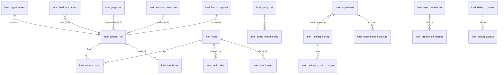

# Tara Intelligence 03: database design

This document builds on [02-architecture.md](02-architecture.md).

**Conventions used in every table below**
- Every new table lives in **`feed_db`**, belongs to the Django app `intel`, and is named with the `intel_` prefix, unless a row says otherwise.
- Identifiers are UUIDs. New row ids are UUIDv7 (`tara_events.envelope.uuid7`), which sort by time.
- Rows never use a cross-service ForeignKey. References to other services are plain UUID columns.
- Two types are written in shorthand:
  - `ts` means `timestamptz`.
  - `enum(...)` means a `varchar` constrained by a `CHECK` constraint generated from a Django `TextChoices`.
- **PII** is graded **none**, **pseudonymous** (an account UUID joined to behaviour) or **sensitive** (it reveals interests or behaviour). Everything that is pseudonymous or sensitive is deleted on `account.deleted`.

## 1. Entity overview



## 2. New tables in `feed_db` (owner: feed, app `intel`)

### 2.1 Content read models (built from events)

**`intel_content_ref`**: one row per post, reel or video, kept apart from fan-out. Built from `post.created`, `post.updated`, `post.deleted`, `post.hidden`, `post.unhidden`, `post.approved`, `group.post.published` and the new `reel.state.changed`, plus `intel_backfill_content`.

| Field | Type | Notes |
|---|---|---|
| `post_id` | uuid PK | n/a |
| `author_id` | uuid | n/a |
| `author_type` | enum(user, page) | n/a |
| `type` | enum(text, image, video, link, share, poll, reel) | n/a |
| `audience` | enum(public, friends, followers, only_me, group) | n/a |
| `group_id` | uuid null | n/a |
| `approval_state` | enum(approved, pending) | From `post.created.approval_state` (`posts/services.py:462`); set to `approved` by `post.approved` / `group.post.published`. Rule E1b |
| `reel_state` | enum(published, media_missing, media_failed, media_elsewhere) null | Reels only; from `reel.state.changed`. Rule E1c |
| `shared_post_id` | uuid null | Marks a reshare, used for originality |
| `lang` | enum(ar, en, mixed, und) | `intel/topics/language.py` |
| `hashtags` | varchar(80)[] | Lower-cased, `normalize_ar` |
| `media_ids` | uuid[] | n/a |
| `simhash` | bigint | Duplicate detection |
| `bait_score` | real | 0 to 1, from the lexicon |
| `state` | enum(live, deleted, hidden) | n/a |
| `moderation_state` | enum(ok, pending, removed) | n/a |
| `pending_reports` | int default 0 | Distinct reporters since the last moderation decision |
| `moderation_open` | bool | n/a |
| `created_at` | ts | The publish time |
| `updated_at` | ts | n/a |
| `event_at` | ts | Newest-wins guard, the same pattern as `PostState` |

Indexes:
- `(author_id, created_at desc)`
- `(group_id, created_at desc) WHERE group_id IS NOT NULL AND state='live'`
- `(type, created_at desc) WHERE audience='public' AND group_id IS NULL AND state='live'`, which feeds the discovery and video pools
- `(created_at desc) WHERE state='live'`, which bounds the pool rebuild to the last `pools.window_days` (default 7)

Retention: deleted rows are purged after 7 days. Live rows older than 180 days are purged, because fan-out `FeedItem` rows keep the old Home feed working. The pool rebuild never reads more than `pools.window_days` of it. PII: pseudonymous (it holds no body text).

---

**`intel_content_topic`**

| Field | Type | Notes |
|---|---|---|
| `post_id` | uuid | n/a |
| `topic_id` | smallint | FK `intel_topic` |
| `source` | enum(hashtag, page, group, lexicon, llm, inherited) | n/a |
| `confidence` | real | 0 to 1 |
| `created_at` | ts | n/a |

PK `(post_id, topic_id)`. Index `(topic_id, post_id)`. A post has at most 3 rows. Rows are deleted with their `intel_content_ref`. PII: none.

---

**`intel_media_ref`**: built from `media.processed` events with **`kind=video`**. The schema (`media.processed.v1.json`) carries `owner`, `kind`, `variants`, `purpose` (enum `["post"]` only, so there is no separate "video purpose"), `renditions`, `duration_ms`, `width` and `height`. Each field below names its source.

| Field | Type | Source |
|---|---|---|
| `media_id` | uuid PK | envelope `subject_id` |
| `duration_ms` | int | `duration_ms` |
| `width` | int | `width` |
| `height` | int | `height` |
| `top_rung` | smallint | `max(renditions)` (the short side of the top HLS rendition, in px) |
| `has_poster` | bool | `"poster" in variants` |
| `has_audio` | bool null | **New additive field** in `media.processed` (WP 2.6b); the media probe already computes it (`media_app/video.py:68-90`). Null for events emitted before that change |
| `quality` | real (0 to 1, computed) | `media_quality` config block (02 section 16) |
| `updated_at` | ts | n/a |

There is no `fps` column: frame rate is not part of the media-quality rule. Retention: rows that no content row references are purged after 180 days. PII: none.

### 2.2 Relationship read models

| Table | Fields | Indexes | Source events | PII |
|---|---|---|---|---|
| `intel_friend_edge` | `account_id` uuid, `friend_id` uuid, `since` ts, `event_at` ts. Stored in both directions | PK `(account_id, friend_id)` | `friendship.accepted`, `friendship.removed`; backfilled from graph `fanout/` by `intel_backfill_edges` | pseudonymous |
| `intel_group_ref` | `group_id` uuid PK, `privacy` enum(public, private, hidden), `status` enum(active, suspended, deleted), `category` varchar(20), `topic_id` smallint null, `member_count` int, `event_at` ts | `(privacy, status)` | `group.created`, `group.updated`, `group.deleted`, `moderation.actioned` (target group) | none. No name is stored, which keeps hidden groups' names **out of `feed_db`** (the bus already carries them: `group.created` and `group.updated` require `name`) |
| `intel_group_membership` | `account_id` uuid, `group_id` uuid, `state` enum(active, requested, invited, banned), `role` enum(owner, admin, moderator, member), `notify_posts` bool, `joined_at` ts, `event_at` ts | PK `(account_id, group_id)`; `(group_id) WHERE state='active'` | `group.member.changed` (carries `role` and `state`); backfill through profile internal `groups/<id>/access/` or a new export | pseudonymous |
| `intel_block_pair` | `low` uuid, `high` uuid, `since` ts | PK `(low, high)` | `user.blocked`, `user.unblocked` (feed has no unblock handler today) | pseudonymous |
| `intel_page_ref` | `page_id` uuid PK, `owner_id` uuid, `status` enum(draft, published, suspended), `deleted` bool, `event_at` ts | PK; `(status) WHERE status <> 'published' OR deleted` | `page.created`, `page.updated` (both carry `status` and `deleted`, `page.updated.v1.json`); backfill from profile | none. Rule E6b |
| `intel_account_restriction` | `account_id` uuid PK, `kind` enum(restrict, shadow), `case_id` uuid, `since` ts, `event_at` ts | PK | `moderation.actioned` with `target_type=user`, action `restrict` / `shadow` (insert or update); the new `reinstate` action (delete). `warn` and `dismiss` change nothing | **sensitive** (a shadow restriction is never shown to its subject, `moderation/account_status.py:23-26`). Rule E11 |
| `intel_fanout_capped` | `post_id` uuid PK, `author_id` uuid, `audience` enum, `total` int, `cap` int, `created_at` ts | PK; `(author_id, created_at desc)` | Written by `feed.services.fan_out_post` when it truncates (`feed/services.py:176-182`), in the same transaction as its `FeedItem` bulk insert | none. Feeds `follow_pull`. Purged with `intel_content_ref` (180 days) |

### 2.3 Topics

**`intel_topic`**

| Field | Type | Notes |
|---|---|---|
| `id` | smallserial PK | n/a |
| `slug` | varchar(40) unique | n/a |
| `label_ar` | varchar(60) | n/a |
| `label_en` | varchar(60) | n/a |
| `parent_id` | smallint null | n/a |
| `status` | enum(active, hidden) | n/a |
| `allow_minors` | bool default true | Rule E9 |
| `sensitive` | bool default false | Politics, religion and Quran are seeded `true`. No inferred rows without the user's opt-in; never used for ads; never shown in staff explain output; shown only as "a topic" in "why" (02 section 13) |
| `created_at` | ts | n/a |

About 40 rows are seeded by `intel_seed_topics` from the group categories, the marketplace roots and the seed topic pages. PII: none.

---

**`intel_topic_alias`**

| Field | Type | Notes |
|---|---|---|
| `id` | bigserial | n/a |
| `topic_id` | smallint | n/a |
| `kind` | enum(hashtag, page_category, group_category, market_category, keyword) | n/a |
| `value_norm` | varchar(80) | n/a |
| `lang` | enum(ar, en, any) | n/a |
| `weight` | real | n/a |
| `strong` | bool | One hit is enough for the lexicon rule |
| `source` | enum(curated, llm_suggested) | n/a |
| `status` | enum(active, pending, rejected) | n/a |
| `approved_by` | uuid null | n/a |
| `created_at` | ts | n/a |

A unique constraint covers `(kind, value_norm)`, and an index covers `(topic_id)`. PII: none.

### 2.4 Interest profile and preferences (private)

**`intel_user_interest`**

| Field | Type | Notes |
|---|---|---|
| `account_id` | uuid | n/a |
| `dim` | enum(topic, format, creator, lang, market_cat, group_cat) | n/a |
| `key` | varchar(64) | A topic slug id, format name, creator UUID, ... |
| `source` | enum(explicit, inferred) | n/a |
| `polarity` | enum(like, dislike, more, less, suppressed) null | Explicit rows only |
| `short_v` | real | n/a |
| `short_at` | ts | n/a |
| `long_v` | real | n/a |
| `long_at` | ts | Lazy decay |
| `events_n` | int | n/a |
| `counts` | jsonb | Per event type, for the "why" view. Never holds item ids |
| `updated_at` | ts | n/a |

PK `(account_id, dim, key, source)`. Index `(account_id, dim, source)`.

Retention: explicit rows stay until the user removes them or deletes the account. Inferred rows are pruned when `max(|short|, |long|) < 0.01` after decay. PII: **sensitive**. Only the owner can read these rows, and only through `/feed/preferences/profile/`. The analytics dashboard never queries this table.

---

**`intel_user_preference`**: one row per account.

| Field | Type | Notes |
|---|---|---|
| `account_id` | uuid PK | n/a |
| `default_mode` | enum(for_you, following, friends, favorites, recent) | n/a |
| `discovery_level` | smallint 0 to 3 | default 2 |
| `languages` | varchar(5)[] | default `[Account.language]` |
| `formats` | jsonb | `{video: "more", poll: "less"}` |
| `discovery_prefs` | jsonb | `{new_creators: true, trending: true, people_suggestions: true, page_suggestions: true, group_suggestions: true, other_languages: false}` (02 section 10.1) |
| `sensitive_inference` | bool default false | Opt-in for inferred rows on sensitive topics |
| `onboarded_at` | ts null | n/a |
| `personalization_off` | bool default false | Forces chronological ranking with no inferred interests **and stops collection**: no telemetry is sent or accepted for the account, and the aggregator stops updating its interest, engagement and decayed-affinity rows (02 section 13). Content-level public counters still update. See the decision on consent in the README |
| `version` | int | Optimistic concurrency |
| `updated_at` | ts | n/a |

Retention: until the account is deleted. PII: sensitive.

---

**`intel_preference_change`**: the undo log.

| Field | Type | Notes |
|---|---|---|
| `id` | uuid PK | n/a |
| `account_id` | uuid | n/a |
| `source` | enum(ui, nl_llm, nl_rules, feedback, onboarding, undo) | n/a |
| `ops` | jsonb | Validated ops |
| `before` | jsonb | n/a |
| `after` | jsonb | n/a |
| `text_sha256` | char(64) null | The natural-language text itself is not stored |
| `llm_model` | varchar(80) null | n/a |
| `undone_by` | uuid null | n/a |
| `created_at` | ts | n/a |

Index `(account_id, created_at desc)`. Retention: 180 days. PII: sensitive.

---

**`intel_nl_proposal`**: natural-language proposals waiting for the user to apply them.

| Field | Type |
|---|---|
| `id` | uuid PK |
| `account_id` | uuid |
| `ops` | jsonb |
| `unrecognized` | jsonb |
| `parser` | enum(llm, rules) |
| `expires_at` | ts (now + 1 h) |

Expired rows are purged hourly. PII: sensitive.

---

**`intel_feedback_action`**

| Field | Type | Notes |
|---|---|---|
| `id` | uuid PK | n/a |
| `account_id` | uuid | n/a |
| `item_type` | enum(post, reel, video, profile, page, group) | n/a |
| `item_id` | uuid | n/a |
| `author_id` | uuid null | n/a |
| `action` | enum(interested, not_interested, more_like_this, less_like_this) | Hide and snooze stay in `post_hide` / `author_snooze` |
| `topic_ids` | smallint[] | The item's topics at the time of the action |
| `surface` | varchar(12) | n/a |
| `created_at` | ts | n/a |
| `undone_at` | ts null | n/a |

A unique constraint covers `(account_id, item_type, item_id, action) WHERE undone_at IS NULL`. An index covers `(account_id, created_at desc)`. Retention: 365 days. PII: sensitive.

---

**`intel_debug_consent`**: the user's time-boxed permission for support to explain their ranking (02 section 21).

| Field | Type | Notes |
|---|---|---|
| `id` | uuid PK | n/a |
| `account_id` | uuid | The user who granted it |
| `granted_at` | ts | n/a |
| `expires_at` | ts | `granted_at + 24 h` |
| `revoked_at` | ts null | n/a |

Index `(account_id, expires_at desc)`. Retention: 90 days. PII: pseudonymous.

### 2.5 Engagement aggregates

**`intel_user_item_engagement`**

| Field | Type | Notes |
|---|---|---|
| `account_id` | uuid | n/a |
| `item_id` | uuid | n/a |
| `item_type` | varchar(8) | n/a |
| `impressions` | smallint | n/a |
| `opens` | smallint | n/a |
| `max_watch_ms` | int | n/a |
| `completions` | smallint | n/a |
| `rewatches` | smallint | n/a |
| `skips` | smallint | n/a |
| `positive` | smallint bitset | like, comment, share, save, interested |
| `negative` | smallint bitset | hide, not_interested, less, report |
| `first_at` | ts | Partition key |
| `last_at` | ts | n/a |
| `data_origin` | enum(real, synthetic, test) | n/a |

**Range-partitioned by `first_at`, one partition per week** (created by `RunSQL`, like `intel_signal_event`). PK `(account_id, item_id, first_at)`; the aggregator, which is the only writer, finds an existing row with `WHERE account_id=$1 AND item_id=$2 AND first_at >= now() - retention` before inserting. This table backs the seen-before demotion and the video `history` term. The ML labels come from `intel_signal_event` joins (with the served `pred`), not from this table.

**Size estimate:** at the section 2.6 load (10k DAU × 300 events a day), a user sees about 150 distinct items a day, so about 1.5M new rows a day. At about 70 B per row plus about 40 B of index, 30 days is about 45M rows and about 5 GB; 90 days would be about 1.35 × 10^8 rows and about 15 GB.

Retention: **30 days by default** (configurable from 7 to 30 days); old weekly partitions are dropped, never deleted row by row. PII: sensitive.

---

**`intel_creator_quality`**

| Field | Type |
|---|---|
| `author_id` | uuid PK |
| `followers` | int |
| `account_age_days` | int |
| `posts_30d` | int |
| `reach_30d` | int |
| `hide_rate` | real |
| `report_rate_90d` | real |
| `removal_rate_90d` | real |
| `completion` | real |
| `comment_depth` | real |
| `originality` | real |
| `quality` | real |
| `is_new` | bool |
| `computed_at` | ts |

The table is rebuilt nightly, and every rate is smoothed with priors. The rebuild excludes events whose actor is a registered synthetic or test account unless `INTEL_SYNTHETIC_IN_RANKING=true` (dev only), and `report_rate_90d` is a rate: reporter ids never reach this table. PII: pseudonymous. These are public-facing creator aggregates.

### 2.6 Telemetry: `intel_signal_event`

Telemetry goes in **a partitioned table created by `RunSQL`**, with `PARTITION BY RANGE (received_at)` and one partition per UTC day. The Django model is `managed=False` and is used for reads only. Writes use `COPY`.

| Field | Type | Notes |
|---|---|---|
| `id` | uuid | Server-assigned UUIDv7 |
| `client_event_id` | uuid null | Natural dedupe key in the aggregator |
| `batch_id` | uuid null | The client batch; deduplicated through `intel_signal_batch` |
| `account_id` | uuid | n/a |
| `session_id` | uuid | Generated by the client per tab; rotates after 30 min idle |
| `event_type` | enum (see section 3.3) | n/a |
| `item_type` | varchar(8) | n/a |
| `item_id` | uuid | n/a |
| `author_id` | uuid null | Filled at aggregation |
| `surface` | enum(home, reels, video, groups, marketplace, discovery, profile, search, link) | From the serve token; the client's hint only when `attributed=false` |
| `position` | smallint null | Feed position, from the serve token |
| `watch_ms` | int null | Clamped |
| `pos_ms` | int null | Playhead position |
| `duration_ms` | int null | From `intel_media_ref` |
| `source` | enum(client, bus, server) | n/a |
| `rank_source` | varchar(16) null | Candidate source (`connections`, `groups`, `discovery`, ...), from the serve token |
| `attributed` | bool | True when a valid serve token issued to this account for this item was presented |
| `cfg_version` | varchar(24) null | **Stamped by the server** from the serve token (or the account's assignment); never from a client field |
| `variant` | varchar(16) null | Same |
| `pred` | bytea null | Impressions only: the quantized rule scores from the serve token (about 9 bytes). This is the served-prediction log for calibration (WP 12.6) and ML |
| `flags` | smallint | `ts_clamped`, `watch_clamped`, `ineligible_item` (aggregation ignores flagged rows except for the viewer's own profile) |
| `data_origin` | enum(real, synthetic, test) | From the `intel_synthetic_account` label only |
| `occurred_at` | ts | Clamped client time (±24 h), or server time. Used by metrics, decay and ML labels. Synthetic rows written by `intel_seed_synthetic_signals` bypass the clamp |
| `received_at` | ts | Partition key and retention. Synthetic backdated rows set `received_at = occurred_at` |

Indexes, created per partition:
- `(account_id, occurred_at)`
- `(item_id)`
- `(event_type, surface)`

Retention: **30 days by default** (an owner decision; `INTEL_SIGNAL_RETENTION_DAYS`, 90 in dev so the 60-day synthetic history survives). The daily task `intel_make_partitions` creates partitions 7 days ahead and runs `DROP PARTITION` once a partition is past retention. The synthetic command creates the past partitions it needs and refuses to backdate beyond retention.

Dedupe is not done with a unique index on this table, because a unique index on a partitioned table must include the partition key. It is also **not** done with one Redis key per event: about 6M keys at 10k DAU would sit in the shared default Redis (AOF, no `maxmemory`; Dokploy `mem_limit: 256m`). Instead:
- **per batch**, in Postgres: `intel_signal_batch` (below), written in the same transaction as the `COPY`;
- **per event**, natural-key checks in the aggregator (`DISTINCT ON` the client event id and the per-type key).

PII: **sensitive**. The table holds no IP address, user agent, location or free text.

Estimated size: about 150 B per row (the `pred` column adds about 10 B to impression rows). At 10k DAU × 300 events = 3M rows per day, that is about 450 MB per day, or about 13.5 GB at 30 days. This is the main driver of the retention decision.

---

**`intel_signal_batch`**: batch-level dedupe.

| Field | Type |
|---|---|
| `account_id` | uuid |
| `batch_id` | uuid |
| `received_at` | ts |

PK `(account_id, batch_id)`. `INSERT ... ON CONFLICT DO NOTHING`: when the insert affects 0 rows, the batch is a retry and nothing is copied. Size: 10 to 30 batches per user per day, so 100k to 300k rows a day at 10k DAU, about 20 to 40 MB with the index at the 48 h retention. Purged hourly. PII: pseudonymous.

### 2.7 Configuration, experiments, analytics, models

**`intel_ranking_config`**

| Field | Type | Notes |
|---|---|---|
| `id` | uuid PK | n/a |
| `surface` | enum(home, reels, video, groups, marketplace, discovery) | n/a |
| `version` | int | n/a |
| `status` | enum(draft, active, archived) | n/a |
| `params` | jsonb | Validated by `intel/config/schema.py` |
| `schema_version` | smallint | n/a |
| `note` | varchar(300) | n/a |
| `created_by` | uuid | n/a |
| `created_at` | ts | n/a |
| `activated_at` | ts null | n/a |

- A unique constraint covers `(surface, version)`, and a partial unique constraint covers `(surface) WHERE status='active'`.
- A row is immutable after activation: a `pre_save` guard plus a DB trigger that rejects any `UPDATE` of `params` when status is not `draft`.
- Retention: forever. PII: none (staff ids only).

---

**`intel_ranking_config_change`**

| Field | Type |
|---|---|
| `id` | uuid PK |
| `surface` | enum |
| `from_version` | int null |
| `to_version` | int |
| `action` | enum(created, activated, rolled_back, paused, experiment_started, experiment_stopped) |
| `diff` | jsonb |
| `reason` | varchar(500) |
| `actor_id` | uuid null (null means the system, for example the guardrail auto-pause) |
| `created_at` | ts |

Index `(surface, created_at desc)`. Each row is mirrored to admin `AuditEntry` through `intel.config.changed`. Retention: forever.

---

**`intel_experiment`**

| Field | Type | Notes |
|---|---|---|
| `key` | varchar(60) PK | n/a |
| `surface` | enum | n/a |
| `status` | enum(draft, running, paused, stopped) | n/a |
| `salt` | varchar(16) | n/a |
| `variants` | jsonb | `[{"name":"control","pct":34,"config_version":2}, ...]`, and the `pct` values must sum to 100 |
| `audience` | jsonb | `{lang:[...], min_account_age_days, data_origin:"real"}` |
| `primary_metric` | varchar(40) | n/a |
| `guardrails` | jsonb | n/a |
| `mde` | real | n/a |
| `started_at` | ts | n/a |
| `ends_at` | ts | n/a |
| `created_by` | uuid | n/a |

At most one `running` experiment per surface is enforced in v1. PII: none.

---

**`intel_daily_metric`**

| Field | Type |
|---|---|
| `day` | date |
| `surface` | enum |
| `variant` | varchar(16) default '' |
| `metric` | varchar(40) |
| `value` | double precision |
| `n_users` | int |
| `n_events` | bigint |
| `data_origin` | enum |

PK `(day, surface, variant, metric, data_origin)`. These are the **only** slice dimensions; there are no free filters. Retention: 400 days. PII: none, because rows are aggregates and **a cell with `n_users < 20` is never written** (suppression at write time, in the rollup job, so no raw small cell exists to be read through the API, a DB read or a backup).

---

**`intel_experiment_exposure`**: exposure logged at assignment.

| Field | Type |
|---|---|
| `experiment_key` | varchar(60) |
| `account_id` | uuid |
| `variant` | varchar(16) |
| `surface` | enum |
| `first_exposed_at` | ts |
| `data_origin` | enum(real, synthetic, test) |

PK `(experiment_key, account_id)`. Written by feed when it first serves an account a surface under a running experiment, and by feed's handler for `intel.experiment.exposed.v1` from graph, profile and marketplace. Retention: until the experiment is archived plus 400 days, then deleted. PII: pseudonymous.

---

**`intel_debug_access`**: every "explain for account" request (02 section 21).

| Field | Type |
|---|---|
| `id` | uuid PK |
| `actor_id` | uuid |
| `target_account_id` | uuid |
| `reason` | varchar(500) (the typed reason; never sent on the bus) |
| `basis` | enum(consent, approver) |
| `consent_id` | uuid null |
| `approver_id` | uuid null (must differ from `actor_id`) |
| `requested_at` | ts |
| `approved_at` | ts null |
| `used_at` | ts null |

Index `(target_account_id, requested_at desc)`. Each use emits `intel.debug.explained.v1` (section 4.3). Retention: 2 years (an audit record). PII: pseudonymous.

---

**`intel_model_registry`** (phase 11)

| Field | Type |
|---|---|
| `id` | uuid PK |
| `surface` | enum |
| `target` | enum(like, comment, share, save, meaningful, complete, negative) |
| `algo` | varchar(40) |
| `features` | jsonb (the feature schema version) |
| `train_from` | date |
| `train_to` | date |
| `train_rows` | bigint |
| `metrics` | jsonb (AUC, log loss, calibration) |
| `artifact_uri` | varchar(300) (object storage) |
| `artifact_sha256` | char(64) |
| `status` | enum(shadow, active, retired) |
| `created_at` | ts |

PII: none. The artifacts are trained on aggregates and labels, and contain no ids.

---

**`intel_synthetic_account`**

| Field | Type |
|---|---|
| `account_id` | uuid PK |
| `label` | varchar(40) (for example `seed-2026-11`, `test-integration`) |
| `created_at` | ts |

The label alone decides the origin: `seed-*` gives `synthetic`, `test-*` gives `test`. No request field can set an origin. In production the table must be empty: a readiness check enforces this when `INTEL_ACCEPT_SYNTHETIC=false`, and `scripts/seed/seed_dataset.py` refuses to run when `TARA_ENV=production`.

### 2.8 Redis keys (`redis-hot`, prefix `feed:`)

| Key | Type | TTL | Size |
|---|---|---|---|
| `rank:{surface}:{viewer}` (replaces today's `rank:{viewer}`) | binary, 24 B per item (`post_id`, source, reason, 3 factor codes) | 1800 s | Home about 25 KB (1,050 items); reels about 10 KB, video 7 KB, groups 4 KB, discover 7 KB. No per-impression scores (they ride in the serve token) |
| `intel:cfg:{surface}:{version}`, `intel:cfg:active:{surface}` | string | 300 s / 30 s | ≤ 8 KB |
| `intel:prof:{account}` | string | 600 s | About 2 KB |
| `intel:pool:{surface}:{lang}:{topic\|_trending\|_new}` | zset (post_id → pool score) | 900 s | ≤ 128 members, so the zset stays in listpack encoding (about 4 KB per key). About 960 keys, about **4 MB**, a fixed budget |

There is no Redis dedupe key: batch dedupe lives in Postgres (`intel_signal_batch`). The full `redis-hot` budget (128 MB, `noeviction`) is worked out in [02](02-architecture.md) section 22: about 78 MB at 10k DAU with 2,000 viewers active per 30 minutes; 07 WP 4b.0 raises `maxmemory` to 384 MB (06 §5.2) and WP 13.2 re-measures.

## 3. Changes to existing tables and services

### 3.1 `feed_db` (existing feed app)

| Table | Change | Why |
|---|---|---|
| `post_stats` | Add `impressions` bigint, `unique_viewers` int, `opens` int, `saves` int, `watch_ms_sum` bigint, `starts` int, `completions` int, `skips` int, `hides` int, `not_interested` int, `reach_fanout` int, `updated_at`. Add per-type reaction counts as `reactions_by_type` jsonb | Rates for predictions (denominators). Handlers skip synthetic and test actors unless `INTEL_SYNTHETIC_IN_RANKING=true` |
| `affinity` | Add `score` real (decayed), `score_at` ts, `likes` int, `comments` int, `shares` int, `replies_exchanged` int, `last_at` ts | Decay and per-type weights. `interactions` stays for the `home@1` golden test. Same synthetic-actor rule. Not updated while the viewer has `personalization_off` |
| `reaction_state` | No schema change | Same synthetic-actor rule |
| `author_ref` | Add `kind` enum(user, page), `active` bool default true, `followers` int, `account_created_at` ts, `page_category_norm` varchar(80), `topic_id` smallint null | Rules E6 and E9, new-creator detection, page topics |
| `feed_item` | Allow `reason='group'` (choices only; no rows are written in v1, because group content is pulled) | Explanations |
| `follow_edge` | No schema change. Backfill command `intel_backfill_edges` | D6 |

### 3.2 Other services

| Service / DB | Change | Why |
|---|---|---|
| post / `post_db` | Index `share(account_id, created_at desc)`. Partial index `post(type, created_at desc) WHERE state='published' AND group_id IS NULL`. Both `AddIndexConcurrently`, following the in-flight `0012_activity_log_idx.py` | D11 |
| post | Emit `post.saved` / `post.unsaved`, `post.reaction.changed`, `reel.hidden` / `reel.unhidden`, `reel.viewed`, and **`reel.state.changed`** from the reconcile job whenever `publish_state` changes (`reels/reconcile.py:102-112`, D15). Add JSON schemas for `post.created`, `.updated`, `.deleted`, `.reacted`, `.unreacted`, `.commented`, `.shared`, `comment.replied` | D7, D8, D9, D15 |
| post | `record_view` requires `watch_ms ≥ 1000` from the client before counting (D12). New `POST /api/v1/reels/batch/`. `/posts/batch/` and `/reels/batch/` accept optional `surface` and `src` hints and count dropped ids in `post_batch_dropped_total{caller,surface,src}` | Hydration, server-side drop metric |
| media | Additive optional fields `has_audio` (bool) and `fps` (number) in `media.processed`, from the probe (`media_app/video.py:68-90`) | Media quality |
| moderation | (1) Handler for `intel.integrity.flagged.v1` that opens a **system-sourced** case: `Report.reporter_id` is a non-null UUID today, so the case gets a `source=system` marker (a new nullable column or a reserved system reporter id, chosen in WP 7.4) and is shown to moderators as "system signal, not a user report". (2) A `reinstate` action for `user` targets, emitted when an appeal overturns `restrict` or `shadow`; today `REVERSALS` (`moderation/services.py:44-62`) covers content removals only | Spam intake, E11 lifting |
| ads | `eligible_creatives` also requires `advertiser.billing_status="active"` (D13) | Payment check |
| graph / `graph_db` | `AccountRef.active` bool, fed by `account.deactivated`, `reactivated`, `suspended` and `unsuspended`. Exclude inactive accounts in `suggestions.people` and `fanout/`. Also exclude accounts under `restrict` / `shadow` from `suggestions.people` (graph consumes `moderation.actioned` with `target_type=user`) | D5, E11 |
| graph, profile | New `intel_config` single-row-per-surface local cache table (`surface`, `version`, `params` jsonb, `experiment` jsonb null, `updated_at`), fed by `intel.config.published`. Local `intel_exposure_seen(account_id, experiment_key)` to emit each exposure once | Config-driven suggestions, A/B |
| marketplace / `market_db` | Same `intel_config` and `intel_exposure_seen` tables. `sort=recommended` | Marketplace surface |
| identity | Emit `account.updated` with `{language}` on `PATCH /me/` | Cold-start language |
| identity | Optional (owner decision) `LegalConsent` kind `personalization` | Consent |
| admin | Consume `intel.config.changed` and `intel.debug.explained` into `AuditEntry` (`action="intel.config.<action>"`, `"intel.debug.explained"`) | Change log, debug audit |
| `libs/tara_common` | `bucketing.py` (FNV-1a with a parameterized fold: `buckets=100` equals `flags.ts`), new capabilities (see [02](02-architecture.md), section 21) | A/B testing, RBAC |
| `scripts/seed` | `seed_dataset.py` exits when `TARA_ENV=production` or when the target is the production domain (D16) | Synthetic separation |

## 4. New events and contracts

All of the following go into `libs/tara_events/tara_events/schemas/` as `<type>.v1.json` (JSON Schema draft 2020-12, like the existing files). They use the standard envelope (`envelope.py`). The routing key is `event_type`.

### 4.1 Produced by post

```jsonc
// post.saved.v1 / post.unsaved.v1   (subject_id = post_id, partition_key = "account:<id>")
{"type":"object","required":["post_id","account_id","author_id","saved_at"],"additionalProperties":false,
 "properties":{"post_id":{"type":"string","format":"uuid"},"account_id":{"type":"string","format":"uuid"},
  "author_id":{"type":"string","format":"uuid"},"item_type":{"enum":["post","video"]},
  "saved_at":{"type":"string","format":"date-time"}}}
```
- Consumers: feed only. Neither the collection id nor the collection name is ever sent.
- Gated by `POST_EMIT_SAVE_EVENTS` (default **off** until the owner approves; see the README).

```jsonc
// post.reaction.changed.v1
{"required":["post_id","reactor","author_id","from_type","to_type"],
 "properties":{"post_id":{"format":"uuid"},"reactor":{"format":"uuid"},"author_id":{"format":"uuid"},
  "from_type":{"enum":["like","love","care","haha","wow","sad","angry"]},
  "to_type":{"enum":["like","love","care","haha","wow","sad","angry"]}}}
```

```jsonc
// reel.hidden.v1 / reel.unhidden.v1
{"required":["post_id","viewer_id","author_id"],"properties":{"post_id":{"format":"uuid"},
 "viewer_id":{"format":"uuid"},"author_id":{"format":"uuid"}}}
// reel.viewed.v1   (one per viewer per reel per UTC day, the same dedupe as ReelView)
{"required":["post_id","viewer_id","author_id","day"],"properties":{"post_id":{"format":"uuid"},
 "viewer_id":{"format":"uuid"},"author_id":{"format":"uuid"},"day":{"format":"date"}}}
// reel.state.changed.v1   (emitted by reels.reconcile when publish_state changes; ids and enums only)
{"required":["post_id","author_id","from_state","to_state"],"properties":{"post_id":{"format":"uuid"},
 "author_id":{"format":"uuid"},
 "from_state":{"enum":["published","media_missing","media_failed","media_elsewhere"]},
 "to_state":{"enum":["published","media_missing","media_failed","media_elsewhere"]}}}
```

### 4.1b Produced by media (additive)

`media.processed.v1` gains two optional properties, `has_audio` (`boolean`) and `fps` (`number`, `minimum` 0), taken from the probe. They are additive (old consumers ignore them; `additionalProperties: false` is kept by adding them to `properties`).

### 4.1c Changed in moderation

- `moderation.actioned.v1`: the `action` enum gains `reinstate`, emitted for `target_type` `user` (and `page`) when an appeal overturns `restrict` or `shadow`. Consumers that do not know it ignore it.
- New consumer of `intel.integrity.flagged.v1` (section 4.3), creating a system-sourced case.

### 4.2 Produced by identity

```jsonc
// account.updated.v1   (only fields that changed; never DOB or gender)
{"required":["account_id","changed"],"properties":{"account_id":{"format":"uuid"},
 "changed":{"type":"array","items":{"enum":["language"]}},"language":{"enum":["ar","en"]}}}
```

### 4.3 Produced by feed (`intel`)

```jsonc
// intel.config.published.v1   (consumers: graph, profile, marketplace)
{"required":["surface","version","params","published_at"],"properties":{
 "surface":{"enum":["home","reels","video","groups","marketplace","discovery"]},
 "version":{"type":"integer"},"params":{"type":"object"},"published_at":{"format":"date-time"},
 "experiment":{"type":["object","null"],"properties":{"key":{"type":"string"},"salt":{"type":"string"},
   "variants":{"type":"array","items":{"required":["name","pct","version","params"]}}}}}}
// intel.experiment.exposed.v1   (producers: graph, profile, marketplace; consumer: feed; once per account per experiment)
{"required":["experiment_key","account_id","variant","surface","exposed_at"],"properties":{
 "experiment_key":{"type":"string"},"account_id":{"format":"uuid"},"variant":{"type":"string"},
 "surface":{"type":"string"},"exposed_at":{"format":"date-time"}}}
// intel.integrity.flagged.v1   (producer: feed; consumer: moderation, which opens a system-sourced case)
{"required":["post_id","author_id","signal","rate","distinct_accounts"],"properties":{
 "post_id":{"format":"uuid"},"author_id":{"format":"uuid"},
 "signal":{"enum":["spam_hides","sexual_hides"]},"rate":{"type":"number"},"distinct_accounts":{"type":"integer"}}}
// intel.debug.explained.v1   (consumer: admin, written to AuditEntry; the reason stays in intel_debug_access)
{"required":["target_account_id","basis","reason_present"],"properties":{
 "target_account_id":{"format":"uuid"},"basis":{"enum":["consent","approver"]},
 "approver_id":{"type":["string","null"],"format":"uuid"},"reason_present":{"type":"boolean"}}}
// intel.config.changed.v1     (consumer: admin, written to AuditEntry)
{"required":["surface","action","to_version"],"properties":{"surface":{"type":"string"},
 "action":{"enum":["created","activated","rolled_back","paused","experiment_started","experiment_stopped"]},
 "from_version":{"type":["integer","null"]},"to_version":{"type":"integer"},
 "experiment":{"type":["string","null"]},"reason_present":{"type":"boolean"}}}
```
- The actor is the envelope's `actor_id`.
- The free-text reason stays in `intel_ranking_config_change`, because event payloads carry no free text. This is the admin convention stated at `adminsvc/models.py:66-68`.

### 4.4 Telemetry (HTTP contract, not bus events)

The batch schema is `intel/signals/serializers.py`. It is also published in feed's OpenAPI (`drf-spectacular`) and as `docs/intelligence/schemas/signals.batch.v1.json` in phase 2.

The batch carries `batch_id` and `session_id`. Each event carries `id`, `t`, `item`, `ts` and, for items that came from a ranked surface, `st` (the serve token, 02 section 12.2). **The batch has no `cfg` or `variant` field**: attribution is stamped by the server from the token, and unknown fields are rejected by the serializer.

| `t` (event type) | Required fields | Validation |
|---|---|---|
| `feed_impression` | `item`, `pos` | Once per (session, item). Visible ≥ 50% for ≥ 1 s |
| `post_open` | `item` | Once per (session, item) |
| `video_start` | `item`, `play_index` | n/a |
| `video_progress` | `item`, `watch_ms`, `pos_ms` | Clamped. At most one every 5 s per item |
| `video_complete` | `item`, `watch_ms` | Needs a start in the same session and `watch_ms ≥ 0.9·duration` |
| `video_rewatch` | `item`, `play_index ≥ 2` | Needs a complete event |
| `video_skip` | `item`, `watch_ms` | `watch_ms < min(2000, 0.2·duration)` |
| `reel_view` | `item`, `watch_ms ≥ 1000` | The server-side `reel.viewed` is authoritative for counts |
| `profile_visit` | `item` (`profile:uuid` / `page:uuid`) | Once per (account, profile, day) |

These event types **cannot** come from the client: the server derives them, and rejects them if a client sends them.
- `post_like`, `post_comment`, `post_share`, `post_save`, `post_report`, `follow`, `unfollow` come from the bus.
- `post_hide`, `interested`, `not_interested` come from server actions.

## 5. Privacy and retention summary

| Data | Class | Who can read | Retention (default) |
|---|---|---|---|
| Raw telemetry | sensitive | Service code only. Analytics read it through aggregates. `post_report` rows hold reporter ids and never surface in any per-author view, creator analytics or explain output | 30 days |
| Interest profile, preferences, feedback actions | sensitive | The owning account. Staff only through `intel.debug.explain` **plus** the user's consent or a second approver, with a reason stored in `intel_debug_access`, shown as factor codes only (sensitive topics masked) | Explicit rows until removed. Inferred rows decay. Feedback 365 days |
| Account restrictions | sensitive | Service code only. Never shown to the account (a shadow is never disclosed) | Until `reinstate` or account deletion |
| User × item engagement | sensitive | Service code | 30 days (weekly partitions) |
| Creator quality | pseudonymous aggregate | Service code. Dashboard aggregates only | Rebuilt nightly |
| Daily metrics | none | `intel.analytics.view`. Cells with fewer than 20 users are never written | 400 days |
| Experiment exposures | pseudonymous | Service code; readouts aggregate them | Experiment lifetime + 400 days |
| Debug access log | pseudonymous | `intel.debug.explain` holders, admin audit | 2 years |
| Config, experiments, change log | none | `intel.config.view` / `intel.config.manage` | Forever |

- The deletion path is **one handler**, `intel/handlers.py::on_account_deleted`. It deletes every `intel_*` row keyed by the account, plus that account's rows in raw partitions, using `DELETE ... WHERE account_id=$1` per partition.
- A test asserts that no `intel_*` table survives account deletion.
