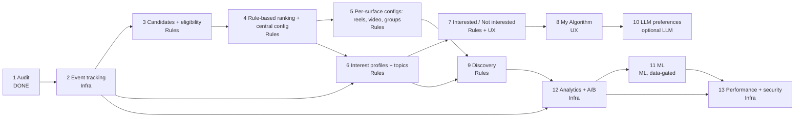

# Tara Intelligence 04: implementation plan

This plan turns the brief's 13 phases into ordered work packages (WP). It is based on [01](01-technical-audit.md), [02](02-architecture.md) and [03](03-database-design.md).

Each phase is marked with one of four kinds:
- **Rules**: deterministic and transparent.
- **ML**: a trained model.
- **Infra**: plumbing with no ranking logic.
- **UX**: user-facing.

Only phase 11 is ML. Until then, the UI and the dashboard must say "rules", and rule outputs are labelled **scores**, not probabilities, until the calibration check of WP 12.6 passes.

**No acceptance criterion hard-codes a dev row count.** The dev data keeps growing while other agents run the seed and the integration suites (01 section 4), so every count check compares against a query run at the same moment.

## 0. Working agreement for every phase

1. **Preserve existing behaviour by default.** Every change ships behind a config version or a flag. The `home@1` config reproduces today's `ranking.py`. Chronological `recent` is never touched: it stays fan-out rows only, and group posts enter it only if the owner turns on `modes.recent_includes_groups` (02 section 9).
2. **Tests first for invariants:** privacy, blocks, sponsored labelling, and chronological order.
3. **At the end of each phase:**
   - run the affected service suites (`pytest` in `services/<svc>`), `frontend/web` `vitest` and the relevant Playwright e2e;
   - record the commands, counts and timings in `docs/intelligence/results/phase-NN.md`;
   - add a line to the repo work log (`docs/ecosystem/07-work-log.ar.md`);
   - commit and push each verified step (repo convention; `.env_prod` is never committed).
4. **Migrations:**
   - additive only;
   - `AddIndexConcurrently` with `atomic=False` for large tables (the same pattern as `posts/migrations/0012_activity_log_idx.py`);
   - a backfill command for every new read model.
5. **Synthetic data** is tagged `data_origin=synthetic` and never reaches real analytics ([02](02-architecture.md), section 12.3).
6. **Dependencies.** `scikit-learn` is added to `services/feed/requirements.txt` in phase 11 only. No other new **runtime** dependency is planned. An OpenAI-compatible LLM client is plain HTTP through `requests`, which feed already has. One new **test** dependency is needed: `hypothesis` in `services/feed/requirements-dev.txt` (today it holds `pytest`, `pytest-django`, `pytest-cov` and `ruff`) for the WP 3.5 property test, added in WP 3.5.

## Phase overview

Phase 12 is built **before** phase 11 in practice. ML needs the metrics and the experiment readouts to be judged safely, so the brief's numbering is kept but the dependency is explicit.

---

## Phase 1: Audit (status: **done**)

**Delivered (2026-11-05):**
- [00-master-spec.md](00-master-spec.md) (the brief);
- [01-technical-audit.md](01-technical-audit.md): per-requirement matrix, 16 defects (D1 to D16), measured baseline with a timestamped drift check;
- [02-architecture.md](02-architecture.md);
- [03-database-design.md](03-database-design.md);
- this plan;
- [README.ar.md](README.ar.md).

**Not done in phase 1:**
- **Tests were counted, not run.** The `tara-feed-1` image has no `pytest`. The baseline run is moved to WP 2.0.
- No code was changed.

---

## Phase 2: Event tracking (Infra)

**Goal:** every brief event is captured once, validated, attributable to a surface, session and config, and separable from synthetic data.

| WP | Tasks (files) | Acceptance criteria | Tests |
|---|---|---|---|
| 2.0 Baseline | Run feed (114 tests), post, graph, profile, marketplace, identity, moderation, media, ads suites and web `vitest` (`feed.spec.ts`, `homeFeed.spec.ts`) in the dev-requirements images. Measure the outbox relay throughput of one service (`publish_pending`, `tara_events/outbox.py:49-97`) on 10k synthetic rows. Record everything in `results/phase-02.md` | `results/phase-02.md` lists, per suite: the exact command, passed / failed / skipped counts and wall time, and every failure with its test id and a one-line cause. Every failure is either fixed or filed as a known failure with an owner. The relay throughput is recorded in events/s, replacing the "about 100 events/s" estimate in 01 section 5 and 02 A5 | The baseline run **is** the test: a CI-style script `scripts/intel/baseline.sh` that runs every suite listed and exits non-zero on any unlisted failure; it is re-run at the end of every phase |
| 2.1 `intel` app skeleton | `services/feed/intel/{apps,models,ports,handlers,urls,views}.py`. Register in `services/feed/config/settings.py` `INSTALLED_APPS` and in feed's `urls.py` | App migrates on a clean DB. No change to existing endpoints | `intel/tests/test_app.py` |
| 2.2 Signal table and partitions | Migration with `RunSQL` for partitioned `intel_signal_event` and `intel_user_item_engagement` (weekly). `intel_signal_batch`. `intel/signals/partitions.py`. Command `intel_make_partitions`. Beat task (daily) in `CELERY_BEAT_SCHEDULE` | Partitions exist 7 days ahead. Partitions older than `INTEL_SIGNAL_RETENTION_DAYS` (30; 90 in dev) are dropped. `intel_signal_batch` rows older than 48 h are purged | `test_partitions.py`: create, drop, idempotent |
| 2.3 Ingestion endpoint | `intel/signals/{serializers,validate,ingest}.py`, `intel/ranking/serve_tokens.py` (issue and verify, secret `INTEL_SERVE_TOKEN_SECRET`). `POST /api/v1/feed/signals/`. Throttle scope `signals`. Batch dedupe in `intel_signal_batch` (no Redis) | Rejects unknown types and server-only types. Ignores client `cfg` / `variant`; attribution comes only from a valid serve token issued to the same account. Clamps `watch_ms` and `ts`. Wall-clock overclaim dropped. p95 ≤ 30 ms for 50 events (local benchmark) | `test_signals_ingest.py`: schema, clamps, batch dedupe (the same batch twice gives one set of rows), overclaim, auth required, `data_origin` from the registry label only, 50-event cap, a forged or foreign serve token gives `attributed=false`, client `variant` ignored. `test_serve_tokens.py`: signature, expiry, wrong viewer, secret differs from `SECRET_KEY` and the internal JWT secret |
| 2.4 `feed-signals` role | **Dev:** `infra/compose/docker-compose.yml`: new `feed-signals` service (same image, gunicorn) and a Traefik router `PathPrefix(/api/v1/feed/signals)` at higher priority. **Production (Dokploy):** a `location /api/v1/feed/signals` block with `client_max_body_size 64k` before `location /api/v1/feed` in `frontend/web/nginx.conf` (`:136`), and a `feed-signals` service in `docker-compose.dokploy.yml` with `environment: {<<: *feed-env, RUN_MIGRATIONS: "false"}` (the only merged env; every other new container aliases). **Kubernetes:** a `/api/v1/feed/signals` rule in `infra/k8s/overlays/feed/ingress.yaml` and a `feed-signals` deployment and service | Feed pages still served by `feed`; signals served by `feed-signals` in all three setups. `feed-signals` resolves `RUN_MIGRATIONS=false` and its log has no `[feed] migrate` line (`services/feed/entrypoint.sh:13` migrates for any `gunicorn` command when it is true). `docker compose -f docker-compose.dokploy.yml config \| base64 -w0 \| wc -c` stays below 131,072 (the 128 KiB Dokploy argument cap from commit 0483ae3; 68 KB today). A 100 KB body to `/api/v1/feed/signals` gets 413 from nginx | Compose smoke test (`curl` both routes through nginx and through Traefik), the env and size checks above as a script in `scripts/intel/check_deploy.sh` |
| 2.5 Bus- and server-sourced signals | `intel/handlers.py`: map `post.reacted/unreacted/commented/shared/reported`, `comment.replied`, `user.followed/unfollowed`, `relationship.muted/unmuted`, `user.blocked/unblocked` into `intel_signal_event` with `source=bus`. The existing `HideView`, `UnhideView`, `SnoozeView` and `UnsnoozeView` (`feed/views.py:105-151`) write a `source=server` signal row in the same transaction as their own row | Every domain event writes exactly one signal row, also under redelivery (uses `ProcessedEvent`). Every post-menu action (hide, snooze, mute, unfollow, block, report) produces exactly one signal row | `test_bus_signals.py`, `test_menu_signals.py` (one test per menu action, plus undo) |
| 2.6 New post events | `services/post/posts/{saved,services}.py`, `reels/services.py`, `reels/reconcile.py`. Emit `post.saved/unsaved` (flag `POST_EMIT_SAVE_EVENTS`), `post.reaction.changed` (D8), `reel.hidden/unhidden`, `reel.viewed`, and `reel.state.changed` from the reconcile job (D15). `record_view` requires `watch_ms ≥ 1000` (D12). JSON schemas for these events and for the existing `post.*` events (D9) | Events validate against the schemas. Existing consumers unaffected. A reconcile run that hides or restores a reel emits exactly one `reel.state.changed` per changed reel, and a dry run emits none | post: `test_events_saved.py`, `test_reaction_changed.py`, `test_reel_view_min_watch.py`, `test_reconcile_events.py`. `libs/tara_events` schema test |
| 2.6b Media fields | `services/media/media_app/transcode.py` (`finalize`): add `has_audio` and `fps` from `asset.video_meta["probe"]` to the `media.processed` payload; add both as optional properties to `media.processed.v1.json` | Old events still validate; new video events carry both fields | media `test_processed_payload.py`, schema test |
| 2.7 Hashtags in feed | `feed/services.py::_snapshot` keeps `hashtags` (D7). `intel_content_ref` handler stores them | Hashtags present for new posts | `test_content_ref.py` |
| 2.8 Web tracker | `frontend/web/src/lib/signals.ts` (queue, flush every 10 s / 30 events / `visibilitychange`, `keepalive`, sends the serve token `st` it received with each item, never `cfg` or `variant`). `useImpression.ts` (`IntersectionObserver`, 50% for 1 s). Hooks in `PostCard.vue`, `ReelPlayer.vue`, `components/media/VideoPlayer.vue`, `ProfileView.vue`, `PageDetailView.vue`. Sends nothing while `personalization_off` is on | One impression per (session, item). Video progress at most every 5 s. No PII in the payload. Zero requests with `personalization_off` | `src/__tests__/signals.spec.ts`: batching, dedupe, keepalive, the 200-event memory cap, serve token passed through, silence under `personalization_off` |
| 2.9 Synthetic separation | `intel_synthetic_account` (label decides `synthetic` vs `test`). `scripts/seed/seed_dataset.py` registers seed accounts and **exits when `TARA_ENV=production`** or the target is the production domain (D16). `intel_seed_synthetic_signals` writes **backdated** impressions and watches over 60 days **directly** (`source=server`, no `ts` clamp, `received_at = occurred_at`), only when `INTEL_ACCEPT_SYNTHETIC=true`, and `--scale N` builds the 10× dataset used by WP 9.1 and 13.1. Bus-fed handlers (`post_stats`, `affinity`, `reaction_state`) and the `intel_creator_quality` rebuild skip synthetic and test actors unless `INTEL_SYNTHETIC_IN_RANKING=true` (dev only). Readiness check when `INTEL_ACCEPT_SYNTHETIC=false` | Seeded rows carry `data_origin=synthetic`. Production readiness fails if the table is non-empty. The seed script refuses `TARA_ENV=production`. With `INTEL_SYNTHETIC_IN_RANKING=false`, a synthetic account's like changes no `post_stats` or `affinity` row. The command refuses to backdate beyond retention | `test_synthetic_origin.py`, `test_synthetic_actor_exclusion.py`, `scripts/seed/tests/test_production_guard.py` |
| 2.10 Retention and deletion | `on_account_deleted` handler. Nightly purge tasks | No `intel_*` row survives account deletion, including `intel_signal_batch`, `intel_experiment_exposure`, `intel_debug_consent`, `intel_account_restriction` and raw partitions. The account's `redis-hot` keys are gone too: `intel:prof:{account}` and every `feed:rank:{surface}:{account}`. The account's posts leave every `intel:pool:*` zset at once (`ZREM` by post id), not at the next rebuild | `test_account_deletion.py` (tables, Redis keys and pool members) |

- **Depends on:** nothing.
- **Risks:**
  - Telemetry volume (estimate in [03](03-database-design.md), section 2.6). Mitigated by retention and partition drops.
  - Ad blockers dropping the tracker. Mitigated: the path is first-party.
  - iOS Safari `keepalive` limits. Mitigated: small batches.

---

## Phase 3: Candidates and eligibility (Rules)

**Goal:** a complete, multi-source candidate inventory, with privacy enforced before ranking.

| WP | Tasks (files) | Acceptance criteria | Tests |
|---|---|---|---|
| 3.1 Read models | Models and handlers for `intel_content_ref` (with `approval_state` and `reel_state`), `intel_media_ref` (`kind=video`), `intel_friend_edge`, `intel_group_ref`, `intel_group_membership`, `intel_block_pair`, `intel_page_ref` (`page.created` / `page.updated`), `intel_account_restriction` (`moderation.actioned` with `target_type=user`), `intel_fanout_capped` (written by `fan_out_post` when it truncates). Handlers for `post.approved`, `group.post.published` and `reel.state.changed`. Extend `author_ref`. Language detector `intel/topics/language.py` | Handlers are idempotent and newest-wins | `test_readmodels_intel.py`, `test_language.py` (ar, en, mixed, und, and Arabizi documented as `en`), `test_fanout_capped.py` (a truncated fan-out writes one row; an untruncated one writes none) |
| 3.2 Backfills | Commands `intel_backfill_content` (from post: paged internal export or replay through `/posts/batch/`), `intel_backfill_edges` (graph `fanout/` per account; fixes the `FollowEdge` drift D6), group memberships (profile internal endpoint), pages (profile) | **Query-based:** right after the backfill, a check script queries both sides in the same minute and asserts: `intel_friend_edge` rows = 2 × graph `friendship` rows with `status='accepted'`; `follow_edge` rows = graph `follow_relation` rows (users and pages); active `intel_group_membership` rows = profile `group_member` rows with `state='active'`; `intel_page_ref` rows = profile `page` rows; `intel_content_ref` rows = post `post` rows not deleted. (For scale, at 2026-11-05 15:51 UTC these were 2 × 1,658, 2,315, 468, 266 and 2,354; the numbers are not the criterion) | Command tests with fixtures; `scripts/intel/check_backfill.sh` |
| 3.3 Graph inactive and restricted accounts | `services/graph/graph/{models,handlers,suggestions,internal_views}.py`: `AccountRef.active`, and a restriction flag from `moderation.actioned` (`target_type=user`, `restrict` / `shadow`, cleared by `reinstate`). Exclude inactive accounts in `suggestions.people` and `fanout/` (D5); exclude restricted and shadowed accounts from `suggestions.people` (E11, D14) | A deactivated account disappears from PYMK and fan-out. A restricted or shadowed account disappears from PYMK but keeps its fan-out | graph `test_suggestions_inactive.py`, `test_suggestions_restricted.py` |
| 3.3b Moderation reinstate | `services/moderation/moderation/services.py`: `REVERSALS` maps `(user, restrict)` and `(user, shadow)` (and `page`) to a new `reinstate` action; `moderation.actioned.v1.json` gains it | An overturned `restrict` or `shadow` emits `moderation.actioned` with `reinstate`; feed and graph lift the restriction | moderation `test_reinstate.py`; feed `test_account_restriction.py` |
| 3.4 Retrieval | `intel/retrieval/{__init__,sources}.py`: sources `connections`, `follow_pull` (D2 from `intel_fanout_capped`, D3 from new follows), `groups` (D1, approved posts only), `reels` (`reel_state=published`), `video` | Group posts of joined groups appear in Home candidates. Capped authors reach all followers through pull. A new follow shows the last 7 days. **No pulled item duplicates a `FeedItem` the viewer already has** (dedupe by `post_id`) | `test_retrieval.py` (including the duplicate case and a capped author with 5,001 followers in a fixture with `FANOUT_MAX_RECIPIENTS=5`) |
| 3.5 Eligibility | `intel/eligibility.py`: rules E1, E1b, E1c, E2, E2b, E3 to E6, E6b, E7 to E11, each a function with its own counter `intel_eligibility_drop_total{rule}`. Add `hypothesis` to `services/feed/requirements-dev.txt` | Rules are fail-closed for privacy | `test_eligibility.py`, one test per rule, plus a **property test** (`hypothesis`): for random synthetic graphs (blocks both ways, private and hidden groups, banned members, pending group posts, draft and suspended pages, unplayable reels, restricted and shadowed authors, friends-only, followers-only and `only_me` posts **reached through every pull source** (`follow_pull`, new-follow rows, `groups`), deactivated authors, minors), no returned id is unauthorized according to a reference oracle that implements post's `visible_to_viewer` semantics (`posts/services.py:96-190`) |
| 3.6 Hydration contract | post `POST /api/v1/reels/batch/`. In post, `/posts/batch/` and `/reels/batch/` accept optional `surface` and `src` hints and increment `post_batch_dropped_total{caller,surface,src}` for every requested id they do not return. The web passes the hints it got from feed | **Measured on the server:** discovery sources show 0 drops in post's counter on the synthetic dataset. Client-reported flags are not used for this metric | post `test_reels_batch.py`, `test_batch_drop_counter.py`. Integration: `scripts/integration/intel_privacy.py`, which asks for every seeded viewer's candidates, hydrates them through post with the hints, and reads post's counter |
| 3.7 Indexes | post migration `0013`: `share(account_id, created_at)`, partial `post(type, created_at)` (D11) | `EXPLAIN` of `video_posts_queryset` uses the index | Migration test |

- **Depends on:** phase 2 (WP 2.1, 2.7).
- **Risks:**
  - Backfill load on graph (`fanout/` is unbounded). Mitigated: throttle to 20 requests/s, run off-peak, resumable cursor.
  - Hidden-group leakage. Mitigated: `intel_group_ref` stores no name (names stay out of `feed_db`; the bus already carries them), and E3 is fail-closed.
  - Reinstate depends on moderation shipping WP 3.3b. Until it does, a lifted restriction is applied by hand (a management command in feed and graph), and this is listed in `results/phase-03.md`.

---

## Phase 4: Rule-based ranking and the central config (Rules)

| WP | Tasks (files) | Acceptance criteria | Tests |
|---|---|---|---|
| 4.1 Config store | `intel/config/{schema,store}.py`, `defaults/home.json` (`home@1` = today's constants from `ranking.py:48-56`, `readmodels.py:33-41`, `feedback.py:23`, `settings.py:81-82`). `intel_ranking_config`, `intel_ranking_config_change`. Event `intel.config.changed` to admin `AuditEntry` (admin handler) | Invalid params are rejected. An active version is immutable. Every change is audited | `test_config_schema.py`, `test_config_store.py`. admin `test_intel_audit.py` |
| 4.2 Features and predictions interface | `intel/ranking/features.py`, `intel/predictions/{base,rules}.py` (`RulePredictor` from [02](02-architecture.md), section 15; every coefficient read from the config's `predictor` block). Outputs named `score_*` | Query count for 1,050 candidates ≤ 12. No cross-service call (no `mutual_count`) | `test_features_queries.py` (`CaptureQueriesContext`, plus an assertion that no HTTP client is called), `test_rule_predictor.py` (priors, monotonicity, cold item = prior, every coefficient read from config) |
| 4.3 Home ranker | `intel/ranking/{scorer,home,explain}.py`. `feed/ranking.py::rank_items` **always** delegates to the new scorer; `home@1` is a params file of today's constants, with weight 0 for the terms today's formula lacks | The new scorer **run with `home@1` params** gives the **identical order** as the current `ranking.rank_items` (a frozen reference copy kept in the test module) on every `test_hide_rank.py` fixture. `home@2` adds groups, quality and integrity terms | **Golden test** `test_home_v1_parity.py` (new scorer + `home@1` vs frozen reference, on all fixtures; it must fail if any `home@1` constant changes). `test_home_v2.py` (each term moves its item in the expected direction) |
| 4.4 Integrity | Handlers for `post.reported`, `moderation.actioned` (pending demotion). SimHash duplicates. Bait lexicon `intel/topics/lexicons/bait_{ar,en}.txt`. Suspect-engagement exclusion. Every threshold read from the `integrity` config block | A pending post is demoted, never removed. A duplicate is demoted except for the oldest copy. **Bait precision ≥ 0.8 and recall ≥ 0.5** on a hand-labelled gold set of 200 posts (100 ar, 100 en, at least 40 bait) in `intel/tests/fixtures/bait_gold.jsonl`, measured and reported in `results/phase-04.md` | `test_integrity.py`, `test_bait_gold.py` |
| 4.5 Diversity re-ranker | `intel/ranking/diversity.py` | On synthetic data: ≤ 2 posts per author per page. No 3 consecutive posts of one format (when alternatives exist). No page shorter than the page size | `test_diversity.py` (constraints, relaxation order, determinism) |
| 4.6 Modes and remembered mode | `friends` mode in `feed/services.py` (`MODES`), `views.py`. `intel_user_preference.default_mode`. `PATCH /feed/preferences/`. Web `HomeView.vue` and `services/feed.ts` read the server mode | All 5 modes work. The mode survives a new browser | feed `test_modes.py`, web `homeFeed.spec.ts` additions |
| 4.7 Realtime session fix (D4) | `?peek=1` path in `views.py` / `ranking.py`. `HomeView.vue::addFromTop` uses it | A realtime push does not replace the session and makes no ads call | `test_peek_does_not_replace_session.py`, web spec |
| 4.8 Why-this v2 | `GET /feed/why/...`. Extend `WhyThisPost.vue`. i18n `ar.ts` / `en.ts` | Factor sentences in ar and en. No private data of others. **404 unless the item is in one of the viewer's sessions or a valid serve token for it, issued to this viewer, is presented**; the 404 body is identical for missing, invisible and not-served items. A sensitive topic is shown only as "a topic you follow" | `test_why.py` (including: a private post id never served to the viewer gives 404; a served item gives 200; a token issued to another viewer gives 404; sensitive topic masked), `whyThisPost.spec.ts` (ar RTL and en) |
| 4.9 Ads slots from config | `meta.ad_slots` in place of the client `i % 5 === 4` (`HomeView.vue:526`). Default `ads.slots = [4]` | Organic order is identical with ads on and off. **With the default config the ad appears at the same index (4) as today, or in the rail when the rail is visible**; a second slot appears only if the owner approves `[4, 14]` | `test_ads_separation.py`, web `homeFeed.spec.ts` (ad position parity) |
| 4.10 Ranking session v2 | `intel/ranking/session.py`: binary packing of `post_id` + source + reason + 3 factor codes (24 B per item), one key per surface `feed:rank:{surface}:{viewer}`, cursor names its surface; later pages load connection items from `FeedItem` by `(recipient, post_id)` and other items from `intel_content_ref`, and re-run E1 to E5 (plus E1b, E1c, E6b) on the page | Group, pull and discovery items survive to page 2 and later. Opening reels does not reset the Home session. An item deleted, hidden or blocked after page 1 is not returned on page 2. Home session ≤ 26 KB for 1,050 items. Next page ≤ 5 queries | `test_session_v2.py` (non-`FeedItem` items on page 3; two surfaces in parallel; deletion and block between pages; size), `test_next_page_queries.py` |
| 4.11 Ads payment check (D13) | `services/ads/ads/services.py::eligible_creatives`: add `ad_set__campaign__advertiser__billing_status="active"` | A creative whose advertiser is not `active` never serves, even in an approved, active, in-budget campaign. The `ads.E001` boot check stays until verified funding ships | ads `test_billing_status_excluded.py` (each non-active status; the active control still serves) |

- **Depends on:** phase 3.
- **Risks:**
  - Regressions in the For You mode. Mitigated: `home@1` parity and a flag-controlled switch to `home@2`.
  - Session size. v2 is about 25 KB per Home session against 16 KB today (02 section 22); measured in WP 4.10, with the full budget re-checked in WP 13.2.

---

## Phase 5: Separate configurations for Feed, Reels, Video and Groups (Rules)

| WP | Tasks (files) | Acceptance criteria | Tests |
|---|---|---|---|
| 5.1 Reels ranker | `intel/ranking/reels.py`, `defaults/reels.json`. `GET /api/v1/feed/reels/`. Web `ReelsView.vue` uses it for `for_you` (post's chronological `?tab=following` is kept) | Watched reels are demoted. Completion is normalized by duration bucket. Hidden reels and authors are excluded | `test_reels_rank.py` (seen demotion, short-clip bias guard, `media_quality` term) |
| 5.2 Video ranker | `intel/ranking/video.py`, `defaults/video.json`. `GET /feed/videos/` (replacing the newest-first `GET /posts/?type=video` for the ranked tab; the chronological listing is kept). `VideosView.vue` | (1) Only `type=video` items, eligible under E1 to E11. (2) A video the viewer completed in the engagement window is demoted by `seen.multiplier`, unless rewatched. (3) Completion is normalized per duration bucket, so a 30 s clip does not outrank a 10 min video on completion alone. (4) `exp_watch`, `creator_relevance` and `history` (02 section 8.3) each move an item in the expected direction. (5) `media_quality` uses the top rung, poster and audio only. (6) First page within the reels budget: 150 ms p95, ≤ 10 queries | `test_video_rank.py` (one test per criterion), `test_video_queries.py` |
| 5.3 Groups surface | `intel/ranking/groups.py`, `defaults/groups.json`. `GET /feed/groups/` ("your groups" feed) | Only active memberships and approved posts. Discussion depth and `group_activity` are used | `test_groups_rank.py` |
| 5.4 Experiment core (no UI) | `libs/tara_common/tara_common/bucketing.py` (FNV-1a hash, `bucket(account_id, key, buckets=100)`), `intel/experiments.py` (`buckets=10000`), `intel_experiment`, `intel_experiment_exposure` written at assignment | Assignment is sticky and its distribution is within ±1% over 100k synthetic ids. Exposure is written once per (experiment, account) at first serve, with or without telemetry | `test_bucketing.py`: **parity with `flags.ts` on the `% 100` fold only**, on shared fixtures of (account id, key) pairs whose expected buckets are generated by running `flags.ts::bucket` in vitest and checked into both suites; the `% 10000` fold is tested only for distribution. `test_experiments.py`, `test_exposure_at_assignment.py` |
| 5.5 Config distribution | `intel.config.published` with the active version **and the running experiment's variants**. Local `intel_config` and `intel_exposure_seen` tables and handlers in graph, profile and marketplace; those services bucket the viewer with `tara_common.bucketing`, stamp `variant` in `meta`, and emit `intel.experiment.exposed.v1` once per account and experiment | Consumers keep the last published version. A marketplace, PYMK or group-suggestion response under a running experiment uses the assigned variant's params, and the exposure reaches `intel_experiment_exposure` | Per-service handler tests; per-service `test_variant_assignment.py` (the same account gets the same variant in feed and in the service) |

- **Depends on:** phase 4.

---

## Phase 6: Interest profiles and topics (Rules)

| WP | Tasks (files) | Acceptance criteria | Tests |
|---|---|---|---|
| 6.1 Taxonomy | `intel_topic` (with `sensitive`), `intel_topic_alias`. `intel_seed_topics` (about 40 topics, ar/en labels, politics and religion/Quran seeded `sensitive=true`; aliases for the dev hashtags, normalized page categories, the 18 group categories, the 8 market categories). Lexicons `intel/topics/lexicons/{ar,en}.txt` | Every dev hashtag with 5 or more uses at run time is mapped or explicitly left unmapped. Every seeded sensitive topic is flagged | `test_taxonomy_seed.py` |
| 6.2 Classifier | `intel/topics/classify.py` on `post.created` / `post.updated`. Backfill | Topic coverage of live posts goes from 25.5% (hashtags only) to a **measured** figure that is reported, not promised. Precision is checked on a 200-post hand-labelled sample (`intel/tests/fixtures/topic_gold.jsonl`), and the target is ≥ 0.8 | `test_classify.py` (each rule, Arabic normalization, inherited topics) |
| 6.3 Aggregators | `intel/signals/aggregate.py` (every 60 s): `post_stats` extensions, `intel_user_item_engagement`, `intel_user_interest` (short and long horizons), decayed `affinity`. Nightly `intel_creator_quality`. Uses `occurred_at` for decay and metrics. Natural-key dedupe | Aggregation is idempotent, and only attributed or public-eligible events count toward public stats (02 section 12.2). **No inferred row is written for a sensitive topic** unless the account opted in. **Nothing is written to an account's interest, engagement or decayed-affinity rows while it has `personalization_off`**. Synthetic and test actors are skipped unless `INTEL_SYNTHETIC_IN_RANKING=true` | `test_aggregate.py` (impression adds 0 interest, skip is weak, decay half-lives, ineligible item ignored, duplicate client id counted once), `test_sensitive_inference.py`, `test_personalization_off_collection.py` (zero new `intel_signal_event` and `intel_user_interest` rows for the account) |
| 6.4 Profile API and UI | `intel/interests.py`. `GET /feed/preferences/profile/`, `DELETE ...`. Web `InterestProfile.vue`. Sensitive-topic opt-in toggle | The user sees explicit and inferred rows, with counts. Deleting a row suppresses it. `post_report` counts never name a reporter | `test_interest_api.py`, web spec |
| 6.5 Interest in ranking | `interest_rel` feature into `home@3`, `reels@2`, `video@2` | Offline replay on backdated synthetic data: items in a viewer's top topic move up and disliked topics move down | `test_interest_ranking.py` |
| 6.6 Cold start | Optional `OnboardingTopics.vue` after registration. Language from `account.updated` (identity emits it, WP 6.7) | A new account gets a non-empty, language-matched feed | `test_cold_start.py`, e2e `onboarding-topics.spec.ts` |
| 6.7 Identity language event | `services/identity/identity/views.py` (`PATCH /me/`) emits `account.updated` | Language changes reach feed | identity `test_account_updated_event.py` |

- **Depends on:** phases 2 and 4.
- **Risk:** lexicon precision in Egyptian Arabic. Mitigated: the gold set plus the `strong`/2-hit rule, and the LLM is never required.

---

## Phase 7: Interested / Not interested and post-menu feedback (Rules + UX)

| WP | Tasks (files) | Acceptance criteria | Tests |
|---|---|---|---|
| 7.1 FeedbackService | `intel/feedback.py`, `intel_feedback_action`. `POST/DELETE /feed/feedback/`. Writes the action, the signal row and the interest delta in one transaction | Undo restores the previous interest state exactly | `test_feedback.py` |
| 7.2 Effects | `not_interested`: −4 on the item's topics and −2 on the author (configurable). `less_like_this`: −2 on topics. `interested` / `more_like_this`: +3. Hide keeps today's behaviour plus an event. Reels `ReelHide` maps to `not_interested` through `reel.hidden` | The legacy test `test_not_interested_does_not_downweight_the_author` is **replaced** by explicit new behaviour (an owner-visible change, listed in `results/phase-07.md`) | `test_feedback_effects.py` |
| 7.3 Menu UI | `PostCard.vue` menu: Interested, Not interested, Show more like this, Show less like this (alongside the existing hide, snooze, mute, unfollow, block, report and why). An undo toast. Reels overlay menu. i18n | Every action is reversible from the toast. RTL layout verified | `postCardMenu.spec.ts`, e2e `feed-feedback.spec.ts` (ar and en) |
| 7.4 Moderation intake for spam hides | Feed emits its own **`intel.integrity.flagged.v1`** (`post_id`, `author_id`, `signal`, `rate`, `distinct_accounts`) when `spam` / `sexual` hides cross `integrity.spam_flag_rate_threshold`, at most once per post per 24 h. Moderation gets a new handler that opens or joins the post's case as a **system-sourced** report (`Report.reporter_id` is a non-null UUID today, so this WP adds a `source` column with `user` / `system`, or a reserved system reporter id; the choice is recorded in `results/phase-07.md`). Feed never emits `post.*` events (post owns them), and a `post.reported` with `reporter=system` would be dropped by `moderation/services.py:419-425` | A spam-flagged post produces exactly one system-sourced case in moderation, shown as "system signal, not a user report", with no reporter id. A user report on the same post joins the same case. Moderation's report counts and a reporter's "My reports" list are unaffected | feed `test_integrity_flagged_event.py`; moderation `test_system_flag_case.py` (case created, deduped, not attributed to a user, absent from every user's "My reports") |

- **Depends on:** phase 6.

---

## Phase 8: My Algorithm (UX)

| WP | Tasks (files) | Acceptance criteria | Tests |
|---|---|---|---|
| 8.1 Preferences API | `intel/preferences/service.py`. `GET/PATCH /feed/preferences/` (topics, formats, recommendation frequency (discovery level), **discovery preferences** as separate toggles (`new_creators`, `trending`, `people_suggestions`, `page_suggestions`, `group_suggestions`, `other_languages`), languages, mode, sensitive-topic opt-in, `personalization_off`). `POST/DELETE /feed/preferences/debug-consent/`. `intel_preference_change` and undo | Every change is undoable. Optimistic concurrency through `version` | `test_preferences.py`, `test_debug_consent.py` (24 h expiry, revoke) |
| 8.2 UI | `frontend/web/src/views/MyAlgorithmView.vue` (Settings > Content Preferences > My Algorithm), route in `router/index.ts`, link from `SettingsView.vue` and `/feeds/manage`. Topic picker (`GET /feed/topics/?q=`). Favourite creators through graph favorites. Frequency and discovery preferences shown as two separate groups | Works in RTL and dark mode. No "AI" wording | `myAlgorithm.spec.ts`, e2e `my-algorithm.spec.ts` |
| 8.3 Effects in ranking | Formats, languages (E10), recommendation frequency (mix scaling), each discovery toggle (removes its source or suggestion block; `other_languages` lifts E10), `personalization_off` (forces chronological with no inferred interests, and stops collection, WP 6.3) | Each control has a measurable effect in replay tests | `test_preference_effects.py` (one case per control and per toggle) |

- **Depends on:** phase 7.

---

## Phase 9: Discovery (Rules)

| WP | Tasks (files) | Acceptance criteria | Tests |
|---|---|---|---|
| 9.1 Pools | `intel/discovery.py`. Beat `rebuild_pools` every 5 min, reading only the last `pools.window_days` (7) of `intel_content_ref`. Redis zsets per (surface, lang, topic) capped at `pools.max_members` (128), plus `_trending` (velocity against a 7-day baseline) and `_new` | Pools contain only content eligible under E1, E1b, E1c, E2, E6, E6b, E7 and E11. **Rebuild takes under 20 s per surface on the 10× synthetic dataset** (`intel_seed_synthetic_signals --scale 10`, the same set WP 13.1 loads), measured and recorded in `results/phase-09.md`; the dev data is too small to show anything. Pools stay within the 4 MB budget | `test_pools.py` (eligibility incl. draft pages, unplayable reels, restricted authors; pending excluded; minors' allow-list; window bound), `bench_rebuild_pools.py` |
| 9.2 Mix, exploration and labels | Mix quotas in `intel/ranking/diversity.py`. ε exploration. `rec_*` reason codes. "Suggested for you" label on cards (`PostCard.vue` badge) | Home `for_you` reaches the configured ratio ±5% when the pools are sufficient. Every recommended card is labelled | `test_mix.py`, `test_exploration.py` (seeded determinism), web spec |
| 9.3 Discover tab | `GET /feed/discover/` (content, trending topics, new creators). Web `DiscoverView.vue` | (1) Every item is eligible under E1 to E11 for the viewer, and none is from an account the viewer follows or is friends with. (2) Every card carries a `rec_*` label and a working "why". (3) Each section (content, trending topics, new creators) respects its discovery toggle and is hidden when off. (4) A minor or `age_band=unknown` viewer sees only allow-listed topics and no people. (5) With empty pools the tab shows an empty state, not an error. (6) First page ≤ 150 ms p95, ≤ 10 queries. (7) RTL layout correct in ar | `test_discover_api.py` (one test per criterion), web `discoverView.spec.ts`, e2e `discover.spec.ts` (ar and en) |
| 9.4 Entity recommenders on config | graph `suggestions.py` and profile `groups/services.py` read the `discovery` config (weights, `max_bridges`, and the optional `interest_overlap` from feed's **viewer-only** `POST /internal/v1/intel/interest-overlap/`, 300 ms). Feed computes the overlap and returns only a 0-3 bucket per candidate | Defaults reproduce today's order when the new weights are 0. **No candidate's topics leave feed**, and the call works only for the account being served | graph and profile parity tests; feed `test_interest_overlap.py`: a call naming another account as the viewer is refused (403); the response holds only buckets, no slugs or counts |
| 9.5 Experiment `home.discovery_ratio` | Control 0.0 against 0.15 against 0.30 (the owner chooses), through the WP 5.4 core. Readouts once phase 12 lands | Exposure is logged **at assignment** in `intel_experiment_exposure`; telemetry rows carry the server-stamped variant | `test_discovery_experiment.py` |
| 9.6 Marketplace recommended sort | `services/marketplace/marketplace/{services,views}.py`: `sort=recommended` using the `marketplace` config (text relevance, category from the viewer's `ListingSave`, price fit, location string match, seller trust with a prior, reports). The default sort is unchanged | The value `newest` behaves exactly as before | marketplace `test_recommended_sort.py` |

- **Depends on:** phases 5 and 6.
- **Risk:** the pool is thin at real launch. Mitigated: share flows back to connections, and the dashboard shows pool sizes.

---

## Phase 10: LLM preference interpretation (optional LLM)

| WP | Tasks (files) | Acceptance criteria | Tests |
|---|---|---|---|
| 10.1 Rules parser | `intel/preferences/rules_parser.py` (ar/en patterns over topic aliases) | It handles a 50-sentence gold set (`fixtures/nl_gold.jsonl`) with ≥ 70% exact ops. The UI labels the result "rules" | `test_rules_parser.py` |
| 10.2 LLM adapter | `intel/preferences/nl.py`: OpenAI-compatible chat call, `INTEL_LLM_*` env, timeout 8 s, closed op schema, serializer validation, `intel_nl_proposal`, apply and undo | With no provider set, the endpoint uses the rules parser. Invalid LLM output is discarded. The prompt holds only the system prompt, the topic list, the op schema and the user's own text (no history, ids or other users' data). **No op can relax E1 to E7, E9 or E11**; applied ops change only preference filters (E8, E10), formats and the mix, and only after Apply. No op can set the sensitive-topic opt-in. A hosted provider is refused unless `INTEL_LLM_THIRD_PARTY_APPROVED=true` (set only after the owner's privacy-notice and DPA decision) | `test_nl_adapter.py` with a fake HTTP server: malformed JSON, unknown slug, more than 10 ops, timeout, prompt-injection text that asks to "show private posts" produces no unsafe op. `test_nl_ops_cannot_relax_privacy.py`: for every op type in the closed schema, applying it leaves the E1 to E7, E9 and E11 outcomes of a fixed fixture unchanged |
| 10.3 UI | Text box in `MyAlgorithmView.vue`. Proposal diff, Apply, Undo. Label "Understood by AI (model)" or "Understood by simple rules" | (1) Nothing changes before Apply: the profile and the feed are identical after "interpret" alone. (2) Apply writes exactly one `preference_change` with `source=nl_llm` or `nl_rules`, and Undo restores the previous state exactly. (3) The label names the real parser: "AI (model name)" only when the LLM answered, "simple rules" otherwise, including after an LLM timeout. (4) `unrecognized` phrases are listed, with a search link for creator names. (5) The 20-per-day limit shows a clear message. (6) Arabic RTL and English layouts both verified, in light and dark mode | `myAlgorithmNl.spec.ts` (one test per criterion), e2e `my-algorithm-nl.spec.ts` (ar and en, with a fake provider and with none) |
| 10.4 Optional LLM topic tagging | `intel/topics/llm_tagger.py` (public posts only, slugs from the closed list, confidence ≤ 0.6, flag `intel.llm_tagging`) | Off by default. Tagged rows are visible as `source=llm` in the dashboard. With a hosted provider, it runs only when `INTEL_LLM_THIRD_PARTY_APPROVED=true` | `test_llm_tagger.py` |

- **Depends on:** phase 8. **The owner must choose a provider, and decide on sending user text and public excerpts to a third party** (privacy notice, DPA; see the README). Nothing in phases 1 to 9 needs an LLM.

---

## Phase 11: ML when there is enough data (ML, data-gated)

**Entry gate:** all of the following, on `data_origin='real'` data for the surface:
- at least 100k impressions;
- at least 2k positives per target;
- at least 500 active users in 14 days.

The dashboard shows the gate status. **Until the gate is met, this phase does not start**, and no UI or document claims ML.

| WP | Tasks (files) | Acceptance criteria | Tests |
|---|---|---|---|
| 11.1 Dataset builder | `intel/ml/dataset.py`: impression to label joins over `intel_signal_event` (the served rule scores are in `pred`). Feature vectors are **logged at ranking time** for a sampled share of first pages (`ml.feature_log_rate`, default 5%) into a day-partitioned `intel_feature_log` with the same retention as raw telemetry; the serve token itself carries only scores. No feature is recomputed after the fact (no leakage) | Deterministic, time-split train/validation sets | `test_dataset_no_leakage.py` |
| 11.2 Training | `scikit-learn` added to `services/feed/requirements.txt`. `intel/ml/train.py` (`LogisticRegression` and `HistGradientBoostingClassifier`, with `CalibratedClassifierCV`). Command `intel_train`. Artifacts in object storage, recorded in `intel_model_registry` | Beats `RulePredictor` on validation AUC and log loss by a pre-set margin | Offline evaluation report in `results/phase-11.md` |
| 11.3 `SklearnPredictor` and shadow mode | `intel/predictions/sklearn_model.py`. Shadow logging | Inference ≤ 15 ms for 1,000 candidates | `test_sklearn_predictor.py` |
| 11.4 Online experiment | Variant config uses `predictor: sklearn:<id>` | Guardrails hold (hide and report rates not worse) | Experiment readout |

PyTorch is considered only if gradient boosting plateaus and the offline gain justifies it. This is decided in writing.

---

## Phase 12: Analytics dashboard and A/B testing (Infra)

| WP | Tasks (files) | Acceptance criteria | Tests |
|---|---|---|---|
| 12.1 Metrics | `intel/analytics.py`. Nightly and hourly `daily_metrics` into `intel_daily_metric` (every metric in [02](02-architecture.md), section 21). Slices are fixed: surface × variant × day × `data_origin` | **k ≥ 20 suppression at write time:** no row with `n_users < 20` exists in the table. No API parameter adds a slice dimension. `data_origin` filter | `test_daily_metrics.py`, `test_k_anonymity.py` (a cell of 19 users is never written; the API rejects unknown filter parameters; two overlapping queries cannot be differenced into a small cell) |
| 12.2 Capabilities | `libs/tara_common/tara_common/capabilities.py`: the `intel.*` keys. Default role grants (`analyst` gets view) | An analyst cannot change configs | `test_intel_capabilities.py` |
| 12.3 Admin API | `intel/admin_views.py`: configs (draft, validate, activate, roll back, with a reason), experiments (start, pause, stop), metrics, topics, `debug/explain`. Explain requires `intel.debug.explain`, a typed reason, **and** either a live `intel_debug_consent` from the target account or approval by a second staff account; the reason is stored in `intel_debug_access`; feed emits `intel.debug.explained.v1` (`reason_present`), which admin writes to `AuditEntry` | Every write is audited. An admin alone (who holds every capability through `LOCKED_ROLES`) cannot explain an account without consent or a second approver. The approver cannot be the requester. Sensitive topics print as `sensitive_topic`; reporter ids never appear | `test_admin_intel_api.py`, `test_debug_explain_gate.py` (no consent and no approver gives 403; expired consent gives 403; self-approval refused; consent path works; approver path works; audit event has no free text) |
| 12.4 Dashboard UI | `frontend/web/src/views/AdminIntelligenceView.vue`, `components/admin/intel/*`. Tabs: Overview, Surfaces, Experiments, Configs (diff and change log), Topics. Prediction columns labelled "score" until WP 12.6 passes for the surface | No per-user rows anywhere | web spec, e2e `admin-intel.spec.ts` |
| 12.5 Experiment readouts and guardrails | **User-level** analysis: per-user metrics compared with the **delta method** for ratio metrics and Welch for per-user means, with CIs. Guardrails checked nightly against **sequential** (O'Brien-Fleming-type alpha-spending) thresholds, then auto-pause. Exposure read from `intel_experiment_exposure` (logged at assignment), never from telemetry. Pre-start sample-size check (`n ≈ 16·CV²/δ²` per arm, 02 section 10.2) | A synthetic experiment with a known effect is detected; **user-clustered A/A simulations** (impressions generated per user with between-user variance) reject at α = 0.05 in 5% ± 2% of 1,000 runs, where an impression-level z-test would over-reject; nightly guardrail looks over 14 days keep the false-pause rate ≤ 5%; an arm whose exposed users stop sending telemetry still counts in its denominator. The dashboard refuses to start an experiment whose projected exposure is below the computed n | `test_experiment_stats.py` (delta method against a bootstrap, A/A clustered calibration, sequential boundary false-pause rate, survivorship case, sample-size refusal) |
| 12.6 Calibration check | `intel/analytics.py::calibration(surface)`: reliability curve of the served scores (`intel_signal_event.pred`) against observed outcomes on real impressions, per target, in 10 bins; expected calibration error (ECE) | A surface's outputs may be renamed `p_*` (API, dashboard) only when ECE ≤ 0.02 per target on at least 50k real impressions of that surface; until then they stay `score_*`. The result is recorded in `results/phase-12.md` | `test_calibration.py` (a calibrated synthetic predictor passes; a mis-scaled one fails) |

---

## Phase 13: Performance and security (Infra)

| WP | Tasks (files) | Acceptance criteria | Tests |
|---|---|---|---|
| 13.1 Load test | `scripts/load/intel_locust.py` against the 10× synthetic dataset built by `intel_seed_synthetic_signals --scale 10` (the same set as WP 9.1) | Budgets in [02](02-architecture.md), section 22 are met at p95 | Report in `results/phase-13.md` |
| 13.2 `redis-hot` sizing (D10) | Measure the v2 sessions (WP 4.10), pools and profiles under the 13.1 load. Raise `maxmemory` (and the container `mem_limit`) in `infra/compose/docker-compose.yml:93-97` and Dokploy `docker-compose.dokploy.yml:509-516`, or add zlib, whichever the measurement favours | A documented capacity (viewers with home plus one more surface) at the chosen `maxmemory`, at least 2× the projected 30-minute peak; pools within their 4 MB budget | `test_session_codec.py`, the measurement in `results/phase-13.md` |
| 13.3 Security review | Signals poisoning (forged and foreign serve tokens, ineligible items ignored), rate limits, prompt injection, capability checks and the explain gate, the "why" oracle, the interest-overlap endpoint, the deletion path, no secrets in logs | Pass the `security-review` checklist | Dedicated tests per finding |
| 13.4 Privacy review | Retention jobs verified, raw partition drop verified, the export of a user's own profile (`GET /feed/preferences/profile/?export=1`) | (1) After running every purge job with the clock advanced past each retention, no row older than its retention exists in any `intel_*` table (queried per table). (2) A dropped raw partition is gone from `pg_inherits`. (3) The export returns the account's explicit and inferred rows, preferences, feedback actions and preference changes, and nothing about any other account (no item ids from other authors' private posts, no reporter ids). (4) Account deletion leaves no row, Redis key or pool member (WP 2.10). (5) Sensitive topics never appear in any staff-facing output. (6) `personalization_off` collects nothing (WP 6.3). Each result is recorded in `results/phase-13.md` | `test_retention.py`, `test_profile_export.py`, `test_privacy_regressions.py` |
| 13.5 Split decision | Evaluate the triggers in [02](02-architecture.md), section 2 against the 13.1 measurements | Decision written down with the measured numbers | `test_split_triggers.py` asserts the trigger metrics exist and are exported (`intel_signal_ingest_total` rate, feed first-page p95, analytics query time), so the decision rests on data; the decision document itself is reviewed, not tested |
| 13.6 Ads relevance (only if the owner keeps it in scope) | In the ads service: targeting by coarse context (`surface`, `lang`, advertiser-chosen topics), a second-price auction on bid × relevance, an ad-quality score from ads' own CTR and hide data with priors | No `intel_*` data and no sensitive topic is used. Organic order is identical with ads on and off. A creative with a higher bid but a much lower quality can lose to a better one. Budget and frequency caps still hold | ads `test_auction.py`, `test_ad_quality.py`, feed `test_ads_separation.py` |

---

## Test matrix against the brief

| Brief test area | Where it is covered |
|---|---|
| Candidate retrieval | `test_retrieval.py` (3.4), `test_pools.py` (9.1), `test_session_v2.py` (4.10) |
| Eligibility, privacy filtering, blocked accounts | `test_eligibility.py` with the property test over every source (3.5), `intel_privacy.py` integration with post's server-side drop counter (3.6), `test_why.py` oracle cases (4.8), `test_interest_overlap.py` (9.4), `test_debug_explain_gate.py` (12.3) |
| Ranking | `test_home_v1_parity.py`, `test_home_v2.py` (4.3), `test_reels_rank.py` (5.1), `test_video_rank.py` (5.2) |
| Personalization | `test_interest_ranking.py` (6.5) |
| Chronological feed | Existing `test_hide_rank.py` plus `test_modes.py` (4.6) |
| Preferences | `test_preferences.py`, `test_preference_effects.py` (8.x) |
| Negative feedback | `test_feedback_effects.py` (7.2) |
| Reels | 5.1 |
| Cold start | `test_cold_start.py` (6.6) |
| Diversity | `test_diversity.py` (4.5), `test_mix.py` (9.2) |
| Sponsored labelling | `test_ads_separation.py` (4.9), `test_billing_status_excluded.py` (4.11), existing `SponsoredCard` specs |
| Performance | `test_features_queries.py` (4.2), `test_next_page_queries.py` (4.10), `bench_rebuild_pools.py` (9.1), load test (13.1) |
| Synthetic data kept apart | `test_synthetic_origin.py`, `test_synthetic_actor_exclusion.py`, seed production guard (2.9), `test_daily_metrics.py` (12.1) |
| Experiments and metrics | `test_bucketing.py` (5.4), `test_exposure_at_assignment.py` (5.4), `test_experiment_stats.py` (12.5), `test_calibration.py` (12.6) |

## Risk register

| Risk | Likelihood | Impact | Mitigation |
|---|---|---|---|
| Unauthorized content reaches a viewer through a new source | Low | Critical | Fail-closed eligibility, the property test, the post hydration re-check, an alert on discovery hydration drops |
| For You regression | Medium | High | `home@1` golden parity, flags, the experiment holdout |
| Telemetry costs storage or DB load | Medium | Medium | Separate process, `COPY`, partitions, 30-day retention |
| Seeded data mistaken for real performance | High in dev | Medium | `data_origin` everywhere, a production readiness check |
| Topic precision is poor for Egyptian Arabic | Medium | Medium | Gold set, the 2-hit rule, curated aliases, optional LLM suggestions that staff review |
| LLM cost or availability | Medium | Low | Optional, with the rules fallback |
| Over-optimizing for time spent | Medium | High | Satisfaction and negative-feedback guardrails, the diversity metrics, the `personalization_off` switch |
| Parallel edits by other agents in `post` | High | Low | Small, additive changes in post. Rebase per WP |
| Forged telemetry skews experiments or someone else's stats | Medium | High | Server-stamped attribution from signed serve tokens; unattributed events never reach public stats or readouts |
| A restricted or shadowed account keeps reach | High today | Medium | E11 in feed and graph (WP 3.1, 3.3); `reinstate` in moderation (WP 3.3b) |
| Staff read one user's behaviour without cause | Low | High | Explain needs consent or a second approver; reason kept in `intel_debug_access`; audited |
| Dokploy deploy breaks on the compose size cap | Medium | High | Alias envs; one merged block only; size check in WP 2.4 |
| Experiments are under-powered at Tara's scale | High at launch | Medium | Pre-start sample-size check; the dashboard refuses under-powered runs |
