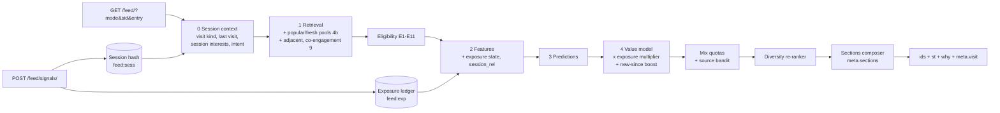
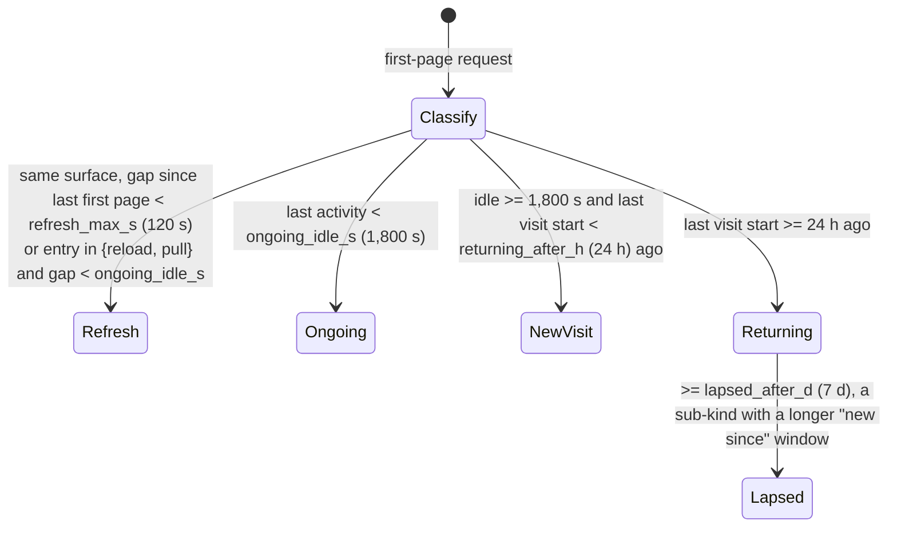

# Tara Intelligence 06: Brief 2 addendum (intelligent, fresh home feed)

This addendum answers [00b-brief-2-intelligent-feed.md](00b-brief-2-intelligent-feed.md). It **extends** [02-architecture.md](02-architecture.md) and [03-database-design.md](03-database-design.md); nothing here replaces a section of either. Where it changes a default from 02, the change is called out and goes through the central config (decision 20). The work packages are in [07-brief-2-plan.md](07-brief-2-plan.md).

All measurements were taken read-only on the dev stack on 2026-11-05 (synthetic seed, 2,470 posts, 39,560 `feed_item` rows at measurement time). **Population, reconciled:** the dev identity database holds 852 accounts at 17:08 UTC (795 when README §4 was written; e2e and test registrations keep adding accounts); `scripts/seed/seed_dataset.py` creates 120 of them (`--accounts`, default 120); `feed_item` has 465 distinct recipients, of which 128 at measurement time (129 at 17:08) hold ≥ 20 rows, mostly the seed accounts plus dev and test accounts that follow them. "Median 276.5" below is over the 120 seed users; "114 of 128" is over recipients with ≥ 20 rows. Line numbers refer to the working tree on `feat/web-social-platform`; where the phase-2 work moved a line, the `HEAD` number is given too.

---

## 1. Root cause: why the home feed repeats and feels static

### 1.1 Measurements

Five seed users (esraa_elsayed.001, sara_salah.089, amr_kamel.088, esraa_nabil.018, adham_abdelaziz.093). One "open" is a fresh login followed by the first 3 pages of 20; 4 opens per mode, 5 s apart.

| Metric | Result |
|---|---|
| Jaccard of page 1, open 1 against opens 2 to 4 | **1.0** in every mode, for all 5 users. Same order every time |
| Jaccard of the first 3 pages (60 items) | **1.0** everywhere |
| Crawl the whole inventory, then reopen | Page 1 unchanged (Jaccard 1.0). Nothing remembers what was served or seen |
| Same rows, `rank_items` at now + 1 h / 6 h / 24 h / 72 h / 168 h | Top-20 Jaccard 1.0 / 1.0 / 0.905 / 0.905 / 0.905. Time alone barely changes anything |
| Recommended items (anything but self, friend, follow) | **0** in every mode, for every user |
| Inventory per user | 88 to 607 rows (median 276.5 across all 120 seed users). 114 of 128 recipients with ≥ 20 rows have fewer than `FEED_RANK_WINDOW = 500` |
| Reach of the public inventory (esraa) | 1,949 public live posts by 272 authors; only 494 can reach her Home. **1,455 (75%) from 232 authors never can**, including 99 videos and 74 reels |
| End of inventory | `has_more=false`; the next open starts the same list again |
| Author diversity on page 1 | Up to 17 of 20 items from one author (sara, `for_you`); 20 of 20 (adham, `following`). 4 to 9 distinct authors per page |
| Session replaced mid-scroll (D4) | Page 2 with the old cursor returns `fallback: true` and **1 to 4 posts already on page 1** |
| Reels `for_you`, 3 opens | Jaccard 1.0; one global list of 107 to 109 |
| Reels already watched | esraa has `reel_view` rows for 37 reels. All 37 are still served, and **the reel at position 0 is one she watched** (others at 20, 24, 26). 3,958 views from 124 viewers exist and none are used |
| Videos (`/posts/?type=video`) | Jaccard 1.0, identical for every user (global list of 108). Page 1 holds 13 items, not 20, because visibility is filtered after paging |
| Latency | Median 8 to 19 ms per page. Speed is not the problem |
| `redis-hot` | 7 `feed:rank` keys, about 16.5 KB each, 1.23 MB of 128 MB used |

### 1.2 Causes, most important first

| # | Cause | Evidence |
|---|---|---|
| R1 | **No recommendation source exists.** Candidates are only the viewer's fan-out rows | `feed/models.py:20-25` (reasons `self`, `friend`, `follow` only); `feed/ranking.py:21-24` ("nothing is recommended from outside the viewer's connections"); `ranking.py:66-81` (`_candidates` reads `FeedItem` for `recipient_id`); fan-out `feed/services.py:92-112`, `:154-224` |
| R2 | **Ranking is deterministic and has no exposure memory.** `rank_items` is a pure function of rows and `now`; `first_page` re-ranks from scratch every open; no impression, served or seen table exists | `ranking.py:101-138` ("Same rows and now, same order"), `ranking.py:243-256`; tie-break `ranking.py:97`; `grep -i "seen\|impression" services/feed/feed/*.py` = 0 hits |
| R3 | **The default mode is chronological** and identical by definition until a connection posts | `feed/services.py:450` (`:423` at HEAD) `DEFAULT_MODE = "recent"`; `HomeView.vue:53` (`:52` at HEAD); decision 5 |
| R4 | **No diversity, rotation or "new since last visit".** Per-item score terms only, no author cap, no format mix, no last-visit marker | `ranking.py:126-136` |
| R5 | **Reels and Videos are global newest-first lists** that ignore watch history | `post/reels/services.py:377-393` (`order_by("-created_at", "-post_id")`, `reel_view` unused); `post/posts/services.py:884-898` + `posts/views.py:95-112` (visibility after paging). Home rails reuse them: `ReelsRail.vue:41`, `VideosRail.vue:36` |
| R6 | **Home never refreshes when the user comes back.** `<KeepAlive include="HomeView" :max="1">`; no `onActivated`, no `visibilitychange`, no pull-to-refresh | `App.vue:107`; `HomeView.vue:390` (`onMounted` only). `public/sw.js:18` never caches `/api/`, so the service worker is not a cause |
| R7 | **A realtime push replaces the ranking session (D4)**, so the next scroll falls back to latest order and repeats items | `HomeView.vue:334-337` (`addFromTop` calls `feedService.home(undefined, mode)`), `ranking.py:264-266`; `FeedResponse` in `services/feed.ts:8` has no `fallback`; repeats are hidden only by the on-screen id check (`HomeView.vue:112-113`) |
| R8 | **Planning gap, not a code cause: the plan defers the fix.** "Seen" is only the feature name `seen_before` (02 §6.2) with no Home weight (02 §8.3 has `seen.multiplier` for reels and video only), no WP, no test. Out-of-network pools arrive in phase 9 | 04 phases 4 to 9 |

**Conclusion.** The owner's complaints are structural, not a tuning problem. Even a perfect scorer would rotate through the same 88 to 607 rows. Two things are needed together: **exposure memory** (R2, R4, R7) and **more inventory** (R1, R5). Client refresh (R6) and the default mode (R3) decide whether the user ever sees the difference.

### 1.3 Limits of this evidence

- **What it proves and what it does not.** R1, R2, R4 to R7 are read from the code: no out-of-network source, no exposure memory, no diversity, no refresh on return. The measurements show their effect on a **static synthetic seed** in which no post is created between opens that are 5 s apart; Jaccard 1.0 at 5 s is what any non-random ranker gives. They do **not** show how much a real user's first page changes between real visits.
- **Inventory arrival on dev is not organic.** 37,806 of 39,615 `feed_item` rows (95%) were written on 2026-11-05 and 1,295 of the distinct posts in `feed_item` were created in the 6 h before 17:08 UTC: one seed burst, no steady arrival.
- **Visit gaps on dev are scripted.** identity's `user_session` has 28,415 rows for 827 accounts; the median gap between an account's successive sessions is 1.2 s (p90 7.8 s): logins by scripts and tests, not visits.
- **What closes the gap.** WP 4b.1 commits the measurement script (the investigation's `measure.py` was never committed, so the baseline above cannot be reproduced until it is) and adds two read-only measurements: new `feed_item` rows per recipient per day, and the gap between real visits. Both run on production read-only with the owner's approval; together they decide how much a chronological or ranked feed changes on its own between visits.

---

## 2. Gap matrix summary (brief 2 against 02, 03 and 04)

**F** = covered, **P** = partial, **N** = not covered. The full per-line matrix was produced in the investigation; this is the condensed result.

| Brief part | Status | Main gaps |
|---|---|---|
| 1 Audit | P | No repeat-exposure root cause in 01 (section 1 above fills it) |
| 2 User Interest Engine | P | Medium-term and emerging tiers; `group_join` weight; "topics explored"; search signal blocked by decision 7 (opt-in WP missing) |
| 2 Session Intelligence Engine | **N** | No visit classification, no session interests, no intent, no session history. Only the client's 30-min `session_id` (`signals.ts:26,120-127`) and the 1,800 s ranking key |
| 2 Candidate Retrieval | P | Communities, professional, local; recommended creators beyond `_new`; item-to-item co-engagement |
| 2 Ranking | P | Session relevance and **repeated exposure on Home** missing; no written CF / two-tower / sequence evaluation |
| 3 Feeds | P | Professional **N**; Explore partial (no entities, no topic browsing); Following `light_rank` has no WP |
| 4 Reels and video | P | Seen suppression has a **dependency defect** (WP 5.1/5.2 need WP 6.3); no reels diversity, fresh quota, reels creator history, objectives or guardrails |
| 5 Refresh and rotation | **N** | Refresh on return, pull-to-refresh, cross-session no-repeat, seen states (retrieved is not stored, consumed for text and skipped for posts undefined), decay rule |
| 6 Diversity and exploration | P | Format-run **defect** (WP 4.5 "no 3 consecutive" vs config `max_same_format_run: 3`); uniform ε draw conflicts with "no random content"; no adjacent-topic exploration |
| 7 Scenarios A to F | P | B **N**; dependency defect for A (WP 6.6 needs 9.1 pools); only A has a test |
| 8 Homepage UX | P | Continue Watching, New Since Last Visit, Popular in Communities, Recently Active Creators, Suggested Groups **N**; fixed placement indexes (`HomeView.vue:525-529`); no customization |
| 9 Feedback | P | Hide creator, Mute topic, full Reset recommendations, UI copy separating hide / mute topic / block |
| 10 Data | P | Feed sessions only in Redis 1,800 s; watch history 30 days |
| 11 Analytics | P | Unique exposure, overall CTR, meaningful-interaction rate, creator concentration, freshness, returning-user behaviour, feed load, **repeat-exposure rate** |
| 12 Ideas | **N** | No evaluation (section 15 below) |
| 13 Safety | P | Cross-session duplicates; no rate limit on feed and refresh endpoints; reset is interests-only |
| 14 Testing | P | Refresh, returning users, scenarios B to F |
| 15 Deliverables | P | Session design, homepage redesign, per-feature status format |

**Conflicts to resolve, and how this addendum resolves them:**
1. **`personalization_off` vs "never deliver duplicates".** The aggregator writes nothing for these users (WP 6.3), so they would be guaranteed repeats. Resolution in section 4.6, with an owner decision (README §6).
2. **"No random content" vs ε exploration** (02 §10.3 uniform draw). Resolution: relevance-bounded exploration through the source bandit (section 11).
3. **Format run.** `max_same_format_run` becomes **2** in `home@2b` (07 WP 4b.10) so the WP 4.5 criterion and the 4b config agree. `home@2` belongs to phase 4 and is immutable once active (04 WP 4.1), so the mismatch with 02's `max_same_format_run: 3` (02:347) is logged as a phase-4 finding in `results/phase-04b.md`, not edited by 4b.

---

## 3. Where the additions sit in the pipeline

The four-stage pipeline of 02 §6 is unchanged. Brief 2 adds one context step before retrieval and two steps inside ranking.



---

## 4. Session Intelligence Engine

### 4.1 What a "session" is

Three things already called "session" exist; this section names them so they are not confused:

| Name | Owner | Lifetime | Purpose |
|---|---|---|---|
| Client session `sid` | web, `signals.ts:119-127` (memory only today; `sessionStorage` from 07 WP 4b.2) | New after 30 min without a signal, and today also on every reload, new tab or device | Impression dedupe, telemetry grouping; **a hint only** for visit classification |
| Ranking session | feed, `feed:rank:{surface}:{viewer}` (WP 4.10) | 1,800 s | Pager for pages 2+ |
| **Visit** (new) | feed, `feed:sess:{viewer}` + `intel_feed_session` | From the first request after idle to the next idle | Visit kind, last visit, session interests, intent, exposure context |

### 4.2 Visit classification

The client sends `sid` (its telemetry session id) and an `entry` hint on every first-page request: `nav` (in-app navigation), `load` (full page load), `reload` (browser reload, from `performance.getEntriesByType("navigation")`), `return` (tab became visible after idle), `pull` (pull-to-refresh). **The server decides the kind from its own timestamps**; the hint only separates a deliberate refresh from navigation. A wrong or forged hint can at most change which of the viewer's own items are rotated, never eligibility.



`last activity` is the latest of: a first or next page on any surface, or a signal batch received (`feed-signals` updates it). All thresholds live in a new `session` block of the home config (decision 20):

```json
"session": {
  "refresh_max_s": 120, "ongoing_idle_s": 1800, "returning_after_h": 24, "lapsed_after_d": 7,
  "new_since": {"max_items": 30, "lapsed_max_items": 60, "min_to_show": 3, "boost": 0.6, "max_age_h": 168},
  "session_interest": {"half_life_min": 20, "max_keys": 10, "k": 3.0, "min_events": 3},
  "refresh_after_s": 600, "auto_refetch_after_s": 1800
}
```

`ongoing_idle_s` equals the client's `sessionIdleMs` (30 min), but a new client `sid` and a new visit do **not** coincide: `sessionId` lives in memory only (`signals.ts:119-127`), so every reload, new tab or new device starts a new `sid` and clears the impression dedupe. Therefore: (1) the kind is computed from server timestamps only (`feed:sess`), and `sid` and `entry` are hints; (2) `sid` moves to `sessionStorage` (07 WP 4b.2) and survives reloads in the same tab; (3) duplicate impressions from reloads or several tabs are folded server-side: the ledger counts one exposure per (item, visit), section 5.2.

**What each kind changes:**

| Kind | Ranking | "New since" marker | Session interests | Exposure |
|---|---|---|---|---|
| Refresh | Re-rank; items displayed in the last minutes get the in-visit multiplier (section 5.3), retrieved-but-not-displayed items keep their place; new eligible items since the session start go first | Not moved | Kept | Unchanged |
| Ongoing (navigating back) | No re-rank if the ranking session is alive and the client still holds the list (KeepAlive); otherwise as Refresh | Not moved | Kept | Unchanged |
| New visit | Full re-rank with exposure multipliers | Moved: `last_visit_at` = previous visit start | Decayed by elapsed time | Applied |
| Returning / lapsed | Full re-rank; "new since last visit" block first (section 6.2) | Moved | Reset to empty, long-term profile only | Applied |

### 4.3 Storage

Three `redis-hot` keys, each built with `hot().make_key(...)` (the cache prefix and version, as `pool_keys` does at `intel/hot.py:47-53`) because they are written with the raw client (`APPEND`, `HSET`); `forget_account` deletes them by that raw name (07 WP 4b.0):

| Key | TTL | Fields | Size |
|---|---|---|---|
| `feed:sess:{viewer}` (hash) | 8 days, so a returning user within a week is classified without a DB read | `sid` (last client session id), `visit_id`, `visit_ord` (visit counter mod 32), `visit_started_at`, `last_activity_at`, `prev_visit_started_at`, `kind`, `first_page_at:{surface}`, per-visit counters `fp` (first pages), `rf` (refreshes), `dc` (displayed), `cc` (consumed) | about 250 B payload, about 0.3 KB with hash overhead |
| `feed:si:{viewer}` (hash) | `ongoing_idle_s + 4 × session_interest.half_life_min` = 1,800 + 4,800 = **6,600 s**: after that the vector has decayed below 1/16 and the visit is over, so nothing behavioural outlives the visit by more than about 2 h | `si` (session interest vector, section 4.4), `intent` (section 4.5) | about 0.4 KB (3 dimensions × ≤ 10 keys × about 12 B, plus the enum) |
| `feed:head:{surface}:{viewer}` (string) | 8 days | The last first page's top 20 as 8-byte id prefixes, for the overlap metric and carry-over (section 5.4). One key per surface actually used, so a Home-only user holds one | 160 B, about 0.25 KB with overhead |

Under `personalization_off` only `visit_started_at`, `last_activity_at` and `prev_visit_started_at` are written, and only once decision 24 is recorded; `si`, `intent`, the counters and `feed:head` are never written (section 5.6).


**Optional durable summary `intel_feed_session`** (new, `feed_db`): one row per visit, written at visit start (one `INSERT`) and closed lazily at the next visit start (one `UPDATE` that also flushes the Redis counters `fp`, `rf`, `dc`, `cc`). That is **2 SQL writes on a new-visit first page and 0 on every other request**; the counters are never written to SQL per request. It backs "last visit" when the Redis hash has expired (lapsed users), the session history the brief asks for, and the returning-user metrics. It never holds item ids. Schema in section 13.

### 4.4 Session interest vector

- **Inputs, at ingest time** (in `feed-signals`, not in the 60 s aggregator, so a refresh a minute later sees it), taking each item's topic, format and author from the **serve token v2** (07 WP 4b.16) so ingest needs no read: consumption-grade events only: `post_open`, `feed_dwell` ≥ `consumed_dwell_ms`, `video_complete`, `video_rewatch`, likes, comments, shares and saves (bus events update it in the consumer). An impression adds nothing (02 §6.2 rule kept). `video_skip` and fast dwell subtract weakly (−0.3). **Dwell-only consumption** (no open, no action) counts `session.dwell_only_weight` (0.3) against 1.0 for an explicit action, and a hide or report subtracts 1.0, so attention-holding bait cannot dominate the vector (brief Part 11).
- **Dimensions:** `topic` (after phase 6; before, hashtags via aliases), `format`, `creator`. At most `max_keys` = 10 keys per dimension, smallest evicted.
- **Decay:** `v_now = v · 2^(−Δt / half_life_min)` with a 20-minute half-life, lazily, like the profile (02 §13).
- **Use:** a new ranking feature `session_rel(item)` with the same shape as `interest_rel`, gated by `min_events` (3) so one click does not flip the feed. Weight `weights.session` (default 0.8 in `home@3`, 0 in `home@2b`). The tech-to-cooking example: three cooking consumptions in 10 minutes give cooking items `session_rel ≈ tanh(3/3) = 0.76`, about half the weight of a long-term interest, so cooking rises gradually and technology stays.
- **Privacy:** the vector lives in `redis-hot` only (`feed:si`, TTL 6,600 s), never in analytics, never in staff "explain ranking" output (decision 17). Under `personalization_off` it is not written. Sensitive topics are not counted without the opt-in (decision 12).
- **What it is:** a rule (decayed counters), not a learned model; "Session Intelligence Engine" is the name of the component, not a claim of machine learning.

### 4.5 Intent signal (v0, rules, shadow first)

An enum chosen by **hand-written rules** (not a model) from context the server already has; no search text (decision 7). It is stored in `feed:si` (TTL 6,600 s) and in `intel_feed_session.intent`, and is excluded from staff "explain ranking" output (decision 17):

| Intent | Rule (first match wins) | Overlay when active |
|---|---|---|
| `catch_up` | Visit kind returning/lapsed and `new_since_count ≥ min_to_show` | New-since block first; connected share +0.1 |
| `browse_video` | ≥ 3 of the last 5 consumptions are video or reel | `max_same_format_run` 3 for video; videos rail placed early |
| `topic_focus` | One topic ≥ 60% of session interest mass with ≥ 3 events | `max_topic_share` 0.5; adjacent-topic exploration on |
| `explore` | Entry from Discover/Explore, or ≥ 2 consumptions of recommended items | Recommended share +0.1 (bounded by the user's discovery level) |
| `none` | Otherwise | none |

**Overlays are config** (`intent_overlays` block) and ship with weight 0: the intent is computed and logged into the visit row and serve tokens, but changes nothing until a readout on real data justifies it (promotion gate in section 15, idea 1).

---

## 5. Exposure ledger

### 5.1 States

| State | Definition | Source (phase-2 signals) | Notes |
|---|---|---|---|
| `retrieved` | The item was in a first page or later page served to the viewer | The ranking session itself (`feed:rank:*`, WP 4.10) and `head:{surface}` | **Never treated as seen.** Used only to know what was offered |
| `displayed` | ≥ 50% visible for ≥ 1 s | `feed_impression` (`useImpression.ts:10`) | |
| `skipped` | Displayed with dwell < `skip_dwell_ms` (1,500 ms) and no interaction; or `video_skip` | `feed_dwell` (new) / `video_skip` | A post scrolled past in under 1 s is not even displayed |
| `viewed` | Opened, or dwell ≥ `viewed_dwell_ms` (3 s) | `post_open`, `feed_dwell` | |
| `consumed` | Text/image: dwell ≥ `consumed_dwell_ms` (8 s, scaled by the excerpt length bucket carried in the serve token v2; marked **dwell-only**) or any like/comment/share/save; video/reel: `video_complete` (≥ 0.9 × duration) or watch ≥ 30 s for long video | `feed_dwell`, `video_complete`, `video_progress`, bus events | |

The highest state reached wins; a later lower state never downgrades it. **New client event `feed_dwell`** `{item, st, dwell_ms}`: sent once per (session, item) when the card leaves the viewport or the page hides, with `dwell_ms` = accumulated ≥ 50%-visible time, clamped server-side by the existing wall-clock check (02 §12.2). It is a client event type added to `CLIENT_EVENT_TYPES` (`intel/models.py:93-104`) and to `validate.py`; event weight 0 (it feeds states, not interests, except through `consumed`).

### 5.2 Storage: hot ledger plus the durable aggregate

- **Hot: `feed:exp:{viewer}`** (raw key via `hot().make_key`), a Redis string used as an append log of 13-byte records: 8-byte item id prefix, 4-byte epoch minute, 1 byte = state (bits 0-2) + `visit_ord` (bits 3-7, the visit ordinal mod 32 that the serve token v2 carries). `feed-signals` appends with one Lua call per batch (`APPEND` + the `feed:sess`/`feed:si` updates, one round trip, no read). **Compaction happens at ingest**: when the length `APPEND` returns exceeds `2 × exposure.ledger.cap × 13` B (5,200 B at `cap` 200), ingest folds and rewrites the log (one GET + SET, rare), so a reels-only or long-scrolling user who never opens a Home first page cannot grow it without bound. The ranker reads it with one `GET` per first page and folds it. TTL `exposure.ledger.ttl_h` (36 h), refreshed on write. **Size ≤ 2.6 KB per viewer** compacted, **never above 5.2 KB**. A 64-bit prefix collision within one viewer's 200 items is negligible and harmless (one extra demotion). The 13-byte layout is a versioned wire format (codec version in the key suffix), not a tunable value.
- **Fold and `exposures`.** Per item: the highest state wins, the latest minute is kept, and `exposures` = the number of distinct `visit_ord` values in which the item reached at least `displayed`, capped at 2. A reload or a second tab in the same visit therefore adds no exposure (the server, not the client, deduplicates per (item, visit)). The compacted record keeps the count in bit 7 (0 = one exposure, 1 = two or more).
- **Durable: `intel_user_item_engagement`** (03 §2.5, modelled at `intel/models.py:201-223`; the table exists in dev with 2 weekly partitions and **0 rows**, because nothing fills it before WP 6.3) gains `dwell_ms`, `state`, `last_displayed_at` and `visits` (section 13). **WP 6.3 arrives in phase 6, so 4b pulls forward its engagement part as 07 WP 4b.13**: a 60 s idempotent job that fills only this table (and honours `personalization_off`, `reset_at` and the synthetic rule); WP 6.3 later extends the same job. Without it a consumed item would return at `m = 1` once its 36 h Redis record expired, contradicting section 5.3 and scenario C. The ranker reads the table for items older than the hot window in the **same single `IN` query** the `seen_before` feature already needs (02 §6.2), so no new query is added.
- **Why not one or the other.** Keeping the whole recovery window in Redis would need a 13-day TTL (section 5.3): about 30k WAU × 2.6 KB = 78 MB compacted and 156 MB worst case at 10k DAU, for data Postgres already holds. Postgres alone misses the last 60 s, so a refresh would repeat what was just displayed. The split keeps the ledgers to about 39 MB (78 MB worst case) and keeps the 60 s path.
- **Fail-soft.** `redis-hot` runs `noeviction` (`infra/compose/docker-compose.yml:103-107`, `docker-compose.dokploy.yml:518-523`): when full it refuses writes. Every ledger and session write in ingest and in the first page is fail-soft: the error is counted (`intel_hot_write_failed_total{key}`), the SQL part commits, ingest still returns 202, and the first page ranks without the missing state. This amends the `POST /feed/signals/` row of 02 §22 ("none (no Redis)") to "1 Redis round trip, fail-soft".
- **Redis budget at 10k DAU** (assumptions: about 15k viewers active within 36 h, 25-30k WAU for the 8-day keys):

| Item | Typical | Worst case |
|---|---|---|
| Ranking sessions `feed:rank:*` (04 WP 13.2) | 70 MB | 70 MB |
| Ledgers `feed:exp` (15k × 2.6 KB; uncompacted 5.2 KB) | 39 MB | 78 MB |
| `feed:sess` (30k × 0.3 KB) | 9 MB | 9 MB |
| `feed:head` (30k × 0.25 KB, Home; other surfaces only when used) | 8 MB | 15 MB |
| `feed:si` (users active in the last 2 h, about 4k × 0.4 KB) | 2 MB | 2 MB |
| Pools and profiles | 8 MB | 8 MB |
| Brief-3 trending zsets (08 §3.12 hard budget) | 8 MB | 8 MB |
| **Total** | **about 151 MB** | **about 190 MB** |

  With the "≥ 2× headroom" rule of 04 WP 13.2, 256 MB is not enough (1.35×). **07 WP 4b.0 raises `maxmemory` to 384 MB** (`mem_limit` 448m) after checking the Dokploy host's free memory, adds an alert at 80% of `maxmemory`, and 13.2-B2 re-measures under load.

### 5.3 Exposure multiplier (soft suppression with recovery)

```
m(item) = 1 − (1 − m0[state]) · 2^(−Δt / h[state]) ,  then  m := m^min(exposures, 2)
score'  = score · m(item)                       # applied before mix and diversity
```

| State | `m0` | Recovery half-life `h` | In-visit `m0` (displayed within the current visit) |
|---|---|---|---|
| `retrieved` only | 1.0 (no effect) | n/a | 1.0 |
| `displayed` | 0.55 | 12 h | 0.25 |
| `skipped` | 0.40 | 24 h | 0.20 |
| `viewed` | 0.30 | 48 h | 0.15 |
| `consumed` | 0.15 | 96 h | 0.10 |

- Defaults live in a new `exposure` block of each surface config. Reels and video keep their own (`seen.multiplier` 0.2, `rewatch_exempt`), now fed by this ledger instead of WP 6.3 only.
- **Revisit is allowed.** Time for `m` to reach 0.9 with the defaults (`m = 1 − (1 − m0)·2^(−Δt/h)`; with two exposures `m²` must reach 0.9, so `m` must reach 0.949):

| State | One exposure | Two or more exposures |
|---|---|---|
| `displayed` (m0 0.55, h 12 h) | 26.0 h | 37.6 h |
| `consumed` (m0 0.15, h 96 h) | 296 h = **12.35 days** | 389 h = **16.2 days** |

  (At +11 days a consumed item is at `m = 1 − 0.85·2^(−264/96) = 0.874`.) The acceptance criteria in 07 WP 4b.5 use these computed values. No state is a filter.
- **Conversation exception:** an item that gained ≥ `revisit.new_comments` (5) comments from **distinct, non-suspect accounts** (not the author; 02 §16 `suspect_account_age_hours` / `suspect_burst_per_min`; not under E11) since the viewer's last display, or a reply in a thread the viewer took part in, gets `m := max(m, 0.8)` and the reason code `rec_new_activity`.
- **Fetched is never seen:** the acceptance test in 07 asserts that with no displayed events, a refresh returns the same head (Jaccard ≥ 0.9).

### 5.4 Relevance-aware rotation

Rotation is the result of `score · m`, not a shuffle. Three rules keep it relevant:
1. **Relevance floor.** An item can enter the first `rotation.floor_slots` (10) slots only if `score' ≥ rotation.floor` (0.25) × the `rotation.floor_pct` (95th) percentile score of the viewer's candidates. If too few items pass, the best seen items fill the slots (revisit), never low-quality filler.
2. **Carry-over.** Items that were `retrieved` in the previous head but never `displayed` keep their full score, so a relevant item the user did not reach is offered again first.
3. **Continuation instead of `has_more=false`.** When connected candidates run out, the cursor continues into the pools (section 6.4); when everything eligible has been displayed in this visit, the client gets a `caught_up` marker, then older items in chronological order.

### 5.5 `recent`, `following`, `friends`, `favorites`

The chronological modes stay chronological (04 §0.1, decision 5): **no multiplier and no reordering**. They gain only the "new since last visit" divider and the caught-up marker (section 6.2) and refresh on return. **Rotation, the ledger and the pools therefore act only in `for_you`. Until decision 25 is recorded in 05, the overlap fix applies only to «لك»**; in the default `recent` mode most users will still see the same first page when no connection has posted, and 4b's measurable result there is the exact divider and caught-up marker (07 WP 4b.7, exit item 2).

Because `recent` is the default (decision 5) and the experiment that was meant to change it needs about 1,600 real users per arm (02 §10.2), the default would in practice stay chronological. **Switching the default to `for_you` is a proposal for the owner** (README §6, decision 25); the 4b exit is measured on synthetic data, not on the experiments decision 5 requires, so it is evidence for the owner, not a trigger. The share of recommended items before an experiment can be powered is proposal 23; **until the owner records it, decision 4 binds: `home@2b` ships `mix.recommended = 0.0` (the control arm) and the 15% and 30% arms exist only as config variants** (07 WP 4b.6).

### 5.6 `personalization_off`

These users send no telemetry and the server drops what arrives (02 §13; today the ingest has **no such check**, `grep personalization services/feed/intel` finds nothing, so 07 WP 4b.16 adds it inside the batch-claim `INSERT` at no extra query). For them, **nothing behavioural is written anywhere**: no `intel_signal_event` row, no ledger record, no `feed:si` (session interests, intent), no `feed:head`, no `intel_feed_session` row or counter, no engagement row. Every surface is chronological. They still get refresh on return and pull-to-refresh. **Only if the owner records decision 24** do they also get visit classification and the "new since last visit" divider, through the visit timestamps in `feed:sess` (`visit_started_at`, `prev_visit_started_at`, `last_activity_at`), functional state like a notification read marker. Until then nothing is stored. 04 WP 13.4(6) "`personalization_off` collects nothing" is amended accordingly by 07 WP 13.4-B2, and `test_personalization_off_collection.py` covers SQL and Redis.

---

## 6. Refresh on return, pull-to-refresh and "new since last visit"

### 6.1 Client behaviour (`HomeView.vue`)

| Trigger | Condition | Action |
|---|---|---|
| `onActivated` (KeepAlive) or `visibilitychange` → visible | Away < `refresh_after_s` (600 s) | Nothing |
| Same | Away ≥ 600 s, user scrolled down | `GET /feed/?peek=1` → "N new posts" pill; the list and the scroll position stay |
| Same | Away ≥ `auto_refetch_after_s` (1,800 s) and the list is at scroll top | Silent first page with `entry=return`; the list is replaced, scroll stays at top |
| Pull gesture at scroll top (touch only), or the "refresh" control | always | First page with `entry=pull`; new items inserted at the top, **items already on screen are not duplicated** (id set), scroll anchored to the item the user was on |
| Realtime push (`addFromTop`) | always | `peek=1` (WP 4.7) so the ranking session is never replaced (fixes D4/R7) |
| Next page returns `fallback: true` | always | `FeedResponse` gains `fallback`; the client drops known ids (already) and requests one more page if fewer than 5 new remain |

The two thresholds come from the server in `meta.refresh_after_s` / `meta.auto_refetch_after_s` (the `session` config block), not from client constants.

### 6.2 "New since your last visit"

- `last_visit_at` = start of the previous visit (section 4.2).
- `for_you`: items with `post_created_at > last_visit_at` that pass eligibility get `+boost · relevance` (0.6) and are kept above the first exposure-demoted item, capped at `max_items` (30; 60 for lapsed). They are labelled with the reason code `new_since_visit`.
- All modes: `meta.visit = {kind, since, new_count, anchor_index}` and `meta.caught_up_index`. The web draws a divider «جديد من آخر زيارة» / "New since your last visit" after `anchor_index`, only when `new_count ≥ min_to_show` (3), and a «انت كده شفت الجديد» / "You're all caught up" marker at `caught_up_index`. In `recent` this is the boundary between rows newer than `since` and older ones, so order is unchanged; this is 4b's measurable result in the default mode.
- **`new_count` counts only items that pass eligibility** (the same E-rules as the page), never a raw `FeedItem` count: a raw count would leak how many posts hidden, blocked or restricted authors made. `since` is clamped to `now − new_since.max_age_h` (168 h), which bounds the scan to the `feed_recipient_idx (recipient_id, post_created_at desc)` range.

### 6.3 API deltas for refresh

| Endpoint | Change |
|---|---|
| `GET /api/v1/feed/?mode=…` | New optional `sid` (uuid) and `entry` (`nav, load, reload, return, pull`). `meta` gains `visit`, `refresh_after_s`, `auto_refetch_after_s`, `caught_up` (bool, on the page where it applies) and keeps `fallback` |
| `GET /api/v1/feed/?peek=1` (WP 4.7) | Gains `since` (epoch from `meta.visit.since` or the session start, clamped to 168 h) and returns `{new_count, ids[]}` of **eligible** items only, without touching the ranking session or ads |
| Rate limits | New throttle scope `feed_first_page`: `session.rate.first_page_per_min` (30) per account (refresh storms), on top of nginx `limit_req`; `feed_peek` `session.rate.peek_per_min` (60); `feed_rail` `session.rate.rail_per_min` (60) for the non-session rail reads of section 9.1; `feed_reset` `reset.min_interval_h` (24 h) |

---

## 7. Interest tiers

Built on top of the planned `intel_user_interest` (02 §13, 03 §2.4); only additions are listed.

| Tier | Representation | Horizon | Use |
|---|---|---|---|
| Session | `feed:sess.si` (section 4.4) | minutes (half-life 20 min) | `session_rel` |
| Short | `short_v` (exists) | 3 days | `interest_rel` (`short_mix`) |
| **Medium** (new) | `mid_v`, `mid_at` columns | 14 days | `interest_rel` gets a three-way mix `{short 0.3, mid 0.3, long 0.4}`; the "Manage interests" view groups by it |
| Long | `long_v` (exists) | 45 days | `interest_rel` |
| **Emerging** (new, derived) | `short/long ≥ emerging.ratio` (3.0) and `short ≥ emerging.floor` (1.5) and ≥ 4 events | read time, no column | Feeds the exploration source (adjacent and topic pools) and the "Topics you may like" section; shown as «اهتمام جديد» in Manage interests |
| Explicit | `source=explicit` rows (exists) | no decay | ×`explicit_multiplier` |
| Negative | Inferred rows below 0, explicit `dislike` / `less` / `suppressed`, and the new `muted` and `hidden` polarities (section 10) | inferred decays; explicit stays | E8 exclusion, demotion |

**New signal weights** (`event_weights`): `group_join` +2 on `group_cat` and the group's topic (from the existing membership read model, WP 3.1), `group_leave` −1, `topic_explore` +0.5 (a Discover/Explore topic page opened; new client event), `search_query` only after the opt-in of decision 7 (new toggle `intel_user_preference.search_signal`, off by default; no WP before phase 8).

---

## 8. Extra feeds as surfaces of one pipeline

Every feed is a `surface` in the same retrieval → eligibility → features → predictions → ranking pipeline, with its own config file (02 §8).

| Surface | Status in 04 | Candidates | Distinctive config (defaults) | Endpoint |
|---|---|---|---|---|
| `home` (`for_you`) | WP 4.3 | all sources | `exposure`, `session`, `sections` blocks added | `GET /feed/` |
| `following` | exists | `follow` rows + `follow_pull` | **`light_rank`** flag (default false): when on, ranks the last 72 h by relationship + freshness only, then chronological | `GET /feed/?mode=following` |
| `groups` | WP 5.3 | joined groups; plus a **"popular in your communities"** pool (public groups in the viewer's `group_cat` interests) | `mix.joined` 0.85, `mix.discover_groups` 0.15 | `GET /feed/groups/` |
| `video` | WP 5.2 | connected + public `type=video` | objectives in section 12; `continue_watching` | `GET /feed/videos/` |
| `reels` | WP 5.1 | connected + public reels pool | objectives in section 12 | `GET /feed/reels/` |
| **`professional`** (new) | none | Topics with `intel_topic.family = professional` (business, careers, education, technology, entrepreneurship), page categories mapped to them, groups with category business/education; connections first | `mix.connected` 0.4, `mix.recommended` 0.6; `weights.quality` 1.2, `weights.originality` 0.8, `bait_multiplier` 0.5; freshness half-life 48 h | `GET /feed/professional/` |
| **`explore`** (WP 9.3 Discover, extended) | partial | content pools, trending engine (decision 19, brief 3), new creators, **entities**: pages, groups, creators; **topic browsing** | sections: trending, topics for you, creators, pages, groups, local trending (from brief 3) | `GET /feed/explore/`, `GET /feed/explore/topics/{slug}/` |

Professional needs the taxonomy (phase 6), so it lands with phase 9.

---

## 9. Homepage sections composer

### 9.1 Registry

| Key | Shown when | Content source | Reason code |
|---|---|---|---|
| `new_since_visit` | Visit kind new/returning/lapsed and `new_count ≥ 3` | Divider only (section 6.2) | `new_since_visit` |
| `continue_watching` | A video watched `sections.continue_watching.min_frac` (10%) to `max_frac` (90%) in the last `window_d` (7) days, not completed, still eligible, **and not in a sensitive topic unless the viewer opted in (decision 12)** | `intel_user_item_engagement` (`max_watch_ms`, `completions`) + hot ledger | `continue_watching` |
| `reels_rail` | ≥ `sections.rules.reels_rail_min` (4) eligible ranked reels | WP 5.1 ranker as a **non-session top-N read** (no `feed:rank:reels` write, throttle `feed_rail`, not counted against `feed_first_page`) | `rec_similar_watched` when applicable and the item is not in a sensitive topic without opt-in |
| `videos_rail` | ≥ `sections.rules.videos_rail_min` (3) eligible ranked videos | WP 5.2 ranker, non-session top-N read as above | same |
| `suggested_people` | `people_suggestions` on, viewer not a minor/unknown age (E9); **minor and unknown-age authors never suggested to adults (E9b)** | graph suggestions (exists) | as today |
| `suggested_pages` | `page_suggestions` on | profile suggestions (WP 9.4) | `rec_topic` |
| `suggested_groups` | `group_suggestions` on | profile group suggestions (WP 9.4) | `rec_topic` |
| `popular_in_communities` | ≥ 1 active membership and ≥ `sections.rules.communities_min_items` (3) items | groups surface pool | `rec_community_popular`, generic text that never names a group |
| `recently_active_creators` | ≥ `sections.rules.active_creators_min` (3) followed creators posted in the last `active_creators_window_h` (24) h | `intel_content_ref` by author; E9b for any non-followed creator | `follow` |
| `trending_topics` | `trending` on | trending engine (brief 3) | `rec_trending` |
| `topics_you_may_like` | ≥ 1 emerging or adjacent topic | interest tiers (section 7) | `rec_topic` |

### 9.2 Placement rules (config block `sections` in `home`)

```json
"sections": {
  "max_first_page": 2, "max_next_page": 1, "max_per_visit": 4,
  "min_index": 1, "min_gap_posts": 6, "not_adjacent_to_ad": true,
  "priority": {"continue_watching": 0.9, "reels_rail": 0.7, "videos_rail": 0.6, "suggested_people": 0.5,
               "popular_in_communities": 0.6, "suggested_groups": 0.4, "suggested_pages": 0.4,
               "recently_active_creators": 0.5, "trending_topics": 0.4, "topics_you_may_like": 0.4},
  "intent_bonus": {"browse_video": {"reels_rail": 0.3, "videos_rail": 0.3, "continue_watching": 0.2},
                   "catch_up": {"recently_active_creators": 0.3}},
  "fatigue_half_life_h": 24
}
```

- Section utility = `priority × context × fatigue`, where `context` is 0 when the "shown when" rule fails and `fatigue` decays a section the viewer scrolled past without interacting (`section_impression` / `section_click` client events, weight 0).
- The server returns `meta.sections = [{key, after_index, endpoint}]` on each page. The web renders by `after_index`, **replacing the fixed indexes** at `HomeView.vue:525-529` (`i === 1`, `i === min(3, …)`, `i === min(2, …)`). Ad slot 4 keeps priority (decision 14).
- Never more than 2 sections on the first page and never two in a row: the homepage is never overwhelming (brief Part 8).

### 9.3 Customization

`intel_user_preference.home_sections` = `{hidden: [keys], pinned: [keys]}`. Each section has a "…" menu with «مش عايز أشوف القسم ده» / "Hide this section"; My Algorithm lists all sections with toggles. A pinned section gets `context ≥ 0.5` whenever its "shown when" rule passes. `PATCH /feed/preferences/ {home_sections}` (undoable through `intel_preference_change`).

---

## 10. Feedback additions

| Action | Semantics | Storage | Effect | Undo |
|---|---|---|---|---|
| **Mute topic** (post menu, and Manage interests) | "Stop showing me this topic", chosen from the item's top topics (≤ 3 shown) | `intel_user_interest` explicit row, new polarity `muted`; `intel_feedback_action.action = mute_topic` | Excluded from every recommended source (E8) **and** ×0.3 on connected items with that topic as primary (≥ 0.6 confidence). Stronger than `dislike`, which only excludes from recommended | Toast; Manage interests |
| **Hide creator** (post menu, on recommended items and on profiles) | "Don't recommend this creator, keep following if I do" | `intel_user_interest` dim `creator`, polarity `hidden`; action `hide_creator` | Removed from every recommended source, people suggestions and rails on all surfaces. Connected posts of a followed creator still show. Differs from Snooze (30 days, everything), Mute (everything, open-ended) and Block (both ways, social) | Toast; Manage interests > Hidden creators |
| **Reset recommendations** (My Algorithm, confirmation dialog with the scope listed) | Start recommendations over | `intel_user_preference.reset_at`, `intel_preference_change(source=reset)` | Deletes, asynchronously (Celery; one `DELETE … WHERE account_id` per weekly partition of `intel_user_item_engagement`, about 5): inferred interest rows (all tiers), `feed:si`, `feed:sess`, `feed:head:*`, the hot ledger `feed:exp`, the **ranking sessions `feed:rank:*`** (they carry factor and reason codes), the **profile cache `intel:prof:{account}`**, the account's **`intel_feed_session` rows** and its `intel_user_item_engagement` rows; decayed affinity is reset to the fan-out prior; feedback-derived deltas are dropped. Raw `intel_signal_event` rows older than `reset_at` are excluded from the aggregator, **from phase-11 training and from phase-12 calibration** (they expire with the 30-day retention). **Reels:** post keeps `reel_view` (view counts) but ignores rows before `reset_at` for the seen order, from a `feed.recommendations.reset {account_id, reset_at}` event (ids only). **Kept:** explicit topics, follows, friends, blocks, mutes, hides, reports and Not interested on specific items (safety and explicit choices). At most one reset per `reset.min_interval_h` (24 h) | Not undoable (stated in the dialog) |
| **Manage interests** | Inspect and edit by tier | `GET /feed/preferences/profile/` gains `tier` per row (`emerging`, `short`, `medium`, `long`, `explicit`, `negative`) and lists muted topics and hidden creators | Edit = explicit row; delete = `suppressed` marker (02 §13) | Per change |

**UI copy** (ar / en), shown in the confirmation toast of each action:
- Hide post: «البوست ده مش هيظهر لك تاني» / "You won't see this post again."
- Not interested: «هنقلل البوستات اللي زي دي» / "We'll show fewer posts like this."
- Mute topic: «مش هنرشّح لك محتوى عن {الموضوع}، وبوستات أصحابك عنه هتنزل تحت» / "We won't recommend {topic}; your connections' posts about it will rank lower."
- Hide creator: «مش هنرشّح لك {الاسم} تاني. لو بتتابعه، بوستاته هتفضل توصلك» / "We won't recommend {name}. If you follow them, you'll still see their posts."
- Block: «{الاسم} مش هيقدر يشوفك أو يكلمك، وانت كمان» / "{name} can't see or contact you, and you won't see them."

**New reason codes** (02 §20): `rec_community_popular` («منتشر في جروبات انت فيها»), `rec_similar_watched` («شبه فيديوهات اتفرجت عليها»), `new_since_visit` («جديد من آخر زيارة»), `continue_watching` («كمّل المشاهدة»), `rec_new_activity` («فيه كلام جديد على بوست شفته»), `rec_adjacent_topic` («قريب من مواضيع بتحبها»).

**Sensitive inferences in reasons and sections.** WP 4.8 masks sensitive topics only in `rec_topic`. Three of the new codes reveal watching or reading history on the Home screen, which anyone looking at the screen can see: `rec_similar_watched`, `continue_watching` and `rec_new_activity` ("a post you saw"). For an item in a sensitive topic (decision 12) without the viewer's opt-in, these codes are replaced by the generic `rec_generic` («مقترح لك» / "Suggested for you") and the item never enters Continue Watching. `rec_community_popular` always uses the generic sentence and never names a group, so a private or hidden group membership cannot show. Golden tests in 07 WP 7.6-B2.

---

## 11. Exploration: a bandit over sources

**Replaces** the uniform ε draw of 02 §10.3 (the "no random content" conflict).

- **Arms** = recommended sources per surface: `popular`, `fresh`, `topic_pools`, `adjacent_topics` (siblings and parent of the viewer's top topics via `intel_topic.parent_id`), `new_creators`, `trending`, `co_engagement` (item-to-item, section 14), `communities`.
- **Policy:** a deterministic **Bayes-UCB** rule on `Beta(α, β)` per (surface, lang, arm): each arm's score is the `bandit.quantile` (0.8) quantile of its posterior, recomputed hourly, no sampling. **Global, not per user** (per-user data is too thin and per-user bandits are hard to explain). **Reward** per displayed recommended impression = explicit action (like, comment, share, save, open) 1.0 + dwell-only consumption `bandit.dwell_only_weight` (0.3) − 2.0 × (hide, report, not interested); counted only for non-suspect, non-synthetic accounts (02 §16, E11). **Position correction:** an arm placed lower earns less for that reason alone, so each impression's reward is divided by the prior of its slot bucket (`bandit.position_buckets`: 1-5, 6-10, 11-20; priors measured per surface, 1.0 / 0.6 / 0.35 until measured). Counts over a `bandit.window_d` (14) day sliding window, with a prior of `bandit.prior` `Beta(2, 20)`.
- **What it decides:** only how the **recommended share** is split between arms, within per-arm bounds `[min_share, max_share]` from config (for example `new_creators ≥ 0.2`, honouring 02 §10.3 fair reach; `trending ≤ 0.3`). It never changes the connected/recommended ratio (the user's discovery level and the experiment) and never relaxes eligibility.
- **Within an arm the item is the top-scored eligible item above the quality floor.** Nothing is drawn at random, neither the arm split nor the item: the same statistics give the same allocation, so it is reproducible and explainable ("this slot came from Trending because Trending is performing well this week"). This is a rule over counters, not machine learning.
- **Exploration of new topics, formats, pages and communities** happens through the `adjacent_topics`, `communities` and `new_creators` arms, plus the emerging tier (section 7), all relevance-bounded.
- **Storage:** `intel_source_stats(day, surface, lang, arm, impressions, rewards, data_origin)` (aggregates, no account ids), rebuilt hourly; current posteriors cached as `intel:bandit:{surface}:{lang}` (hash, about 1 KB).
- Below the ML gate the bandit runs on real data only; with synthetic data it stays at its prior (arms split by `min_share` and the prior means), which the tests use.

---

## 12. Reels and video objectives

| | Reels | Long video |
|---|---|---|
| Primary objective | Satisfied watch: completion normalised by duration bucket + rewatch + share/save − fast skip − hide | Expected watch time (capped at 20 min) × satisfaction, plus completion and resume |
| Seen handling | Ledger states; `seen.multiplier` 0.2, recovery half-life 7 d, `rewatch_exempt`. **Fed by the hot ledger plus `reel_view`**, which removes the WP 5.1 → WP 6.3 dependency defect | Completed videos ×0.2; partially watched (10% to 90%) are not demoted: they go to Continue Watching |
| Fresh injection | ≥ 20% of each 20 reels from items < 48 h old above the quality floor, when available | ≥ 15% < 72 h |
| Diversity | ≤ 1 per author per 5 consecutive; ≤ 3 per page; `max_topic_share` 0.5 | ≤ 2 per author per page |
| Creator history | `creator_relevance` and `history` (02 §8.3) extended to reels | exists |
| Guardrails (per session, in analytics) | skip rate (skips / starts), completions per session, hide rate, top-creator share (≤ 20%), repeat-view rate | average watch fraction, hide rate, repeat-view rate |

**Quick fix before phase 5** (07 WP 4b.9): `reels/services.py::feed_queryset` serves reels the viewer has not viewed in the `reels` config `seen.window_h` (72 h) before viewed ones through a **two-phase keyset pager** (unseen, then seen; cursor `(phase, created_at, post_id)`), because `tara_common` `CursorPagination` takes the cursor position from the first ordering field only (`libs/tara_common/tara_common/pagination.py:24-33`), so a boolean `seen` first key would make every unseen reel tie and be walked by offset, and a view recorded between pages would skip or repeat items. `video_posts_queryset` gains the SQL audience predicate reels already use (`reels/services.py:387-391`) and a bounded over-fetch loop, so `only_visible` (`posts/services.py:901`, Python) never runs on an unpaged table and pages are full. **Ownership after phase 5:** `GET /feed/reels/` (WP 5.1) owns `for_you`; post's ordering stays only as the fallback when feed is unavailable.

---

## 13. Database deltas

All additive; `feed_db` unless stated. In dev, `intel_signal_batch`, `intel_signal_event`, `intel_synthetic_account` and `intel_user_item_engagement` (2 weekly partitions) are already migrated, so the new engagement columns need their own migration (07 WP 4b.13). **Every migration below has a forward and backward test on an empty and a populated table** (`test_migrations_b2.py`, brief Part 14), including the `polarity` enum change.

| Table | Change | Notes |
|---|---|---|
| `intel_feed_session` (new) | `id uuid PK`, `account_id uuid`, `client_sid uuid null` (hint only), `kind enum(new, returning, lapsed)`, `entry_surface varchar(12)`, `started_at ts`, `last_activity_at ts`, `ended_at ts null`, `first_pages smallint`, `refreshes smallint`, `displayed int`, `consumed int`, `new_since_count smallint`, `intent varchar(16) null`, `head_overlap real null` (Jaccard with the previous visit's head), `data_origin` | Index `(account_id, started_at desc)`. Retention 30 days (nightly delete; in the 13.4-B2 retention test). No item ids, no topics. About 30k rows a day at 10k DAU. PII: pseudonymous. Deleted on `account.deleted` and on Reset; included in the user's export; excluded from staff "explain ranking" (decision 17). **Not written under `personalization_off`** |
| `intel_user_item_engagement` | Add `dwell_ms int`, `state smallint` (0 displayed, 1 skipped, 2 viewed, 3 consumed), `consumed_dwell_only bool`, `last_displayed_at ts`, `visits smallint` (distinct visits with ≥ displayed, section 5.2) | Same partitioning and retention; filled by 07 WP 4b.13 |
| `intel_user_interest` | Add `mid_v real`, `mid_at ts`; `polarity` enum gains `muted`, `hidden` | Medium tier; mute topic, hide creator |
| `intel_user_preference` | Add `home_sections jsonb default {}`, `reset_at ts null`, `search_signal bool default false` | Sections customization, reset epoch, decision-7 opt-in |
| `intel_feedback_action` | `action` enum gains `mute_topic`, `hide_creator` | |
| `intel_preference_change` | `source` enum gains `reset` | |
| `intel_topic` | Add `family varchar(16) default 'general'` (`professional`, `entertainment`, …) | Professional feed |
| `intel_ranking_config` | `surface` enum gains `professional`, `explore` | Config files `professional.json`, `explore.json` |
| `intel_source_stats` (new) | `day date`, `surface`, `lang varchar(5)`, `arm varchar(20)`, `slot_bucket smallint`, `impressions int`, `rewards real`, `data_origin`; PK on all but the counts | Aggregates only; 400 days (in the 13.4-B2 retention test) |
| `intel_author_ref` | Add `age_class` enum(`adult`, `minor`, `unknown`) default `unknown` | Rule E9b (section 18); captured from the author's own JWT claims; **pending owner decision 37** |
| `intel_daily_metric` | New metric names only (section 14) | k ≥ 20 kept |
| `intel_signal_event` | `event_type` gains client types `feed_dwell`, `topic_explore`, `section_impression`, `section_click` and server type `group_join`/`group_leave` | Validation in `intel/signals/validate.py` |
| post `reel_view` | none (existing index is enough) | Query change only |

**`redis-hot` keys added** (all built with `hot().make_key(...)`, because they are written with the raw client):

| Key | Type | TTL | Size |
|---|---|---|---|
| `feed:sess:{viewer}` | hash | 8 days | about 0.3 KB |
| `feed:si:{viewer}` | hash | 6,600 s | about 0.4 KB |
| `feed:head:{surface}:{viewer}` | string | 8 days | about 0.25 KB |
| `feed:exp:{viewer}` | string (13 B records) | 36 h | ≤ 2.6 KB compacted, ≤ 5.2 KB |
| `intel:bandit:{surface}:{lang}` | hash | 2 h | about 1 KB |

The per-viewer keys join `intel/hot.py::session_keys` / `forget_account` (`intel/hot.py:26-67`). `forget_account` deletes through `hot().delete_many`, which applies the cache prefix, so the keys must be created through `make_key` too; `test_account_deletion.py` asserts on the **raw** stored names (07 WP 4b.0), otherwise deletion would silently leave the ledgers behind. Reset (section 10) deletes the same keys plus `feed:rank:*` and `intel:prof:{account}`.

---

## 14. API deltas

| Method and path | Change |
|---|---|
| `GET /api/v1/feed/` | Params `sid`, `entry`. `meta`: `visit`, `refresh_after_s`, `auto_refetch_after_s`, `sections`, `caught_up`, `fallback` (exists, now typed on the client) |
| `GET /api/v1/feed/?peek=1&since=` | `{new_count, ids}`; never replaces a session |
| `GET /api/v1/feed/sections/{key}/` | Content of one home section (`continue_watching`, `popular_in_communities`, `recently_active_creators`, `topics_you_may_like`, …), each item with `st` and `why` |
| `GET /api/v1/feed/professional/` | New surface |
| `GET /api/v1/feed/explore/`, `GET /api/v1/feed/explore/topics/{slug}/` | Explore v2 (extends `GET /feed/discover/` of WP 9.3, which stays as an alias) |
| `POST /api/v1/feed/feedback/` | `action` accepts `mute_topic` (with `topic` slug, must be one of the item's topics) and `hide_creator` |
| `POST /api/v1/feed/preferences/reset/` | `{scope: "recommendations", confirm: "<token from GET>"}`; two-step to avoid accidental resets |
| `GET /api/v1/feed/preferences/profile/` | Rows gain `tier`; lists `muted_topics`, `hidden_creators` |
| `PATCH /api/v1/feed/preferences/` | `home_sections`, `search_signal` |
| `POST /api/v1/feed/signals/` | Accepts `feed_dwell`, `topic_explore`, `section_impression`, `section_click` |
| post `GET /api/v1/reels/?tab=for_you` | Seen-last-3-days reels after unseen (phase 4b quick fix) |

---

## 15. Analytics additions (02 §21)

| Metric | Definition | Target direction |
|---|---|---|
| `repeat_exposure_rate` | Displayed impressions of items the same user already had displayed in the previous 24 h without interaction, over all displayed impressions; reported for first-page impressions and for all pages | Down; < 5% of **first-page** impressions (scenario C uses the same 5% on first pages and ≤ 10% over all pages) |
| `first_page_overlap` | **Median** (p90 also reported) Jaccard between a visit's first-page head and the previous visit's (from `intel_feed_session.head_overlap`), new/returning visits only, per mode | ≤ 0.3 in `for_you` (the same statistic as the 07 exit) |
| `unique_exposure` | Distinct items displayed per user per day | Up |
| `ctr_overall` | Opens / displayed impressions, all sources | Watch, not a goal alone |
| `meaningful_interaction_rate` | (comments + shares + saves + explicit-action consumption + 0.3 × dwell-only consumption) / displayed | Up |
| `dwell_only_share` (guardrail) | Dwell-only consumptions / all consumptions | Bounded; a rise with flat explicit actions flags bait |
| `negative_feedback_rate` (guardrail) | (hides + reports + not interested) / displayed, per source | Down; a source above 2× the surface mean is reviewed |
| `creator_concentration` | Share of impressions to the top 10% of creators; Gini over authors | Down / bounded |
| `freshness` | Median age of displayed items; share displayed < 24 h old | Balanced |
| `new_since_hit_rate` | Returning visits where ≥ 1 new-since item was consumed / returning visits with `new_count ≥ 3` | Up |
| `returning_users` | D1 and D7 return rate per weekly cohort; visits per user per week | Up |
| `inventory_exhaustion_rate` | Visits that hit `caught_up` | Down |
| `feed_load_p95` | First and next page p95 per surface (Prometheus, copied nightly) | Within 02 §22 budgets |
| `reels_skip_rate`, `reels_completions_per_session` | Section 12 guardrails | Skip down, completions up |
| `bandit_arm_share` | Recommended impressions per arm | Observed |
| `section_ctr` | `section_click / section_impression` per section | Observed |

All metrics stay aggregate with k ≥ 20 at write time and fixed slices (02 §21). Time spent is not an objective (brief Part 11): dwell is only a weak consumption signal, weighted below explicit actions everywhere it is used (session interests, bandit reward, this table), and the two guardrails watch it.

---

## 16. Scenarios A to F

| Scenario | Handling | Test (07) |
|---|---|---|
| **A, new user** | Optional topic picker (WP 6.6); with no profile, recommended slots come from the `popular` and `fresh` pools pulled forward into phase 4b (resolves the WP 6.6 → 9.1 dependency), in `Account.language`; suggested groups and people sections; never empty | `test_scenario_a_new_user.py`: page 1 has 20 items, ≥ 60% recommended, all eligible |
| **B, returning after days** | Visit kind returning/lapsed; new-since block first (up to 60 for lapsed); unseen relevant connected items carried over; "Recently active creators" section; followed accounts' changes | `test_scenario_b_returning.py`: after a 3-day clock jump, page 1 starts with items newer than the last visit, and `meta.visit.new_count` equals the query count |
| **C, very active user** | Exposure ledger removes displayed items; pool continuation instead of `has_more=false`; bandit widens arms; `caught_up` marker honest | `test_scenario_c_heavy.py`: 5 visits × 3 pages with impressions, under `home@2b-r15`: repeat-exposure rate ≤ 5% on first pages and ≤ 10% over all pages while eligible unseen inventory remains; a consumed item does not return within 12 days (durable state of 07 WP 4b.13) |
| **D, interest shift** | Session vector reacts within minutes; medium tier within days; long tier keeps older interests | `test_scenario_d_shift.py` **under `home@3`**: after 4 cooking consumptions, cooking share of page 1 rises by ≥ 2 items and technology keeps ≥ 30% |
| **E, few friends** | Connected share flows to recommended when connections run out (02 §10.1); communities and creators arms | `test_scenario_e_few_friends.py`: a user with 2 connections gets a full, non-repeating page across 3 visits |
| **F, one strong topic** | `max_topic_share` 0.4; adjacent-topic arm; emerging tier | `test_scenario_f_one_topic.py`: page 1 has ≥ 2 topics besides the dominant one when the pools have them |

---

## 17. Part 12: evaluation of the 12 ideas

| # | Idea | How it works in Tara | Complexity | Benefits | Risks | Verdict | Promotion gate |
|---|---|---|---|---|---|---|---|
| 1 | Intent-aware | Rule-based intent enum (section 4.5) from visit kind, entry surface and the last 5 consumptions; selects config overlays | M | Feed reacts within a visit | Misclassification feels erratic; unmeasurable on synthetic data | **Later** (computed and logged in shadow from phase 6; overlays at weight 0) | ≥ 30 days of real signals; entry-context groups differ ≥ 10% in meaningful-interaction rate and an offline replay of the overlay raises it |
| 2 | Contextual sessions | Session Intelligence Engine (section 4) + exposure ledger (section 5) | M | Fixes the owner's top complaint (repeats, static Home) | Redis memory (384 MB, section 5.2); thresholds untuned until real data; in `for_you` only until decision 25 | **Initial release** (phase 4b) | Success: first-page repeat-exposure rate < 5%, median first-page overlap ≤ 0.3 in `for_you` |
| 3 | Interest evolution | Short/medium/long accumulators + derived emerging tier (section 7) | S | Covers scenarios C, D, F; explainable | Filter bubble from short-term weight; decay untestable on 3-day-old dev data (backdated fixtures needed) | **Initial release** (phase 6) | Tune half-lives after ≥ 45 days of real data by replay |
| 4 | Cross-format | Topic and creator dimensions are format-agnostic; reels interest lifts long videos | S (transfer), M (learned transitions) | Lifts the 132 videos and 109 reels | Some users never want video; the format dimension must win | **Initial** for transfer; **later** for learned transitions | ≥ 20% of WAU use ≥ 2 formats and injected cross-format CTR ≥ 0.8 × same-format CTR |
| 5 | Knowledge graph | Keep `intel_topic.parent_id` + aliases as a lite KG | L | Better "related" | Curation cost, sensitive edges, latency | **Not now** | Taxonomy > 200 topics and related-topic CTR < 0.5 × same-topic CTR |
| 6 | Semantic discovery | CPU sentence encoder + pgvector | L | Covers the 74.5% of posts without hashtags | No pgvector today (`search_db` has `plpgsql`, `pg_trgm` only), ~1 GB image growth, opaque similarity, contradicts 02 §23 | **Later** (after phase 11) | Topic coverage still < 60% after lexicons, and embeddings beat topic-Jaccard by ≥ 15% precision@10 offline |
| 7 | Explanations | 02 §20 + new reason codes (section 10) | S to M | Trust, feedback, debugging | Leaking private signals or detector names | **Initial release** (phase 4) | Golden test that reasons match top factors |
| 8 | Fresh-content opportunities | `fresh` pool per surface/lang with an impression budget (first 50 impressions spread over matching viewers), quality floor and integrity gates; graduates into popular/trending by Beta posteriors | M | New creators and content get a fair test; feeds the `fresh` bandit arm | Spam floods; mitigated by `max_posts_24h`, SimHash, suspect-engagement rules | **Initial release** (basic `fresh` pool in 4b; budgets in phase 9) | n/a |
| 9 | Personal content modes | User-chosen presets ("Catch up", "Learn", "Relax", "Videos") that apply an intent overlay explicitly | S once overlays exist | User control without inference; no creepiness | Mode sprawl next to the 5 feed modes | **Later** (phase 8 follow-up, as My Algorithm presets) | Intent overlays validated (idea 1) and ≥ 10% of users change a My Algorithm setting |
| 10 | Adaptive feed composition | Mix quotas + source bandit (section 11) + sections composer (section 9) | M | Home adapts to what works, bounded by user controls | Feedback loops; mitigated by bounds and global (not per-user) arms | **Initial release** (phase 9) | n/a |
| 11 | User-controlled algorithms | My Algorithm (02 §19) + mute topic, hide creator, reset, sections | S to M | Control and trust | Settings nobody finds | **Initial release** (phases 7 and 8) | n/a |
| 12 | Cross-platform intelligence | `market_cat` dimension and the viewer-only interest summary (02 §7.1); marketplace recommended sort (WP 9.6) | M | Social interests improve marketplace and vice versa | Privacy across sections; commerce intent is sensitive | **Later**, beyond WP 9.6 | ≥ 15% of WAU active in both social and marketplace in a week, and a replay shows lift |

**Ranking-approach evaluation** (brief Part 2.4), recorded here as asked:

| Approach | Fit at Tara's scale now | Decision |
|---|---|---|
| Rule-based value model (02 §6.4) | Works with zero real data; explainable | **Now** |
| Item-to-item co-engagement (collaborative filtering by rules: items co-consumed by ≥ 3 users in 7 days) | Cheap set-based SQL over `intel_user_item_engagement`, nightly, top 20 neighbours per item | **Phase 9** as the `co_engagement` arm |
| Content-based (topics, creators, formats) | The interest profile | **Phase 6** |
| Learning-to-rank / GBDT | Needs the ML gate (100k impressions) | **Phase 11** |
| Two-tower retrieval | Needs embeddings, vector index, millions of interactions | **Not now** (same gate as idea 6) |
| Sequence-aware models | Needs long sequences of real sessions | **Not now**; the session vector is the rule-based stand-in |
| Contextual bandit per user | Too sparse; global source bandit instead (section 11) | **Not now** |

---

## 18. Safety and privacy of the additions

- Eligibility (02 §11) runs before every new source, section and rail; the property test of WP 3.5 gains the `popular`, `fresh`, `adjacent_topics`, `co_engagement` and section sources.
- The ledger, session hash and session vector are per-viewer, short-lived, in `redis-hot` only, never in analytics, and removed on account deletion and on Reset.
- Co-engagement neighbours are computed over public, eligible items only and never reveal who consumed them (minimum 3 distinct users per pair).
- Minors and unknown age **as viewers** (E9): no people section, no `communities` arm outside allow-listed topics.
- **Minors and unknown age as authors (E9b, decision 9(b))**: E9 (02 §11) is viewer-side only and `grep -rniE "minor|age_band" services/feed` finds nothing, so decision 9(b) is implemented nowhere today. New rule E9b: an author whose `intel_author_ref.age_class` is `minor` or `unknown` (fail-closed) is excluded from an adult viewer's pool rebuilds, `fresh`/`popular`, `co_engagement`, `recently_active_creators` beyond the viewer's connections, Explore creator sections and every `suggested_*` source (graph applies the same rule to people suggestions); their friends and followers still see their posts. Age leaves identity only as the `is_minor` / `age_band` token claims (`identity/tokens.py:94-96`, roadmap 2.12), so the class is captured from the author's own claims on their feed and graph requests. Storing it per author is owner decision 37 (README §6; decision 36 on asking for the birth date reduces the `unknown` share); until it is recorded, the recommended-share variants stay off for real accounts. Tests in the WP 3.5 property test (07 WP 4b.14). Dev impact: 86 of 852 accounts have no date of birth.
- **Manipulation of the new paths.** `rec_new_activity` (comment spam could push a post back to everyone who saw it), `co_engagement` (three sybil accounts would form a pair), the bandit reward and the `popular`/`fresh` pools count only **distinct, non-suspect** accounts: older than `suspect_account_age_hours` (24), outside `suspect_burst_per_min` (20) bursts (02 §16), not under E11. Tests in 07 WP 13.3-B2.
- **Staff explanations (decision 17).** Besides the session vector, the intent, the ledger, `feed:head` and `intel_feed_session` are excluded from any staff "explain ranking" output.
- **Test clock.** `X-Tara-Test-Now` needs `INTEL_TEST_CLOCK_ENABLED=true` (default false), `TARA_ENV=dev` and a synthetic account; a system check and the readiness probe refuse the flag outside dev (07 WP 4b.15). It applies to both `feed` and `feed-signals`; criteria beyond the 36 h Redis TTL (+40 h, +12.5 d) are unit tests with a frozen clock, because Redis TTLs always run on real time.
- New rate limits (section 6.3) protect the first-page path from refresh storms and Reset from abuse.

---

## 19. Brief coverage: what 4b and the B2 items do not cover

| Brief requirement | Status | Where |
|---|---|---|
| Part 5.3 infinite scroll on slow connections, loading and error states, scroll stability | Covered from 4b | 07 WP 4b.8 (skeleton, error row with Retry, back-off, reserved media boxes; Playwright Slow 3G, CLS ≤ 0.1) |
| Part 2.2 "current searches" as a session input | **Blocked by decision 7** (search history only with explicit opt-in) | 07 WP 8.7-B2: when the opt-in is on, the topics (not the text) of the last 3 queries enter `feed:si` for the current visit only. Nothing before phase 8 |
| Part 4 audio metadata as a reels signal | **Not covered.** Only `has_audio` exists (`media_app/transcode.py:254-260`); there is no sound or track id to group reels by | No WP in this round; needs an audio fingerprint or track id in media first |
| Part 2.3 local content as a source | Deferred to brief 3 | 08 §3 (Geo-Trending Engine) and the `trending_local` arm (08:496) |
| Part 14 migrations | Covered | `test_migrations_b2.py` (07 WP 4b.13, 6.3-B2) |
| Part 6 "near-identical topics" | Not before phase 6: 4b has **no topics**, so it diversifies by author and format only | `max_topic_share` with the phase-6 taxonomy |
| 04 WP 9.2 ε exploration and `test_exploration.py` | **Superseded** by 07 WP 9.2-B2 (deterministic source bandit); not to be built | 04 WP 9.2 carries the note |

---

## 20. Every value has a config key (decision 20)

| Value | Default | Key |
|---|---|---|
| Ledger cap, TTL | 200 items, 36 h | `exposure.ledger.cap`, `exposure.ledger.ttl_h` |
| Ledger record layout | 13 B | Not a parameter: a versioned wire format (codec version in the key) |
| State thresholds | 1,500 / 3,000 / 8,000 ms, length buckets | `exposure.skip_dwell_ms`, `exposure.viewed_dwell_ms`, `exposure.consumed_dwell_ms`, `exposure.length_buckets` |
| Multipliers and half-lives | section 5.3 | `exposure.m0.*`, `exposure.half_life_h.*`, `exposure.in_visit_m0.*`, `exposure.max_exposures` (2) |
| Rotation floor | 0.25 of the 95th percentile, first 10 slots | `rotation.floor`, `rotation.floor_pct`, `rotation.floor_slots` |
| Conversation exception | 5 distinct commenters | `revisit.new_comments` |
| Reels seen window (post) | 72 h | `reels` config `seen.window_h`, read by post from `intel.config.published` (as graph does, 02:54); post setting `REELS_SEEN_WINDOW_H` only as the fallback default. Changes go through the config change log |
| Throttles | 30, 60, 60 per minute; 1 reset per 24 h | `session.rate.first_page_per_min`, `session.rate.peek_per_min`, `session.rate.rail_per_min`, `reset.min_interval_h` |
| Session and new-since thresholds | section 4.2 | `session.*` |
| Session-interest weights | dwell-only 0.3 | `session.dwell_only_weight`, `session.session_interest.*` |
| Pools | 7 d, 48 h, 128, 300 s | `pools.popular.window_d`, `pools.fresh.max_age_h`, `pools.cap`, `pools.rebuild_s` |
| Co-engagement | ≥ 3 users, top 20, 7 d | `co_engagement.min_users`, `co_engagement.neighbours`, `co_engagement.window_d` |
| Bandit | `Beta(2, 20)`, 14 d, quantile 0.8, slot buckets | `bandit.prior`, `bandit.window_d`, `bandit.quantile`, `bandit.position_buckets`, `bandit.dwell_only_weight`, per-arm `min_share`/`max_share` |
| Continue Watching | 10%-90%, 7 d | `sections.continue_watching.min_frac`, `max_frac`, `window_d` |
| Section thresholds | ≥ 4 reels, ≥ 3 videos, ≥ 3 creators in 24 h, ≥ 3 community items | `sections.rules.reels_rail_min`, `videos_rail_min`, `active_creators_min`, `active_creators_window_h`, `communities_min_items` |

Every key lives in the versioned surface config (04 WP 4.1) with its change log; none is a code constant.
