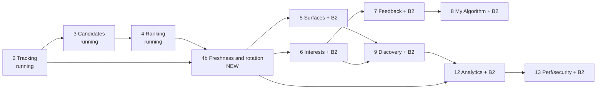

# Tara Intelligence 07: Brief 2 plan (work packages)

This plan turns [06-brief-2-addendum.md](06-brief-2-addendum.md) into work packages that slot into [04-implementation-plan.md](04-implementation-plan.md) **without changing phases 2 to 4**, which are being implemented now. Nothing here edits a phase-4 config version or acceptance criterion; where 4b finds a phase-4 defect, it is logged as a **phase-4 finding** in `results/phase-04b.md` and fixed by phase 4's owner, not by a 4b edit. It adds:
- **Phase 4b, "Freshness and rotation quick wins"**, which starts the day phase 4 lands and fixes the repetition the owner reported **in «لك» (`for_you`)**, and makes the default `recent` mode show where the new part ends;
- **WP x.y-B2** additions folded into phases 5 to 9, 12 and 13.

The working agreement of 04 §0 applies to every WP here: flags or config versions, invariant tests first, `results/phase-NN.md` (phase 4b writes `results/phase-04b.md`), a work-log line, commit and push per verified step, additive migrations **with a migration test** (brief Part 14).

**Binding owner decisions this plan does not override** (05): decision 4 (discovery share is an A/B test with a 0% control), decision 5 (`recent` stays the default), decision 9(b) (minor authors out of adults' discovery), decision 12 (sensitive topics), decision 17 (staff explanations), decision 20 (no hard-coded values). Decisions 23 to 25 and 37 in README §6 are **proposals until the owner records them in 05**; until then every WP below ships at the values of decisions 4 and 5.

**Acceptance criteria are measured, not hard-coded to dev counts.** "A seeded user with enough inventory" means a user whose eligible candidates (connections, plus pools when a recommended-share variant is active) at run time number at least 3 pages (≥ 60). The harness of WP 4b.1 selects them by query at run time. Per-item results for the brief's status format (files, DB, API, frontend, tests, limitations) go into each `results/phase-NN.md` under a "Per feature" heading. Latency figures are p95 **on the dev data set**, not production.

---

## Scope of this round (decision 22)

Decision 22 closes the round when "everything planned" is done, reviewed, pushed and verified in production. [09-unified-roadmap.md](09-unified-roadmap.md) orders the round as steps R0 to R9 and closes it at R9. To make the definition of done checkable, every brief-2 item is listed below as **in this round** (with its step) or **later** (not needed to close the round):

| In this round | Step (09) | Later (outside decision 22's definition of done) |
|---|---|---|
| Phases 2, 3, 4 (running, unchanged) | R0 | Intent overlays above weight 0 (6.8-B2 ships them at 0; promotion needs the 06 §17 idea-1 gate on ≥ 30 days of real data) |
| 4b.0, 4b.1, 4b.6, 4b.9, 4b.10, 4b.11, 4b.14 (E9b, once decision 37 is recorded), 4b.15 (test clock) | R1 | Bandit allocation away from its priors (9.2-B2 runs at priors on synthetic data; moves only with real traffic) |
| 4b.2, 4b.3, 4b.4, 4b.5, 4b.7, 4b.8, 4b.13, 4b.16 | R3 | Personal content modes, cross-format learned transitions, knowledge graph, semantic discovery, two-tower and sequence models (06 §17 "Later" / "Not now") |
| 6.3-B2, 6.5-B2, 6.6-B2, 6.8-B2 (shadow), 7.5-B2, 7.6-B2, 8.4-B2 to 8.7-B2 | R4 | Reels audio or track signal (06 §19: needs media work first) |
| 9.1-B2, 9.2-B2 (at priors), 9.9-B2 | R5 | Any recommended share above 0% for real users before decision 23 is recorded or the decision-4 experiment is powered |
| 5.1-B2, 5.2-B2, 5.3-B2, 5.6-B2, 9.3-B2, 9.7-B2, 9.8-B2, 9.10-B2 | R6 | Switching the default mode before decision 25 is recorded |
| 12.7-B2, 12.8-B2 | R7 | |
| 13.2-B2, 13.3-B2, 13.4-B2 | R9 | |

---

## Phase 4b: Freshness and rotation quick wins (Rules + UX)

**Goal:** in **«لك» (`for_you`)**, reopening Tara shows a different, still relevant first page and nothing already consumed comes back soon; in **«الأحدث» (`recent`, the default under decision 5)**, the user sees exactly where the new part starts and ends; Home refreshes when the user returns; reels stop opening on a watched reel. **The overlap fix applies only to «لك» until decision 25 is recorded in 05.** Recommended items appear only in the decision-4 variants (15% and 30%) until decision 23 is recorded; the active default keeps `mix.recommended = 0.0`.

**Depends on:** WP 2.3 (ingest), 2.8 (tracker; `signals.ts`, `useImpression.ts` exist in the working tree), 3.5 (eligibility), 4.3 (scorer), 4.5 (diversity), 4.7 (peek), 4.10 (session v2), and **the engagement part of WP 6.3, pulled forward as 4b.13** (the durable exposure memory; `intel_user_item_engagement` is "Filled by the aggregator (WP 6.3)", `intel/models.py:200-202`, and has 0 rows in dev today).

| WP | Tasks (files) | Acceptance criteria | Tests |
|---|---|---|---|
| 4b.0 Deploy prerequisites | Raise `redis-hot` `maxmemory` to **384 MB** and `mem_limit` to 448m in `infra/compose/docker-compose.yml:103-107` and `docker-compose.dokploy.yml:518-523` (pulled forward from WP 13.2; budget in 06 §5.2: worst case about 190 MB at 10k DAU, so 256 MB would give only 1.35× headroom). Check the Dokploy host has ≥ 512 MB free first (`docker stats`), recorded. Alert `intel_redis_hot_used_ratio > 0.8` of `maxmemory`. Every new key is built with `hot().make_key(...)` (the shape `pool_keys` uses, `intel/hot.py:47-53`) and added to `session_keys` / `forget_account` | `redis-cli CONFIG GET maxmemory` = 402653184 in dev; Dokploy compose base64 size still < 131,072 (`scripts/intel/check_deploy.sh`). Account deletion removes `feed:exp`, `feed:sess`, `feed:si` and `feed:head:*` **as stored raw keys** | Extend `test_account_deletion.py` (WP 2.10): write the keys with the raw client and assert `client.exists(...) == 0` for each after deletion |
| 4b.1 Repetition harness and baseline | Commit `scripts/intel/measure_repetition.py` **first** (the investigation's `measure.py` is not in the repo; `find -name "measure*.py"` returns nothing): opens per user and mode, page-1 and 3-page Jaccard, recommended count, author diversity, inventory, reels/video overlap, fallback repeats; optional simulated impressions through `POST /feed/signals/`; `--clock-offset` through `X-Tara-Test-Now`. Add two read-only measurements: **inventory arrival** (new `feed_item` rows per recipient per day, `post_created_at` buckets) and **visit gap** (gap between successive `user_session.last_seen_at` / `created_at` per account, identity). Both run on dev now and, read-only, on production with the owner's approval (`--readonly-dsn`, `SET default_transaction_read_only = on`); the production run is recorded, with no account ids in the output | The baseline reproduces 06 §1.1 (page-1 Jaccard 1.0, 0 recommended) from the committed script. The population line states the reconciled counts of 06 §1 (accounts, seed accounts, recipients). Arrival and gap distributions (p10/p50/p90) are recorded for dev and, if approved, production; dev is flagged as non-representative (seed burst, scripted logins) | `intel/tests/test_measure_repetition.py` (Jaccard and arrival maths on a fixture) |
| 4b.2 `feed_dwell` event | `frontend/web/src/lib/useImpression.ts` accumulates visible time and emits `feed_dwell {item, st, dwell_ms}` once per (session, item) on leave or `visibilitychange=hidden`; `signals.ts` type; `intel/models.py` `CLIENT_EVENT_TYPES`; `intel/signals/validate.py` (clamp to wall-clock, ≤ 10 min). `signals.ts` keeps `sessionId` and its impression dedupe set in **`sessionStorage`** (today memory only, `signals.ts:119-127`, so every reload starts a new `sid` and re-sends impressions) | One `feed_dwell` per (session, item). Nothing sent under `personalization_off`. Dwell over the wall-clock window dropped and counted. A reload in the same tab keeps the `sid` and sends no second impression for an item already reported | web `signals.spec.ts` additions (reload keeps `sid`; storage throwing falls back to memory); `test_signals_ingest.py` additions (dwell clamp, dedupe) |
| 4b.3 Exposure ledger v0 | `intel/exposure.py`: record codec (13 B: 8 B item prefix, 4 B epoch minute, 1 B = state in bits 0-2 + `visit_ord` in bits 3-7; codec version in the key suffix), `append` from `feed-signals` ingest through one Lua script (`APPEND` + `HSET last_activity_at` + session-interest update, one round trip). **Compaction at ingest**: when the length `APPEND` returns exceeds `2 × exposure.ledger.cap × 13` B, ingest folds and rewrites the log (GET + SET, rare). `load(viewer)` folds: highest state wins, latest minute, **`exposures` = number of distinct `visit_ord` values with state ≥ displayed** (capped at 2; a reload in the same visit is one exposure). All Redis writes are **fail-soft**: a refused write (noeviction, timeout) is counted in `intel_hot_write_failed_total{key}` and the request still returns 202. Thresholds in the `exposure` config block | Ingest p95 for 50 events ≤ 30 ms with the gate, the token decode and the Lua call (local benchmark, recorded). A displayed item is visible to the next first page within 1 s of the batch. Ledger ≤ 2.6 KB compacted and **never above 5.2 KB** per viewer (cap 200). **`retrieved` items never get a state.** With `redis-hot` full (`maxmemory` reached in a test container), ingest returns 202 and the SQL rows are stored | `test_exposure_codec.py` (round trip, fold, highest state wins, distinct visits, reload duplicate = 1 exposure, compaction, collision harmless), `test_exposure_ingest.py` (states from each event type; none from served-only; compaction at the threshold; Redis refusal fail-soft), `bench_ingest_with_ledger.py` |
| 4b.4 Visit classifier and session keys | `intel/session_ctx.py`: classify **from server timestamps only**; `sid` and `entry` are hints (06 §4.2). Keys: `feed:sess:{viewer}` (timestamps, `visit_id`, `visit_ord`, kind, counters; TTL 8 d), `feed:si:{viewer}` (session interests and intent; TTL `ongoing_idle_s + 4 × half_life` = 6,600 s), `feed:head:{surface}:{viewer}` (last head, 160 B; TTL 8 d). `intel_feed_session` model and migration. Per-visit counters (`first_pages`, `refreshes`, `displayed`, `consumed`) are `HINCRBY` fields in `feed:sess`, flushed into the closing `UPDATE` at the next visit start. `feed/views.py` passes `sid`, `entry`; `meta.visit`, `meta.refresh_after_s`, `meta.auto_refetch_after_s`; `session` config block in `defaults/home.json` (`home@2b`) | Kinds match the thresholds in 06 §4.2 on a clock-driven table test, including a reload and a new tab (new `sid`) within 30 min classified as refresh/ongoing, not new. `last_visit_at` moves only on new/returning visits. On Redis miss the latest `intel_feed_session` row is used. SQL writes: **2 on a new-visit first page** (INSERT new row, UPDATE previous), **0** on refresh, ongoing and next pages. Under `personalization_off` only `visit_started_at`, `last_activity_at`, `prev_visit_started_at` are written, and only once decision 24 is recorded (until then: nothing) | `test_visit_classify.py` (refresh, ongoing, new, returning, lapsed, reload, new tab, forged `entry`/`sid` cannot change eligibility or the kind), `test_feed_session_table.py` (one row per visit, closed lazily with the Redis counters, deleted on account deletion), query-count test |
| 4b.5 Exposure multiplier and rotation in `for_you` | `intel/ranking/scorer.py` applies `m(item)` (06 §5.3) from the ledger + `intel_user_item_engagement` (the existing `seen_before` `IN` query); relevance floor and carry-over (06 §5.4); `rec_new_activity` exception (≥ `revisit.new_comments` **distinct, non-suspect** commenters, author excluded); new config `home@2b` = `home@2` + `exposure`, `session`, `rotation`, `revisit` blocks (`home@2` untouched) | **Rotation:** for every seeded user with enough inventory, open A, display the first 8 page-1 items with 4 s dwell and impressions only for the rest, then open B at +45 min: page-1 Jaccard(A, B) **median** ≤ 0.30, p90 ≤ 0.50, and ≤ 1 item consumed in A appears in B's page 1. At +6 h same thresholds. **Fetched is not seen:** pools frozen (rebuild paused) and no new posts; open A, no signals, refresh at +60 s: Jaccard ≥ 0.90. **Revisit** (unit test, frozen clock): a displayed item has `m ≥ 0.9` at +40 h after two exposures (computed 37.6 h; 26 h after one); a consumed item `m ≥ 0.9` at **+12.5 d after one exposure (computed 12.35 d) and +16.5 d after two (16.2 d)**. **Relevance kept:** mean **pre-multiplier** `score` of B's page 1 ≥ 0.8 × the mean pre-multiplier `score` of A's page 1. `home@1` and `home@2` golden tests still pass | `test_exposure_rank.py` (each criterion), `test_home_v1_parity.py` unchanged, harness run recorded in `results/phase-04b.md` |
| 4b.6 Popular and fresh pools (pulled forward from 9.1) | `intel/discovery.py` minimal: per (surface, lang) zsets `_popular` (`pools.popular.window_d` 7, smoothed engagement rate from `post_stats` counting **only non-suspect reactions**: 02 §16 `suspect_account_age_hours` / `suspect_burst_per_min`, E11) and `_fresh` (`pools.fresh.max_age_h` 48 above the floor), rebuilt every `pools.rebuild_s` (300), capped at `pools.cap` (128); retrieval source `recommended_basic`. Mix uses `mix.recommended` from the active config: **`home@2b` = 0.0 (decision 4 control)**; config variants `home@2b-r15` and `home@2b-r30` carry 0.15 and 0.30 for the decision-4 arms, assigned by the phase-5 A/B core (before phase 5 they are selected only by the dev test override). The cursor continues into pools instead of `has_more=false` **only when the active variant has `mix.recommended > 0`** (`continuation.pools`); `caught_up` marker in every variant. Pool rebuilds apply E1, E1b, E1c, E2, E6, E6b, E7, E11 and the new author-side **E9b** (4b.14) | Pools hold only items eligible under those rules (property test extended). **Under `home@2b` (control):** 0 recommended items for every user (golden: decision 4 control = today). **Under `home@2b-r15`:** page 1 contains recommended items for every seeded user when the pools are non-empty, at 0.15 ± 0.05 over 20 users; no user gets `has_more=false` while pool items remain. Every recommended card has a `rec_*` reason and the "Suggested" label | `test_pools_basic.py`, `test_eligibility.py` property test with the new source, `test_continuation.py`, `test_pools_suspect.py`, web `PostCard` label spec |
| 4b.7 New since last visit and `caught_up` (all modes) | `intel/ranking/home.py` new-since boost (06 §6.2); `meta.visit.anchor_index` and `meta.caught_up_index` in every mode; `GET /feed/?peek=1&since=` and `meta.visit.new_count` count **only rows that pass eligibility** (never a raw `FeedItem` count, which would leak hidden or blocked authors' posts), with `since` clamped to `now − session.new_since.max_age_h` (168 h); web `NewSinceDivider.vue` and a «انت كده شفت الجديد» / "You're all caught up" marker, i18n `ar.ts`/`en.ts` | **`recent` (default mode) exit:** order identical to today (golden); after a +3 d clock jump with K new eligible connected rows, `anchor_index` = K exactly and the caught-up marker sits at the first row older than `since`; a second open at +45 min with no new rows gives `new_count = 0` and no divider; a row from a blocked author created after `since` changes neither `new_count` nor `ids`. **`for_you`:** after a 3-day jump, every position i < min(new_count, 30) holds a new-since item or an item whose `score'` is greater than the minimum `score'` among the new-since items. Divider hidden when `new_count < 3` | `test_new_since.py`, `test_peek_since.py` (eligibility, clamp), web `newSinceDivider.spec.ts` (ar RTL and en) |
| 4b.8 Refresh on return, pull-to-refresh and infinite scroll | `HomeView.vue`: `onActivated` + `visibilitychange` handler (06 §6.1), pull gesture (touch, top of list), scroll anchoring; `addFromTop` uses `peek=1&since=`; `services/feed.ts` `FeedResponse.fallback`, `meta.visit`, `sid`/`entry` params from `signals.ts`'s session; throttle scopes `feed_first_page` and `feed_peek` (rates from `session.rate.*`, 06 §20). **Infinite scroll on slow connections (brief Part 5.3):** skeleton while loading, an error row with "Retry" on a failed page, exponential back-off (1 s, 2 s, 4 s, then manual), media boxes with reserved aspect ratio so nothing shifts | Back to Home after ≥ 10 min while scrolled: pill with the server count, list and scroll unchanged. After ≥ 30 min at top: list refreshed, no duplicate ids. Pull-to-refresh inserts new items above without duplicating visible ones, and the item under the finger stays in place (± 8 px). A realtime push never changes the next page's `fallback` (D4). The 31st first page in a minute gets 429. On Playwright "Slow 3G" with page 2 forced to fail once: the error row appears, Retry loads page 2, no duplicate ids across 3 pages, CLS ≤ 0.1 | web `homeRefresh.spec.ts` (fake timers, KeepAlive activation, visibility), web `infiniteScroll.spec.ts`, e2e `home-refresh.spec.ts` and `home-slow-network.spec.ts` (ar and en), `test_feed_throttle.py` |
| 4b.9 Reels and video quick fixes (post) | `services/post/reels/services.py::feed_queryset` today orders `-created_at, -post_id` (`:393`). Replace the single cursor with a **two-phase pager**: phase 1 = reels with no `ReelView(viewer, viewed_at ≥ now − window)` in keyset order `(created_at, post_id)`, then phase 2 = viewed reels in the same keyset order; the opaque cursor carries `(phase, created_at, post_id)`. (A boolean first ordering key does not work with `tara_common` `CursorPagination`: it honours the explicit `order_by` (`pagination.py:24-33`) but builds the position from the first field only, so every unseen reel ties and DRF walks them by offset, and a view recorded between pages flips `seen` and skips or repeats items.) `window` = the `reels` config `seen.window_h` (72), read from `intel.config.published` like graph does (02:54), with setting `REELS_SEEN_WINDOW_H` as the fallback default. **Video:** move the audience rule into SQL (the predicate reels already use, `reels/services.py:387-391`) for `video_posts_queryset`, then a bounded over-fetch loop (≤ 3 fetches of 2 × page size) for the per-item checks that stay in Python; `only_visible` (`posts/services.py:901`) never runs on an unpaged queryset | Over 3 opens with views recorded, position 0 is never a reel viewed in the window while ≥ 1 unviewed eligible reel exists; viewed reels occupy ≤ 10% of the first 20 when ≥ 40 unviewed exist. Paging 5 pages while views are recorded between pages gives no duplicate and no skipped reel. Video pages return 20 items when ≥ 20 visible exist (today 13). `EXPLAIN` uses `reel_view_viewer_idx` and no sequential scan of `post` | post `test_reels_seen_order.py`, `test_reels_pager.py` (duplicates and skips across pages), `test_video_page_full.py` |
| 4b.10 Diversity config in `home@2b` | `defaults/home.json`: `max_same_format_run: 2` **in `home@2b` only** (`home@2` belongs to phase 4 and is immutable once active, WP 4.1). The mismatch between WP 4.5 ("no 3 consecutive") and 02's `max_same_format_run: 3` (02:347) is logged in `results/phase-04b.md` as a **phase-4 finding**, not fixed by a 4b edit. Author cap verified. Before phase 6 there are no topics, so 4b diversifies **only by author and format**; "near-identical topics" (brief Part 6) waits for `max_topic_share` in phase 6 | On the harness under `home@2b`: ≤ 2 posts per author per page (today up to 17 of 20), ≥ 8 distinct authors on page 1 when the inventory has them, no 3 consecutive items of one format when alternatives exist | `test_diversity.py` additions (under `home@2b`) |
| 4b.11 Repeat-exposure and Redis metrics (early) | Prometheus `intel_first_page_overlap` (histogram, from `feed:head`), `intel_repeat_display_total`, `intel_caught_up_total`, `intel_hot_write_failed_total{key}`, `intel_redis_hot_used_ratio` (alert > 0.8); `intel_feed_session.head_overlap` | Exported on `/metrics`; the alert rule fires in a test at 0.81; dashboard rows come in WP 12.7-B2 | `test_overlap_metric.py`, `test_hot_metrics.py` |
| 4b.13 Engagement-state aggregator v0 (pulled forward from 6.3) | `intel/signals/aggregate.py` minimal job (every 60 s, idempotent, natural-key dedupe): fills **only** `intel_user_item_engagement` from `intel_signal_event` (impressions, opens, completions, `max_watch_ms`, plus the new `dwell_ms`, `state`, `last_displayed_at`, `visits`). Migration adding those 4 columns to the partitioned table. Skips `personalization_off` accounts, events before `reset_at`, synthetic and test actors unless `INTEL_SYNTHETIC_IN_RANKING=true`. WP 6.3 later extends this job (interests, affinity, `post_stats`) instead of writing a second one | A consumed item displayed again after the 36 h hot TTL keeps `m < 0.9` until +12.5 d (it no longer resets to 1 when the Redis record expires). Re-running a window changes nothing. An account with `personalization_off` gets 0 rows | `test_aggregate_engagement.py` (idempotence, states, visits, personalization_off, reset_at), `test_migrations_b2.py` (forward and backward on an empty and a populated partition) |
| 4b.14 Author-side minor rule E9b | `intel_author_ref.age_class` (`adult`, `minor`, `unknown`; default `unknown`), captured from the author's own JWT claims (`is_minor`, `age_band`, `identity/tokens.py:94-96`) on their feed requests (one upsert when the class changes). **Fail-closed:** `minor` and `unknown` authors are excluded from adults' discovery: pool rebuilds, `fresh`/`popular`, `co_engagement`, `recently_active_creators` beyond the viewer's connections, Explore creator sections and every `suggested_*` source; connected items (friends, followers) are unaffected (decision 9(b)). Graph applies the same rule to people suggestions. **Blocked on owner decision 37** (storing an age class per author outside identity changes roadmap 2.12, under which age leaves identity only as token claims); until recorded, the recommended-share variants of 4b.6 stay off for real accounts | A minor or unknown-age author never appears in an adult viewer's recommended items, sections or suggestions; their posts still reach their friends and followers. Dev impact recorded (86 of 852 accounts have no date of birth) | `test_eligibility.py` property test extended with E9b (WP 3.5), graph `test_suggestions_minor_author.py` |
| 4b.15 Test clock guard | `X-Tara-Test-Now` is honoured only when **all** hold: new setting `INTEL_TEST_CLOCK_ENABLED` (default `false`), `TARA_ENV=dev`, and the account is in `intel_synthetic_account`. A Django system check (pattern of `intel.E003`, `intel/checks.py:62-63`) and the readiness probe (WP 2.9) refuse to start when the flag is true outside dev. The header applies to **both** `feed` (ranking `now`) and `feed-signals` (`received_at`, ledger minutes) so ranking and ledger share one clock | With the flag off, the header changes nothing (test). With the flag on and `TARA_ENV=production`, `manage.py check --deploy` fails and `/readyz` returns 503. A ledger record written under the fake clock carries the fake minute | `intel/tests/test_test_clock_guard.py` (each gate separately; feed and feed-signals) |
| 4b.16 Serve token v2 and ingest gate | `intel/ranking/serve_tokens.py` v2 (append-only codes): adds `fmt` (u8), primary `topic_id` (u16, 0 before phase 6), excerpt `length_bucket` (u8), author id prefix (8 B), `visit_ord` (u8, visit ordinal mod 32). `ingest.py`: the batch claim becomes `INSERT … SELECT … WHERE NOT EXISTS (SELECT 1 FROM intel_user_preference WHERE account_id = %s AND personalization_off)`, so **the `personalization_off` check costs no extra query** (today ingest has none: `grep personalization intel/` finds nothing). Under `personalization_off` nothing is written: no `intel_signal_event` row, no ledger record, no session-interest or intent update, no `intel_feed_session` counter | Ingest per batch: the conditional `INSERT` + 1 `COPY` (+ the existing video-session read when the batch carries video events) and **1 Redis round trip** (4b.3); no other read. v1 tokens keep validating until they expire (24 h). With `personalization_off`, a batch of every event type leaves 0 new rows and 0 Redis writes | `test_serve_tokens.py` additions (v1/v2 both valid, tamper), `test_personalization_off_collection.py` (all event types; SQL and Redis) |

**Query and Redis budget of 4b (first page, `for_you`).** The base is the count phase 4 measures and records in `results/phase-04.md` (not written yet on 2026-11-05; WP 4.2 alone allows ≤ 12 queries for features). 4b adds, against that base: **Redis** +1 pipelined round trip (`GET feed:exp`, `HGETALL feed:sess`, `GET feed:si`, `GET feed:head:home`, pool `ZRANGE`s); **SQL reads** +1 (the eligibility-checked new-since `COUNT`, on new/returning visits only); the durable exposure read reuses the `seen_before` `IN` query (+0); pool candidates join the existing feature `IN` queries (+0); **SQL writes** +2 on a new-visit first page, +0 otherwise. Ingest (`feed-signals`): unchanged SQL count (the gate is inside the batch `INSERT`), +1 Redis round trip, + rare compaction. This amends the `POST /feed/signals/` row of 02 §22 ("none (no Redis)") to "1 Redis round trip, fail-soft".

**Phase 4b exit (all must hold, recorded in `results/phase-04b.md`):**
1. `for_you` under `home@2b`: harness **median** first-page overlap ≤ 0.30 across two opens ≥ 45 min apart with simulated display; refresh with no signals keeps Jaccard ≥ 0.90.
2. `recent` (the default): golden order unchanged; divider and caught-up marker exact on the +3 d case; `new_count` matches the eligibility-checked count.
3. Decision-4 control: 0 recommended items under `home@2b`; under `home@2b-r15`, recommended items for every seeded user and no `has_more=false` with pools remaining.
4. Reels position 0 unseen; reels pager without duplicates or skips; video pages full.
5. `personalization_off`: 0 rows, 0 Redis writes (besides the two timestamps once decision 24 is recorded).
6. `home@1` and `home@2` golden green; first page p95 ≤ 150 ms on the dev set; first-page queries ≤ phase-4 base + 1 read (+ 2 writes on a new visit).
7. `redis-hot` used memory under the harness load recorded; fail-soft test green.

**Honest limits of this exit.** It is measured on the synthetic dev seed, not on the experiments decision 5 requires, so it does **not** by itself justify flipping the default mode (decision 25 is the owner's call). The dev seed has no organic arrival (95% of `feed_item` rows, 37,806 of 39,615, were written on 2026-11-05 by the seed) and its logins are scripted (median gap between successive `user_session` rows 1.2 s), so 4b.1's production measurement is what tells how much a chronological feed changes on its own between real visits.

**Risks:** Redis memory (mitigated by 4b.0, ingest compaction and the 80% alert); demotion making the head worse (mitigated by the relevance floor and the 0.8 × pre-multiplier criterion); client dwell under-reporting on iOS (mitigated: impressions alone already give `displayed`); dwell-only consumption rewarding bait (06 §5.1: dwell-only consumption is weighted below explicit actions).

---

## Additions folded into phases 5 to 13 (in this round, at the steps listed above)

### Phase 5 (surfaces)

| WP | Tasks (files) | Acceptance criteria | Tests | Depends on |
|---|---|---|---|---|
| 5.1-B2 Reels objectives | `intel/ranking/reels.py` seen handling from the ledger + `reel_view` (removes the WP 6.3 dependency); fresh quota; reels diversity block; `creator_relevance`/`history` for reels; guardrail counters. **Ownership:** after 5.1, `GET /feed/reels/` owns `for_you`; the web switches behind `INTEL_REELS_FEED_RANKER`, and post's `GET /reels/?tab=for_you` keeps the 4b.9 order only as the fallback when feed is unavailable (no second ranker) | ≥ 20% of each 20 reels < 48 h old when ≥ 20 such eligible exist; ≤ 1 per author per 5 consecutive; seen reels demoted without WP 6.3 running; with the flag on the web never calls post's `for_you` while feed answers | `test_reels_rank.py` additions, `test_reels_fresh_quota.py`, web `reelsSource.spec.ts` | 4b.3, 5.1 |
| 5.2-B2 Video and Continue Watching data | `intel/ranking/video.py` uses ledger; partial-watch selector (`sections.continue_watching.min_frac` 0.1 to `max_frac` 0.9, `window_d` 7) in `intel/sections/continue_watching.py`. **Sensitive-topic items are never selected** without the decision-12 opt-in | Completed videos demoted ×0.2; partially watched not demoted and returned by the selector; nothing ineligible returned; a sensitive-topic video is not returned without opt-in | `test_video_rank.py` additions, `test_continue_watching.py` | 4b.3, 5.2 |
| 5.3-B2 Groups surface communities | `defaults/groups.json` `mix.discover_groups`; "popular in your communities" pool (public groups in the viewer's `group_cat` interests) | Only public active groups in the discover share; joined-group content ≥ 85% | `test_groups_rank.py` additions | 5.3, 6.3 |
| 5.6-B2 Following `light_rank` | `following` mode honours `modes.following_light_rank` (default false) | Off: order identical to today (golden). On: last 72 h ranked by relationship + freshness only, older chronological | `test_following_light_rank.py` | 4.6 |

### Phase 6 (interests)

| WP | Tasks (files) | Acceptance criteria | Tests | Depends on |
|---|---|---|---|---|
| 6.3-B2 Medium tier, emerging, new weights | Migration `mid_v`, `mid_at`; aggregator third accumulator (14 d) **in the 4b.13 job**; `emerging()` at read time; `event_weights` `group_join` +2, `group_leave` −1, `topic_explore` +0.5 | Backdated fixture: a topic consumed only in the last 10 days ranks medium > long; a topic with short/long ≥ 3 and ≥ 4 events is flagged emerging; group join raises `group_cat` | `test_interest_tiers.py`, `test_aggregate.py` additions, `test_migrations_b2.py` (`polarity` enum, `mid_*`) | 6.3, 4b.13 |
| 6.5-B2 Session interest vector and `session_rel` | `intel/session_ctx.py` vector update at ingest (from serve-token v2 attributes, no read) and in the bus consumer; feature `session_rel`; `weights.session` 0.8 in `home@3`. Dwell-only consumption counts `session.dwell_only_weight` (0.3) against 1.0 for an explicit action; hide and report subtract 1.0 | **Scenario D passes under `home@3`** (06 §16). No write under `personalization_off`; sensitive topics not counted without opt-in; ingest p95 ≤ 30 ms re-measured with the vector update | `test_session_interest.py`, `test_scenario_d_shift.py` | 4b.4, 6.2 |
| 6.6-B2 Cold start on basic pools | `OnboardingTopics.vue` flow uses `_popular`/`_fresh` of 4b.6 until 9.1 pools exist, at the share of the active decision-4 variant | Scenario A test passes with no 9.1 pools under `home@2b-r15` | `test_scenario_a_new_user.py` | 4b.6, 6.6 |
| 6.8-B2 Intent v0 (shadow, rules) | `intel/intent.py` rules (06 §4.5); stored in `feed:si` and `intel_feed_session.intent`; `intent_overlays` config at weight 0 | With overlays at 0 the order is identical to without intent (golden). Each rule fires on its fixture | `test_intent_rules.py` | 6.5-B2 |

### Phase 7 (feedback)

| WP | Tasks (files) | Acceptance criteria | Tests | Depends on |
|---|---|---|---|---|
| 7.5-B2 Mute topic and Hide creator | `intel/feedback.py` actions `mute_topic`, `hide_creator`; polarity `muted`, `hidden`; E8 extended; `PostCard.vue` menu items, reels overlay, profile menu; toasts with the copy of 06 §10; i18n | Muted topic: 0 recommended items with it as a topic, connected items with it as primary demoted ×0.3. Hidden creator: 0 recommended items, rails or people suggestions with them; followed creator's connected posts still present. Undo restores exactly | `test_mute_topic.py`, `test_hide_creator.py`, `postCardMenu.spec.ts` additions, e2e `feed-feedback.spec.ts` (ar and en) | 7.1 |
| 7.6-B2 New reason codes | `rec_community_popular`, `rec_similar_watched`, `new_since_visit`, `continue_watching`, `rec_new_activity`, `rec_adjacent_topic` in `intel/ranking/explain.py`, `WhyThisPost.vue`. **Sensitive inference guard:** for an item with a sensitive topic and no decision-12 opt-in, `rec_similar_watched`, `continue_watching` and `rec_new_activity` are replaced by the generic `rec_generic`; `rec_community_popular` never names a group | Every code renders in ar and en; golden test that codes match top factors; golden test that a sensitive-topic item never carries the three history-revealing codes without opt-in and that no reason string contains a group name | `test_why.py` additions, `test_why_sensitive.py` | 4.8 |

### Phase 8 (My Algorithm)

| WP | Tasks (files) | Acceptance criteria | Tests | Depends on |
|---|---|---|---|---|
| 8.4-B2 Reset recommendations | `POST /feed/preferences/reset/` two-step, throttled to `reset.min_interval_h` (24 h); `reset_at`; deletes, **asynchronously** (Celery, per partition: one `DELETE … WHERE account_id` per weekly partition of `intel_user_item_engagement`, about 5): inferred interests, ledger `feed:exp`, `feed:sess`, `feed:si`, `feed:head:*`, **`feed:rank:*` sessions** (they carry factor and reason codes), **`intel:prof:{account}`**, **`intel_feed_session` rows**, engagement rows; resets decayed affinity; raw `intel_signal_event` rows before `reset_at` are excluded from the aggregator, **phase-11 training and phase-12 calibration** (one `reset_at` join in each reader). Reels: feed publishes `feed.recommendations.reset {account_id, reset_at}` (ids only); post ignores `reel_view` rows before it for the seen order (the rows stay: they are view counts, not preferences) | After reset: no inferred row, none of the listed keys, 0 engagement and 0 `intel_feed_session` rows for the account; explicit topics, follows, blocks, hides and mutes unchanged; **Home and Reels page 1 each equal a cold-start page** for the same connections; a second reset within 24 h gets 429 | `test_reset_recommendations.py`, post `test_reels_reset.py` | 6.3, 4b.3, 4b.13 |
| 8.5-B2 Manage interests by tier | Profile API `tier`, muted topics, hidden creators; `InterestProfile.vue` grouped view | Each tier listed with counts by event type; no item ids | `test_interest_api.py` additions, web spec | 6.3-B2, 7.5-B2 |
| 8.6-B2 Home sections customization | `home_sections` preference; section "Hide this section" menu; toggles in `MyAlgorithmView.vue` | A hidden section never appears in `meta.sections`; a pinned one appears whenever eligible | `test_home_sections_prefs.py`, web spec | 9.8-B2 |
| 8.7-B2 Search signal opt-in | `search_signal` toggle (off); search service emits nothing unless on. Brief Part 2.2 "current searches" as a session input is **blocked by decision 7** until this toggle exists; with it on, only the topics of the last 3 queries (no text) enter `feed:si` for the current visit | Off: no search-derived row or `feed:si` entry exists | `test_search_signal_optin.py` | 8.1 |

### Phase 9 (discovery)

| WP | Tasks (files) | Acceptance criteria | Tests | Depends on |
|---|---|---|---|---|
| 9.1-B2 More arms | Topic pools (9.1) + `adjacent_topics` (via `parent_id`), `co_engagement` (nightly item neighbours, ≥ `co_engagement.min_users` (3) **distinct non-suspect** users per pair, top `co_engagement.neighbours` (20), public eligible only, E9b), `communities` | Every arm passes the eligibility property test; co-engagement never returns a pair below 3 qualifying users; 3 accounts younger than `suspect_account_age_hours` create no pair | `test_adjacent_topics.py`, `test_co_engagement.py` | 9.1, 4b.14 |
| 9.2-B2 Source bandit (replaces 04 WP 9.2's uniform ε and `test_exploration.py`) | `intel/ranking/bandit.py`, `intel_source_stats`, `intel:bandit:*`; config `bandit` block (`prior` [2, 20], `window_d` 14, per-arm `min_share`/`max_share`). **Deterministic policy:** Bayes-UCB (the `bandit.quantile` 0.8 quantile of each arm's Beta posterior), no sampling. **Position-corrected reward:** consumption per impression is divided by the slot-bucket prior (`bandit.position_buckets` 1-5, 6-10, 11-20). Reward counts only non-suspect, non-synthetic accounts; dwell-only consumption weighs `bandit.dwell_only_weight` (0.3) against 1.0 for an explicit action; hides and reports subtract 2.0 | Allocation stays within bounds; with synthetic data the arms sit at their priors; same inputs give the same allocation (no random number generator in the module, grep test); an arm placed only in slots 11-20 with the same per-bucket rate as an arm in 1-5 gets the same posterior | `test_bandit.py` (bounds, determinism, position correction, reward update, suspect accounts ignored) | 9.2, 12.1 |
| 9.3-B2 Explore v2 | `GET /feed/explore/`, `/explore/topics/{slug}/`; entity sections (pages, groups, creators, with E9b); consumes the trending engine (decision 19) | 04 WP 9.3 criteria 1-7 hold; topic pages show only eligible items in that topic | `test_explore_api.py`, e2e `explore.spec.ts` | 9.3, brief-3 trending |
| 9.7-B2 Professional feed | `intel_topic.family`; `defaults/professional.json`; `GET /feed/professional/`; web tab | ≥ 80% of items carry a professional-family topic or come from a mapped page/group category; eligibility as all surfaces | `test_professional_rank.py` | 6.1, 9.1 |
| 9.8-B2 Homepage sections composer | `intel/sections/` registry and composer; `GET /feed/sections/{key}/`; `meta.sections`; `HomeView.vue` renders by `after_index` (removes fixed indexes at `:525-529`); `section_impression`/`section_click` events. **Rails** read a non-session top-N (`GET /feed/sections/reels_rail/?limit=10`): ranked with the visit's ledger but **no `feed:rank:*` write**, own throttle scope `feed_rail`, not counted against `feed_first_page`. Thresholds from `sections.rules.*` (06 §20) | ≤ 2 sections on page 1, never adjacent, never adjacent to the ad; each section only when its rule holds; one Home open writes exactly one ranking session (`feed:rank:home`); a sensitive-topic item never appears in Continue Watching without opt-in | `test_sections_composer.py`, `test_rails_no_session.py`, web `homeSections.spec.ts` | 5.1-B2, 5.2-B2, 9.4 |
| 9.9-B2 Fresh-content budgets | `fresh` pool impression budget (first 50 impressions), graduation by Beta posterior counting only non-suspect engagement | A new eligible post above the floor receives its budget within 24 h when matching viewers exist (synthetic replay) | `test_fresh_budget.py` | 9.1, 4b.6 |
| 9.10-B2 Scenario suite | `intel/tests/scenarios/test_scenario_{a..f}.py` from 06 §16, on the WP 2.9 backdated dataset | All six pass | the suite itself | 4b, 6.5-B2, 9.2-B2 |

### Phase 12 (analytics)

| WP | Tasks (files) | Acceptance criteria | Tests | Depends on |
|---|---|---|---|---|
| 12.7-B2 Metric additions | `intel/analytics.py`: the metrics of 06 §15, including the guardrails `dwell_only_share` and `negative_feedback_rate` | Each metric computed on a fixture with a known answer; k ≥ 20 suppression holds | `test_daily_metrics.py` additions | 12.1 |
| 12.8-B2 Dashboard panel "Freshness and repetition" | `components/admin/intel/FreshnessPanel.vue` | On a fixture with known values (repeat-exposure 0.04, first-page overlap median 0.25, new-since hit rate 0.5, caught-up rate 0.1, per surface and day), the panel shows exactly those values | web spec with that fixture | 12.4 |

### Phase 13 (performance and security)

| WP | Tasks (files) | Acceptance criteria | Tests | Depends on |
|---|---|---|---|---|
| 13.2-B2 Redis re-measure | Measure ranking sessions + ledgers + `feed:sess`/`feed:si`/`feed:head` + pools/profiles under the 13.1 load | Projected at 10k DAU (about 15k viewers in 36 h, 25-30k WAU): sessions 70 MB + ledgers 39 MB (78 MB uncompacted worst case) + `feed:sess` 9 MB + `feed:head` ≤ 15 MB + `feed:si` 2 MB + pools/profiles 8 MB + brief-3 trending zsets ≤ 8 MB (08 §3.12) ≈ **151 MB typical, 190 MB worst**. Measured worst case ≤ 50% of `maxmemory` (≥ 2× headroom: ≤ 192 MB at 384 MB); if it is above, ranking sessions get zlib (04 WP 13.2 option) before anything else | measurement in `results/phase-13.md` | 4b.0 |
| 13.3-B2 Security review additions | Forged `entry`/`sid`, refresh storms, ledger poisoning through foreign serve tokens (ignored), reset abuse (throttle), test-clock header outside dev, **manipulation**: comment spam forcing `rec_new_activity`, sybil co-engagement, bandit reward poisoning, `popular`/`fresh` pool inflation by suspect accounts | Each finding has a test; each manipulation case shows no effect from accounts that fail the 02 §16 suspect rules or E11 | per finding; `test_manipulation_b2.py` | 4b, 8.4-B2 |
| 13.4-B2 Privacy review additions | Amends 04 WP 13.4: (1) retention test covers `intel_feed_session` (30 d) and `intel_source_stats` (400 d); (3) the user export includes the account's `intel_feed_session` rows and a decoded snapshot of `feed:exp` and `feed:sess` (states and timestamps of its own items only); (6) `personalization_off` collects nothing **except**, once decision 24 is recorded, the two visit timestamps in `feed:sess`; staff "explain ranking" (decision 17) excludes the session vector, intent, ledger, `feed:head` and `intel_feed_session` | Each item queried and recorded in `results/phase-13.md` | `test_retention.py`, `test_profile_export.py`, `test_personalization_off_collection.py`, `test_staff_explain_scope.py` | 4b, 13.4 |

---

## Order of work (summary)

1. Phases 2, 3, 4 finish as planned (no change).
2. **Phase 4b**, in the two steps of 09: **R1** = 4b.1 first (script committed and baseline reproduced before anything else) → 4b.15 (test clock) → 4b.0 → 4b.10 → 4b.11 → 4b.6 (control `mix.recommended = 0.0`; variants need 4b.14 and decision 37). **R3** = 4b.16 (serve token v2 and the `personalization_off` gate) → 4b.2 → 4b.3 (after 09's impression v2, 4c.9-B3) → 4b.13 → 4b.4 → 4b.5 → 4b.7 → 4b.8. 4b.9 (post) can run in parallel from day one since it touches only `services/post`.
3. Phases 5 to 9 with their B2 items, then 12 and 13, in the R-step order of 09.

## Test matrix additions (04 "Test matrix against the brief")

| Brief test area | Where |
|---|---|
| Pagination and refresh | `test_continuation.py` (4b.6), `homeRefresh.spec.ts`, `home-refresh.spec.ts`, `test_peek_since.py` (4b.7, 4b.8), `test_reels_pager.py` (4b.9) |
| Infinite scroll on slow networks | `infiniteScroll.spec.ts`, `home-slow-network.spec.ts` (4b.8) |
| Duplicate prevention across sessions | `test_exposure_rank.py` (4b.5), `test_exposure_codec.py` reload case (4b.3), harness (4b.1) |
| Returning users | `test_visit_classify.py` (4b.4), `test_new_since.py` (4b.7), scenario B |
| Migrations | `test_migrations_b2.py` (4b.13, 6.3-B2) |
| Privacy of the additions | `test_personalization_off_collection.py` (4b.16), `test_why_sensitive.py` (7.6-B2), `test_staff_explain_scope.py` (13.4-B2) |
| Scenario tests A to F | 9.10-B2 (A and D earlier in 6.6-B2 and 6.5-B2) |
| Reels seen suppression | `test_reels_seen_order.py` (4b.9), `test_reels_rank.py` (5.1-B2) |
| Feedback additions | `test_mute_topic.py`, `test_hide_creator.py` (7.5-B2), `test_reset_recommendations.py` (8.4-B2) |
| Manipulation | `test_pools_suspect.py` (4b.6), `test_manipulation_b2.py` (13.3-B2) |
