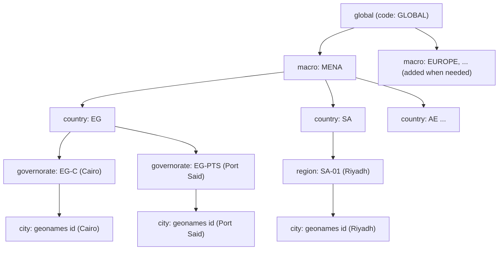
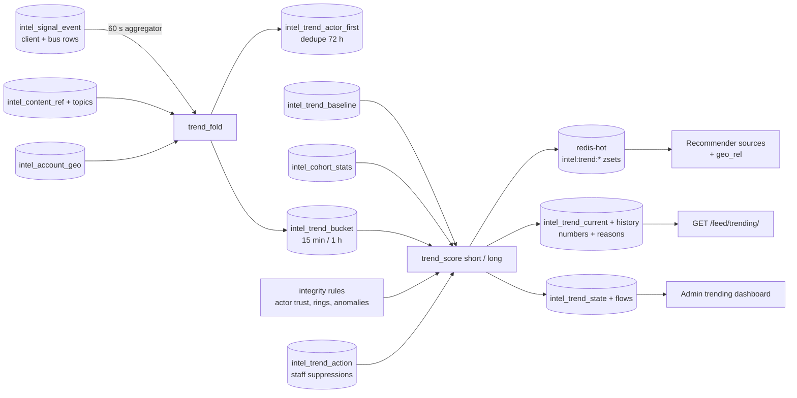
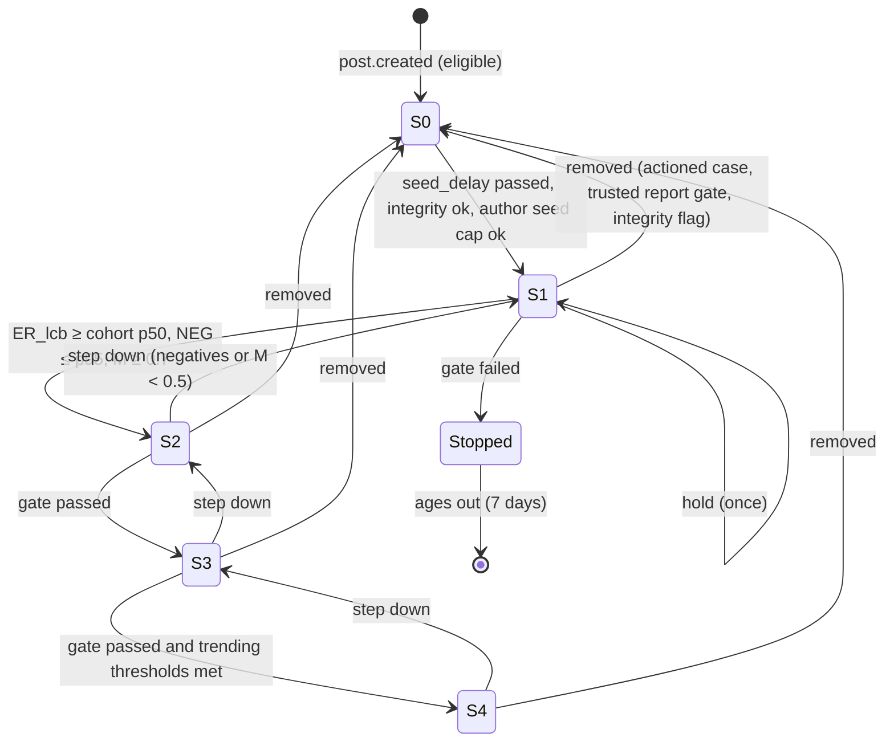

# Tara Intelligence 08: Brief 3 addendum (geo-trending, viral discovery, feed delivery)

This addendum answers [00c-brief-3-geo-trending.md](00c-brief-3-geo-trending.md). It **extends** [02-architecture.md](02-architecture.md), [03-database-design.md](03-database-design.md) and the Brief 2 addendum [06-brief-2-addendum.md](06-brief-2-addendum.md); it replaces no section of them. Where it changes something written there, the change is listed in section 13 with its reason. Owner decisions in [05-owner-decisions.md](05-owner-decisions.md) are binding, in particular **19** (trending is an independent engine that feeds the recommender), **20** (every weight, threshold and window lives in the versioned central config), **3** (retention), **9** (minors), **10** (dashboard roles) and **22** (definition of done).

**Status.** Nothing in this document is built. Two read-only audits on 2026-11-05 are the evidence base: a location and trending audit (`psql` in `tara-postgres-1`) and a feed-delivery audit (Playwright, Chromium, preview build on `:4173`, desktop 1366×900 and mobile 390×844 @3x). The dev data is seeded, mostly Arabic, and its reactions arrive in bursts (7,780 of 9,132 reactions fall in one hour, 2026-11-05 12:00 UTC), so **no dev count below predicts production**. Line numbers refer to the working tree on `feat/web-social-platform` while phases 2 to 4 are being implemented by another workflow; they may move.

**Revision 2 (2026-11-05, review applied).** A design review found privacy leaks (sub-country post lists, "started in" reasons, silent backfill consent, the picker publishing a city), schema errors (a partitioned unique key, an expression primary key), a snapshot storage estimate about 50× too low, missing config schemas and unmeasurable targets. The fixes are made **in place** in the sections below, and section 15 holds the new detail (full config schemas, the cost re-estimate, the reviewed points it rejects). Where a sentence here disagrees with section 15, section 15 wins.

**Honesty rules carried from the brief.**
- Every trend number shown to a user or staff member is read from a stored row. Nothing is estimated at display time.
- The rules here are rules: thresholds and formulas, no learned model. The UI never says "AI" (02 §15).
- Where the data cannot support a feature yet (for example city trends in dev), the document says so and the product falls back to the next level up.

---

## 1. Decisions at a glance

| # | Decision | Why |
|---|---|---|
| G1 | **The Geo-Trending Engine is a module of `intel` in `services/feed`** (`intel/trending/`), with its own Celery queue `feed.trending`. It is not part of search and not a new service | Section 3.1. It needs impressions, eligibility (E2, E11, minors), topics and `redis-hot` pools, which only feed has (A1 in 02 §1) |
| G2 | **Location is owned by profile.** Structured codes (ISO 3166-1, ISO 3166-2, a gazetteer city id) extend `UserProfile`; preferences and consent are new profile tables | Profile already owns `city` and `country` (`services/profile/profiles/models.py:35-36`) |
| G3 | **A static region table ships as a library** (`libs/tara_geo`), loaded read-only by profile and feed. No service owns it at runtime and no event carries it | It is reference data; a versioned file is cheaper and safer than a replicated table |
| G4 | **Geo reaches feed through a new private event `profile.geo.changed.v1`**, never through `profile.updated` | `profile.updated` is indexed publicly by search (`profiles/services.py:108-127`) |
| G5 | **Precise coordinates are never stored.** The server snaps them to a gazetteer city and discards them in the same request | Brief §1 and §13 |
| G6 | **Trend counts use "new distinct engagers"** (an actor counted once per entity within a 72 h dedupe horizon), which is additive across time buckets | It gives exact distinct counts over any window with plain `SUM`, without HyperLogLog or a Postgres extension. The dedupe table is hash-partitioned on `entity_key` so its unique key stays global (section 9.2) |
| G7 | **k-anonymity is enforced at publish time and at dashboard write time**, with automatic roll-up to the parent region | Brief §13; 02 §21 k ≥ 20 rule |
| G7b | **Below country level only `hashtag` and `topic` entities exist.** Posts, videos, reels and creators are counted and published at `country`, `macro` and `global` only | Reactor lists on posts are public (`posts/<uuid>/reactions/`, `services/post/posts/urls.py:56`): "Rising in Port Said" on a post with about 25 public reactors at D ≥ 20 would tell anyone that most of those named people are in Port Said. A hashtag or topic list needs ≥ 5 (city) or ≥ 3 authors and has no single reactor list |
| G8 | **"Rising" and "popular" are separate scores and separate lists** | Brief §1 time windows |
| G9 | **Viral discovery is a staged impression budget** with cohort-relative gates, built on the `fresh` pool idea of 06 §17 (idea 8) | Brief §2 lifecycle and fairness |
| G10 | **Geography enters ranking as one bounded feature, `geo_rel`, plus trend sources inside the bandit's caps** | Brief §3: location never controls the feed alone |
| G11 | **Delivery parameters (first-batch size, prefetch, virtualization, video policy) live in a `delivery` block of each surface config** and reach the client in `meta.delivery` | Brief §4 ("first batch size in configuration") and decision 20 |
| G12 | **All anti-manipulation is rules-based** and measured against a labelled synthetic set; each rule reports its precision on that set and nothing more | Brief §2 protection list; no claim of ML |

---

## 2. Privacy-safe location model and consent

### 2.1 What exists today (measured)

| Data | Where | Measured (dev) | Problem |
|---|---|---|---|
| `UserProfile.city`, `.country` | `profiles/models.py:35-36`, free text `CharField(80)` | 848 profiles; **122 (14.4%) have both**, none has only one. 7 distinct countries (مصر 76, السعودية 19, قطر 11, الإمارات 7, الكويت 7, plus 2 lorem-ipsum values); 16 cities, the largest الرياض 14, القاهرة 13, الدوحة 11, بورسعيد 10. **No city reaches 20 profiles** | No codes, no hierarchy, junk values |
| Field privacy | `ProfileFieldPrivacy`, `CONTROLLABLE_FIELDS` (`profiles/models.py:25`) | 8 explicit rows (city: public 2, friends 1, private 1; country: public 3, friends 1). Missing row means public | Visibility only; no "use for recommendations" switch |
| City on the bus | `profile_search_payload` (`profiles/services.py:108-127`) | `city` is sent only while public; `country` never leaves profile | Search indexes it as `location_norm` (238 rows; "cairo" 42 next to "القاهره، مصر" 19 for the same city) |
| `Page.location`, `Post.location` | `profiles/models.py:135`, `posts/models.py:127` | 62 of 293 pages; 39 of 2,470 posts | Free text, author-set display values |
| `ip_region` | `identity/models.py:269, 414`, read from `HTTP_X_GEO_REGION` (`identity/views.py:52`) | **0 of 28,243 sessions, 0 of 31,089 security events** | Both edges blank the header (`frontend/web/nginx.conf:59, :79`; `infra/traefik/dynamic/middlewares.yml:27`) |
| Language | `Account.language` (`identity/models.py:50`) | ar 664, en 184 | The only locale signal intel uses (pool keys `{surface}:{lang}`, 02:189) |
| Consent | `LegalConsent` (`identity/models.py:199-221`) | 762 rows, source `register` only | No location or personalization consent of any kind |

### 2.2 Region hierarchy and the static reference table



**Package `libs/tara_geo/`** (new, installed into profile and feed images like `tara_common`):

| File | Content | Size (MENA scope) |
|---|---|---|
| `tara_geo/data/regions.json` | One row per node: `code` (e.g. `GLOBAL`, `MENA`, `EG`, `EG-C`, `c:360630`), `level` (`global`, `macro`, `country`, `admin1`, `city`), `parent`, `name_ar`, `name_en`, `iso` (3166-1 or 3166-2), `population` (cities), `lat`/`lng` (city centroid only, used for snapping, never per user) | About 20 countries, about 300 first-level divisions, about 3,000 cities with population ≥ 15,000 (GeoNames cities15000 filtered to MENA). Estimated under 600 KB of JSON |
| `tara_geo/data/aliases.json` | Normalized spellings to codes: `مصر`, `Egypt`, `EG` → `EG`; `القاهرة`, `القاهره`, `Cairo` → Cairo's city id. Normalization reuses `normalize_ar` | A few thousand entries |
| `tara_geo/__init__.py` | `region(code)`, `ancestors(code)` (city → admin1 → country → macro → global), `children(code)`, `resolve_alias(text)`, `nearest_city(lat, lng, max_km)`, `DATA_VERSION` | n/a |

- **Macro-regions** are a list of member countries in `regions.json`. v1 defines `MENA` only (every country present in dev is in it). A country has exactly one macro parent in the tree; overlapping groupings (GCC, Levant) are out of scope until asked for.
- **Versioning.** `DATA_VERSION` is stamped on every stored code set (`geo_data_version` on profile and on `intel_account_geo`). Changing the file is a code change with a backfill, like the classifier constants of 02 §8.4.
- **Licence.** GeoNames is CC-BY 4.0: the attribution goes on the About/Legal page. The source choice is an owner decision (B3-3, section 12).
- **Why not a DB table per service.** Two services need the same read-only data; a package keeps one source, zero events, and lets tests import it.

### 2.3 Profile fields, sources and precedence

New columns on `UserProfile` (profile service, additive migration):

| Field | Type | Notes |
|---|---|---|
| `country_code` | char(2) null | ISO 3166-1 alpha-2 |
| `admin1_code` | varchar(6) null | ISO 3166-2 (e.g. `EG-C`, `SA-01`) |
| `city_code` | varchar(16) null | `tara_geo` city code |
| `location_source` | enum(`user`, `ip`, `device`, `legacy_text`, `none`) default `none` | Where the codes came from; `legacy_text` = mapped by the backfill from the display text, never consented |
| `location_updated_at` | ts null | |
| `geo_data_version` | smallint null | `tara_geo.DATA_VERSION` used |

**Precedence:** an explicit user choice (`user`) always wins; `device` (the "use my current location" button) is also an explicit act and overwrites `user` only when the user presses it; `ip` fills `country_code` only when the user has chosen nothing and has opted in; `legacy_text` is the lowest and is replaced by any of the others. A lower source never overwrites a higher one. **Minors and unknown-age accounts** (`is_minor` or `age_band=unknown` in their own JWT, E9) do not see the "Use my current location" button and their codes are stored at country level only (`admin1_code`, `city_code` stay null); owner decision B3-14 (README decision 40).

**Free text stays, and the picker never writes it.** `city` and `country` remain the author-typed display fields, governed by `ProfileFieldPrivacy` (a missing row means public, and a public `city` goes to search through `profile_search_payload`, `profiles/services.py:108-127`). `PATCH /profile/me/location/` writes **codes only** (`country_code`, `admin1_code`, `city_code`, `location_source`); it never touches `city`/`country`, so a location chosen for recommendations never becomes public or searchable. Test `test_location_picker_no_display_write.py`: after a picker save, `city`/`country` are unchanged, no `profile.updated` is emitted, and search's `location_norm` is unchanged.

**Backfill is not consent.** A one-off command `profile_backfill_geo_codes` maps the display text through `aliases.json` into codes with a new source value `location_source=legacy_text`, and creates `profile_geo_pref` with **`use_location_for_recs=false`**. The 122 dev users who typed a city for display are therefore not fed into ranking or trend aggregation until they confirm in Settings > Location ("We found Cairo in your profile. Use it for local trends?"), which writes a `profile_privacy_consent` row (`kind=location_for_recs`) and flips the switch. Unmapped values (the 2 lorem-ipsum countries, "Sapiente sapiente si") stay unmapped with `location_source=none`. In dev it should map at most 120 of 122 located profiles; the command prints the real count and the unmapped values. Test `test_backfill_no_consent.py`: after the backfill, 0 rows have `use_location_for_recs=true`, 0 `profile.geo.changed` events carry non-null codes, and 0 `intel_account_geo` rows have `use_for_recs=true`.

### 2.4 Preferences and consent

**`profile_geo_pref`** (one row per account, created lazily):

| Field | Default | Meaning |
|---|---|---|
| `use_location_for_recs` | `false`. It becomes `true` only by an explicit act in Settings > Location (picking a place with the switch shown on, or confirming a backfilled place), which writes a `profile_privacy_consent` row in the same transaction | Whether ranking, local trends and trend aggregation may use the account's codes. Owner decision B3-1 (README decision 28, revised) |
| `ip_country_opt_in` | `false` | May the edge country fill `country_code` when the user chose none |
| `trend_regions` | `[]` (the UI then shows home country, `MENA`, `GLOBAL`) | Up to 3 codes the user follows for trends, e.g. `["EG", "MENA", "GLOBAL"]`. Validated against `tara_geo` |
| `updated_at` | | |

- **These are separate from field visibility.** `ProfileFieldPrivacy` decides who *sees* the display city; `use_location_for_recs` decides whether the *system* uses the codes. Codes are never shown to anyone. Because posts and creators are not counted below country (G7b), an allowed private city only ever contributes to city/admin1 **hashtag and topic** counts that already need ≥ 20 engagers and ≥ 5 (city) or ≥ 3 authors, never to a list that can be joined with a public reactor list.
- **The "explore another region" choice is session-only** and never stored: the client passes `region=<code>` on trending requests (section 6).

**`profile_privacy_consent`** (append-only, profile service):

| Field | Notes |
|---|---|
| `id`, `account_id` | |
| `kind` | `ip_country`, `device_location`, `location_for_recs` |
| `granted` | bool |
| `version` | Text version of the consent copy shown |
| `at` | ts |

- Every grant and every revocation is a row. Revoking `ip_country` or `device_location` clears the codes whose `location_source` is that source in the same transaction and emits `profile.geo.changed` with nulls.
- `LegalConsent` in identity stays for terms and privacy acceptance only; location is a profile concern (G2).

### 2.5 Coarse country from the edge (opt-in only)

- **What the edge can and cannot prove today.** The nginx edge trusts only Docker/Traefik ranges (`set_real_ip_from 172.16.0.0/12` and `10.0.0.0/8`, `frontend/web/nginx.conf:27-29`) and has no Cloudflare range check, and nothing at the Traefik level restricts the origin to Cloudflare. A request sent straight to the origin with a forged `CF-IPCountry` is therefore indistinguishable from a Cloudflare one. Until the origin is locked, **`X-Geo-Country` is treated as client-controlled**: it may pre-select the picker and, with opt-in, fill the user's **own** `country_code` (a user who forges it gains nothing they could not pick by hand), but it never feeds security decisions, rate limits or any other account.
- **Header handling.** The API locations get `proxy_set_header X-Geo-Country $http_cf_ipcountry;` next to the existing `X-Geo-Region` blanking at `:59` and `:79`, with a `map` that keeps only two uppercase ASCII letters and blanks anything else; Traefik's dev middleware (`infra/traefik/dynamic/middlewares.yml:27`) blanks it in dev.
- **Optional hardening (WP 9b.4-B3, infra):** lock the origin to Cloudflare (a host firewall or Traefik `ipAllowList` with Cloudflare's published ranges, or Cloudflare Tunnel / authenticated origin pulls). Only after that may a later document treat the header as trusted.
- **Spoofing test** (13.8-B3, either way): a direct request with `CF-IPCountry: ZZ` and one with `CF-IPCountry: EG; DROP` reach profile as `""`; a forged valid code changes only the requester's own suggestion, and never another account or any trend count.
- **Without opt-in** the value is read per request by `GET /profile/me/location/` only to pre-select a country in the picker. It is not stored, logged or put on the bus.
- **With opt-in** it fills `country_code` (`location_source=ip`) when the user chose no country, and is re-checked at most once a day.
- Whether to enable this at all is owner decision B3-2. Until then the header stays blank and everything works from user choice.

### 2.6 Precise location (explicit permission only)

- The browser Geolocation API is called only from a "Use my current location" button in Settings > Location, never on page load.
- **The edge blocks it today.** `frontend/web/nginx.conf:43` sends `Permissions-Policy: geolocation=()`, which disables the Geolocation API on every page, so the button cannot work as things stand. The change to `geolocation=(self)` ships **only with** owner decision 26's "button" option and in the same WP as the button (9b.2-B3); a web test asserts the header is present with exactly `geolocation=(self)` (and the other directives unchanged), and an e2e test asserts the button is hidden when `navigator.geolocation` is unavailable or denied.
- The client sends `{lat, lng}` once to `POST /api/v1/profile/location/resolve/`. The view rounds nothing, stores nothing: it calls `tara_geo.nearest_city(lat, lng, max_km=geo.snap_max_km)` (default 40 km), returns `{city_code, admin1_code, country_code, name_ar, name_en}` and lets the user confirm before `PATCH /profile/me/location/` saves the codes with `location_source=device`.
- **Coordinates never persist.** The view is excluded from request-body logging; the access log never sees a body; nothing goes to the outbox. A test posts a sentinel coordinate and asserts it appears in no DB table, no outbox row and no log line (section 11, test G-P1).
- A user's location is never shown next to their posts. `Post.location` stays an author-typed check-in shown exactly as the author chose, and is **never used as a geo signal**.

### 2.7 Bus contract and feed's read model

**New event `profile.geo.changed.v1`** (schema in `libs/tara_events/tara_events/schemas/`), produced by profile on any change of codes, `use_location_for_recs`, consent revocation or account deactivation:

```json
{"account_id": "uuid", "country_code": "EG|null", "admin1_code": "EG-C|null", "city_code": "c:360630|null",
 "use_for_recs": true, "trend_regions": ["EG", "MENA", "GLOBAL"], "geo_data_version": 1, "occurred_at": "ts"}
```

- When `use_location_for_recs=false`, the codes are sent as nulls, so feed never holds a code it may not use. `trend_regions` (the regions the user follows, not their location) is sent either way, because feed builds the chip bar of section 6.1 from it; it is stored in `intel_account_geo.trend_regions`.
- Consumed by **feed only** (the routing key is not bound by search's queue). Search keeps consuming `profile.updated` as today.
- `is_minor` is not in this event: age stays in identity. Feed already gets `is_minor`/`age_band` for viewers from JWT claims (E9, `identity/tokens.py:94-96`); for **authors** the minors rule of decision 9b needs the same flag on `author_ref`, which the phase-3 work carries (if it does not yet, identity's planned `account.updated` gains an additive `age_band` field; listed in section 9.4).

**Feed read model `intel_account_geo`** (feed_db): `account_id` PK, `country_code`, `admin1_code`, `city_code`, `use_for_recs`, `trend_regions varchar(16)[]`, `geo_data_version`, `event_at` (newest-wins). Deleted by `on_account_deleted` (03 §5). PII: **sensitive** (location). About 40 B per row.

**Content origin.** At `post.created`, intel stamps the author's codes (only if the author's `use_for_recs` is true) onto `intel_content_ref.origin_country`, `origin_admin1` (never city). They are used only inside the scoring job to detect where a **hashtag or topic** trend started (section 3.7) and are never returned by any API, shown in any reason, or written to a flow row for a post or creator.

### 2.8 Privacy invariants (tested)

1. No API returns another account's codes, preferences or consent rows.
2. No trend output (API, Redis, snapshot, dashboard) contains an account id, an engager list, or a count below the level's k.
3. Coordinates are never stored (G-P1).
4. An account with `use_for_recs=false` contributes to trends **only at the `GLOBAL` level** (its engagement is still a public action, like today's public reaction counts), and gets `geo_rel = 0`.
5. Minors' **and unknown-age accounts'** location is never aggregated below country: their engagement counts at `GLOBAL`, `MENA` and country levels only (owner decision B3-5; unknown age is treated as minor, fail-closed, as E9 and 06 E9b do).
6. Private and hidden group content, and any non-public audience, never enters public trends (section 3.3).
7. Account deletion removes `intel_account_geo`, the account's rows in `intel_trend_actor_first`, `intel_trend_actor_creator` and `intel_account_trust`, its profile geo rows, **and every trend row keyed by the account as a creator or by its posts** (section 9.2: buckets, snapshots, state, flows, baselines, daily rows and their `intel_trend_entity` rows).
8. **Below country, only `hashtag` and `topic` entities are counted, stored or published** (G7b). Property test `test_subcountry_kinds.py`: over random synthetic volumes, 0 bucket, zset, snapshot or daily rows have `level IN (city, admin1)` and `entity_kind IN (post, creator)`.
9. **No reason names a place for a post or creator.** `trend_spread_from` is allowed for hashtags and topics only; seed and expansion explanations never mention a place (section 4.1). Test: every snapshot row with `reason_code=trend_spread_from` has `entity_kind IN (hashtag, topic)`.
10. **Backfilled locations are off** until the user confirms (section 2.3), and the picker never writes the public display fields (section 2.3). Tests `test_backfill_no_consent.py`, `test_location_picker_no_display_write.py`.
11. **Sensitive-family topics** (decision 12: religion, health, politics and the other families flagged `sensitive` in the 6.1 taxonomy) and hashtags whose classified topic is in a sensitive family are **never published at any level** in v1 and never appear in the dashboard (owner decision B3-12, README decision 38). `trend_your_topic` never uses an inferred topic of a sensitive family, even with the decision-12 opt-in. Test `test_sensitive_topics_unpublished.py`.

```mermaid
sequenceDiagram
  autonumber
  participant U as User (Settings > Location)
  participant E as nginx edge
  participant P as profile
  participant B as RabbitMQ
  participant F as feed / intel
  U->>E: GET /profile/me/location/
  E->>P: X-Geo-Country (2 letters or blank; client-controlled until the origin is locked)
  P-->>U: saved codes + suggested country (not stored)
  opt "Use my current location"
    U->>P: POST /profile/location/resolve/ {lat,lng}
    P-->>U: nearest city codes (coordinates discarded)
  end
  U->>P: PATCH /profile/me/location/ {codes, use_location_for_recs}
  P->>P: profile_privacy_consent row (if a consent changed)
  P->>B: profile.geo.changed.v1 (nulls if not allowed)
  B->>F: intel_account_geo upsert (newest wins)
```

---

## 3. Geo-Trending Engine

### 3.1 Where it runs: feed `intel`, not search

| Need | Feed `intel` | Search |
|---|---|---|
| Impressions (the denominator of every rate) | `intel_signal_event` `feed_impression` (phase 2) | None |
| Engagement events with event time | Same table, `source=bus` rows (02 §12.1) | Hashtag links only (`PublicPostHashtag`) |
| Eligibility E2 (public, no group), E11 (restricted, shadowed), minors (9b), moderation state | Planned in `intel/eligibility.py` (02:492, 02:503) | **Missing**: no shadow, restrict, minor or age check anywhere in `searchsvc` |
| Topics | `intel_content_topic` | None |
| Engager geography | `intel_account_geo` (section 2.7) | Only public `location_norm` free text |
| Serving to the recommender | Same process, `redis-hot` pools (decision 19) | Would need a sync call or a copied read model on the feed path (against A1 and the "no cross-service call on the request path" rule, 02 §6.2) |

**Conclusion.** Trending runs in feed `intel`. Search keeps full-text search and keeps `GET /search/trending/` (`searchsvc/history.py:139-151`) as a geo-free fallback, with two fixes: it applies the E11 and minors filters, and it caches its answer for 5 minutes (today it is a live `GROUP BY` per request). The web switches its trending widgets to the feed endpoint (section 6) once the engine is live.

**Isolation inside feed.** Trend jobs run on a dedicated Celery queue `feed.trending`, served by the existing `feed-worker` in dev and by one new `feed-trending` worker container in Dokploy that aliases `environment: *feed-env` (about 0.1 KB of base64 against the 131,072-byte cap of 02 §7.2; it never runs migrations because workers do not start `gunicorn`). A slow scoring run then cannot delay fan-out or the 60 s signal aggregator.

**Mapping of brief §12 names:** Trending Engine = `intel/trending/`; Geographic Interest Engine = `intel/geo.py` + `geo_rel` (section 5); Content Discovery = `intel/distribution.py` (section 4) + `intel/discovery.py`; Feed Candidate / Ranking / Session / Seen / Impression / Feedback / Analytics = the existing `intel` modules of 02 §7 and 06.

### 3.2 Entities, levels and windows

- **Entity kinds:** `post` (with `type` so lists can filter video and reel), `hashtag` (normalized, as in `intel_content_ref.hashtags`), `topic` (`intel_topic`), `creator` (author account or page; pages are therefore viral entities through this kind). **Groups are not viral entities in v1**: a group, as a community, gets a **group-scoped** list shown only to its members (section 3.3 and `GET /feed/groups/{id}/trending/`, section 10), never a public one; public-group recommendation stays with the entity recommenders of 04 WP 9.4 (R6).
- **Levels:** `city`, `admin1`, `country`, `macro`, `global`. An engagement by a located actor is counted once at each ancestor of the actor's most precise allowed code (section 2.8 rules 4 and 5), **for `hashtag` and `topic` keys; `post` and `creator` keys start at `country`** (G7b, rule 8).
- **Interest areas** (brief §1 last level, §3 example "technology trending in Cairo / Egypt / global"): served by the `topic` entity at every level, and, for posts, by per-topic-family post lists at `country`, `macro` and `global` (`intel:trend:{mode}:post_tf:{family}:{window}:{level}:{code}`, rising 1 h and popular 24 h only), read through `GET /feed/trending/?section=posts&topic_family=` (section 10). At city or admin1 the interest view is the topic entity itself ("Technology is rising in Cairo"), not a post list.
- **Windows** (`trending.windows`): 15 min, 1 h, 6 h, 24 h, 72 h. Rising uses 15 min, 1 h and 6 h; popular uses 24 h and 72 h.
- **Time base: event time** (`occurred_at`, clamped ±24 h by the validator, 02 §8.4), bucketed to 15 minutes. Late rows (up to 15 min late) are folded into their own bucket on the next run; rows later than that go into the current bucket and are counted in `intel_trend_late_total`.

### 3.3 Eligibility

**Content** (the same rules as the discovery pools, E1, E1b, E1c, E2, E6, E6b, E7, E11, plus minors):
- `audience=public` and `group_id IS NULL`, `state=live`, `moderation_state=ok`, `approval_state=approved`, reel `published`;
- author active, `searchable`, not under `restrict`/`shadow`, not a minor (decision 9b), page `published`;
- not a duplicate copy (SimHash, 02 §16: only the oldest copy can trend);
- no open moderation case, and not above the **trusted report gate** of section 4.5 (reports alone open a review; they exclude a post only when reporters pass trust and ring checks and the trusted report rate exceeds the cohort's; this narrows E7 for discovery and trending, see section 13);
- **eligibility is re-checked on every score run**, not only at ingest: a post deleted, removed by moderation, made non-public or moved to a group after it engaged is dropped from post lists and its contributions are subtracted from hashtag and topic counts on the next run (section 3.4 step 5).

Dev: 1,949 of 2,470 posts are public, published, `ok` and not deleted, before the author rules.

**Groups.** Posts in **public** active groups (`privacy=public`, `status=active`; dev: 55) may count toward public topic and hashtag trends only if `trending.include_public_groups` is true (default **false**, conservative: group context can be sensitive). Private and hidden group content (dev: 59 private groups) **never** enters public or geo trends. A group-scoped "popular in this group" list is computed only from that group's posts and served only to active members (rule E3).

**Actors** (whose engagement counts):
- account active, not suspended (dev: 10 suspended), not `restrict`/`shadow`;
- not a registered synthetic or test account (`data_origin=real`, 02 §12.3) unless `INTEL_SYNTHETIC_IN_RANKING=true` in dev;
- not the author, and, for a post published as a page, **not an admin or editor of that page** (read model `intel_page_ref.admin_ids`, fed by `page.created` / `page.updated` and page-role events; an additive `admin_ids` field if those events do not carry it, listed in 9.4);
- passes the actor-trust rules of section 4.6 (otherwise the engagement goes to a suspect counter and does not count);
- **suspended or banned later:** when an actor is suspended, banned or set to trust 0 after it engaged, its earlier contributions are subtracted (section 3.4 step 5), so manipulation does not outlive its detection.

### 3.4 Ingest: actor-first dedupe and buckets

The 60 s aggregator of phase 2 already reads new `intel_signal_event` rows. A new step, `intel/trending/ingest.py::fold(rows)`, runs in the same task after the per-user aggregation:

0. **Single flight.** The fold takes a Postgres advisory lock (`pg_try_advisory_lock(hashtext('intel.trend_fold'))`); a run that cannot take it exits and the next run picks the rows up (the aggregator's watermark is advanced only by the run that folded). Upserts are sent **sorted by key**, so two writers (fold and the step-5 compensation) never deadlock on the global hot rows.
1. Keep eligible events: `feed_impression`, `post_open`, `video_complete`, `reel_view` (client) and `post_like`, `post_comment`, `post_share`, `post_save` (bus). **Client events count only when their serve token (`st`, `intel/ranking/serve_tokens.py`) was issued to that same viewer for that same item** and is unexpired; others go to `intel_trend_untokened_total` and count nowhere. Join `intel_content_ref` (eligibility, hashtags, author) and `intel_content_topic`, and `intel_account_geo` for the actor.
2. Expand each event to its entity keys. **Engagements** expand to the post, its creator, its hashtags (≤ 10) and its topics (≤ 3); **impressions, opens and views expand to the post key only** (hashtag and topic rates use the impressions of their eligible posts, summed at score time). Post and creator keys get levels `country`, `macro`, `global` only (G7b).
3. For engagement events, `INSERT ... ON CONFLICT DO NOTHING RETURNING` into **`intel_trend_actor_first`** keyed by `(entity_key, actor_key)` with `first_at`, `kind`, `post_key` (the post through which the actor first reached the entity) and `geo_slot` (the actor's allowed code tuple at that time). A returned row is a **new distinct engager**; a conflict is a repeat and adds nothing. For `video` and `reel` posts, `reel_view`/`video_complete` events write the same table with `kind=view`, which gives **distinct viewers** (`V`) and caps every actor at one counted view per entity per 72 h. Keys use the single hashing scheme of section 15.4 (`actor_key` = HMAC-SHA-256 of the account id with `INTEL_TREND_ACTOR_SALT`, truncated to 64 bits; a user creator's `entity_key` is the same value), so the table holds no raw account id.
4. **Pre-aggregate in memory, then one upsert per distinct key.** The run sums its rows per `(bucket_start, bucket_len, level, code, entity_kind, entity_key, post_key)` and writes **one** `INSERT ... ON CONFLICT DO UPDATE SET x = x + EXCLUDED.x` row per distinct key into **`intel_trend_bucket`**: `impressions`, `opens`, `reactions`, `comments`, `shares`, `saves`, `completions`, `new_engagers`, `new_engagers_trust_half`, `new_viewers`, `new_commenters`, `new_sharers`, `negatives`, `suspect_engagers`, `new_engager_child_codes` (see 3.7). `post_key` is the post itself for post keys and the contributing post for hashtag and topic keys (a **contribution row**), which is what makes step 5 possible.
5. **Compensation (every score run).** `intel_trend_ineligible` holds post keys that became ineligible in the last 8 days (from `post.deleted`, which moderation removal also emits, `post.updated` audience or group changes, `moderation.actioned`, E11 restrictions) and actor keys suspended, banned or set to trust 0. Scoring drops ineligible posts outright, excludes hashtag and topic contribution rows whose `post_key` is ineligible (an anti-join on a small table), and, for a newly ineligible actor, reads that actor's `intel_trend_actor_first` rows (index on `actor_key`) and writes negative increments into the buckets identified by `first_at`, `post_key` and `geo_slot`. Test `test_trend_compensation.py`: a hashtag at D = 25 drops below k on the next run after 6 of its posts are deleted; a post engaged by 10 accounts that are then suspended loses those 10 from `D`.

**Why this shape.** Because each (entity, actor) pair is counted once, `new_engagers` summed over any set of buckets inside the 72 h dedupe horizon is an **exact** distinct count for that window. No HyperLogLog, no extension, no per-window recount. A hashtag engager is attributed to the post through which it first engaged, so removing that post removes the engager even if it also engaged another post of the hashtag; this under-counts slightly and is the conservative direction.

**Impressions are not deduplicated** across sessions (the client already sends one per session and item, `useImpression.ts`, and step 1 drops untokened ones); `opens` and impressions feed rates only. View growth uses deduplicated distinct viewers `V`, never raw view events.

**Personalization off.** These accounts send no telemetry (02 §13), so they add no impressions; their bus engagements still count, at `GLOBAL` only (2.8 rule 4). The rate denominators therefore slightly under-count; this is stated in the dashboard tooltip.

### 3.5 Metrics per window

For an entity `e` at region `r` and window `w` (sums over the window's buckets):

| Symbol | Definition |
|---|---|
| `I` | impressions |
| `D` | new distinct engagers used in scores: trust-1 engagers plus `integrity.trending.half_trust_weight` (0.5) × trust-0.5 engagers |
| `D_int` | **integer count of trust-1 distinct engagers**. The only number used for k thresholds and for any displayed "N+" count; never weighted, never including saves (decision 6: saves are private) |
| `V` | new distinct viewers (video and reel posts; `kind=view` rows of 3.4 step 3) |
| `NEG` | negatives per impression: hides, Not Interested, trusted reports (section 4.5) divided by `I` |
| `C` | new distinct commenters whose comment passed the discussion filter (section 4.6 R-C) |
| `S` | new distinct sharers (reshares and saves are separate; saves are private and count only as a number) |
| `ER` | impression-normalised engagement rate `(D + a) / (I + a + b)`, Beta prior per `(entity_kind, post type)` from config (`trending.er_prior`, default `[1, 30]`). When `I < trending.min_impressions_for_rate` (50), `ER` is the prior mean and flagged `rate_known=false` |
| `F` | freshness `2^(−age_h / trending.fresh_half_life_h)` (posts only; 12 h default) |
| `Q` | quality multiplier in [0, 1]: `intel_creator_quality.quality` (posts and creators) and topic/hashtag hygiene (section 4.6), times the **negative-rate term** `q_neg = clamp(1 − NEG_6h / max(trending.neg.ref_mult × cohort.p95_neg, ε), trending.neg.floor, 1)` (defaults 2.0 and 0.2), so hides, Not Interested and trusted reports lower trend scores directly (brief signal 12), not only through `M` |
| `M` | manipulation discount in [0, 1] (section 4.6) |

### 3.6 Baseline and velocity

- **Baseline** `λ(e, r)` is the expected `D` per hour for hashtags, topics and creators: the mean hourly `D` over the previous `trending.baseline_days` (7) days, **excluding the last 24 h**, smoothed toward the level's median entity rate with weight `trending.baseline_prior_hours` (24). Posts have no history, so their baseline is the **cohort expectation** (section 4.2): the median `D` per hour at the same age for posts of the same type, language and topic family in that region.
- **Velocity** in window `w` (length `L` hours): Poisson z-score `z_w = (D_w − λ·L) / sqrt(λ·L + 1)`. The `+1` keeps a zero baseline from producing infinite scores.
- **Acceleration** `acc = (D_1h / 1) / max(D_6h / 6, ε)`: above 1 means the last hour is faster than the 6 h average.
- **Growth ratio** shown to staff: `D_24h / max(λ·24, 1)`, rounded to one decimal.

### 3.7 Spread across sub-regions and cross-region propagation

- **Spread** at region `r`: over the child codes of `r` (cities of a governorate, governorates of a country, countries of MENA, macro-regions of global), `spread = H(p) / ln(n)` where `p` is the share of `D_w` per child that has at least `trending.spread_min_child` (5) new engagers, and `n` is the number of such children; `spread = 0` when `n < 2`. A trend carried by one city of a country scores low on spread; one carried by six governorates scores high. Children below 5 are ignored, so spread never reveals a tiny child.
- **Propagation.** `intel_trend_state` stores, per `(entity, level, code)`, the time the entity first **qualified** there (passed the publish thresholds of 3.9 and 3.10). The scoring run flags `propagated_from = r0` when the entity qualified in sibling region `r0` at least `trending.propagation_min_lag_min` (60) minutes before it qualified in `r`, and the entity's content origin (`origin_country`, 2.7) is `r0` or unknown. The term `prop` is 1 for a propagating entity, decaying with half-life `trending.propagation_half_life_h` (24) after it qualified in `r`. For posts and creators `prop` may be computed (country level and above) but **is never shown**: a flow from the origin country on a post or creator card would reveal the author's country, which section 2.7 keeps private.
- **Flows for the dashboard** (`intel_trend_flow`): `(entity, from_code, to_code, from_at, to_at)` written only at country level and above, only when both sides passed k, and **only for hashtags and topics**.

### 3.8 Popular vs rising

```
rising_score  = Q · M · ( r1·z_1h + r2·z_15m + r3·acc + r4·log1p(S_1h) + r5·log1p(C_1h)
                          + r6·ER_6h + r7·spread_1h + r8·prop + r9·F + r10·zV_1h )
popular_score = Q · M · ( p1·log1p(D_24h) + p2·log1p(C_24h) + p3·log1p(S_24h)
                          + p4·ER_24h + p5·spread_24h + p6·log1p(D_72h) )
```

`zV_1h` is the Poisson z-score of distinct viewers `V` (3.6, same formula with the view baseline), i.e. **growth velocity of views** (brief signal 1), from deduplicated, tokened views only; it is 0 for entities without views. Default weights (config `trending.rising.w` / `trending.popular.w`): `r = {1.0, 0.5, 0.4, 0.4, 0.5, 2.0, 0.6, 0.5, 0.3, 0.5}`, `p = {1.0, 0.6, 0.5, 1.5, 0.4, 0.3}`. They are starting points, chosen so that no single term can exceed half the typical total on the synthetic set; WP-T9 tunes them against planted trends.

**Classification** (every number below is a config key of section 15.1):
- **Rising** requires `z_1h ≥ trending.rising.z_min` (3.0), `acc ≥ trending.rising.acc_min` (1.2), `D_1h / D_24h ≥ trending.rising.recent_share_min` (0.3), and the entity was **not** in the same region's popular top `trending.rising.popular_exclusion_top` (20) for more than `trending.rising.popular_exclusion_h` (6) h. Rising lists are ordered by `rising_score`.
- **Most viewed** (dashboard and the Viral Videos section's "most viewed" sort): video and reel posts ordered by `V_24h`, distinct viewers, never by raw view events.
- **Popular** is the top of `popular_score` among entities with `D_24h ≥` the publish threshold. Popular lists exclude nothing that is rising; the UI de-duplicates between sections on screen.
- The **topic interest growth** signal of the brief is the `topic` entity's `z` and growth ratio; it is shown in Popular Topics and used by `geo_rel` (section 5).

### 3.9 Minimum volume and k-anonymity

Thresholds per level (config `trending.k`, owner decision B3-4 for the values). `D` here is always `D_int` (trust-1 only):

| Level | `D_int` (new distinct engagers) | Distinct authors behind the entity (hashtag, topic) | Located accounts in the region (from `intel_account_geo`) | Kinds that exist at this level |
|---|---|---|---|---|
| `city` | ≥ 20 | ≥ 5 | ≥ 200 | `hashtag`, `topic` |
| `admin1` | ≥ 20 | ≥ 3 | ≥ 200 | `hashtag`, `topic` |
| `country` | ≥ 20 | ≥ 3 | ≥ 50 | all |
| `macro`, `global` | ≥ 20 | ≥ 3 | n/a | all |

- The 20 matches the k ≥ 20 rule of 02 §21; the 3 authors matches `min_authors` (02:374).
- **Roll-up.** A region whose list is below thresholds publishes nothing; the API answers with the nearest ancestor that has a list and says so (`resolved_code`, section 10). This is how "city when there is enough data" is implemented.
- **Dev today:** with 122 located profiles and no city above 14, **no city or governorate qualifies** and at most **one country (Egypt, 76 profiles)** can; Saudi Arabia (19 located profiles) fails the 50-account floor. Dev shows `MENA`/`GLOBAL` lists, which is correct behaviour, not a bug. City and region scenarios are tested on the synthetic geo set (section 11).
- **Display rules.** Counts shown to users are `D_int` floored to buckets: `20+`, `50+`, `100+`, `500+`, `1K+`, `5K+`, `10K+`, and **always name their window** («+500 تفاعل في 24 ساعة» / "500+ engaged in 24 h"). They are never trust-weighted and never include saves. **No percentage is ever shown in the user UI**; percentages appear only in the dashboard, and only when numerator and denominator are both ≥ k. No engager, no author location and no per-city number below k is ever shown.
- **Staleness.** Each section is hidden (the API returns `stale: true` and no items) when its snapshot's `computed_at` is older than `trending.max_snapshot_age_min` (short windows 15, long windows 45); an alert fires on the same condition. A stalled scorer therefore never shows "Rising now" for something measured an hour ago.

### 3.10 Outputs, explanations and caps

1. **Redis zsets** in `redis-hot` (prefix `intel:trend:`): `intel:trend:{mode}:{kind}:{window}:{level}:{code}` → `entity_key → score`. Members capped at `trending.max_members` (50, inside the 128-entry listpack limit). Only codes that passed thresholds get a key. TTL 2 × the window's cadence. The recommender reads post keys as candidate sources; the UI reads all kinds through the API. **Write budget:** before writing, the run sums the bytes it is about to write (`MEMORY USAGE` sampled on the previous run's keys); above `trending.redis_budget_bytes` (6 MB) it writes only the highest-volume codes up to the budget and counts the rest in `intel_trend_budget_skipped_total`. **OOM:** `redis-hot` runs `maxmemory-policy noeviction` (`infra/compose/docker-compose.yml:107`, `docker-compose.dokploy.yml:522`), so a full Redis rejects writes with an OOM error instead of evicting. The run catches it, keeps the previous keys (their TTL is 2 × cadence) and the previous snapshot, marks the run `failed_oom`, and the staleness rule of 3.9 hides sections if it persists.
2. **Snapshots** in Postgres, in two tables (sizes in section 15.3):
   - **`intel_trend_current`**: one row per `(level, code, mode, kind, window, rank)`, **upserted** on every run (rows past the new list length are deleted in the same transaction). It holds `entity_key` and the numbers used (`D_int`, `I`, `V`, `ER`, `z`, `growth`, `spread_children`, `rank`, `reason_code`, `m_discount`, `rules_bitset`, `computed_at`). Its primary key is the API's access path: `GET /feed/trending/` reads `WHERE level=$1 AND code=$2 AND mode=$3 AND kind=$4 AND window=$5 ORDER BY rank LIMIT $6`, an index range scan of at most 50 rows, and the response is cached in `redis-hot` for the run's cadence, which is how the p95 ≤ 30 ms target of scenario 15 is met.
   - **`intel_trend_history`**: the top `trending.history_members` (20) of each list, written once an hour (the run at :00 to :05), kept `trending.history_days` (3) days, for the dashboard and for audits ("why was X shown at 14:00?").
   **Every reason and number in the UI is read from `intel_trend_current`**, never recomputed in a view.
3. **Reason codes** (ar/en strings in the web i18n files):
   - `trend_rising_region` («بيكبر في {المنطقة}» / "Growing in {region}"). For posts and creators `{region}` is a country, macro or "worldwide"; for hashtags and topics any published level.
   - `trend_most_discussed` («من أكتر المواضيع نقاشًا في آخر 24 ساعة» / "Among the most discussed in the last 24 h"), requires `C_24h` rank ≤ `trending.reasons.most_discussed_rank` (10). The window is rolling, so the copy says "last 24 h", never "today".
   - `trend_gaining_fast` («بينتشر بسرعة» / "Gaining fast"), requires growth ≥ `trending.reasons.gaining_fast_growth` (3.0).
   - `trend_spread_from` («بدأ في {منطقة} وبينتشر» / "Started in {region}, now spreading"), **hashtags and topics only**, requires a flow row (rule 9 of 2.8).
   - `trend_your_topic` («رائج في موضوع بتتابعه» / "Trending in a topic you follow"), requires the topic to be among the viewer's explicit topics or top `trending.reasons.your_topic_inferred_top` (5) inferred topics, **excluding every sensitive-family topic** (rule 11 of 2.8).
   - The brief's "liked by people with similar interests" is shown only for items that came from the `co_engagement` source of 06 §11, where the claim is literally what the source computed.
   - **No reason names a place for a post or creator other than the region of the list it is in**; seed and expansion items (section 4.1) carry no geo reason at all.

### 3.11 Cadence (Celery beat, queue `feed.trending`)

| Task | Schedule | Work |
|---|---|---|
| `intel.trend_fold` | inside the 60 s aggregator | Section 3.4 |
| `intel.trend_score_short` | every 5 min | Compensation (3.4 step 5), then rising for 15 min, 1 h, 6 h windows, all levels; writes zsets, `intel_trend_current`, state, flows; `intel_trend_history` on the first run of each hour |
| `intel.trend_score_long` | every 15 min | Popular for 24 h and 72 h |
| `intel.trend_baselines` | hourly at :07 | Recompute `λ` for hashtags, topics, creators (and the view baseline for video/reel cohorts) into `intel_trend_baseline` |
| `intel.trend_cohorts` | hourly at :12 | `intel_cohort_stats` (section 4.2) |
| `intel.trend_integrity_graph` | nightly 02:30 UTC | Co-engagement ring detection (section 4.6 R-R) over **`intel_trend_actor_creator`** (7 days), not over `intel_trend_actor_first` |
| `intel.trend_daily_rollup` | nightly 03:00 UTC | `intel_trend_daily` for the previous **UTC** day (k ≥ 20 at write time). The dashboard labels these as "UTC day"; no user-facing copy says "today" for them |
| `intel.trend_purge` | hourly | Batched deletes (10k rows per statement) of `intel_trend_actor_first` rows with `first_at` older than 72 h + 1 h; `intel_trend_actor_creator` days older than 7; 15 min buckets older than 8 h; hourly post buckets older than 73 h; `intel_trend_history` older than 3 days; `intel_trend_ineligible` older than 8 days; `intel_trend_entity` rows that no table references any more |

**Bucket storage.** 15-minute rows are kept 8 h; the score job merges them into hourly rows (`bucket_len=60`) that are kept 73 h for posts. Hashtag and topic **contribution rows** (with `post_key`) are kept 73 h; older hourly hashtag, topic and creator rows are **compacted** without `post_key` and kept to 8 days for the baseline only (the baseline is not eligibility-filtered after 73 h; stated in the dashboard tooltip).

### 3.12 Cost estimates

**Revision 2 replaces the first table**, which counted only engagements in the fold and stored a snapshot row per member per run (about 15M rows a day, not the 2M it claimed over 7 days). The full arithmetic is in section 15.3. Summary at 10k DAU (03 §2.6: 3M events a day, of which about 300k engagements and about 2.7M impressions, opens and views):

| Item | 10k DAU (estimate, to be measured in 9b.11b-B3) |
|---|---|
| `trend_fold` per 60 s run | about 2,100 events in, about 6k distinct upserts out after pre-aggregation (impressions to post keys at 3 levels only); target < 1 s |
| `intel_trend_actor_first` | about 0.95M engagement rows + up to about 0.4M view rows a day, 72 h horizon: about 4M rows, about 450 MB with indexes |
| `intel_trend_actor_creator` | about 0.3M rows a day × 7 days ≈ 2M rows, about 150 MB |
| `intel_trend_bucket` | about 10 to 15M rows, 1 to 1.5 GB (posts 73 h + contribution rows 73 h + compacted rows 8 days) |
| `intel_trend_current` | about 70k rows (1,400 lists × 50), constant |
| `intel_trend_history` | 1,400 lists × 20 × 24 h × 3 days ≈ 2M rows, about 200 MB |
| Redis zsets | about 1,900 keys (1,400 + about 480 topic-family post lists) × about 2 KB ≈ **4 MB**; budget 6 MB enforced at write time, alarm at 6 MB, hard budget 8 MB |
| `trend_score_short` | target **< 20 s** on the scale-10 synthetic set (section 11.1 defines the scale) |

The total disk is about 2 to 2.5 GB at 10k DAU, against about 13.5 GB for raw telemetry (03 §2.6). **Split trigger:** if `trend_score_short` exceeds 60 s p95, or `intel_trend_bucket` exceeds 2 GB **as measured**, first drop contribution rows to 24 h, then revisit HyperLogLog sketches or a column store; neither is proposed now (02 §23).

### 3.13 Config block `trending` (surface `discovery`, extends 02:374)

The complete schema, with every key, default and bound, is in **section 15.1** (`trending`, `geo`, `distribution`, `integrity.trending`, `delivery`). `window_hours` 24, `baseline_days` 7 and `min_authors` 3 from 02:374 keep their meaning: `min_authors` becomes the second column of `k`. The blocks arrive through a **schema-version bump** of `intel/config/schema.py`; unknown keys stay rejected (02 §8.2, 02:310), so a typo in a weight name fails validation instead of being ignored.



---

## 4. Viral discovery lifecycle

### 4.1 Stages

Every eligible public post (section 3.3) gets a row in `intel_distribution_state` at `post.created`. Its connections always see it through fan-out; the stages decide **non-connection** reach only.

| Stage | Audience ring | Impression budget to evaluate (config `distribution.stages`) | Source code in serve tokens |
|---|---|---|---|
| 0 | Connections only (fan-out, unchanged) | n/a | `connections` |
| 1 Seed | Non-connections who match the post's language and top topic, in the author's country when the author's codes are allowed, else language-wide. **The explanation shown to the viewer never mentions a place** ("Suggested: new post in a topic you follow"), so a seed item cannot reveal the author's country | 40 impressions | `seed` |
| 2 Near | Same topic family, adjacent topics (06 §11), whole macro-region | 300 | `expand_2` |
| 3 Wide | All matching languages, global | 2,000 | `expand_3` |
| 4 Trending | Eligible for trending lists and `_trending` pools | unlimited, monitored | `trending` |

- Stage 1 starts `distribution.seed_delay_min` (10) minutes after publish so that an immediate delete or edit does not waste seed impressions, and only once the post passed the integrity checks of section 4.6 that run at creation (duplicate, bait, author trust).
- Seed and expansion items are served through the bandit arm `fresh` (06 §11), so they never exceed that arm's `max_share`, and through the normal eligibility and diversity steps.
- A post that does not get its budget within `distribution.stage_timeout_h` (24) is evaluated on what it has if `I ≥ distribution.min_eval_impressions` (25), else it stays at its stage until it ages out of the pools (7 days).

### 4.2 Similar-content cohorts

`cohort_key = (type, duration_bucket for video/reel, lang, topic_family, stage)`. `intel_cohort_stats` (hourly, last 7 days of evaluated posts, real data only) stores per cohort: `n_posts`, the 50th/75th/90th percentile of stage engaged rate (`D / I`), the 95th percentile of the stage negative rate (hides + not interested + reports per impression), the median completion rate for video. A cohort with `n_posts < distribution.min_cohort` (30) falls back to its parent key without `topic_family`, then without `lang`.

### 4.3 Gates

At the end of a stage's budget:

```
ER_lcb  = lcb_quantile of Beta(D + a, I − D + b)     # distribution.gate.lcb_quantile (0.10); prior from trending.er_prior
NEG     = negatives / I
advance if ER_lcb ≥ cohort.p50_er(stage)   and   NEG ≤ cohort.p95_neg(stage)   and   M ≥ distribution.gate.m_min (0.7)
          and (video: completion ≥ cohort.median_completion)
hold    if ER_lcb within [distribution.gate.hold_band (0.8), 1.0) × cohort.p50_er  → one extra budget of the same size, once
stop    otherwise (stays in its current ring; no further expansion)
```

Using the posterior **lower** bound means a post needs evidence, not luck, to advance; using the cohort median means it is compared with similar content, not with famous accounts.

### 4.4 Fairness

- **Follower count is not an input** to any gate, budget or seed audience. The budget is the same for a new account and a large page.
- **Per-author seed cap:** at most `distribution.seed_per_author_day` (3) posts per author enter stage 1 per day (the rest stay at stage 0), so a prolific or spammy author cannot occupy the seed pool. Pages and users are treated alike.
- **New accounts** (under 30 days or under 200 followers, the `_new` definition of 02 §6.1) keep their reserved share of recommended slots (`new_creators ≥ 0.2`, 06 §11), and their posts enter stage 1 in that share.
- **Fair-reach metric** (dashboard): share of stage-2+ posts by new creators, and stage advance rate by author follower bucket. Advance rates that differ by bucket beyond the CI are reported, not hidden.
- **Measurable fairness criterion** (test `test_distribution_fairness.py`, scenario 16 of 11.2): on the synthetic set, a planted post by a new account with 3 followers and an equal-engagement post (same `D`, `I`, `NEG`, cohort) by a 10k-follower account have stage-advance probabilities whose difference has a 95% CI containing 0, over ≥ 200 seeded repetitions each.

### 4.5 Monitoring after expansion and automatic de-boost

- After stage 2, every `trend_score_short` run recomputes the post's rolling `distribution.monitor.neg_window_h` (2) h negative rate and `M`.
- **Step down** one stage when `NEG_2h > cohort.p95_neg × distribution.monitor.neg_mult` (1.5) with at least `distribution.monitor.neg_min_count` (20) negatives, or `M < distribution.monitor.m_step_down` (0.5). Test `test_distribution_deboost.py`: planted negatives above the threshold step the post down within one score run (≤ 5 min).
- **Reports: one rule** (replaces the earlier `pending_reports ≥ 3` removal, which contradicted R-F). A report **opens a review** (a system-sourced moderation case once `distribution.reports.review_min_reporters` (3) distinct reporters exist) and **never removes reach on its own**. A post leaves non-connection sources (stage := 0, `decision = "removed_reports"`) only when **all** hold: (a) at least `distribution.reports.min_trusted_reporters` (5) distinct reporters with trust 1, (b) no two of them in the same ring (R-R) and none created within `integrity.trending.new_account_days` (7) days, and (c) the trusted report rate per impression exceeds `distribution.reports.rate_mult` (3) × the cohort's p95 report rate. Three aged accounts therefore cannot wipe a rival's reach.
- **Remove from all non-connection sources** (stage := 0) when a moderation case is **actioned** against the post, or the post is flagged by `intel.integrity.flagged` with a signal whose rule is not in shadow mode.
- Every transition writes `intel_distribution_event(post_id, from_stage, to_stage, reason, numbers jsonb, at)`, so the dashboard and the author's (future) studio insight can show exactly why reach changed.



### 4.6 Anti-manipulation rules (rules only, measured on a labelled set)

Every number in this table is a key of `integrity.trending` (full schema in 15.1); the defaults are shown in brackets.

| Id | Threat | Rule | Effect |
|---|---|---|---|
| R-A | Fake and throwaway accounts | Actor trust = 0 when the account is under `suspect_account_age_hours` (24) h old (02 §16), or under `new_account_days` (7) days old **and** has no avatar, no friends and no posts; trust 0.5 under 7 days otherwise. **R-A2 (aged farms):** an account with no engagement in the previous `dormant_days` (30) days gets trust 0.5 for `dormant_reactivation_days` (3) days after it wakes. **Inputs and their read model** `intel_actor_profile` (feed_db, keyed by `actor_key`): `created_at` from `account.created`, `has_avatar` from `profile.updated` (`avatar_media_id`, `profiles/services.py:108-127`), `friend_count` from feed's existing graph read models, `post_count` from `post.created`/`post.deleted`, `last_engaged_at` from the fold | Trust 0: not counted (goes to `suspect_engagers`); 0.5: weighted by `half_trust_weight` (0.5) in `D`, stored in a separate column; **never counted in `D_int`**, so it never helps reach k or a displayed count |
| R-B | Bought views and likes (velocity anomaly) | Engagements without matching impressions: `D_15m ≥ velocity.min_d15` (20) and `D_15m / max(I_15m, 1) > velocity.max_ratio` (0.6) while the cohort's `velocity.cohort_quantile` (p99) is lower; or a burst above `suspect_burst_per_min` (20) per minute from accounts that share one reactor set (02 §16). **Forged impressions and views** are handled upstream: only tokened events count (3.4 step 1), one counted view per actor per entity per 72 h, and view counts are distinct viewers `V` | `M ×= velocity.m_mult` (0.3) for the window; post stays at its stage; `intel.integrity.flagged.v1` with `signal="velocity_anomaly"` |
| R-R | Engagement rings (like exchange) | Nightly co-engagement graph over **`intel_trend_actor_creator`** (7 days, 15.2): an edge between two actors when they engaged with ≥ `rings.min_common_creators` (5) common creators **and** with each other's posts (possible because a user creator's `entity_key` equals its `actor_key`, 15.4); connected components of ≥ `rings.min_size` (5) actors with edge density ≥ `rings.min_density` (0.5) form a ring (union-find in SQL + Python, bounded to actors with ≥ `rings.min_actor_engagements` (10) engagements) | Each ring counts as **one** effective engager per entity (`ring_id` column on `intel_account_trust`); ring size and members never leave feed; dashboard shows ring count and size buckets only |
| R-C | Bot comments | A comment counts toward `C` only if it has ≥ `comments.min_tokens` (3) word tokens or ≥ `comments.min_letters` (15) letters, is not emoji-only, and its SimHash is not within distance `comments.simhash_distance` (3) of the same actor's comments on ≥ `comments.repeat_posts` (3) other posts in the last `comments.repeat_window_min` (60) minutes | Failing comments count as reactions, not discussion; repeated ones mark the actor trust 0 for `comments.penalty_hours` (24) h |
| R-D | Repeated reposting of the same content | SimHash duplicates (02 §16): only the oldest copy is eligible; hashtag and topic trends count **distinct content clusters**, not posts | Copies add nothing to trends |
| R-E | Coordinated trend attacks (many accounts push a hashtag) | For a hashtag or topic in a window: > `coordination.new_engager_share` (0.5) of new engagers or > `coordination.new_author_share` (0.5) of authors under `new_account_days` old; or the top `coordination.top_authors` (3) authors produce > `coordination.top_author_share` (0.8) of posts; or > `coordination.near_dup_share` (0.3) of posts are SimHash near-duplicates of each other. **R-E-post (posts, at country level, where a small country can be pushed by a handful of trusted accounts):** > `coordination.post_ring_share` (0.3) of `D` from accounts in rings, or > `coordination.new_engager_share` of `D` from accounts under `new_account_days`, or > `coordination.post_same_inviter_share` (0.5) of `D` from accounts that engaged with the same top 3 creators in the last 7 days | Entity ineligible for the window with reason `coordinated`; listed in the dashboard's excluded tab |
| R-F | Report storms against a rival | The single report rule of section 4.5: reports count as negatives only from trust-1 reporters; reports alone open a review, never remove reach, unless the trusted-reporter gate of 4.5 passes (02 §16: "a report is not proof") | Prevents weaponized de-boosting |
| R-G | Page staff boosting their own page | Admins and editors of the authoring page are not counted (section 3.3 actors) | Removes self-engagement through a page |

`M = Π (rule multipliers)`, recorded per snapshot row. **Honesty clause:** these rules will be wrong sometimes. WP 9b.11a-B3 builds a labelled synthetic set (rings, bursts, forged views, bot comments, coordinated hashtags, aged farms, a country-level post pushed by 20 trusted accounts, plus normal viral posts) **before** the engine is scored, and the phase results report each rule's precision and recall on it; the production rate of flags is a dashboard metric. A rule whose measured precision on that set is below `integrity.trending.shadow_precision_min` (0.8) ships in **shadow mode** (it logs, it does not discount).

**Storage:** `intel_account_trust(actor_key PK, trust real, ring_id bigint null, reasons smallint bitset, computed_at)`, rebuilt nightly and patched by the 60 s rules. Keyed by the same salted hash as `intel_trend_actor_first`.

---

## 5. Location-aware blending into ranking

### 5.1 One bounded feature

`intel/geo.py::geo_rel(viewer_geo, candidate)` ∈ [0, 1]:

```
geo_rel = max over levels L in viewer's allowed ancestors (city → admin1 → country → macro):
              g_L · pct_L(candidate)
pct_L   = percentile of the candidate's own rising_score (country, macro only: posts exist there)
          or of its best hashtag's / top topic's rising_score (every level)
          in the viewer's region at level L (0 when not in any published list)
g       = geo.level_weight  {city 1.0, admin1 0.9, country 0.8, macro 0.5}
```

- Added to the value model of 02 §6.4 as `+ w_geo · geo_rel`, with `geo.weight` default **0.6** (below `interest` 1.5 and `freshness` 3.0, so geography can reorder close candidates but cannot lift a poor one over a good one).
- **Hard bound:** `w_geo · geo_rel ≤ geo.max_share × value_without_geo` (`max_share` 0.25), applied per item.
- `geo_rel = 0` when `use_for_recs` is false, when the viewer has no codes, in `recent`/`following`/`friends`/`favorites` (chronological modes never change, 02 §9), and under `personalization_off`.
- **No extra query:** the viewer's codes ride in the cached profile (`intel:prof`, 2 KB budget), and the percentiles come from the zsets already read for trend sources (one `ZSCORE` pipeline per page).

### 5.2 Trend candidate sources

The single `trending` source of 02 §6.1 becomes three bandit arms (06 §11), each with its own cap:

| Arm | Reads | `max_share` of recommended | `min_share` |
|---|---|---|---|
| `trending_local` | rising post zsets at the viewer's **country** (posts do not exist below country, G7b), plus eligible posts carrying a hashtag or topic that is rising at the viewer's city or admin1 (the card's reason then names the hashtag or topic, never the post, as local) | 0.20 | 0 |
| `trending_regional` | macro-region rising + popular | 0.10 | 0 |
| `trending_global` | global rising + popular | 0.10 | 0 |

Together they stay under the 0.30 trending cap of 06 §11. Explicit dislikes (E8), muted topics and hidden creators (06 §10) still apply.

**Minors and unknown-age viewers** (decision 9a, E9 at 02:501: `is_minor=true` or `age_band=unknown`): the three arms return only items that pass E9, that is posts by **pages and public groups in the allow-listed topic set**; creator-kind items never come from them (no people recommendations); `geo_rel` uses at most the country code (B3-14). Test `test_trend_arms_minor.py` for both claim values.

**Example (brief §3):** a Cairo user who likes technology with `discovery_level` 2 gets, on a 20-item page with `mix.recommended` 0.30: about 14 connection items (friends, follows, pages), and about 6 recommended, split by the bandit, for instance 2 from `topic_pools` (technology), 1 `trending_local` (a post rising in EG, or one carrying a topic rising in EG-C), 1 `trending_global` (technology rising globally), 1 `new_creators`, 1 `fresh` seed. The exact split is the bandit's, inside the caps; the numbers here illustrate the bounds, not a promise.

### 5.3 Config block `geo` (every surface that ranks)

```json
"geo": {"weight": 0.6, "max_share": 0.25,
        "level_weight": {"city": 1.0, "admin1": 0.9, "country": 0.8, "macro": 0.5},
        "snap_max_km": 40}
```

Reels and video use the same block with `weight` 0.4 (watch-centric objectives, 06 §12). Marketplace already has its own `location_match` (02 §8.3) and is not changed here.

### 5.4 Manual control

- **Settings > Location** (new section in `SettingsView.vue`): country, governorate, city pickers from `GET /geo/regions/`; "Use my current location" button; switch «استخدم موقعي لترشيح المحتوى والترندات المحلية» / "Use my location for recommendations and local trends"; up to 3 followed trend regions.
- **Trending/Explore region switcher:** a session-only choice that changes which lists are displayed; it does not change `geo_rel` in Home.
- My Algorithm (02 §19) shows the location switch and links to Settings > Location.

---

## 6. Trending and Explore UI

### 6.1 Placement

- **`ExploreView.vue`** (new route `/explore`, the Explore v2 of 06 §8 and 07 WP 9.3-B2) gets a **Trending** tab, which is the full trending surface. `SearchView`'s home and `RightSidebar.vue:111-112` (`TrendingList.vue`, limit 5) switch to `GET /feed/trending/` with `section=hashtags` once WP-T5 lands.
- The **region switcher** is a chip bar at the top: «قريب منك» Near you (best level ≤ admin1 with a list; **the chip is hidden** when no city or admin1 list exists, so it never relabels the country list as "near you"), the viewer's country, the macro-region, «عالمي» Global, plus the user's followed trend regions and «استكشف دولة» Explore a country (opens a searchable country list). Selected chip and section are kept per tab in `sessionStorage` (try/catch, renders without it).
- **Mode toggle** inside each chip: «بيطلع دلوقتي» Rising now / «الأكثر انتشارًا» Popular, with window chips (1 h, 6 h, 24 h, 3 days) where meaningful.

### 6.2 Sections

| Section (ar / en) | API `section` | Source | Default window | Card |
|---|---|---|---|---|
| ترند قريب منك / Trending Near You | `near` = `hashtags` + `topics` at the best level ≤ admin1 (never posts, G7b). **Hidden** when the best level with a list is the country (`resolved_level=country`), instead of duplicating the next section | rising hashtag and topic zsets | 1 h | `TrendCard` + reason chip |
| ترند في {الدولة} / Trending in Your Country | `posts`, `country` | rising + popular | 6 h / 24 h | same |
| ترند في المنطقة / Trending in Your Region | `posts`, `macro` | same | 24 h | same |
| ترند عالمي / Global Trending | `posts`, `global` | same | 24 h | same |
| بيطلع دلوقتي / Rising Now | `rising` (all kinds, viewer's best level) | rising only | 15 min / 1 h | mixed `TrendCard` |
| هاشتاجات رائجة / Popular Hashtags | `hashtags` | hashtag lists | 24 h | `TrendCard` (tag, bucketed count, growth arrow when growth ≥ 1.5) |
| مواضيع رائجة / Popular Topics | `topics` | topic lists | 24 h | `TrendCard` → `/explore/topics/{slug}` |
| فيديوهات منتشرة / Viral Videos | `videos` | post lists filtered `type=video`; `sort=most_viewed` orders by distinct viewers `V_24h` | 24 h | video tile (thumb poster, duration) |
| ريلز رائجة / Trending Reels | `reels` | post lists filtered `type=reel` | 24 h | reel tile (portrait) |
| بوستات رائجة / Trending Posts | `posts` | as above | 24 h | `PostCard` |
| صناع محتوى رائجين / Trending Creators | `creators` | creator lists | 72 h | creator chip, follow button; **never** a minor (9b) |

- **Reasons** come from `intel_trend_current.reason_code` (section 3.10) and are shown as a small chip on each card. Counts appear only as bucketed floors of `D_int` with their window (`+500 تفاعل في 24 ساعة`, "500+ engaged in 24 h"), never below k, **never as a percentage**.
- **Interest filter.** Every post section accepts a topic-family chip (`topic_family=`, section 10) at country, macro and global, which serves the brief's "technology trending in Egypt / globally"; at city or admin1 the Topics section answers it ("Technology is rising in Cairo").
- **Minors and unknown-age viewers** (E9): the tab shows Popular Topics and Hashtags restricted to the allow-listed topic set, and post sections restricted to pages and public groups in that set; the Creators section is not shown (decision 9a: no people recommendations).
- **Stale data** (3.9): a section whose snapshot is older than its maximum age is not shown; the tab shows «الترندات بتتحدّث، ارجع كمان شوية» / "Trends are updating, check back shortly" if all are stale.
- **Fallback text** when a level has no list: «مفيش نشاط كفاية في {المدينة} لسه، بنعرض ترندات {الدولة}» / "Not enough activity in {city} yet; showing {country}." The `resolved_code` from the API drives it.
- **Empty, loading, error states:** card skeletons (same height as the card), an empty state with a link to Global, and an inline retry on error. RTL: chip bar, growth arrows and number formatting mirror in `ar` (Arabic-Indic digits follow the existing locale setting).
- **Moderation and safety:** every card is hydrated through `post` (`/posts/batch/`), so the final visibility check still applies (02 A4); a trend suppressed by staff disappears on the next score run (≤ 5 min) and immediately from the API (the API filters `intel_trend_action` at read time too).

### 6.3 Where trends appear outside Explore

- Home section `trending_topics` of 06 §9.1 reads `GET /feed/trending/?section=topics&limit=5` for the viewer's best level.
- Home cards that came from a `trending_*` arm carry the reason chip.
- Search home and the right sidebar use the hashtags section.

---

## 7. Feed delivery specification

### 7.1 Baseline (measured on 2026-11-05)

| Metric | Today |
|---|---|
| First feed page | 20 items, 12 KB; server 27 ms (`recent`), 55 ms (`for_you`) |
| Hydration `/posts/batch/` | 26 KB, 59 ms |
| Time to first post | 726 to 762 ms desktop, 704 ms mobile, 1,223 ms `for_you` |
| First image decoded | 829 ms |
| First load | 152 requests (39 API incl. 9 `/media/resolve/`, 33 scripts 357 KB, 68 media), **3.97 MB** |
| Slow network (400 kbps, 400 ms RTT) | **first post at 13.2 s**; `/feed/` done at 9.9 s behind about 20 sidebar calls. If the 357 KB of scripts is the transfer size, it alone costs about 7.1 s at 400 kbps (357 × 8 / 400) before any RTT, which is more than the 6 s target of scenario 14; hence WP D9 (critical-JS budget, 7.13). Whether 357 KB is transfer or decoded size is re-measured first |
| Serial chain before an image | `/feed/` → `/posts/batch/` → `/users/lookup/` + `/media/resolve/` → image (`services/feed.ts:82-97`, `HomeView.vue:109`) |
| After 5 batches (120 items) | DOM 11,883 nodes (15,245 `for_you`), heap 29.5 MB, **95 `<video>` mounted**, 217 media GETs, 15.8 MB (93 posters = 5.0 MB) |
| Prefetch | Fires with **330 px** left below the viewport (`HomeView.vue:386-391`, 600 px sentinel) |
| Images | 0 of 62 with `srcset`; 53 of 62 more than 2× the shown size; the 320 px `thumb` variant exists for every image (10 KB vs 266 KB) and is ignored (`services/media.ts:151`) |
| Duplicates | 0 over 15 API pages and 6 UI pages in both modes |
| Next-page error | Toast in English in an Arabic UI; 0 automatic retries (`HomeView.vue:126`) |
| End of feed | Nothing shown (`HomeView.vue:531`) |
| Page size | Fixed 20 (`tara_common/pagination.py:18`, `services/feed/config/settings.py:94`); the server already honours `limit` (`feed/views.py:51-56`) but the client never sends it |

### 7.2 Config block `delivery` (each surface) and `meta.delivery`

```json
"delivery": {
  "first_page_size": 10, "page_size": 20,
  "prefetch_remaining_items": 5, "prefetch_root_margin_vp": 2.5,
  "media_warm_items": 6, "media_resolve_window_ms": 20,
  "virtualize_after_items": 40, "keep_mounted_vp": 3,
  "next_page_retries": 3, "next_page_backoff_ms": 1000,
  "defer_rails_until_first_post": true,
  "video": {"autoplay": "muted_single", "min_visible": 0.6, "min_visible_ms": 300, "pause_below": 0.25,
            "load_margin_vp": 1.0, "unmount_beyond_vp": 3, "respect_save_data": true, "respect_reduced_motion": true}
}
```

- **First page size 10** (not 20): a desktop viewport shows about 1 card (about 950 px each), so 10 cards are about 10 screens, and with prefetch at 5 remaining the user never reaches the end before page 2 arrives. It halves first hydration (about 13 KB) and the first media burst. Reels use `first_page_size` 5. The value is A/B-testable like any config key.
- The server applies `first_page_size` when the request has no cursor and no `limit`, `page_size` otherwise; `limit` stays accepted up to 100 (`views.py:51-56`).
- The response carries `meta.delivery` (the block above, minus server-only keys), so the web holds **no** delivery constants. The ranked session (02 §22) is still built once over all candidates; page size changes only what is returned.

### 7.3 Cursor contract

**Ranked modes (`for_you`, reels, video, groups, explore).**
- The cursor is the signed token of `ranking.decode_cursor` extended to `{k: "r", s: surface, sid: ranking session id, o: offset, v: config version}`.
- **Stable within a viewing session:** pages read the frozen list in `feed:rank:{surface}:{viewer}` (02 §22, 24 B per item). The order never changes while the session lives (1,800 s, refreshed on each page).
- **Deletes and hides:** each page re-runs E1 to E5 (plus E1b, E1c, E6b) on the items it reads. `o` indexes the **frozen list**, not the returned count: the server reads forward from `o` until it has `size` survivors or reaches the end, and returns the new `o` past the last item it examined. A dropped item therefore never shifts or repeats another, and short pages are refilled from the list.
- **Inserts:** new posts never enter a frozen list. They are reported by `GET /feed/?peek=1&since=` (06 §6.3) and the "new posts" pill; the user decides when to load them.
- **Session lost or replaced** (expiry, a `redis-hot` restart, a first page in another tab, or a session that could not be **written** because `redis-hot` is full: it runs `noeviction`, `infra/compose/docker-compose.yml:107`, so memory pressure shows up as OOM write errors, never as eviction): the cursor's `sid` no longer matches, or the first page could not store its frozen list. In the OOM case the server catches the error, serves the first page in chronological order with `fallback: true`, and counts `intel_rank_session_oom_total`; it never retries the write in the request path. The server answers `fallback: true` and continues with a chronological keyset **below the oldest `post_created_at` already served in this session** (the cursor carries `t_min`, `id_min`), so nothing is repeated by construction. Unserved ranked items above `t_min` are not lost: they were `retrieved` but not `displayed`, so the next first page offers them again first (06 §5.4 carry-over). The client keeps its id set as a second guard (`HomeView.vue:112-114`).
- **Two tabs:** the session key gains the session id (`feed:rank:{surface}:{viewer}` holds the latest; the cursor's `sid` lets a stale tab detect replacement instead of reading another tab's list).

**Chronological modes (`recent`, `following`, `friends`, `favorites`).**
- Today the queryset orders by `-post_created_at` only (`feed/services.py:469`), and `CursorPagination` encodes only the first ordering field plus an offset for ties (`tara_common/pagination.py:24-33`). Ties at the boundary are walked by offset, which can skip or repeat a row when a tied row is inserted or deleted between pages.
- **Fix:** a `KeysetCursorPagination` in `tara_common/pagination.py` that encodes `(post_created_at, id)` and filters `(post_created_at, id) < (t, i)`, with `services.py:469` ordering `("-post_created_at", "-id")` and the existing `feed_recipient_idx` (`services/feed/feed/models.py:43`) extended to `(recipient_id, post_created_at desc, id desc)`. Inserts above the cursor and deletes anywhere cannot shift a keyset.
- **Migration:** the new index is built with `CREATE INDEX CONCURRENTLY` (Django `AddIndexConcurrently` in a migration with `atomic = False`), then the old index is dropped concurrently, so the feed table is never locked against writes.
- **Golden test:** adding `-id` changes the `recent` order **for rows with equal `post_created_at` only**. The R0 golden ("`recent` byte-identical") is regenerated in the same WP, and the regeneration test asserts that the old and new orders differ only inside groups of tied timestamps.

**Guarantees tested (section 11):** no duplicate id across pages; every item of the frozen list is either returned or dropped by a named eligibility rule (counted); order identical across two reads of the same session. The chronological guarantees ship with the keyset WP (R2); the ranked-mode loss-and-fallback guarantee ships with the ranked cursor WP (R3, 4b.12-B3), so R2's acceptance covers chronological modes only.

### 7.4 First paint

1. **Render from the snapshot.** `services/feed.ts::page()` returns the `/feed/` items at once as snapshot cards (`snapshotToPost`, `feed.ts:45`), and `HomeView.vue:109` renders them; hydrated posts replace them in place (same key, same height reservation). The first post no longer waits for `/posts/batch/` and `/users/lookup/`.
2. **Defer the rails.** Stories, events, pages, suggestions, birthdays, trending and groups (about 20 calls) start after the first feed card has rendered or after 1.5 s, whichever is first (`delivery.defer_rails_until_first_post`). On the slow profile this removes the queueing that made `/feed/` finish at 9.9 s.
3. **Later, optional:** the existing `bff` service can return feed ids, hydrated posts and resolved media URLs in one response, removing 2 of the 3 serial round trips. It is listed as an option to measure (WP-D3b), not a commitment.
4. The first card's first image gets `fetchpriority="high"` and `loading="eager"`; everything else is lazy.

### 7.5 Prefetch

- Trigger the next page when **either** `prefetch_remaining_items` (5) rendered cards remain below the viewport **or** the sentinel enters a `rootMargin` of `prefetch_root_margin_vp` (2.5) viewport heights; today's 600 px margin (`HomeView.vue:386-391`) becomes the computed value.
- When a page arrives, warm the next `media_warm_items` (6) items: one batched `/media/resolve/` and the thumb URLs with `fetchpriority="low"`. Nothing else is prefetched (no video segments, no posters beyond the load margin).
- One request in flight per (surface, cursor); a second trigger while one is pending is ignored.

### 7.6 New-posts pill and refresh

The pill and the return/refresh behaviour are specified in 06 §6.1 (`peek=1&since=`, 10 min pill, 30 min auto refetch at top, pull-to-refresh with anchoring). Brief 3 adds:
- `page.fallback` is respected (06 §6.1 last row).
- **Position survives a full reload:** the web stores `{surface, anchor_post_id, offset_px, cursor, at}` in `sessionStorage` on `pagehide` (try/catch). On reload within 30 min, it requests the first page with `entry=reload`, then pages forward until the anchor is present (at most 3 pages), and scrolls to it; otherwise it starts at the top with the pill.

### 7.7 Skeletons and states

| State | Today | Spec |
|---|---|---|
| First page loading | 3 text rows (`HomeView.vue:459`) | 3 card skeletons with media blocks sized like real cards |
| Next page loading | Text "loading" (`HomeView.vue:532`) | 2 card skeletons |
| Next page error | English toast, no retry | Automatic retry `next_page_retries` (3) with backoff 1 s, 2 s, 4 s; then an inline retry card («تعذّر التحميل، حاول تاني» / "Couldn't load, try again"); the sentinel is unobserved and re-observed after each attempt so the IntersectionObserver fires again |
| End of content | Nothing | «خلّصت كل الجديد» / "You're all caught up" card with links to Explore and Reels; in `for_you` this follows the `caught_up` marker of 06 §5.4 |
| Hidden card | `v-show` stays mounted (`HomeView.vue:472,506`) | `v-if` after the undo window closes |

### 7.8 Images

- **Client** (`services/media.ts`, `lib/useMediaList.ts`, `components/post/MediaGrid.vue`, `components/common/UserAvatar.vue`): keep `variants` in the URL cache; `resolveThumb(id)` and `resolveSrcset(id)`. Grid tiles (2+ images) use the 320 px thumb; a single image uses `srcset="thumb 320w, display_640 640w, display_1280 1280w"` with `sizes="(max-width: 600px) 100vw, 600px"`; avatars always use the thumb.
- **Backend** (`services/media/media_app/tasks.py:29,112-127`): add `display_640` and `display_1280` WebP variants and store image `width`/`height` (today `null`), so the client sets `width`/`height` attributes and `aspect-ratio` (the single-image layout at `MediaGrid.vue:47` has none).
- **Cacheable URLs** (`media_app/storage.py:137-157`): display GETs are signed with the time-bucketed `presign_get_at` (1 h buckets, as HLS already does) and `ResponseCacheControl="private, max-age=3600"`; the client TTL (`media.ts:34-35`, 10 min) becomes 50 min. The same URL then hits the browser cache across reloads within the bucket.
- **Rails:** `VideosRail.vue:70` and `ReelsRail.vue:80` get `loading="lazy"`.
- **Coalescing:** the media batch loader (`services/media.ts:42-46`, `lib/batchLoader.ts`) gets `windowMs = delivery.media_resolve_window_ms` (20 ms) so a page's mounts produce 1 or 2 `/media/resolve/` calls instead of 9.

### 7.9 Video playback policy

- **Load near the viewport only:** `VideoPlayer.vue` defers playback resolution (today on mount, `:259`) and the poster until an IntersectionObserver with `load_margin_vp` (1 viewport) fires. Posters use a thumb-sized `poster_480` variant generated in `media_app/transcode.py`. `preload="none"` stays.
- **Play policy `muted_single`:** at most one video plays at a time, the most visible one with ≥ 60% visible for ≥ 300 ms, muted; it pauses below 25% (existing observer, `VideoPlayer.vue:262-270`). Autoplay is off when `navigator.connection.saveData` is true, when `prefers-reduced-motion: reduce` matches, and when the surface config says `"click"`. A user's unmute applies to the next autoplayed video in the same session only.
- **Unmount far players:** a player more than `unmount_beyond_vp` (3) viewports away is replaced by its poster (hls.js instance destroyed).
- The policy is documented here and is A/B-testable through the config; reels keep their own pager behaviour.

### 7.10 Virtualization

- **Step 1 (always):** `content-visibility: auto; contain-intrinsic-size: auto 900px` on `[data-feed-item]`.
- **Step 2 (after `virtualize_after_items`, 40):** cards farther than `keep_mounted_vp` (3) viewports are replaced by placeholders holding their measured height (cached by post id); remounted as they approach. Implemented in `HomeView.vue` with an IntersectionObserver per placeholder band, or `@tanstack/vue-virtual` with dynamic measurement if the simple version measures worse (choice recorded in the results file).
- Targets: at 120 items, DOM ≤ 6,000 nodes, ≤ 6 `<video>` elements mounted, heap ≤ 22 MB (section 11).

### 7.11 Request de-duplication

- **In-flight map** in `lib/api.ts`: identical GETs (same URL and params) and idempotent POSTs (`/posts/batch/`, `/media/resolve/`, `/users/lookup/` with the same sorted ids) share one promise.
- The batch loaders already de-duplicate ids within a window (`lib/batchLoader.ts`); the URL caches stop repeat resolves for 50 min.
- Measured today: 18 object keys requested twice, all served from the memory cache with 0 bytes. Target: 0 repeat network transfers per session for the same media key within its URL bucket.

### 7.12 Impression rule for tall cards

`useImpression.ts:10` requires ≥ 50% of the card visible for 1 s, which a card taller than 2 viewports can never reach. The rule becomes: ≥ 50% of the card **or** ≥ 50% of the viewport covered by the card, for ≥ 1 s, once per (session, item). This is a change to a stored-data definition (02 §8.4), so it ships with `impression_def_version = 2` stamped on telemetry rows and a note in the dashboard, so rates before and after are not mixed silently.

### 7.13 Critical JavaScript budget (WP D9)

- **Why:** at 400 kbps every 50 KB of transfer costs about 1 s. The first load ships 33 scripts, 357 KB (7.1). The weak-network target (first post ≤ 6 s) is infeasible unless the scripts needed before the first post shrink.
- **Budget:** the JS needed to render Home's first card (entry chunk + router + Home route + `PostCard` path) ≤ 150 KB transfer, compressed (`critical_js_kb` in the build budget file `frontend/web/perf-budget.json`, versioned like the config because it is a build-time value); everything else (admin, settings, marketplace, Explore, editors, hls.js, emoji pickers, rails) is a lazy route or `defineAsyncComponent` chunk loaded after the first post or on demand.
- **Check:** a CI step reads the Vite build manifest and fails when the critical set exceeds the budget; the perf harness records transfer bytes of scripts before first post.
- **If the budget cannot be met**, scenario 14's target is revised in the results file with the measured critical-JS size and the arithmetic, not silently kept.

```mermaid
sequenceDiagram
  autonumber
  participant W as HomeView
  participant F as feed
  participant P as post /posts/batch
  participant M as media /resolve
  W->>F: GET /feed/?mode&sid&entry (no limit)
  F-->>W: 10 ids + snapshots + meta.delivery + cursor
  W->>W: render snapshot cards (skeleton → card)
  par hydrate
    W->>P: POST /posts/batch/ (10 ids)
  and media
    W->>M: POST /media/resolve/ (first screen, 1 call)
  end
  P-->>W: hydrated posts (swap in place)
  W->>W: after first post: start rail calls
  Note over W: user scrolls; 5 cards left or sentinel within 2.5 viewports
  W->>F: GET /feed/?cursor (page_size 20)
  F-->>W: 20 ids (E1–E5 re-checked, offset past examined items)
  W->>M: warm next 6 items (thumbs, low priority)
  Note over W: error → retry 1 s / 2 s / 4 s → inline retry card
  Note over W: has_more=false → "You're all caught up"
```

---

## 8. Trending admin dashboard and moderation

**Where:** a new **Trends** tab in `AdminIntelligenceView.vue` (02 §21), calling `/api/v1/feed/admin/intel/trends/...`.

| Panel | Data | Privacy rule |
|---|---|---|
| Top topics and hashtags by country, and by city when published | `intel_trend_daily` + live snapshot | Only cells that passed `trending.k` are written; the slice is `(day, level, code, kind)` from the static table only, no free filter combinations |
| Rising trends with growth rate | snapshot `z`, growth, acceleration | Same |
| Most viral posts, **most-viewed videos (by distinct viewers `V`)**, most viral reels | `intel_trend_current` / `intel_trend_history` `posts`/`videos`/`reels` lists | Same; cards hydrated as the staff member (they see only what they may see) |
| Trends moving between regions | `intel_trend_flow` (country level and above, hashtags and topics only) | Both endpoints ≥ k |
| Abnormal engagement | counts of R-A to R-G triggers per day, suspect-engager share, ring count and size buckets (5-9, 10-19, 20+) | No actor ids, no ring members |
| Excluded from trends, with reason | `intel_trend_exclusion(entity, level, code, window, reason_code, numbers, at)`: `coordinated`, `velocity_anomaly`, `duplicate`, `restricted_author`, `moderation_open`, `staff_suppressed` are **listed**; `group_private`, `minor_author` and `below_k` are **count-only** (a number per day and reason, no entity, no hashtag text, no post), so private-group content and minors' posts never reach staff through this tab | Listed entities only if they would otherwise have passed k |
| Distribution funnel | stage counts and advance rates per cohort; fair-reach by follower bucket | k ≥ 20 per cell |

Sensitive-family topics and their hashtags never appear in any panel (rule 11 of 2.8, decision 12).

**Moderation actions** (capability `intel.trends.moderate`, default **`admin` only**, as decision 10 says (analyst reads, admin edits); viewing is `intel.trends.view`, `analyst` and `admin`. The existing moderator role keeps only "Open moderation case", which lands in its own queue. Giving moderators suppress/lift is owner decision B3-13, README decision 39):

| Action | Effect | Record |
|---|---|---|
| Suppress trend | Entity removed from trending lists for a scope (`GLOBAL` or a code) and a duration (1 h to 30 days, or until lifted); for hashtags, also from search's trending | `intel_trend_action(id, entity_kind, entity_key, scope_code, action, until, reason_code, actor, at)` + event `intel.trend.actioned.v1` (no free text on the bus; the typed reason stays in feed, like 02 §21) → admin `AuditEntry` |
| Lift suppression | Ends a suppression early | Same |
| Mark false positive | Sets `M = 1` for that entity and window for a manipulation rule; counted per rule to measure precision | Same |
| Open moderation case | Sends the post to moderation as a system-sourced case (`intel.integrity.flagged.v1`, 02 §16) | Moderation's own records |

There is **no "promote" or "pin trend" action**: staff can remove, never inject, so trends stay a measurement and not an editorial channel. Suppressions apply at read time immediately and in the next score run.

---

## 9. Database and event deltas

All additive. Retention follows decision 3: raw-like tables (actor dedupe) days, aggregates (daily) 400 days.

### 9.1 profile (`profile_db`)

| Table | Change | PII |
|---|---|---|
| `profiles_userprofile` | `country_code`, `admin1_code`, `city_code`, `location_source`, `location_updated_at`, `geo_data_version`; index `(country_code)` | sensitive |
| `profile_geo_pref` (new) | `account_id` PK, `use_location_for_recs`, `ip_country_opt_in`, `trend_regions varchar(16)[]` (≤ 3), `updated_at` | sensitive |
| `profile_privacy_consent` (new) | `id`, `account_id`, `kind`, `granted`, `version`, `at`; index `(account_id, kind, at desc)` | pseudonymous. Kept for the account's lifetime; **after deletion**, proposed 2 years with `account_id` replaced by a keyed hash, on the basis of being able to demonstrate consent (GDPR Art. 7(1); defence of legal claims, Art. 17(3)(e)). Egypt's PDPL (Law 151 of 2020) and Saudi PDPL have their own rules; **counsel must confirm the period for the launch market** (owner decision B3-15, README decision 41). Until confirmed, the deletion job keeps the hashed rows and nothing else |

### 9.2 feed (`feed_db`, app `intel`)

| Table | Key, columns | Size / retention |
|---|---|---|
| `intel_account_geo` (new) | `account_id` PK, `country_code`, `admin1_code`, `city_code`, `use_for_recs`, `trend_regions varchar(16)[]`, `geo_data_version`, `event_at` | 1 row per located account; until deletion |
| `intel_content_ref` | + `origin_country char(2) null`, `origin_admin1 varchar(6) null` | existing retention |
| `intel_page_ref` | + `admin_ids uuid[]` (page admins and editors, rule R-G) | existing retention |
| `intel_actor_profile` (new) | `actor_key` PK, `created_at`, `has_avatar`, `friend_count`, `post_count`, `last_engaged_at` (R-A inputs) | until deletion; pseudonymous |
| `intel_trend_actor_first` (new) | PK `(entity_key bigint, actor_key bigint)`, `first_at`, `kind smallint` (`engage`, `view`), `post_key bigint`, `geo_slot int`; index `(actor_key)` for compensation and deletion, index `(first_at)` for the purge. **Hash-partitioned on `entity_key` (16 partitions)**, so the primary key stays global and `ON CONFLICT` deduplicates across all time (a range partition on `first_at` would force `first_at` into the key and break G6) | rows older than 72 h + 1 h removed by batched deletes (3.11) |
| `intel_trend_actor_creator` (new) | PK `(day date, actor_key, creator_key)`, `n smallint` (engagements that day); `creator_key` uses the hashing scheme of 15.4 | 7 days (R-R input), within decision 3's 30 days for raw signals; pseudonymous |
| `intel_trend_bucket` (new) | PK `(bucket_start, bucket_len, level, code, entity_kind, entity_key, post_key)` (`post_key` = the post itself for post keys, the contributing post for hashtag/topic contribution rows, 0 for compacted rows); counts of section 3.4; index `(level, code, entity_kind, bucket_start desc)` | 15 min 8 h; hourly 73 h (posts and contribution rows); compacted hashtag/topic/creator rows 8 days |
| `intel_trend_ineligible` (new) | `(key_kind, key)` PK (`post` or `actor`), `reason`, `at` | 8 days |
| `intel_trend_entity` (new) | `entity_key` PK (64-bit hash), `entity_kind`, `ref` (post uuid, hashtag text, topic id, creator uuid) | Resolves hashes for the API and dashboard. **Kept while any table references it** (up to the 400 days of `intel_trend_daily` and forever for `intel_trend_action`); purged by the hourly job when unreferenced; post and creator rows of a deleted account are deleted with it (2.8 rule 7) |
| `intel_trend_baseline` (new) | PK `(entity_key, level, code)`, `lambda_per_h`, `lambda_views_per_h`, `computed_at` | Rebuilt hourly |
| `intel_trend_state` (new) | PK `(entity_key, level, code)`, `first_qualified_at`, `last_qualified_at`, `in_popular_since` | 14 days after last qualification |
| `intel_trend_flow` (new) | `(entity_key, from_code, to_code, from_at, to_at)`, hashtags and topics only | 30 days |
| `intel_trend_current` (new) | PK `(level, code, mode, kind, window, rank)`, `entity_key`, numbers of 3.10, `reason_code`, `m_discount`, `rules_bitset`, `computed_at` | upserted each run; about 70k rows |
| `intel_trend_history` (new) | PK `(hour, level, code, mode, kind, window, rank)`, same columns, top 20 | 3 days |
| `intel_trend_daily` (new) | `(day, level, code, kind, entity_key)`, `d`, `i`, `v`, `c`, `s`, `peak_z`; **written only when k passes**; `day` is a UTC date | 400 days; creator rows and post rows of a deleted account are deleted with it; a deleted post's row keeps its numbers with `entity_key` pointing to a tombstone ref ("deleted post") |
| `intel_trend_exclusion` (new) | see section 8 | 30 days |
| `intel_trend_action` (new) | see section 8 | forever (audit) |
| `intel_account_trust` (new) | `actor_key` PK, `trust`, `ring_id`, `reasons`, `computed_at` | rebuilt nightly; rows for actors inactive 30 days dropped |
| `intel_distribution_state` (new) | `post_id` PK, `stage`, `stage_entered_at`, `stage_impressions`, `stage_engaged`, `stage_negative`, `cohort_key`, `decision`, `updated_at` | 7 days after the post leaves pools |
| `intel_distribution_event` (new) | `(post_id, at)`, `from_stage`, `to_stage`, `reason`, `numbers jsonb` | 90 days |
| `intel_cohort_stats` (new) | PK `(day date, cohort_key)` (a primary key cannot be an expression such as `computed_at::date`), `computed_at`, percentiles of 4.2, upserted hourly | 400 days (aggregates) |
| `intel_ranking_config` | surface params gain `trending`, `geo`, `delivery`, `distribution`, `integrity.trending` blocks; validated by `intel/config/schema.py` | n/a |
| `intel_signal_event` | `event_type` unchanged; new column `impression_def smallint default 1` (7.12) | existing |

`intel/deletion.py` (`on_account_deleted`) adds `intel_account_geo`, `intel_actor_profile`, and the account's rows in `intel_trend_actor_first`, `intel_trend_actor_creator` (as actor and as creator) and `intel_account_trust` (looked up by the salted hash); it also deletes every row keyed by the account's **creator entity** and by the entity keys of its posts (found through `intel_content_ref.author_id`) in `intel_trend_bucket`, `intel_trend_current`, `intel_trend_history`, `intel_trend_state`, `intel_trend_baseline`, `intel_trend_daily` and `intel_trend_entity`, then writes negative compensation for the account's engagements (3.4 step 5). Test `test_trend_account_deletion.py`: after deletion no trend table holds the account's actor key, creator key or post keys.

### 9.3 Redis (`redis-hot`)

| Key | Type | TTL | Size |
|---|---|---|---|
| `intel:trend:{mode}:{kind}:{window}:{level}:{code}` and `intel:trend:{mode}:post_tf:{family}:{window}:{level}:{code}` | zset ≤ 50 | 2 × cadence | writes stop at the 6 MB budget (3.10), hard budget 8 MB; OOM errors under `noeviction` keep the last keys |
| `intel:trend:api:{hash}` | string (cached API response) | the run's cadence | < 1 MB |
| `intel:trend:sup` | set of suppressed `entity_key:scope` | none (rebuilt from Postgres on miss) | < 100 KB |

### 9.4 Other services

| Service | Change |
|---|---|
| search | **Now (R1, 4b.20-B3), independent of the engine:** `trending()` (`searchsvc/history.py:139-151`) requires ≥ `min_authors` (3) distinct authors, and the web (`components/search/TrendingList.vue:75`, which shows raw `tag.posts`) shows no post count below 20 and bucketed floors above; restricted and shadowed authors excluded by binding `moderation.actioned` (`target_type=user`); 5 min cache. **Later:** minor authors once the age flag reaches search (identity row below / 06 E9b), and staff-suppressed hashtags (consumes `intel.trend.actioned`) |
| media | `display_640`, `display_1280` WebP variants and image `width`/`height` (`tasks.py`); `poster_480` (`transcode.py`); hour-bucketed presign with `Cache-Control` (`storage.py:137-157`) |
| identity | `account.updated` (planned in 02 §3) gains `age_band` if the author-minor flag is not already carried by phase 3 |
| nginx edge / Traefik | `X-Geo-Country` two-letter filter (section 2.5), behind owner decision B3-2; optional origin lock to Cloudflare; `Permissions-Policy` `geolocation=()` → `geolocation=(self)` at `frontend/web/nginx.conf:43`, only with decision 26's button (section 2.6) |
| post / page | `page.created` / `page.updated` carry `admin_ids` (additive) if not already, for R-G |
| deploy | `INTEL_TREND_ACTOR_SALT` (32 random bytes, generated, never rotated while rows live) added to `scripts/gen-dokploy-env.sh` and `.env_prod.example` (both have no trend entry today); the `feed-trending` worker service (queue `feed.trending`, `environment: *feed-env`) added to `docker-compose.dokploy.yml` and `infra/compose/docker-compose.yml`; the Dokploy base64 env stays under 131,072 bytes |
| `tara_common` | `KeysetCursorPagination`; capabilities `intel.trends.view`, `intel.trends.moderate` |
| `libs/tara_geo` | new package (section 2.2) |

### 9.5 Events

| Event | Producer → consumers | Payload |
|---|---|---|
| `profile.geo.changed.v1` (new) | profile → feed | section 2.7 (codes or nulls, `use_for_recs`, `trend_regions`, `geo_data_version`) |
| `intel.trend.actioned.v1` (new) | feed → admin (`AuditEntry`), search | `action`, `entity_kind`, `entity_ref` (hashtag text or post id), `scope_code`, `until`, `actor`, `reason_code` (enum, no free text) |
| `intel.integrity.flagged.v1` (exists in 02 §16) | feed → moderation | `signal` gains `velocity_anomaly`, `coordinated_trend`, `bot_comments` |

---

## 10. API deltas

| Method and path | Service | Purpose | Auth |
|---|---|---|---|
| `GET /api/v1/profile/me/location/` | profile | Saved codes, prefs, consent state, and a suggested country from the edge (not stored) | user |
| `PATCH /api/v1/profile/me/location/` | profile | `{country_code, admin1_code, city_code, use_location_for_recs, trend_regions}`; validated against `tara_geo` | user |
| `POST /api/v1/profile/location/resolve/` | profile | `{lat, lng}` → nearest city codes; nothing stored; throttle 10/hour | user |
| `POST/DELETE /api/v1/profile/me/consents/{kind}/` | profile | Grant or revoke `ip_country`, `device_location` | user |
| `GET /api/v1/geo/regions/?parent=&q=&level=` | profile | Static table lookup (ar/en names) for pickers; cacheable 1 day | user |
| `GET /api/v1/feed/trending/?section=&level=&code=&mode=rising\|popular&window=&topic_family=&sort=&limit=` | feed | One section. Returns `{resolved_level, resolved_code, fallback_reason, computed_at, stale, items: [{entity, reason_code, display_count_bucket, window, growth_bucket, st}]}`. `level`/`code` default to the viewer's best allowed level; any code may be requested (explore), which never changes stored prefs. `section=posts\|videos\|reels\|creators` rejects `level=city\|admin1` (400). `topic_family=` (post sections, country and above) reads the per-family lists of 3.2; `sort=most_viewed` (videos, reels) orders by `V_24h`. Reads `intel_trend_current` through its primary key, cached per run. Throttle 60/min | user |
| `GET /api/v1/feed/groups/{id}/trending/?mode=&limit=` | feed | Group-scoped "popular in this group" (hashtags, topics, posts of that group only); active members only (E3), 403 otherwise; folded into buckets with `level=group`, `code=group id` (never into public levels) and scored by `intel.trend_score_long` for groups with ≥ `trending.group.min_members` (50) members, counts floored like public lists; about 1 KB per active group in `intel_trend_current` (`level=group`, `code=group id`) | member |
| `GET /api/v1/feed/trending/sections/` | feed | Which sections have data for the viewer's chips (for the tab bar) | user |
| `GET /api/v1/feed/explore/` | feed | Gains a `trending` block (06 §14 defines the endpoint) | user |
| `GET /api/v1/feed/?mode=…` | feed | No `limit` on the first page uses `delivery.first_page_size`; `meta.delivery`; cursor gains `sid`, `t_min`, `id_min` (opaque to the client) | user |
| `GET /api/v1/feed/admin/intel/trends/{overview,rising,flows,anomalies,excluded,funnel}/` | feed | Dashboard panels | `intel.trends.view` |
| `POST /api/v1/feed/admin/intel/trends/actions/`, `DELETE .../actions/{id}/` | feed | Suppress, lift, mark false positive | `intel.trends.moderate` |
| `GET /api/v1/search/trending/` | search | Unchanged contract; filtered and cached (9.4) | user |

---

## 11. Test and performance plan

### 11.1 Fixtures

- **`intel_seed_synthetic_geo --scale N`** (new command, dev and staging only, refuses when `TARA_ENV=production`; built **right after 9b.3-B3**, before the engine, so tests are written first): creates synthetic accounts registered in `intel_synthetic_account` with codes across EG (Cairo, Giza, Alexandria, Port Said), SA (Riyadh, Jeddah), AE and global, and plants **labelled** scenarios with ground truth: a Cairo-only rising hashtag, an Egypt-wide popular topic, an EG → SA propagating hashtag, a global trend in ≥ 4 countries, an engagement ring of 30 accounts, an impression-less like burst, forged untokened views, a coordinated hashtag from 50 new accounts, an aged account farm, a country-level post pushed by 20 trusted accounts, bot comments, page admins engaging their own page, and a viral post by a new account with 3 followers next to an equal-engagement post by a 10k-follower account. Events are written through the real ingest path with `data_origin=synthetic` and `INTEL_SYNTHETIC_IN_RANKING=true`.
- **Scale definition.** `--scale 1` = 3,000 located accounts (≥ 300 per test city) and an event replay rate of 300k events a day; `--scale 10` = 30,000 accounts and 3M events a day, the 10k-DAU assumption of 03 §2.6. "The 10× synthetic set" in this document means `--scale 10`.
- **Perf harness** `scripts/intel/feedperf.cjs` (productised from the audit's Playwright scripts): desktop 1366×900; mobile 390×844 @3x **with 4× CPU throttling** (CDP `Emulation.setCPUThrottlingRate`); a throttled network profile (400 kbps, 400 ms RTT, plus 4× CPU). Every timing is **cold cache** (new browser context, cache disabled for the first load), **n ≥ 10 runs**, reported as p50 and p90 with the host's CPU, RAM, OS and Docker version in the results file; numbers are host-specific. It records time to first post, first image, request counts and bytes by type (scripts before first post separately), DOM nodes, heap, mounted and playing videos, prefetch distance, duplicate ids.
- **Load harness** `scripts/intel/load_feed.js` (k6): first page plus 5 scrolls per virtual user, trending endpoint calls, with the scoring jobs running. The results file records the host hardware; 300 VUs on the dev host is a host-specific smoke result, not a capacity claim.
- Repetition harness `scripts/intel/measure_repetition.py` from 07 WP 4b.1.

### 11.2 The 15 scenarios

| # | Scenario | Setup | Measurable targets (baseline in brackets) |
|---|---|---|---|
| 1 | First open | Preview build, seeded account, desktop and mobile (mobile with 4× CPU throttle), cold cache, n ≥ 10 | Time to first post p50 ≤ **450 ms** desktop and ≤ 450 ms mobile [726-762 / 704]; `for_you` ≤ 700 ms [1,223]; first image ≤ 650 ms [829]; first-load bytes ≤ **1.5 MB** [3.97 MB]; requests ≤ 90 [152]; API calls before the first post = 1 [3 serial] |
| 2 | First batch only | Count what the first load fetches | Feed items returned = `delivery.first_page_size` (10) [20]; media requests before any scroll ≤ 20 [68]; no poster or video playback request below 1 viewport; `/media/resolve/` calls ≤ 2 [9] |
| 3 | Scroll to the next batch | Scroll at 1 viewport per second | Next page requested with ≥ 2 viewports of content left [0.4 viewport, 330 px]; 0 sentinel waits over 300 ms locally; after 5 batches DOM ≤ 6,000 nodes [11,883], `<video>` mounted ≤ 6 [95], heap ≤ 22 MB [29.5], media bytes ≤ 4 MB [15.8 MB] |
| 4 | No duplicates between batches | 15 API pages and 6 UI pages per mode, with posts **inserted and deleted between pages** by a fixture and one item hidden mid-scroll | 0 duplicate ids in the chronological modes (R2) and in ranked modes including a lost-session fallback (R3, 4b.12-B3) [0, kept]; every frozen-list item either served or dropped with a named rule (counter equals the difference); `recent` keyset test with 5 tied `post_created_at` rows across a page boundary: 0 skipped, 0 repeated |
| 5 | Refresh | Full reload at scroll depth 5,600 px | Position restored to the same card ±1 card [lost, 0 px]; 06/07 4b.5 rotation criteria (page-1 Jaccard after display ≤ 0.30 median) hold; "fetched is not seen" Jaccard ≥ 0.90 |
| 6 | Return after a while | KeepAlive activation and `visibilitychange` with fake clocks at +5, +15, +45 min | +5 min: no request; +15 min scrolled: pill with server count, list and scroll unchanged; +45 min at top: list replaced, 0 duplicate ids (07 WP 4b.8) |
| 7 | New content during the session | A connection posts while the viewer is on page 2 | 0 reordering of rendered cards; pill count equals `peek` `new_count`; next page `fallback=false`; after tapping the pill, new items above with 0 duplicates |
| 8 | Trends differ between countries | Synthetic geo set, EG and SA planted distinct trends | Country top-10 Jaccard(EG, SA) ≤ 0.3; planted country trends recalled ≥ 0.9 within 2 short-score runs (10 min); an SA viewer gets SA lists by default and EG lists only through explore |
| 9 | Trends differ between regions | Cairo vs Alexandria vs Giza (planted **hashtags and topics**); plus a city below k | Planted admin1/city hashtag and topic trends recalled ≥ 0.9; 0 post or creator rows below country (rule 8); **100% of below-k cells unpublished** (property test over random volumes); the API's `resolved_code` rolls up to the nearest qualifying ancestor; no displayed count < 20 |
| 10 | A rising local trend | Planted Cairo hashtag burst starting at T | Appears in EG-C rising within ≤ **10 min** of reaching k; classified rising, not popular, during its first 6 h; **false rising alarms** on a 7-day replay without planted bursts: ≤ 5% of `(level, code, hour)` lists that publish at least one rising entity, denominator = every `(level, code, hour)` that passed the located-accounts floor; reason chip «بيكبر في القاهرة» rendered from the `intel_trend_current` row |
| 11 | Global trends | Planted trend in ≥ 4 countries with staggered starts | Global rising within ≤ 10 min of global k; propagation flow EG → SA detected with the correct order and ≥ 60 min lag; planted ring, burst and coordinated hashtag **not** published (precision of each rule ≥ 0.8 on the labelled set, recall reported) |
| 12 | New user, no history | Fresh synthetic account with and without location | First page renders within scenario 1 targets; with location: ≥ 1 `trending_local` item when lists exist; without location: global lists only, `geo_rel = 0`; no error and no empty page |
| 13 | Heavy-history user | Account with 10k engagement rows, 200 ledger items, 3 trend regions | `for_you` first page p95 ≤ **150 ms** and ≤ 12 queries (02 §22) with the geo feature on (geo adds 0 SQL queries and 1 Redis pipeline); next page p95 ≤ 40 ms |
| 14 | Weak network | 400 kbps, 400 ms RTT, mobile, 4× CPU, cold cache, n ≥ 10 | Critical JS ≤ 150 KB transfer (7.13) [357 KB, all scripts]; first post ≤ **6 s** [13.2 s], or a revised target recorded with the arithmetic if the JS budget is not met; `/feed/` done ≤ 3 s [9.9 s]; first image ≤ 8 s; while reading at 30 s per card, 0 visible next-page waits; a forced next-page failure recovers automatically within 3 retries |
| 15 | Many concurrent users | k6, 300 virtual users on the dev host (hardware recorded; results host-specific) and 1,000 on staging when available, 10 min, scoring jobs running on the scale-10 set | Feed first page server p95 ≤ 150 ms, next page ≤ 40 ms, trending endpoint p95 ≤ 30 ms; error rate < 0.5%; `trend_score_short` < 20 s; `redis-hot` used memory within the 256 MB budget with trend keys ≤ 8 MB; Postgres connections below pool limits |
| 16 | Fair chance for a new account | Planted post by a new account with 3 followers and an equal-engagement post (same `D`, `I`, `NEG`, cohort) by a 10k-follower account, ≥ 200 seeded repetitions | 95% CI of the difference in stage-advance probability contains 0 (4.4) |
| 17 | De-boost | Planted negatives above the `distribution.monitor` thresholds on a stage-3 post | Steps down one stage within one score run (≤ 5 min); a report storm from 3 aged accounts does **not** remove reach (4.5) |
| 18 | Leak checks | Random synthetic volumes | 0 post or creator rows below country (rule 8); every `trend_spread_from` row is a hashtag or topic (rule 9); 0 sensitive-family topics published (rule 11); 0 consented locations after backfill (rule 10); untokened views count 0 |

### 11.3 Cross-cutting checks

| Measure (brief §14) | How |
|---|---|
| Time to first content, feed latency | perf harness; server timings from feed's Prometheus histograms |
| Query count | `CaptureQueriesContext` tests pinned per endpoint (02 §22) |
| Memory | browser heap and DOM (harness); `redis-hot` `INFO memory`; Postgres table sizes recorded per phase |
| Bytes and media request count | harness, per scenario |
| Order stability | two reads of one ranked session return identical id lists; Kendall tau = 1.0 |
| Trend-detection accuracy | precision and recall against planted labels, time to detect, false-alarm rate on baseline replay |
| Diversity and repetition | 06 §15 metrics (`repeat_exposure_rate`, `first_page_overlap`, distinct authors per 20, topic entropy) on the harness |
| Privacy | G-P1 (coordinates never stored); no account id in any trend table except the salted-hash keys; k property test; minors' content and private-group content absent from every trend list (randomized test in the style of 02 §11); rules 8 to 11 of 2.8 (scenario 18); `Permissions-Policy` header test (2.6); `X-Geo-Country` spoofing test (2.5); excluded tab count-only for `group_private`, `minor_author`, `below_k` |
| Config discipline | `test_no_literal_thresholds.py`: an AST scan of `intel/trending/`, `intel/distribution.py`, `intel/geo.py` and `intel/integrity/trending*.py` fails on any numeric literal other than 0, 1, −1 and 2 (for `log1p`, halves) outside `intel/config/schema.py` defaults; every key of 15.1 has a schema test for bounds |
| RTL and i18n | Explore trending, chips, reasons and delivery states rendered in `ar` and `en` (web unit and e2e) |

Results go to `docs/intelligence/results/phase-NN.md` per the working agreement of 04 §0; no number in a results file is written unless the harness produced it.

### 11.4 Work packages (to be folded into 04 by the plan owner)

| WP | Content | Depends on |
|---|---|---|
| WP-G1 | `libs/tara_geo` data and API; alias backfill command | none |
| WP-G2 | Profile fields, `profile_geo_pref`, `profile_privacy_consent`, endpoints, Settings > Location UI, `profile.geo.changed` | G1 |
| WP-G3 | Feed `intel_account_geo`, content origin stamping, deletion | G2, phase 2 |
| WP-G4 | Edge `X-Geo-Country` (only after B3-2) | G2 |
| WP-T1 to T4 | Trend fold, buckets, baselines, scoring, zsets, snapshots, cadence, purge | G3, phase 2 aggregator, phase 3 eligibility |
| WP-T5 | Trending API and Explore Trending UI; sidebar and search switch | T4, 9.3-B2 |
| WP-T6 | `geo_rel` and trend arms in ranking | T4, phase 4, 06 §11 bandit |
| WP-T7 | Distribution stages and cohorts | T4, 4b.6 `fresh` pool |
| WP-T0 | Labelled synthetic geo set and its ground truth (11.1), before any scoring code ("invariant tests first", 04 §0) | G3 |
| WP-T8 | Integrity rules R-A to R-G, `intel_actor_profile`, actor→creator edges, shadow mode | T1, T0 |
| WP-T9 | Admin Trends tab and moderation actions; the excluded-with-reason and anomalies panels ship with the actions (launch day), the rest in R7 | T4, T8 |
| WP-T10 | Scenarios 8 to 11, 15 to 18, cost measurements | T0 to T9 |
| WP-D1 to D9 | Delivery: snapshot first paint and deferred rails (D1), `delivery` config and first page size (D2), prefetch and media warming (D3; D3b BFF option), retry, end and skeleton states (D4), images and media variants (D5), video policy (D6), virtualization (D7), keyset pagination, reload position, request de-dup, impression v2 (D8), critical-JS budget and code splitting (D9, 7.13) | D1 to D7 and D9 need none of the trend work and can start in phase 4b |
| WP-S0 | Search trending honesty fix (9.4 search row: author floor, no raw counts below 20, restrict/shadow filter) | none for the floor; `moderation.actioned` binding for restrict/shadow |

---

## 12. Owner decisions proposed (README §7, decisions 26 to 41)

All take the recommended option under decision 20 unless the owner says otherwise. README numbers are the owner-facing ids; decision 37 is reserved by 06 §18 (storing the author age class).

| # | README | Question | Recommended |
|---|---|---|---|
| B3-9 | 26 | How location is obtained | Settings > Location pickers, optional; the "Use my current location" button only with `Permissions-Policy: geolocation=(self)` (2.6) |
| B3-2 | 27 | Use Cloudflare `CF-IPCountry` at all | Yes, as a picker suggestion; stored only with opt-in; treated as client-controlled until the origin is locked to Cloudflare (2.5) |
| B3-1 | 28 | Default of `use_location_for_recs` | **Revised:** on only when the user picks or confirms a place in Settings > Location (consent row written); **off** for locations backfilled from the display text (2.3, 2.4) |
| B3-4 | 29 | k values | Those of section 3.9; below country only hashtags and topics |
| B3-5 | 30 | Minors' (and unknown-age) location in trend aggregation | Country level and above only |
| B3-6 | 31 | Public-group posts in public trends | Off (`include_public_groups=false`) |
| B3-7 | 32 | Home video autoplay | `muted_single` with data-saver and reduced-motion guards, A/B against `click` |
| B3-8 | 33 | First page size | 10 (Home), 5 (Reels), A/B-able |
| B3-3 | 34 | Gazetteer | GeoNames cities15000, MENA countries, CC-BY attribution on the Legal page |
| B3-10 | 35 | Can staff pin or promote a trend | No: remove only |
| B3-11 | 36 | Ask for the birth date in the profile | Recommended (10.8% of dev accounts have none) |
| B3-12 | 38 | Sensitive-family topics in trends | Never published at any level, never in the dashboard (2.8 rule 11) |
| B3-13 | 39 | Moderators and trend actions | Admin only (decision 10); moderators keep "open moderation case" |
| B3-14 | 40 | Device location for minors and unknown age | No button; country-level codes only |
| B3-15 | 41 | Consent evidence after account deletion | 2 years, hashed account id, counsel to confirm for the launch market (9.1) |
| B3-16 | 42 | End of this round (decision 22) | R8 (ML/LLM) and experiment **conclusions** are outside this round; see 09 §7 |

---

## 13. Changes to earlier documents and conflicts resolved

| Earlier text | Change | Reason |
|---|---|---|
| 02 §6.1 `trending` source keyed `intel:pool:{surface}:{lang}:_trending` (02:189) | Replaced by the three geo-aware arms of 5.2 reading `intel:trend:*`; the language filter (E10) still applies per item | Brief 3 needs geography; decision 19 |
| 02 §8.3 `discovery.trending` `{window_hours 24, baseline_days 7, min_authors 3}` (02:374) | Extended into the `trending` block of 3.13; same meanings | Decision 20 |
| 02 §21 "no country dimension" (02:859) | One reviewed new slice: `(day, level, code, kind)` from the static region table, with k ≥ 20 and the located-accounts floor written at rollup time; no combination with variant, language or age band | Brief 3 §11 asks for top topics by country and city; the 02 rule required exactly this kind of reviewed change |
| 02 §8.4 impression definition | Version 2 (7.12) with `impression_def` stamped on rows | Tall cards never counted |
| 02 §22 pagination "page size 20" | `delivery.first_page_size` and `page_size` per surface; keyset for chronological modes | Brief 3 §4 |
| 06 §11 bandit arm `trending` | Split into three arms with caps summing to the old 0.30 | Section 5.2 |
| Search `/search/trending/` | Kept as a fallback, now filtered (E11, minors, suppressions) and cached; the author floor and count floor ship **now** (R1) | Audit gap: no restriction or minor filter in `searchsvc`, raw counts below 20 in `TrendingList.vue:75` |
| 02 §11 E7 ("≥ N reports excluded from discovery") | For discovery and trending, reports exclude only through the trusted-reporter gate of 4.5; a report alone opens a review. Connection sources unchanged (demoted, as E7 says) | Three aged accounts could otherwise wipe a rival's non-connection reach; R-F and 02 §16 "a report is not proof" |
| 02 §8.2 "unknown keys rejected" (02:310) | Unchanged. New blocks arrive through a schema-version bump (09 R0 corrected) | Accepting unknown keys would hide typos in weights |
| `frontend/web/nginx.conf:43` `geolocation=()` | `geolocation=(self)` with decision 26's button only | The button cannot work otherwise |

---

## 14. What this addendum does not claim

- **City and governorate trends will not appear in dev** (no city above 14 located profiles); they are demonstrated only on the synthetic geo set. Production will show them only where real volume passes k.
- **Trend rates under-count impressions** from accounts with personalization off, and from surfaces without telemetry; the dashboard says so.
- **Manipulation rules are heuristics.** Their precision is known only on a synthetic labelled set until real flags are reviewed by staff (the "mark false positive" counts give the first production estimate).
- **Cost numbers in 3.12 are estimates** from stated assumptions; WP-T10 replaces them with measurements.
- **No IP geolocation database, no stream processor, no HyperLogLog extension and no new service** are introduced; the split triggers in 3.12 say when to revisit that.
- **Posts and creators are not local trends.** Below country only hashtags and topics are counted (G7b); "Trending Near You" is a hashtag and topic section and is hidden where no city or governorate list exists.
- **Targets are lab targets on a recorded host.** Every timing in 11.2 is a p50/p90 of n ≥ 10 cold runs on the host named in the results file; none is a promise about a user's device.

---

## 15. Revision 2 detail

### 15.1 Config schemas (decision 20)

Every key below is validated by `intel/config/schema.py` (types, bounds; unknown keys rejected, 02:310) and arrives through a **schema-version bump**. `test_no_literal_thresholds.py` (11.3) fails on a numeric literal in the trending, distribution, geo or trending-integrity modules, so no value of this section can live only in code or only in this text.

```json
"trending": {
  "windows_min": [15, 60, 360, 1440, 4320], "dedupe_horizon_h": 72, "late_tolerance_min": 15,
  "baseline_days": 7, "baseline_prior_hours": 24, "eps": 0.01,
  "er_prior": {"post": [1, 30], "hashtag": [1, 40], "topic": [1, 60], "creator": [1, 40]},
  "min_impressions_for_rate": 50, "fresh_half_life_h": 12,
  "max_hashtags_per_post": 10, "max_topics_per_post": 3,
  "rising": {"z_min": 3.0, "acc_min": 1.2, "recent_share_min": 0.3,
             "popular_exclusion_top": 20, "popular_exclusion_h": 6,
             "w": [1.0, 0.5, 0.4, 0.4, 0.5, 2.0, 0.6, 0.5, 0.3, 0.5]},
  "popular": {"w": [1.0, 0.6, 0.5, 1.5, 0.4, 0.3]},
  "neg": {"window_h": 6, "ref_mult": 2.0, "floor": 0.2},
  "k": {"city": [20, 5, 200], "admin1": [20, 3, 200], "country": [20, 3, 50], "macro": [20, 3, 0], "global": [20, 3, 0]},
  "subcountry_kinds": ["hashtag", "topic"],
  "spread_min_child": 5, "propagation_min_lag_min": 60, "propagation_half_life_h": 24,
  "include_public_groups": false, "max_members": 50,
  "topic_family_lists": {"levels": ["country", "macro", "global"], "rising_window_min": 60, "popular_window_min": 1440},
  "group": {"min_members": 50},
  "display_buckets": [20, 50, 100, 500, 1000, 5000, 10000],
  "reasons": {"most_discussed_rank": 10, "gaining_fast_growth": 3.0, "growth_arrow_min": 1.5, "your_topic_inferred_top": 5},
  "max_snapshot_age_min": {"short": 15, "long": 45},
  "history_members": 20, "history_days": 3,
  "buckets": {"fine_min": 15, "fine_keep_h": 8, "hourly_post_keep_h": 73, "contribution_keep_h": 73, "compact_keep_days": 8},
  "redis_budget_bytes": 6291456, "redis_hard_budget_bytes": 8388608
},
"geo": {"weight": 0.6, "max_share": 0.25,
        "level_weight": {"city": 1.0, "admin1": 0.9, "country": 0.8, "macro": 0.5},
        "snap_max_km": 40, "minor_max_level": "country"},
"distribution": {
  "stages": [{"stage": 1, "budget": 40}, {"stage": 2, "budget": 300}, {"stage": 3, "budget": 2000}],
  "seed_delay_min": 10, "stage_timeout_h": 24, "min_eval_impressions": 25, "pool_age_days": 7,
  "seed_per_author_day": 3, "min_cohort": 30, "cohort_days": 7,
  "gate": {"lcb_quantile": 0.10, "m_min": 0.7, "hold_band": 0.8, "hold_max": 1},
  "monitor": {"from_stage": 2, "neg_window_h": 2, "neg_mult": 1.5, "neg_min_count": 20, "m_step_down": 0.5},
  "reports": {"review_min_reporters": 3, "min_trusted_reporters": 5, "rate_mult": 3.0}
},
"integrity": {"trending": {
  "suspect_account_age_hours": 24, "new_account_days": 7, "half_trust_weight": 0.5,
  "dormant_days": 30, "dormant_reactivation_days": 3, "suspect_burst_per_min": 20,
  "velocity": {"min_d15": 20, "max_ratio": 0.6, "cohort_quantile": 0.99, "m_mult": 0.3},
  "rings": {"window_days": 7, "min_common_creators": 5, "min_size": 5, "min_density": 0.5, "min_actor_engagements": 10},
  "comments": {"min_tokens": 3, "min_letters": 15, "simhash_distance": 3, "repeat_posts": 3, "repeat_window_min": 60, "penalty_hours": 24},
  "coordination": {"new_engager_share": 0.5, "new_author_share": 0.5, "top_authors": 3, "top_author_share": 0.8,
                   "near_dup_share": 0.3, "post_ring_share": 0.3, "post_same_inviter_share": 0.5},
  "views_per_actor_entity": 1,
  "shadow_precision_min": 0.8
}},
"delivery": {"(keys of section 7.2, plus)": null,
  "impression": {"min_card_visible": 0.5, "min_viewport_cover": 0.5, "min_ms": 1000, "def_version": 2}}
```

Where 02 §16 already owns a key (`suspect_account_age_hours`, `suspect_burst_per_min`), the `integrity.trending` value is a reference to it, not a second copy; the schema test asserts they are equal. The new-creator definition (`_new`, under 30 days or under 200 followers) stays in 02 §6.1's block.

### 15.2 Actor→creator edges for R-R

`intel_trend_actor_creator(day, actor_key, creator_key, n)` is written by the fold from engagement events (one upsert per distinct triple per run), kept 7 days, and is the only input of the nightly ring job. It exists because R-R needs 7 days of actor→creator history while `intel_trend_actor_first` is purged after 72 h + 1 h. It is pseudonymous (keyed hashes, 15.4), sits inside decision 3's 30-day limit for raw-like data, and is deleted per account by `on_account_deleted`.

### 15.3 Cost arithmetic (10k DAU, 03 §2.6)

| Quantity | Arithmetic | Result |
|---|---|---|
| Events per minute | 3M / 1,440 | about 2,080 (about 210 engagements, about 1,870 impressions, opens, views) |
| First estimate's fold, had impressions been expanded like engagements | 2,080 × 4.5 keys × up to 5 levels | up to about 47k increments a minute (the review estimated about 20k) |
| Revised fold increments | impressions: 1,870 × 1 post key × 3 levels ≈ 5.6k; engagements: 210 × (2 post/creator keys × 3 levels + about 2.5 hashtag/topic keys × 5 levels) ≈ 3.9k | about 9.5k increments, about **6k distinct upserts** after in-memory pre-aggregation |
| Lists | about 40 qualifying codes × 7 kind lists × 5 window/mode pairs (an upper bound: city and admin1 now have 2 kinds, not 7) | 1,400 lists: 840 short-window, 560 long-window |
| First estimate's snapshot rows, corrected | 840 × 50 × 288 runs + 560 × 50 × 96 runs | about 14.8M rows a day, about 104M over 7 days (the first table said 2M) |
| `intel_trend_current` | 1,400 × 50 | about 70k rows, constant |
| `intel_trend_history` | 1,400 × 20 × 24 h × 3 days | about 2.0M rows |
| Hourly post rows | 10k to 20k distinct posts with impressions per hour × 3 levels × 73 h | about 2.2M to 4.4M |
| Contribution rows | 80k to 100k distinct (entity, post, level, code) per hour × 73 h | about 5.8M to 7.3M |
| Compacted rows | 10k to 20k per hour × 120 h (days 4 to 8) | about 1.2M to 2.4M |
| 15 min rows | about 40k per 15 min × 32 | about 1.3M |
| Bucket total | | about **10.5M to 15.4M rows, 1 to 1.5 GB** at about 100 B per row with indexes |
| `intel_trend_actor_first` | (0.95M engagement + about 0.4M view rows a day) × 3 days | about 4M rows, about 450 MB |
| Redis | (1,400 + 12 codes × 20 families × 2 lists) × about 2 KB | about 1,900 keys, about 4 MB |
| Group lists | about 1 KB per group with ≥ 50 members | below 1 MB in dev (55 public and 59 private groups) |

Every row of this table is replaced by a measurement in 9b.11b-B3 on `--scale 10`.

### 15.4 One hashing scheme

- `actor_key(account)` = the first 64 bits of `HMAC-SHA-256(INTEL_TREND_ACTOR_SALT, "acct:" + account_uuid)`.
- `entity_key(creator = user)` = `actor_key(that account)`, so R-R can match "engaged with each other's posts" without storing a raw id.
- `entity_key(creator = page)` = HMAC of `"page:" + page_uuid`; `entity_key(post)` of `"post:" + post_uuid`; `entity_key(hashtag)` of `"tag:" + normalized_tag`; `entity_key(topic)` of `"topic:" + topic_id`; all with the same salt and truncation.
- The keys are **pseudonymous, not anonymous**: `intel_trend_entity` maps a creator's key back to the creator, which re-identifies that creator's `actor_key` inside feed. That is accepted inside feed_db (same access as the rest of `intel`), and no key leaves feed (2.8 rule 2).
- `INTEL_TREND_ACTOR_SALT` is generated once per environment by `scripts/gen-dokploy-env.sh`, listed in `.env_prod.example` without a value, and never rotated while rows live (rotation means truncating every trend table).

### 15.5 Review points rejected or narrowed

| Point | Decision | Reason |
|---|---|---|
| Publish a sub-country post when its D ≤ 0.5 × its public engagers (alternative in item 1) | Not adopted; the strict rule is | At 0.5 a list still says "at least half of these named reactors live here"; only removing post lists below country closes the join |
| Redis `SET NX EX 72h` dedupe (alternative in item 7) | Not adopted | About 4M keys × about 90 B is about 360 MB, more than the 256 MB `redis-hot`, which runs `noeviction` |
| Pages as viral entities "neither built nor excluded" (item 19) | Narrowed | Pages are already `creator` entities (3.2); only groups were unstated, now explicitly excluded in v1 |
| Search trending fix "has no dependency" (item 28) | Narrowed | The author floor and the count floor have none and ship in R1; the restrict/shadow filter needs search to bind `moderation.actioned`, and the minors filter needs the author age flag, which search does not receive today |
| Coordination checks for posts at city/admin1 (item 20) | Moot, applied at country | Posts no longer exist below country (G7b); R-E-post applies at country, where small countries carry the same risk |
| 357 KB weak-network arithmetic (item 26) | Accepted, conditional | The audit did not say whether 357 KB is transfer or decoded size; D9 re-measures first, and the budget applies to transfer bytes |
