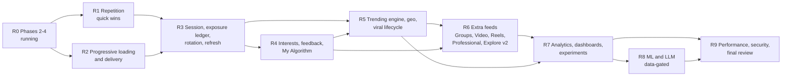

# Tara Intelligence 09: unified roadmap (original plan + brief 2 + brief 3)

This is the **single ordered roadmap** for Tara Intelligence. It merges:
- the 13 phases and their work packages (WP) of [04-implementation-plan.md](04-implementation-plan.md);
- the brief 2 additions of [06-brief-2-addendum.md](06-brief-2-addendum.md) and [07-brief-2-plan.md](07-brief-2-plan.md) (phase 4b, WPs `x.y-B2`);
- the brief 3 additions of [08-brief-3-addendum.md](08-brief-3-addendum.md) (its `WP-G*`, `WP-T*`, `WP-D*` become `x.y-B3` here).

It adds no new design. Every WP keeps the tasks, files and tests written in its source document; this file decides **order, merges and duplicates**, and states per step what the owner sees and how "done" is proven. Decisions 1 to 22 of [05-owner-decisions.md](05-owner-decisions.md) are binding, in particular **19** (trending is an independent engine feeding the recommender), **20** (every weight and threshold in the versioned config), **21** (engineering suggestions are evaluated before they are built) and **22** (definition of done). The working agreement of 04 §0 applies to every step: flags or config versions, invariant tests first, `results/phase-NN.md`, a work-log line, commit and push per verified step, additive migrations.

**Revision 2 (2026-11-05).** A design review of 08 and this file was applied: privacy fixes in R5 (no post or creator lists below country, no "started in" reason for posts, backfilled locations off, the picker never publishes the display city), a search trending fix moved to R1, R2 scoped to chronological modes with a critical-JS WP, R5 reordered (labelled set first; public UI and arms only after integrity and suppression; launch-day staff panels), deploy items named, and the end of the round defined (section 7). Details and rejected points: 08 §15.

**Honesty rules.** Nothing in steps R1 to R9 is built. Numbers in brackets are baselines measured on 2026-11-05 (06 §1.1, 08 §7.1); targets are acceptance thresholds, not predictions. No acceptance criterion hard-codes a dev row count (04 preamble).

---

## 1. Where we are (read on 2026-11-05)

| Item | State | Evidence |
|---|---|---|
| Phase 1 audit and design | Done | 01 to 05, 06 to 08 |
| Phase 2 event tracking | **In progress** (another workflow) | `services/feed/intel/` has `signals/{ingest,partitions,serializers,server,store,validate}.py`, `ranking/serve_tokens.py`, `hot.py`, `deletion.py`, 13 test modules; web `lib/signals.ts`, `lib/useImpression.ts`, `lib/videoSignals.ts` exist |
| Phases 3 and 4 | Not started in code | No `intel/eligibility.py`, `intel/config/`, `intel/ranking/scorer.py` yet |
| `redis-hot` memory | 128 MB, `maxmemory-policy noeviction` (a full Redis rejects writes; it never evicts) | `infra/compose/docker-compose.yml:107`, `docker-compose.dokploy.yml:522` (07 cites `:93-97` / `:509-516`; the lines moved) |
| Search trending | No restrict, shadow or minor filter; the web shows raw post counts below 20 | `services/search/searchsvc/history.py:139-151`, `frontend/web/src/components/search/TrendingList.vue:75` |
| Geolocation in the browser | Blocked on every page by `Permissions-Policy: geolocation=()` | `frontend/web/nginx.conf:43` |
| Trend deploy entries | None: no `INTEL_TREND_*` key or `feed-trending` service | `scripts/gen-dokploy-env.sh`, `.env_prod.example`, `docker-compose.dokploy.yml` (0 matches) |
| Feed prefetch | `rootMargin: "600px"` | `frontend/web/src/views/HomeView.vue:391-395` |
| Page size | 20 fixed | `libs/tara_common/tara_common/pagination.py:18` |
| Chronological order | `-post_created_at` only (tie risk) | `services/feed/feed/services.py:469` |
| Home repetition | page-1 Jaccard **1.0** across 4 opens, **0** recommended items | 06 §1.1 |
| First post | 726 to 762 ms desktop, **13.2 s** on a 400 kbps profile, 3.97 MB first load | 08 §7.1 |

Line numbers refer to the working tree on `feat/web-social-platform` and may move while phases 2 to 4 land.

---

## 2. The order at a glance

| Step | Name | Contains (source phases) | Can start |
|---|---|---|---|
| R0 | Phases 2 to 4 | 04 phases 2, 3, 4 (unchanged) | running |
| R1 | Repetition quick wins + search trending honesty fix | 07 phase 4b, server-side part without the ledger; **4b.20-B3** (08 WP-S0) | when WP 4.1, 4.3, 4.5 and 3.5 land; **4b.9 and the floor part of 4b.20-B3 now** |
| R2 | Progressive loading and delivery | 08 §7 (`WP-D1` to `D9`) as phase **4c-B3** | client-only WPs now; 4c.2-B3 after WP 4.1 |
| R3 | Session, exposure ledger, rotation, refresh | rest of 07 phase 4b + ranked cursor contract of 08 §7.3 | after R1 and the impression rule of R2 |
| R4 | Interests, feedback, My Algorithm | 04 phases 6, 7, 8 + B2; experiment core 5.4, 5.5 | after R3 |
| R5 | Trending, geo, Explore Trending, viral lifecycle | 04 9.1, 9.2 + B2; 08 §2 to §6 as phase **9b-B3** | after R4 (topics) |
| R6 | Extra feeds and Explore v2 | 04 phase 5 surfaces, 9.3, 9.4, 9.6 + B2 | after R4; Explore v2 after R5 |
| R7 | Analytics, dashboards, experiments | 04 phase 12, 9.5 + B2 + B3 | after R5 and R6 |
| R8 | ML and LLM | 04 phases 10, 11 (gated) | data gate of 04 phase 11 |
| R9 | Performance, security, final review | 04 phase 13 + B2 + B3, decision 22 | after R7 |

**Why this order.** The owner's top pain is "same posts every time I open Tara" and a slow, heavy first load. R1 and R2 attack both with the least new machinery; R3 adds the memory that makes rotation honest; everything else (interests, trends, more feeds, dashboards, ML) builds on a feed that already rotates and loads progressively. R1 and R2 run in parallel: they touch different files (ranking/config vs web delivery and media).

---

## 3. Duplicates resolved

Each row names the one place where an overlapping item is built. The other documents keep their text; this table wins on order.

| # | Overlap | Built once in | Rule |
|---|---|---|---|
| 1 | `popular`/`fresh` pools: 07 WP 4b.6 vs 04 WP 9.1 | **4b.6 in R1** | 9.1 (R5) extends the same `intel/discovery.py` with topic pools; it does not rebuild the two basic pools |
| 2 | `redis-hot` sizing: 04 WP 13.2 vs 07 WP 4b.0 vs 08 §9.3 (8 MB trend budget) | **4b.0 in R1** (raise to 256 MB) | 13.2 and 13.2-B2 in R9 re-measure ledgers, sessions, pools **and** trend keys together |
| 3 | Fresh-content budget: 07 WP 9.9-B2 (first 50 impressions) vs 08 §4 stage 1 seed (40 impressions) | **9b.8-B3 in R5** | 9.9-B2 is superseded; its test `test_fresh_budget.py` becomes the stage-1 test of the lifecycle |
| 4 | Trending source: 02 `_trending` pool (02:189), 06 §11 bandit arm `trending`, 08 §5.2 three geo arms | **9b.7-B3 in R5** | One implementation: `trending_local`, `trending_regional`, `trending_global`, caps summing to the old 0.30 (08 §13) |
| 5 | Explore: 04 WP 9.3 Discover (`/feed/discover/`), 07 WP 9.3-B2 Explore v2, 08 `WP-T5` Trending tab | **9b.6-B3 in R5** (route `/explore` with the Trending tab) + **9.3-B2 in R6** (entity sections, topic pages) | One view `ExploreView.vue`; `/feed/discover/` stays an alias (06 §14), no separate `DiscoverView.vue` |
| 6 | "New posts" pill: 04 WP 4.7 (`peek`), 07 WP 4b.8, 08 §7.6 | 4.7 in R0, **4b.8 in R3** | 08 adds only reload position (4c.8-B3 in R2) |
| 7 | Impression definition: 04 WP 2.8 (≥ 50% of card, 1 s) vs 08 §7.12 (v2 for tall cards) | **4c.9-B3 in R2** | Must land **before** the ledger (4b.3) so exposure states use v2; `impression_def` stamped on rows |
| 8 | Pagination: 04 WP 4.10 ranked session, 08 §7.3 cursor (`sid`, `t_min`) and chronological keyset | 4.10 in R0; **keyset 4c.8-B3 in R2**; **ranked `sid`/`t_min` fallback 4b.12-B3 in R3** | Chronological keyset has no dependency on the ledger; the ranked fallback needs the visit `sid` of 4b.4 |
| 9 | Integrity: 04 WP 4.4 (SimHash, suspect engagement), 7.4 (`intel.integrity.flagged.v1`), 08 §4.6 R-A to R-F | 4.4 in R0, 7.4 in R4, **9b.9-B3 in R5** | 9b.9-B3 reuses the 4.4 SimHash and suspect rules and the 7.4 event; no second integrity module |
| 10 | Trending in search (`searchsvc/history.py:139-151`) vs feed trending engine | **4b.20-B3 in R1** (author floor, count floor, restrict/shadow filter) + **9b.6-B3 in R5** (switch the web to feed; minors and suppression filters) | Search keeps `/search/trending/` as a filtered, cached fallback (08 §3.1); the live privacy and honesty gap is closed before the engine exists |
| 11 | Format runs: 04 WP 4.5 diversity, 07 WP 4b.10, brief 3 §6 "long runs of videos" | **4b.10 in R1** | Same key `max_same_format_run: 2`; no new rule |
| 12 | "Session": 02 §22 ranking session (frozen list), 06 §4 visit session, brief 3 §5 "Feed Session service" | 4.10 (R0) + **4b.4 (R3)** | Brief 3's service is these two modules, not a third one (08 §3.1 mapping) |
| 13 | Location switch: 08 §5.4 Settings > Location vs 04 WP 8.2 My Algorithm | **9b.2-B3 in R5** | One stored switch (`profile_geo_pref.use_location_for_recs`); My Algorithm shows it and links to Settings |
| 14 | Experiment core: 04 WP 5.4/5.5 (phase 5) is needed by decisions 4, 20, B3-7, B3-8 | **R4** | Pulled ahead of the phase-5 surfaces of R6 |
| 15 | Capabilities: 04 WP 12.2 vs 08 `intel.trends.view`/`moderate` | **12.2 in R5** | Pulled forward so staff can suppress a trend the day trends go live |
| 16 | Bandit rewards: 07 WP 9.2-B2 depends on 12.1 metrics | 9.2-B2 in R5 **at priors**, reward updates switched on in R7 | Allocation stays inside per-arm bounds in both modes |
| 17 | Video autoplay: existing `VideoPlayer.vue:262-270` observer vs 08 §7.9 policy | **4c.6-B3 in R2** | Reels keep their pager behaviour |
| 18 | Ads relevance 04 WP 13.6 | **Not scheduled** | Decision 15: out of Tara Intelligence scope |

---

## 4. The steps

Format per step: goal, WPs (source in brackets), dependencies, what the owner sees, acceptance criteria, test scenarios. "Seeded user with enough inventory" = a user whose eligible candidates number ≥ 60 at run time, selected by query (07 preamble).

### R0. Phases 2 to 4 (running, unchanged)

- **Goal:** events captured once and attributable (2), a privacy-first candidate inventory (3), rule-based ranking on a versioned config with diversity, explanations, ranking session v2 and the ads payment check (4).
- **WPs:** 2.0 to 2.10, 2.6b; 3.1 to 3.7, 3.3b; 4.1 to 4.11 (04).
- **Depends on:** phase 1.
- **Owner sees:** almost nothing on purpose: `home@1` reproduces today's order; "Why am I seeing this" v2; friends mode; ad slot from config.
- **Acceptance:** each WP's criteria in 04; `home@1` parity green; eligibility property test (WP 3.5) green; `recent` order byte-identical (golden).
- **Tests:** as listed per WP in 04; results in `results/phase-02.md` to `phase-04.md`.
- **Brief 2/3 hooks to keep in mind (no change to 04):** 4.1's schema keeps rejecting unknown keys (02 §8.2, 02:310) and carries a **schema version**, so `exposure`, `session`, `delivery`, `geo`, `trending`, `distribution` and `integrity.trending` are added later by a version bump with their own typed dataclasses, never by accepting unknown blocks (which would hide a typo in a weight); 4.10's cursor must stay opaque to the client (R3 adds `sid`, `t_min`).
- **Golden note:** the `recent` golden stays byte-identical in R0; R2's keyset WP (4c.8-B3) adds the `-id` tiebreak and **regenerates** it, with a test that old and new orders differ only inside groups of tied `post_created_at`.

### R1. Repetition quick wins

- **Goal:** Home stops being "only my friends' posts, same order, one author 17 times"; reels stop opening on a reel already watched; everything measured by a harness from day one.
- **WPs (07, 08):** 4b.0 Redis to 256 MB + key registration (still `noeviction`: every writer handles OOM errors, 08 §3.10 and §7.3); 4b.1 repetition harness and baseline; 4b.6 `popular`/`fresh` pools + continuation into pools + `caught_up`; 4b.9 reels seen-last and full video pages (post service; **can start now**); 4b.10 `max_same_format_run: 2` + author cap; 4b.11 repeat-exposure metrics; **4b.20-B3** search trending honesty fix (08 §9.4 search row): `trending()` requires ≥ 3 distinct authors, `TrendingList.vue` shows no post count below 20 and bucketed floors above, restricted and shadowed authors are excluded once search binds `moderation.actioned`; the minors filter follows when the author age flag reaches search (06 E9b, decision 37).
- **Depends on:** 3.5 eligibility, 4.1 config, 4.3 scorer, 4.5 diversity (R0). 4b.9 and the floor part of 4b.20-B3 depend on nothing in R0.
- **Owner sees:** "Suggested" posts from outside his circle on every user's Home; the feed continues into suggestions instead of ending; at most 2 posts per author per page; the first reel is one not watched in the last 3 days; video pages full (20, today 13).
- **Acceptance (07):** `redis-cli CONFIG GET maxmemory` = 268435456, Dokploy compose base64 < 131,072; harness baseline reproduces 06 §1.1 (page-1 Jaccard 1.0, 0 recommended); recommended items on `for_you` page 1 for **every** seeded user at the configured share ± 5% over 20 users; no `has_more=false` while pool items remain; ≤ 2 posts per author per page and ≥ 8 distinct authors on page 1 when inventory has them; reel position 0 never viewed in the last 3 days while an unviewed eligible reel exists; viewed reels ≤ 10% of the first 20 when ≥ 40 unviewed exist; search trending returns no hashtag with fewer than 3 authors and the sidebar shows no count below 20 (`test_trending_floor.py`, web `trendingList.spec.ts`).
- **Tests:** `test_pools_basic.py`, `test_eligibility.py` (new source), `test_continuation.py`, `test_diversity.py`, post `test_reels_seen_order.py`, `test_video_page_full.py`, `test_overlap_metric.py`, `test_test_clock_guard.py`, account-deletion test with the new keys.
- **Honest limit:** R1 alone does **not** make page 1 differ between two opens; it widens and diversifies it. The page-1 overlap target is the exit of R3.

### R2. Progressive loading and delivery (phase 4c-B3)

- **Goal:** the first post appears fast on any network, the page never loads everything, scrolling never waits, and the browser stops mounting 95 videos.
- **WPs (new ids; source 08 §7, `WP-D*`):**

| WP | Source | Content | Depends on |
|---|---|---|---|
| 4c.1-B3 | D1, 08 §7.4 | Render snapshot cards from `/feed/` at once (`services/feed.ts::page`, `snapshotToPost`), hydrate in place; defer the ~20 rail calls until the first card or 1.5 s; `fetchpriority="high"` on the first image | none (`HomeView.vue` and `services/feed.ts` are **modified in the working tree by the running workflow; coordinate**) |
| 4c.2-B3 | D2, 08 §7.2 | `delivery` config block per surface, `first_page_size` 10 (Reels 5), `meta.delivery`; the web holds no delivery constants | WP 4.1 |
| 4c.3-B3 | D3, 08 §7.5 | Prefetch at 5 remaining cards or 2.5 viewports (today 600 px, `HomeView.vue:395`); warm 6 items' media; one request in flight per cursor; 4c.3b-B3 = BFF option measured only | 4c.2-B3 for values (defaults until then) |
| 4c.4-B3 | D4, 08 §7.7 | Card skeletons, auto-retry 1/2/4 s then inline retry card (ar/en), "You're all caught up" card, `v-if` for hidden cards | none |
| 4c.5-B3 | D5, 08 §7.8 | `srcset` with `thumb`/`display_640`/`display_1280`, image `width`/`height`, hour-bucketed presign + `Cache-Control`, `loading="lazy"` on rails, media-resolve coalescing 20 ms | media service (`media_app/tasks.py`, `storage.py`) |
| 4c.6-B3 | D6, 08 §7.9 | Video `muted_single` policy, load within 1 viewport, unmount beyond 3, `poster_480`, data-saver and reduced-motion guards | media `transcode.py` (**also modified by the running workflow; coordinate**) |
| 4c.7-B3 | D7, 08 §7.10 | `content-visibility: auto`, then placeholder virtualization after 40 items | none |
| 4c.8-B3 | D8, 08 §7.3, §7.6, §7.11 | `KeysetCursorPagination` (`tara_common/pagination.py`) + `services.py:469` order `("-post_created_at", "-id")` + `feed_recipient_idx` (`feed/models.py:43`) rebuilt with `CREATE INDEX CONCURRENTLY` (`AddIndexConcurrently`, `atomic = False`); `recent` golden regenerated; reload position from `sessionStorage` for chronological modes; in-flight request de-dup in `lib/api.ts` | none |
| 4c.9-B3 | D8, 08 §7.12 | Impression rule v2 for tall cards, `impression_def` column; thresholds in `delivery.impression` (08 §15.1) | WP 2.8, 2.2 |
| 4c.10-B3 | D9, 08 §7.13 | Critical-JS budget: code-split so the JS before the first post is ≤ 150 KB transfer (`frontend/web/perf-budget.json`), CI check on the Vite manifest; first re-measure whether the 357 KB of 08 §7.1 is transfer or decoded size | none |

- **Depends on:** R0 only for 4c.2-B3 and 4c.9-B3; the rest can start now.
- **Owner sees (targets, not promises):** the target is the first post on screen in under half a second on desktop and under 6 s on a weak mobile network (today 13.2 s); skeletons instead of text; smooth scrolling with no "loading" stop; an Arabic retry card instead of an English toast; a clear end-of-feed card; a reload returns to the same post.
- **Measurement protocol:** cold cache, n ≥ 10 runs, p50 and p90; mobile 390×844 @3x with **4× CPU throttling**; host CPU, RAM, OS and Docker version recorded in `results/phase-04c.md`; the numbers are host-specific.
- **Acceptance (08 §11.2 scenarios 1-4 and 14; duplicates and reload in the chronological modes only, ranked modes in R3):** time to first post p50 ≤ 450 ms desktop and mobile [726-762 / 704], `for_you` ≤ 700 ms [1,223], first image ≤ 650 ms [829]; first load ≤ 1.5 MB [3.97 MB] and ≤ 90 requests [152]; first page returns `delivery.first_page_size` items [20]; `/media/resolve/` ≤ 2 calls [9]; next page requested with ≥ 2 viewports left [330 px]; after 5 batches DOM ≤ 6,000 nodes [11,883], `<video>` mounted ≤ 6 [95], heap ≤ 22 MB [29.5], media ≤ 4 MB [15.8]; 0 duplicate ids across 15 API pages with inserts, deletes and a hide between pages in `recent`, `following`, `friends`, `favorites`; keyset test with 5 tied timestamps: 0 skipped, 0 repeated; the new index built concurrently (a migration test asserts `atomic = False`); critical JS ≤ 150 KB transfer; weak network first post ≤ 6 s [13.2 s] **or** a revised target recorded with the measured critical-JS size and the arithmetic (at 400 kbps, 357 KB alone is about 7.1 s); recovery within 3 retries.
- **Tests:** perf harness `scripts/intel/feedperf.cjs` (desktop 1366×900, mobile 390×844 with 4× CPU, throttled 400 kbps / 400 ms with 4× CPU); `perf-budget` CI check; feed `test_keyset_pagination.py`, `test_first_page_size.py`; web specs for retry, end card, skeletons, reload position (ar RTL and en); media variant tests; impression v2 spec.

### R3. Session, exposure ledger, rotation and refresh

- **Goal:** Tara remembers what each user actually saw, tells a refresh from a return after hours or days, rotates the first page without losing relevance, and refreshes Home politely.
- **WPs:** 4b.2 `feed_dwell`; 4b.3 exposure ledger v0; 4b.4 visit classifier + `intel_feed_session`; 4b.5 exposure multiplier and rotation in `for_you` (`home@2b`); 4b.7 "New since your last visit" divider; 4b.8 refresh on return, pull-to-refresh, throttles (07); **4b.12-B3** ranked cursor `sid` + `t_min`/`id_min` fallback and two-tab detection (08 §7.3).
- **Depends on:** R1 (4b.0 Redis, 4b.1 harness, 4b.6 pools); 4c.9-B3 (impression v2); WP 4.7, 4.10.
- **Owner sees:** opening Tara again after 45 minutes shows a different, still relevant first page; posts already read don't come back for days but are not banned forever; after days away, the new posts are on top with a divider; a "New posts" pill after 10 minutes away; auto refresh after 30 minutes at the top; pull-to-refresh on mobile with no jump.
- **Acceptance (07 4b exit + 08 scenarios 5-7):** page-1 Jaccard between opens ≥ 45 min apart with simulated display: median ≤ 0.30, p90 ≤ 0.50 [1.0]; ≤ 1 consumed item from visit A in visit B's page 1; "fetched is not seen": refresh after 60 s with no signals keeps Jaccard ≥ 0.90; a displayed item's multiplier ≥ 0.9 at +40 h, a consumed one at +11 days; mean predicted value of B's page 1 ≥ 0.8 × A's; `retrieved` items never get a ledger state; ingest p95 for 50 events ≤ 30 ms; ledger ≤ 2.6 KB per viewer at 200 items; first page p95 ≤ 150 ms and ≤ 12 queries; `home@1` parity green; new content during the session causes 0 reordering of rendered cards and the pill count equals `peek` `new_count`; a lost ranking session (including a session write that failed with an OOM error under `noeviction`) continues chronologically below `t_min` with 0 duplicates; 0 duplicate ids and reload to the same card in the ranked modes (scenarios 4 and 5 for `for_you`); the 31st first page in a minute gets 429.
- **Tests:** `test_exposure_codec.py`, `test_exposure_ingest.py`, `bench_ingest_with_ledger.py`, `test_visit_classify.py`, `test_feed_session_table.py`, `test_exposure_rank.py`, `test_home_v1_parity.py`, `test_new_since.py`, `test_peek_since.py`, `test_feed_throttle.py`, `test_ranked_cursor_fallback.py` (new), web `homeRefresh.spec.ts`, `newSinceDivider.spec.ts`, e2e `home-refresh.spec.ts`; harness run recorded in `results/phase-04b.md`; 06 scenario C (heavy user, repeat-exposure ≤ 10%) as an early run.
- **Owner decision attached:** proposed decision 25 (README §6): "For You" becomes the Home default once this step's exit holds.

### R4. Interests, feedback and My Algorithm

- **Goal:** the feed learns topics over short, medium and long horizons and within the session; the user can say more/less, mute a topic, hide a creator, reset, and switch personalization off.
- **WPs:**
  - Experiment platform (pulled forward): 5.4 experiment core, 5.5 config distribution (04).
  - Phase 6: 6.1 taxonomy, 6.2 classifier, 6.3 aggregators, 6.4 profile API/UI, 6.5 interest in ranking, 6.6 cold start, 6.7 identity language event (04); 6.3-B2 medium tier and emerging; 6.5-B2 session interest vector; 6.6-B2 cold start on basic pools; 6.8-B2 intent v0 in shadow (07).
  - Phase 7: 7.1 to 7.4 (04); 7.5-B2 mute topic and hide creator; 7.6-B2 new reason codes (07).
  - Phase 8: 8.1 to 8.3 (04); 8.4-B2 reset; 8.5-B2 interests by tier; 8.7-B2 search-signal opt-in (07).
- **Depends on:** R3 (ledger, visit session); R0.
- **Owner sees:** a topic picker after sign-up (optional, decision 11); Interested / Not interested / More / Less / Mute topic / Don't recommend this creator in the post menu with clear copy; Settings > My Algorithm with formats, discovery level, interests by tier, "Reset recommendations" and "Turn off personalization" (decision 8).
- **Acceptance:** 04 criteria of 6.x, 7.x, 8.x; 06 scenario A (new user: page 1 has 20 items, ≥ 60% recommended, all eligible) and D (after 4 cooking consumptions cooking rises by ≥ 2 items on page 1 and technology keeps ≥ 30%); muted topic: 0 recommended items with it; hidden creator: 0 recommended items or suggestions, followed posts still present; after reset: no inferred row, no ledger key, 0 engagement rows, explicit choices kept; intent overlays at weight 0 give an identical order (golden); sensitive topics never inferred without opt-in (decision 12); no search-derived row with the toggle off (decision 7).
- **Tests:** `test_interest_tiers.py`, `test_aggregate.py`, `test_session_interest.py`, `test_scenario_a_new_user.py`, `test_scenario_d_shift.py`, `test_intent_rules.py`, `test_mute_topic.py`, `test_hide_creator.py`, `test_why.py`, `test_reset_recommendations.py`, `test_interest_api.py`, `test_search_signal_optin.py`, `bucketing` tests of 5.4, e2e `feed-feedback.spec.ts` (ar and en).

### R5. Trending engine, geo, Explore Trending and viral lifecycle

- **Goal:** an independent trending engine (decision 19) that measures spread **velocity** per city, governorate, country, MENA and global, separates rising from popular, explains every trend from stored numbers, feeds the recommender as bounded sources, and gives new content a fair, staged chance to spread.
- **WPs:**
  - Discovery base: 9.1 topic pools (extends 4b.6), 9.1-B2 adjacent topics, co-engagement, communities; 9.2 mix and labels; 9.2-B2 source bandit **at priors** (04, 07).
  - Phase **9b-B3** (source 08):

Rows are in **build order** (the ids are kept so 08 and README references stay valid). "Invariant tests first" (04 §0): the labelled set comes before any scoring code, and nothing reaches users before integrity runs (at least in shadow) and staff can suppress.

| Order | WP | Source | Content | Depends on |
|---|---|---|---|---|
| 1 | 9b.1-B3 | WP-G1 | `libs/tara_geo` (GeoNames cities15000, MENA), aliases, `profile_backfill_geo_codes` (writes `location_source=legacy_text`, `use_location_for_recs=false`) | none (can start any time) |
| 2 | 9b.2-B3 | WP-G2 | Profile geo codes, `profile_geo_pref`, `profile_privacy_consent`, location endpoints (picker writes **codes only**, never `city`/`country`), Settings > Location UI (country, governorate, city pickers; "confirm your backfilled place"; optional "Use my current location" with `Permissions-Policy: geolocation=(self)` at `nginx.conf:43`, only with decision 26; hidden for minors and unknown age, decision 40), `profile.geo.changed.v1` with `trend_regions` | 9b.1-B3 |
| 3 | 9b.3-B3 | WP-G3 | Feed `intel_account_geo` (with `trend_regions`), content origin stamping, `intel_actor_profile`, `intel_page_ref.admin_ids`, deletion | 9b.2-B3, phase 2 |
| 4 | **9b.11a-B3** | WP-T0 | `intel_seed_synthetic_geo` (`--scale 1` and `--scale 10`, 08 §11.1) with labelled ground truth, and the invariant tests of 08 §2.8 rules 1 to 11 written red | 9b.3-B3 |
| 5 | 9b.5-B3 | WP-T1 to T4 | Single-flight fold with pre-aggregation and serve-token check, actor-first dedupe (hash-partitioned), contribution rows and compensation, buckets, baselines, rising and popular scores, k-anonymity and roll-up (posts and creators country and above only), zsets with write budget and OOM handling, `intel_trend_current` + `intel_trend_history`, cadence on queue `feed.trending`, purge, new `feed-trending` worker | 9b.11a-B3, 3.5, 6.1 topics, 4.4 |
| 6 | 9b.9-B3 | WP-T8 | Integrity rules R-A to R-G on the 4.4 base, `intel_trend_actor_creator`, shadow mode below precision 0.8 on the labelled set; the single report rule of 08 §4.5 | 9b.5-B3, 4.4, 7.4 |
| 7 | 9b.10-B3 | WP-T9 (part) | Trend moderation actions API (`suppress`, `lift`, `false_positive`; **admin only**, decision 10) + staff list with a Suppress button + the **excluded-with-reason** (count-only for `group_private`, `minor_author`, `below_k`) and **anomalies** panels (moved from 12.9-B3: staff need them on launch day); 12.2 capabilities pulled forward | 9b.5-B3, 9b.9-B3 |
| 8 | 9b.4-B3 | WP-G4 | Edge `X-Geo-Country` two-letter filter (`nginx.conf`, Traefik), treated as client-controlled; optional origin lock to Cloudflare | 9b.2-B3 and decision 27 |
| 9 | 9b.6-B3 | WP-T5 | `GET /feed/trending/` (with `topic_family=`, `sort=most_viewed`, `stale`), `/trending/sections/`, `GET /feed/groups/{id}/trending/`, `ExploreView.vue` route `/explore` with the Trending tab (chips with "Near you" hidden when only the country has a list, rising/popular toggle, 11 sections, reason chips, fallback text, minors' view), sidebar and search switch; `/search/trending/` minors and suppression filters | 9b.5-B3, **9b.9-B3 (at least shadow), 9b.10-B3** |
| 10 | 9b.7-B3 | WP-T6 | `geo_rel` feature (bounded, `max_share` 0.25) and the three trend arms inside the bandit, E9-limited for minors and unknown age | 9b.5-B3, 9.2-B2, **9b.9-B3, 9b.10-B3** |
| 11 | 9b.8-B3 | WP-T7 | Distribution stages 0-4, cohorts, gates, per-author seed cap, de-boost, place-free seed explanations; supersedes 9.9-B2 | 9b.5-B3, 9b.9-B3, 4b.6 |
| 12 | **9b.11b-B3** | WP-T10 | Scenarios 8 to 12 and 16 to 18 on the labelled set, cost measurements on `--scale 10` replacing the 08 §15.3 estimates | 9b.5-B3 to 9b.10-B3 |

- **Depends on:** R4 (topics, aggregator, 7.4 integrity event); R3 (pools, bandit inputs).
- **Owner sees (targets):** Settings > Location where he picks country, governorate and city (optional) and a switch "use my location for recommendations and local trends" (off until he picks or confirms a place); an Explore page with Trending Near You (hashtags and topics; hidden where only the country has data), in Your Country, in Your Region, Global, Rising Now, Hashtags, Topics, Viral Videos, Trending Reels, Posts and Creators, each with a reason chip and bucketed counts with their window (`20+ in 24 h`, …), never a percentage; the sidebar trends from the same engine; occasional "Technology is rising in Cairo"-style cards in For You; good posts from new accounts reaching people who don't follow them; staff (admin) can suppress a trend and see what was excluded and why from day one.
- **Acceptance (08 §11.2 scenarios 8-12 and §2.8):** country top-10 Jaccard(EG, SA) ≤ 0.3 and planted country trends recalled ≥ 0.9 within 2 short-score runs; planted admin1/city trends recalled ≥ 0.9; **100% of below-k cells unpublished** (property test) and no displayed count < 20; a planted Cairo hashtag burst appears in EG-C rising within ≤ 10 min of reaching k and stays "rising", not "popular", for its first 6 h; false rising alarms ≤ 5% of `(level, code, hour)` lists on a 7-day replay without planted bursts (denominator: every `(level, code, hour)` that passed the located-accounts floor); **0 post or creator rows below country**; every `trend_spread_from` reason is on a hashtag or topic; 0 sensitive-family topics published; after the backfill 0 rows with `use_location_for_recs=true`; a picker save changes no display field and emits no `profile.updated`; untokened views count 0; deleted posts and later-suspended engagers are subtracted on the next run; a new account's post advances like an equal-engagement post of a 10k-follower account (95% CI of the difference contains 0) and planted negatives step a post down within one run; a report storm from 3 aged accounts removes no reach; stale sections hidden past their maximum age; the excluded tab lists no `group_private`, `minor_author` or `below_k` entity; EG → SA propagation detected with ≥ 60 min lag; planted ring, burst and coordinated hashtag not published, each rule's precision ≥ 0.8 on the labelled set (else shadow); a new user without location gets global lists and `geo_rel = 0` with no empty page; coordinates sent to `/profile/location/resolve/` appear in no table, outbox row or log (G-P1); minors and private-group content absent from every trend list (randomized test); an account with the switch off counts at `GLOBAL` only; `trend_score_short` < 20 s on `--scale 10` (3M events a day, 08 §11.1); trend keys ≤ 8 MB with writes stopping at 6 MB and an injected OOM keeping the last snapshot; `for_you` first page still p95 ≤ 150 ms and ≤ 12 queries with geo on (0 extra SQL, 1 Redis pipeline); stage gates use the posterior lower bound and follower count is not an input (grep + unit test); `test_no_literal_thresholds.py` green; `test_subcountry_kinds.py` and `test_trend_account_deletion.py` green.
- **Deploy acceptance:** `INTEL_TREND_ACTOR_SALT` generated by `scripts/gen-dokploy-env.sh` and listed (without a value) in `.env_prod.example`; the `feed-trending` worker present in `docker-compose.dokploy.yml` (queue `feed.trending`, `environment: *feed-env`) and in `infra/compose/docker-compose.yml`; the Dokploy base64 env still < 131,072 bytes; production checked after the push (decision 22). The `Permissions-Policy` change ships only with decision 26's button.
- **Tests:** `tara_geo` unit tests, `test_geo_privacy.py` (G-P1, invariants 1-11 of 08 §2.8), `test_backfill_no_consent.py`, `test_location_picker_no_display_write.py`, `test_subcountry_kinds.py`, `test_sensitive_topics_unpublished.py`, `test_trend_compensation.py`, `test_trend_account_deletion.py`, `test_trend_arms_minor.py`, `test_distribution_fairness.py`, `test_distribution_deboost.py`, `test_no_literal_thresholds.py`, web `permissionsPolicy.spec.ts`, `test_trend_fold.py`, `test_trend_k_rollup.py` (hypothesis), `test_trend_scores.py`, `test_trend_reasons.py`, `test_trend_api.py`, `test_geo_rel_bound.py`, `test_distribution_gates.py`, `test_integrity_rules.py`, `test_bandit.py`, `test_adjacent_topics.py`, `test_co_engagement.py`, web `explore-trending.spec.ts` (ar RTL and en), e2e `explore.spec.ts`, scenarios 8 to 11 on the synthetic geo set.
- **Honest limit (08 §14):** in dev no city or governorate qualifies (largest city 14 located profiles) and at most Egypt passes the country floor; dev shows MENA and global lists. City trends are proven on the synthetic set only, and they are hashtag and topic trends only: no post or creator is ever listed below country.

### R6. Extra feeds and Explore v2

- **Goal:** each feed experience of brief 3 §8 (Reels, Videos, Groups, Following light rank, Professional, Explore) gets its own rules on the shared pipeline, plus the homepage sections.
- **WPs:** 5.1 reels ranker + 5.1-B2; 5.2 video ranker + 5.2-B2 (Continue Watching); 5.3 groups + 5.3-B2; 5.6-B2 following `light_rank` (off by default); 9.3 + 9.3-B2 Explore v2 entity sections and topic pages (on the R5 route); 9.4 entity recommenders on config; 9.6 marketplace recommended sort; 9.7-B2 Professional feed; 9.8-B2 homepage sections composer (removes fixed indexes in `HomeView.vue`); 8.6-B2 sections customization; 9.10-B2 scenario suite A to F (04, 07).
- **Depends on:** R4; R5 for Explore v2, the `trending_topics` home section and trend arms in reels/video.
- **Owner sees:** a ranked Reels feed with fresh reels and no author streaks; Videos with "Continue watching"; a Groups tab mixing joined-group posts with a small share of public groups to discover; a Professional tab; Explore with pages, groups, creators and topic pages; at most 2 smart sections on Home page 1 that the user can hide.
- **Acceptance (07):** ≥ 20% of each 20 reels < 48 h old when ≥ 20 exist; ≤ 1 reel per author per 5 consecutive; completed videos demoted ×0.2, partial ones listed in Continue Watching; joined-group content ≥ 85% of Groups; `following` order identical to today with `light_rank` off (golden); ≥ 80% of Professional items carry a professional-family topic; ≤ 2 sections on page 1, never adjacent to each other or to the ad; a hidden section never appears; scenarios A to F all pass; every new source passes the eligibility property test.
- **Tests:** `test_reels_rank.py`, `test_reels_fresh_quota.py`, `test_video_rank.py`, `test_continue_watching.py`, `test_groups_rank.py`, `test_following_light_rank.py`, `test_explore_api.py`, `test_professional_rank.py`, `test_sections_composer.py`, `test_home_sections_prefs.py`, `intel/tests/scenarios/test_scenario_{a..f}.py`, web `homeSections.spec.ts`, e2e `explore.spec.ts`.

### R7. Analytics, dashboards and experiments

- **Goal:** staff see what the system does with numbers read from the database only; experiments decide the defaults the owner delegated (decisions 4, 20, 23, 25, B3-7, B3-8).
- **WPs:** 12.1 metrics; 12.3 admin API; 12.4 dashboard UI; 12.5 readouts and guardrails; 12.6 calibration check (04); 12.7-B2 metric additions; 12.8-B2 Freshness and repetition panel (07); **12.9-B3** Trends tab panels of 08 §8 (top topics by country/city, rising with growth, viral posts, most-viewed videos by distinct viewers, viral reels, flows of hashtags and topics, distribution funnel and fair-reach; the anomalies and excluded-with-reason panels already shipped in R5 with 9b.10-B3); **12.10-B3** Delivery panel (engineering suggestion, section 5); 9.5 discovery-ratio experiment; switch the 9.2-B2 bandit to reward updates; experiments for B3-7 (autoplay `muted_single` vs `click`) and B3-8 (first page 10 vs 20).
- **Depends on:** R5, R6. (12.2 already landed in R5.)
- **Owner sees:** an Intelligence admin with Overview, Surfaces, Experiments, Configs (diff and change log), Topics, Freshness, Trends and Delivery tabs; `analyst` reads, `admin` edits (decision 10).
- **Acceptance:** each metric computed on a fixture with a known answer; k ≥ 20 suppression on every slice including the new `(day, level, code, kind)` slice; no actor id or ring member in any panel; experiment readouts are user-level with CIs and say "not conclusive" below the sample sizes of decision 4; bandit allocation within bounds and deterministic per day and surface; the dashboard states the `impression_def` change date.
- **Tests:** `test_daily_metrics.py`, `test_trend_dashboard_k.py`, `test_experiment_readout.py`, `test_calibration.py`, web specs per panel (ar and en).

### R8. ML and LLM (data-gated)

- **Goal:** replace rule scores with calibrated models only where real data proves a gain; optional natural-language preferences.
- **WPs:** 10.1 rules parser, 10.2 LLM adapter, 10.3 UI, 10.4 LLM topic tagging (decisions 2 and 13: rule parser only in production, no third-party LLM); 11.1 to 11.4 (04).
- **Depends on:** R7 (metrics, calibration, experiments); the phase 11 gate: ≥ 100k real impressions, ≥ 2,000 positive interactions per target, ≥ 500 users active in 2 weeks.
- **Not in this round** (section 7): the gate cannot be met on dev data (seeded, no real users), so R8 is planned but not built in this round; the gate check is run and its numbers recorded in `results/phase-13.md`.
- **Owner sees:** nothing labelled "AI" before a model wins an online experiment (02 §15).
- **Acceptance and tests:** as 04 phases 10 and 11; shadow mode before any online arm; geo and trending stay rules (08 G12).

### R9. Performance, security and final review

- **Goal:** prove the whole system under load and attack, then close the round (decision 22).
- **WPs:** 13.1 load test; 13.2 + 13.2-B2 Redis re-measure (sessions, ledgers, pools, trend keys); 13.3 + 13.3-B2 security review; 13.4 privacy review; 13.5 split decision (04, 07); **13.7-B3** k6 scenario 15 with scoring jobs running and the heavy-history scenario 13; **13.8-B3** brief-3 security and privacy review (location consent and revocation, backfill without consent, picker not publishing the display city, `X-Geo-Country` spoofing by a direct origin request (08 §2.5 test), `Permissions-Policy` header, reaction-list inference at sub-country level (rule 8), author-country inference through reasons and flows (rule 9), trend manipulation through many accounts, forged views, report storms, coordinate leakage, `region=` exploration cannot change stored prefs, Redis OOM behaviour); final review of old and new code, fixes, push, production check.
- **Depends on:** R7 (R8 when it ran).
- **Owner sees:** a final report answering brief 3 §15 (what existed, what was built, files, services, tables, how geo-trending, progressive loading, repetition control and ranking work, which tests passed, what is not built).
- **Acceptance (08 scenarios 13 and 15):** heavy-history `for_you` first page p95 ≤ 150 ms and ≤ 12 queries, next page ≤ 40 ms; 300 virtual users for 10 min with scoring running on `--scale 10` (dev host hardware recorded; the result is host-specific, not a capacity claim): feed p95 ≤ 150 ms, trending p95 ≤ 30 ms, errors < 0.5%, `trend_score_short` < 20 s, `redis-hot` within 256 MB with trend keys ≤ 8 MB; every security finding has a test; production site checked after the push.
- **Tests:** `scripts/load/intel_locust.py`, `scripts/intel/load_feed.js`, per-finding tests, results in `results/phase-13.md`.

---

## 5. Engineering suggestions (decision 21)

Evaluated, not yet approved for building beyond the slot shown.

| # | Suggestion | Value | Cost | Risk | Verdict |
|---|---|---|---|---|---|
| E1 | **Delivery panel** (12.10-B3): real-client time to first post, bytes and retries sent as one `feed_delivery` event per visit | The 08 targets are lab numbers; this measures real users after R2 | S (one event type, one panel) | Telemetry volume (one row per visit, small) | **R7** |
| E2 | Run the R1 repetition harness and the R2 perf harness in CI on every intel PR (smoke scale) | Catches a regression of the owner's two top complaints before deploy | S to M (CI minutes) | Flaky timings; mitigated by thresholds with margin and server-side metrics | **R2 exit** |
| E3 | Share one `ExploreView.vue` for Discover, Explore v2 and Trending | Removes a duplicate view and route (section 3 row 5) | none (saves work) | none | **Adopted** in R5/R6 |
| E4 | Ask for the birth date in the profile (decision 9 note: 10.8% of dev accounts have none and are treated as unknown age) | More users get full discovery and can count in local trends | S | Privacy copy needed | Owner choice; README §7 decision 36 |

---

## 6. Test scenario map

| Scenario | Source | Step |
|---|---|---|
| 1 First open, 2 first batch, 3 next batch, 4 no duplicates, 14 weak network | 08 §11.2 | R2 |
| 5 Refresh, 6 return after a while, 7 new content during the session | 08 §11.2, 07 4b.5/4b.8 | R3 |
| C heavy user (repetition) | 06 §16 | R3 (early run), R6 (suite) |
| A new user, D interest shift | 06 §16 | R4 |
| 8 to 11 trends by country, region, local rising, global; 16 fair chance, 17 de-boost, 18 leak checks | 08 §11.2 | R5 |
| 12 new user without history (with and without location) | 08 §11.2 | R5 |
| B returning after days, E few friends, F one strong topic | 06 §16 | R6 |
| 13 heavy-history user, 15 many concurrent users | 08 §11.2 | R9 |

Results of every scenario go to `docs/intelligence/results/phase-NN.md`; no number is written there unless a harness produced it, and every timing names the host it ran on.

---

## 7. Where this round ends (decision 22)

Decision 22 says "finish everything planned, review old and new code, fix, push, confirm production, then stop". Two planned items cannot finish on the data this round has, so the round's scope is stated here instead of being silently missed:

| Item | Why it cannot finish now | What this round does |
|---|---|---|
| R8 ML and LLM | Its gate (≥ 100k real impressions, ≥ 2,000 positive interactions per target, ≥ 500 users active in 2 weeks) needs real users; dev data is seeded | Runs the gate check query and records the numbers in `results/phase-13.md`; builds nothing of R8 |
| Experiment **conclusions** (decision 4 ratio, B3-7 autoplay, B3-8 first page, 25 Home default, bandit rewards) | Decision 4 needs about 1,600 users per arm | Builds and switches on the experiments, runs them at their documented defaults, and reports "not conclusive" with the current sample size |

**The round is done when** R0 to R7 and R9 meet their acceptance criteria, the R8 gate check is recorded, the final review of old and new code has its findings fixed with tests, everything is pushed, and the production site is checked. This interpretation is proposed owner decision 42 (README §7).
